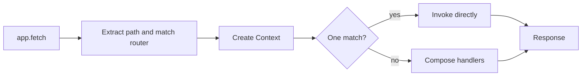

# Request dispatch and middleware lifecycle

`HonoBase` owns registration and dispatch; a concrete `Hono` preset supplies the router. The application keeps route definitions across requests, while each dispatch creates a new `Context` for request data, bindings, response state, and handler-local variables.

## From registration to response

HTTP methods and `use()` both register handlers in the router. `use()` registers the special all-methods value, defaulting to `*` when no path is supplied. Each registered handler also receives route metadata, which becomes available through the request wrapper during execution.

`fetch(request, env, executionCtx)` delegates to dispatch. `request()` is an in-process convenience that builds a Fetch request, resolving relative paths against `http://localhost`, then uses the same entrypoint. HEAD dispatch reuses GET matching and returns a bodyless response; the original request method remains HEAD inside the handler.

## Ordering and finalization

For multiple matches, `compose()` advances through handlers when they call `next()`. Code before `await next()` runs toward the endpoint; code after it runs as the nested calls return. Returning a response without calling `next()` stops downstream execution. This makes registration order significant for authentication, rendering, and response decoration.

The composer tracks an index and rejects repeated `next()` calls. Before invoking each matched handler it updates `c.req.routeIndex`, so parameter and route metadata reflect the current handler. A returned response is assigned when the context is not already finalized, or when it came from error handling. To deliberately replace an existing response, assign `c.res`.

When the chain reaches its end without a finalized response, the configured not-found handler runs. A handler that neither returns a response nor awaits downstream execution can leave the composed context unfinished; dispatch raises the explicit “Context is not finalized” error. The single-handler fast path bypasses composition and has its own synchronous and promise fallback handling, so changes here need tests for both branches.

## Error ownership

Within composition, thrown `Error` instances are stored in `c.error` and passed to the application's error handler. Non-`Error` thrown values propagate. Dispatch also catches handler failures, but path extraction and router matching happen before its handler-level catch blocks.

The default not-found response is text with status 404. The default error handler recognizes an error exposing `getResponse()` and recreates that response through the context; otherwise it logs the error and returns text with status 500. `HTTPException` supplies the expected `getResponse()` behavior and uses its own status even when constructed with an existing response. Applications customize these boundaries with `onError()` and `notFound()`.

Subapplication registration preserves a child application's custom error handler by wrapping imported handlers. See [routing and composition](routing.md) for the distinction between copying Hono routes and mounting a Fetch application.

## Working on this flow

Read `src/hono-base.ts` together with `src/compose.ts`. `src/compose.test.ts` checks downstream state, headers after `next()`, short circuits, replacement responses, and error handling. `src/hono.test.ts` additionally covers the single-handler path, unfinished contexts, subapplication error handlers, and HEAD behavior.

Continue with [request context](../concepts/request-context.md) for response/header ownership or [middleware policies](../concepts/middleware-and-security.md) for concrete consumers of this lifecycle.
