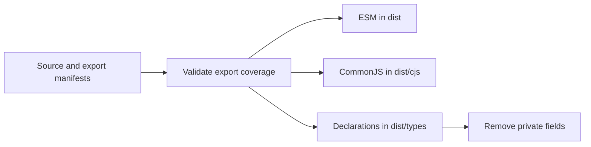

# Testing, packaging, and release workflow

This checkout is the framework source and package build, not a generated application. Bun is the repository package manager. Install dependencies with `bun install --frozen-lockfile`; the contributor guide asks changes to pass `bun run test`.

## Choose validation by boundary

| Change | Focused starting point |
| --- | --- |
| Request dispatch or context | src/hono.test.ts, src/compose.test.ts, src/context.test.ts |
| Router behavior | Individual router test wrappers, which call the common case suite |
| Validation and client inference | src/validator tests, src/client tests, and TypeScript checking |
| JSX rendering | Server JSX tests plus both DOM runtime projects |
| Platform integration | Relevant runtime-tests project and neighboring adapter tests |
| Package exports or declarations | Build plus build/validate-exports.test.ts and declaration cleanup tests |

A focused example, after dependency installation:

```sh
bunx vitest run --project main src/compose.test.ts
bunx tsc -p tsconfig.spec.json
```

The full `test` script runs TypeScript checking before `vitest --run`. The main project includes source and build tests and excludes standalone `*.case.test.*` files. Router wrappers invoke those case suites with each router implementation. Runtime projects are also discovered from `runtime-tests/*/vitest.config.ts`; do not equate an unqualified Vitest run with only the main project.

Two additional projects run DOM tests with different automatic JSX import sources: the default server JSX runtime and the specialized DOM runtime. Coverage is enabled with V8 in the root configuration, with type-only sources and runtime/benchmark directories excluded from that coverage selection.

Named scripts select `node`, `workerd`, `fastly`, `lambda`, and `lambda-edge` Vitest projects. Bun and Deno have separate native test commands; Deno includes its runtime suite and two JSX configurations. Runtime tests may build or start platform infrastructure; read the corresponding config before interpreting missing-tool or environment failures as library regressions.

## Build and public exports

`bun run build` removes dist, runs the Bun build script, and copies package.cjs.json into the CommonJS and declaration output trees. The postbuild script runs publint.

The build script first validates package.json and jsr.json export coverage in both directions. The validator recognizes exact names and compatible wildcard coverage; it does not compare implementation semantics. When adding a public subpath, review both manifests and the package's typesVersions mapping.

Build entrypoints are discovered from source TypeScript files with explicit exclusions. Esbuild emits ESM under dist and CommonJS under dist/cjs. The ESM plugin rewrites local imports to explicit .js or /index.js paths and marks them external, preserving the module structure. TypeScript emits declarations under dist/types concurrently with those JavaScript builds. An AST-based cleanup removes private identifier fields from emitted declarations.



The watch script uses esbuild watch contexts and TypeScript watch mode. Package consumers receive the export-map-selected ESM/CommonJS/types artifacts; JSR maps public names to source files.

## CI and release boundaries

CI's main job installs dependencies, checks format/lint/editorconfig, builds, and runs tests. Separate jobs exercise native Bun and Deno, JSR publishing validation, Fastly, workerd, Lambda, Lambda@Edge, and a Node version matrix. Coverage artifacts are gathered from main, Bun, and Deno jobs. Additional jobs measure types, bundle sizes, and HTTP performance.

Tool version declarations are not identical: this checkout's packageManager specifies Bun 1.2.20 while .tool-versions specifies Bun 1.2.19; workflows generally read .tool-versions. Preserve this distinction when reproducing CI rather than assuming one universal version pin.

The local release script invokes `np --no-publish`; prerelease runs Deno tests and a build. The release workflow triggers on pushed tags. Its npm job builds and runs `npm stage publish --provenance --access public`; the JSR job delegates to publish-on-tag. These are publishing operations, separate from normal contributor validation.

For application-level examples start at [quickstart](../quickstart.md). For tests requiring platform behavior, use [runtime adapters](../integrations/runtime-adapters.md); for type-sensitive API work, see [validation and clients](../workflows/validation-and-client.md).
