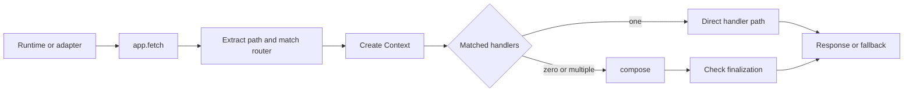

# Request dispatch and middleware lifecycle

Hono's runtime center is [HonoBase](../../src/hono-base.ts). It owns route registration, the request entrypoint, and application error policy. A router selects handlers; a fresh `Context` carries request state; the composer coordinates handler execution. There is no application database or persistence layer in this dispatch path: external resources arrive through runtime bindings or application middleware.

## From registration to a response

`app.get`, `app.post`, and the other method helpers register each supplied handler separately. `app.on` expands method and path arrays. `app.use` registers handlers under the all-method marker, defaulting to `*` when no path is supplied. The private route-adder prefixes the base path, uppercases the method, and stores the same handler/route pair in the router and `app.routes`.



`fetch(request, env, executionCtx)` passes the request method into dispatch. Dispatch computes a path using the configured path getter and asks the router for a match before constructing a context. Router matching and path extraction occur outside the dispatch error guards; failures there are not ordinary handler failures handled by `onError`.

HEAD dispatch recursively uses GET matching and wraps its response with a null body. The original request remains available, so a handler reading `c.req.method` still sees HEAD. [Routing](routing.md) explains how matching and path configuration fit this flow.

## Composition and ordering

[compose](../../src/compose.ts) walks the matched handler array. A handler calling `await next()` enters the next handler; execution after that await runs as the stack unwinds. A terminal handler can return a response without continuing. Register middleware before the endpoints it must wrap.

```ts
app.use('*', async (c, next) => {
  c.set('startedAt', Date.now())
  await next()
  c.header('X-Elapsed', String(Date.now() - c.get('startedAt')))
})
app.get('/health', (c) => c.json({ ok: true }))
```

In TypeScript, declare the `startedAt` context variable in the app's `Variables` generic; see [request state](../concepts/request-context-validation.md). The example illustrates the execution order rather than a complete app declaration.

The composer updates `c.req.routeIndex` before entering each handler, allowing parameter lookup to use that handler's match. A monotonic dispatch index rejects repeated `next()` calls. Returned responses are assigned to `c.res` when the context is still unfinished, or when an error handler supplies a replacement. Middleware that intentionally replaces an already finalized response should assign `c.res` explicitly.

## Fast path and finalization

One matched handler bypasses composition. Its supplied `next` invokes the application's not-found handler. Synchronous results return directly, with a not-found fallback for a missing response; asynchronous results additionally honor an already finalized context. Keep handlers explicit: return a response, or await downstream work that produces one.

For zero or multiple matches, dispatch awaits the composed context and requires `context.finalized`. If a handler stops without returning a response or properly awaiting `next()`, dispatch raises the diagnostic beginning `Context is not finalized`. Merely reading `c.res` creates a provisional response but does not finalize the context; assigning `c.res` does.

## Not-found and error policy

The default not-found handler returns `404 Not Found` with status 404. `app.notFound` replaces that application policy. The composer invokes it at the end of an unfinished chain.

For handler failures that are `Error` instances, composition records `c.error` and calls the configured error handler. Outer middleware can inspect `c.error` after awaiting `next()`. The default error handler uses an error's `getResponse()` when present, carrying its body/status/headers through `c.newResponse`; otherwise it logs the error and returns a generic 500 response. [HTTPException](../../src/http-exception.ts) supplies that response-producing contract. Thrown non-Error values are rethrown.

`app.onError` changes the policy. Grouping a child app with `route()` wraps child handlers when that child has its own custom error handler, preserving the child policy. For streaming callbacks, response production has a separate lifetime; use the [streaming error contract](../integrations/streaming-websockets.md).

## Where to verify changes

[compose tests](../../src/compose.test.ts) cover before/after middleware effects, early responses, async handlers, not-found responses, and failure handling. [Hono tests](../../src/hono.test.ts) exercise single-handler versus composed dispatch, grouping order, custom error policies, missing finalization, and HEAD behavior. Changes to dispatch should consider both execution paths and context header preservation.

Continue with [routing and composition](routing.md), [context and validation](../concepts/request-context-validation.md), or [middleware boundaries](../concepts/middleware-security.md).
