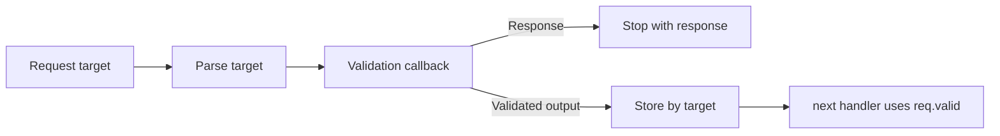

# Request state, responses, and validation

Each dispatch creates a [Context](../../src/context.ts). It holds runtime bindings, request variables, response construction state, and error/rendering state. The context lazily creates its [HonoRequest](../../src/request.ts), which owns the raw Web Request, matched parameters, body cache, and validated output. These objects live for one request; application integrations own any external persistence.

## Bindings and variables

Use `c.env` for resources passed to `app.fetch` by the runtime or adapter. Use `c.set`, `c.get`, or `c.var` for values shared between handlers during this request. Context variables use a lazily allocated Map; `c.var` returns a read-only typed object view assembled from its entries.

```ts
type AppEnv = {
  Bindings: { GREETING: string }
  Variables: { requestStarted: number }
}
const app = new Hono<AppEnv>()
app.use('*', async (c, next) => {
  c.set('requestStarted', Date.now())
  await next()
})
app.get('/', (c) => c.json({ greeting: c.env.GREETING, started: c.var.requestStarted }))
```

Import `Hono` from `hono` in a consuming application. Types describe the supplied bindings; they do not provision those resources. `c.executionCtx` and `c.event` expose runtime execution context and FetchEvent capabilities and throw when the required context is absent. [Adapters](../integrations/runtime-adapters.md) decide what is supplied.

## Read request inputs

`param()` resolves the parameter map for the currently executing matched handler and decodes encoded values. `query()` reads single query values; `queries()` preserves repeated values as arrays. `header(name)` delegates to the raw Headers object, returning undefined for a missing value; its no-argument form builds a header record.

Body readers such as `text`, `json`, `arrayBuffer`, `blob`, and `formData` share HonoRequest's body cache. The first underlying read is cached; later compatible representations can be reconstructed through a Response. JSON parsing uses cached text. This supports common middleware/handler rereads through `c.req`, while directly consuming `c.req.raw.body` or calling raw body readers bypasses this cache. It does not make a Web Request stream generally reusable.

`parseBody()` is specifically for form-compatible content types and returns an empty object for other media types. It converts form fields into a null-prototype record, with `all` and `dot` options controlling repeated and nested field conversion. Its form parser also caches FormData for later `c.req.formData()` access. This API is distinct from JSON parsing and from validation.

## Construct and finalize a response

`c.body`, `c.text`, `c.json`, and `c.html` construct Web Responses. `c.json` serializes through JSON.stringify and supplies the JSON content type; `c.html` supports asynchronous escaped HTML values. `c.text` has an optimized direct Response path when no prepared status or headers require merging. Explicit status and header arguments provide the response-specific settings.

Before a response exists, `c.header` stores prepared headers. After finalization it creates a mutable response wrapper before updating them. `c.newResponse` merges context headers with its supplied response/init and header arguments, treating Set-Cookie as appendable.

Reading `c.res` lazily creates a provisional response without setting `finalized`. Assigning `c.res` sets `finalized` and preserves prior response headers, except that content-type is left to the replacement; multiple Set-Cookie values receive special handling. Returning a response from a handler lets dispatch/composition finalize it. The [lifecycle page](../architecture/request-lifecycle.md) explains why a missing response or unawaited `next()` can fail.

## Validation data flow

[validator](../../src/validator/validator.ts) is middleware taking an input target and a sync or async validation callback. Targets are JSON, form, query, path parameters, headers, and cookies.



JSON and form targets parse only when Content-Type matches their supported media types; otherwise the callback receives the initial empty object. Recognized malformed JSON or form input throws an HTTP 400 exception. Query extraction keeps a scalar for a single value and an array for repeated values. Form extraction retains repeated values and builds a null-prototype record.

If the callback returns a Response, middleware returns it immediately. Otherwise it stores the callback result under the target and awaits `next()`. `c.req.valid('json')`, for example, retrieves that stored output; calling `valid()` does not itself parse or validate anything.

```ts
app.post('/names', validator('json', (value: { name?: unknown }, c) => {
  if (typeof value.name !== 'string') return c.text('name required', 400)
  return { name: value.name.trim() }
}), (c) => c.json(c.req.valid('json'), 201))
```

Import `validator` from `hono/validator`. The callback defines both the runtime validation decision and inferred input/output types. Validate structural assumptions before using an unchecked parsed body. No particular schema library is required; focused tests include custom callbacks and optional schema-library integration.

## Verify or extend

Use [request tests](../../src/request.test.ts) for parameters and cached reads, [context tests](../../src/context.test.ts) for response/header replacement, [body tests](../../src/utils/body.test.ts) for form conversion, and [validator tests](../../src/validator/validator.test.ts) for content-type gating, malformed payloads, transformations, cloning, and prototype-sensitive field names.

Validation types and typed response helpers feed [route/client inference](../workflows/typed-client.md). Place [body limits and authentication](middleware-security.md) before the validation/endpoint work they guard, and use [rendering](jsx-rendering.md) for the HTML-specific response contract.
