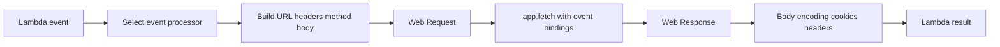

# Runtime adapters and deployment boundaries

The framework's portable entrypoint is `app.fetch(request, env, executionCtx)`. Adapters translate a host's invocation into that contract, then translate its Response back when necessary. [Dispatch](../architecture/request-lifecycle.md) owns matching and middleware; adapters own event formats, host capabilities, and response transport.

## Choose the boundary by invocation shape

| Runtime surface | Repository entrypoint | Main responsibility |
| --- | --- | --- |
| Fetch-compatible server/runtime | `app.fetch` | Accept a Web Request and return a Web Response. |
| Cloudflare Pages | `hono/cloudflare-pages` | Forward the Pages request, bindings, event context, and background-work capability. |
| AWS Lambda | `hono/aws-lambda` | Convert supported event families and result envelopes; optionally stream through Lambda APIs. |
| Lambda@Edge | `hono/lambda-edge` | Convert CloudFront records and callback results. |
| Vercel | `hono/vercel` | Wrap a Web Request in `app.fetch`. |
| Netlify | `hono/netlify` | Forward the request and expose host context through bindings. |
| Service Worker | `hono/service-worker` | Respond to a FetchEvent and optionally fall back to network fetch on 404. |
| Node HTTP server | external `@hono/node-server` | Bridge Node server requests/responses; this repository contains integration tests. |

Cloudflare Workers, Deno, and Bun subpaths also export static file, WebSocket, connection-info, or SSG helpers appropriate to the runtime. These helpers do not make an unsupported host API portable by themselves. Runtime capabilities such as filesystem access, Cache API, Web Crypto, and WebSocket upgrade still determine which features work.

For a Web Request host, a minimal application exports its fetch-compatible object:

```ts
import { Hono } from 'hono'
const app = new Hono()
app.get('/health', (c) => c.json({ ok: true }))
export default app
```

Host configuration and provisioning are outside core dispatch. For Lambda, the corresponding export is `export const handler = handle(app)` with `handle` imported from `hono/aws-lambda`.

## Bindings and execution context

[Cloudflare Pages handle](../../src/adapter/cloudflare-pages/handler.ts) passes `{ ...eventContext.env, eventContext }` as bindings and provides `waitUntil` and `passThroughOnException` in execution context. Its `handleMiddleware` bridges a Hono middleware to Pages' `next()`, preserves errors on context, returns HTTPException responses, and rethrows other captured errors. Its advanced-mode static helper delegates to `env.ASSETS.fetch` and maps an asset 404 to Hono's not-found handler.

Vercel's wrapper forwards only the Request. Netlify supplies `{ context }` as bindings. Bun's [getBunServer](../../src/adapter/bun/server.ts) accepts either a server stored under `c.env.server` or the environment value itself, supporting the server needed for upgrades and connection information.

The [adapter helper](../../src/helper/adapter/index.ts) offers runtime detection and environment lookup. `env(c)` returns process environment for Node/Bun/edge-light, Deno environment for Deno, context bindings for workerd, and an empty object for Fastly/other. It does not merge every environment source. Read this helper's behavior separately from direct `c.env` access; type parameters do not change which source is returned.

## Lambda event and result flow

[Lambda handling](../../src/adapter/aws-lambda/handler.ts) selects an event processor for ALB, API Gateway v2, Lattice v2, or the v1 fallback. Detection matters: API Gateway v2 requires both `rawPath` and an `http` member in requestContext, because v1 custom-domain events can also carry rawPath.



The event processor decodes base64 request bodies and updates Content-Length to the byte size. Buffered `handle` exposes `event`, `requestContext`, and `lambdaContext` through bindings. Request conversion errors are logged and become status 400 for TypeError or 500 otherwise, using the same processor's result conversion.

Result conversion consumes the response as text or base64 according to content type and content encoding. It carries status and headers, and preserves cookies through the event family's output convention. `isContentTypeBinary` customizes the content-type classification; it does not remove the additional encoding check.

`streamHandle` instead requires the Lambda `awslambda` streaming global, publishes response metadata, and copies the Web stream into the host writable stream. It has its own failure logging and completion handling. Use [streaming documentation](streaming-websockets.md) when maintaining that transport path.

## Verification and extension

Keep host-specific information in adapters rather than teaching core dispatch about event envelopes. For a new adapter, trace request URL construction, body bytes, repeated headers/cookies, environment ownership, abort propagation, and output conversion. Core `app.request()` tests cannot establish all transport behavior.

The [Node runtime suite](../../runtime-tests/node/index.test.ts) exercises an actual adapter server from `@hono/node-server`; [Lambda unit tests](../../src/adapter/aws-lambda/handler.test.ts) cover event conversions; [Pages tests](../../src/adapter/cloudflare-pages/handler.test.ts) cover context forwarding and middleware bridging. Runtime test projects also cover Bun, Deno, Fastly, workerd, Lambda, and Lambda@Edge. Their commands and build requirements are in [development and testing](../workflows/development-and-testing.md).

Continue with [static files and generation](../workflows/static-assets-and-generation.md), [WebSockets](streaming-websockets.md), or [context ownership](../concepts/request-context-validation.md).
