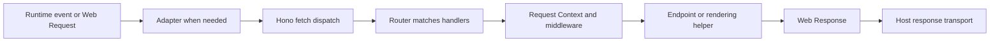

# Start here

This repository implements Hono, a TypeScript web framework centered on Web Requests and Responses. The main entrypoint exports `Hono`, context APIs, and shared types. Middleware, routers, clients, rendering, and runtime integrations are available through package subpaths. This wiki explains the repository's mechanisms and maintenance boundaries, with source links and representative tests.

## Make a first request

In an application with the published package installed:

```ts
import { Hono } from 'hono'

const app = new Hono()
app.get('/', (c) => c.text('Hono!'))
app.get('/users/:id', (c) => c.json({ id: c.req.param('id') }))

const response = await app.request('/users/42')
console.log(response.status)       // 200
console.log(await response.json()) // { id: '42' }

export default app
```

`app.request()` builds a Web Request for a path or URL and invokes the same fetch entrypoint without opening a server port. For a relative path, its default origin is `http://localhost`. Hosts that accept fetch-compatible application exports can use the exported app; other hosts use a runtime adapter. The [runtime adapter guide](integrations/runtime-adapters.md) describes those differences.

When experimenting directly with this checkout, use `import { Hono } from './src/index'` in a root-level scratch script and run it with Bun. All route registration should happen before the first request: the default SmartRouter selects and freezes its matcher on first use.

## Set up repository development

Install the toolchain described by [.tool-versions](../.tool-versions) and the package metadata, then:

```sh
bun install --frozen-lockfile
bunx vitest --run --project main src/compose.test.ts --coverage.enabled=false
```

That focused suite is a small entrypoint into middleware behavior. For the repository-wide checks used by the main CI job:

```sh
bun run format
bun run lint
bun run editorconfig-checker
bun run build
bun run test
```

The main test command includes spec TypeScript checking before Vitest. Native Bun/Deno and named host projects add runtime-specific coverage. See [development, testing, and builds](workflows/development-and-testing.md) for selection rules, package outputs, export consistency, CI, and toolchain details. The commands above are documented workflows, not a claim that this wiki generation executed them.

## Follow a maintenance task

| If you need to… | Read | Start verifying in… |
| --- | --- | --- |
| Diagnose a handler that returns 404/500 or never finalizes | [Request dispatch and middleware lifecycle](architecture/request-lifecycle.md) | `src/hono-base.ts`, `src/compose.ts`, their tests |
| Change a route pattern, preset, group, or mount | [Routing strategies and application composition](architecture/routing.md) | `src/router/common.case.test.ts`, router suites, `src/hono.test.ts` |
| Read bodies, share request state, construct headers, or validate input | [Request state, responses, and validation](concepts/request-context-validation.md) | `src/request.ts`, `src/context.ts`, `src/validator/validator.ts` |
| Configure authentication, CORS/CSRF, request limits, cache, or timeout | [Middleware composition and security boundaries](concepts/middleware-security.md) | The matching middleware implementation and adjacent suite |
| Preserve route inference or change client request serialization | [Typed routes and the HTTP client](workflows/typed-client.md) | `src/types.ts`, `src/client/client.ts`, client/type tests |
| Render HTML, nest layouts, or investigate async JSX context | [HTML, JSX, and rendering](concepts/jsx-rendering.md) | JSX, renderer, context-isolation, and DOM suites |
| Deploy to a different host or fix event/header/body conversion | [Runtime adapters and deployment boundaries](integrations/runtime-adapters.md) | `src/adapter/` and the corresponding `runtime-tests/` project |
| Stream a response, send SSE, or upgrade a WebSocket | [Streaming responses and WebSockets](integrations/streaming-websockets.md) | Streaming utilities, shared WS helpers, runtime adapters |
| Serve files or generate static pages | [Static assets and site generation](workflows/static-assets-and-generation.md) | Shared static middleware, SSG helpers, runtime loaders |
| Build exports, choose a regression check, or understand CI | [Development, testing, and package builds](workflows/development-and-testing.md) | `package.json`, `build/`, `vitest.config.ts`, workflows |

## Understand the main flow



Request-scoped variables and validated data live in context/request objects. External databases, service clients, filesystems, caches, and host execution capabilities are supplied by application code or adapters. TypeScript route schemas power the client surface; they do not replace runtime input validation or provision dependencies.

## Use repository evidence

For a behavior change, read the owning implementation and its focused tests together, then follow the wiki links across the relevant boundary. For example, a cache change may also require execution-context setup in tests; a grouped route change may affect client inference; an async JSX change may depend on runtime context capabilities. Source and tests remain authoritative when they diverge from documentation.

[README](../README.md) introduces the public project and application scaffolding. [CONTRIBUTING](../docs/CONTRIBUTING.md) describes development expectations, and [MIGRATION](../docs/MIGRATION.md) records migration guidance. Begin with the task map above for repository internals rather than reading every page in sequence.
