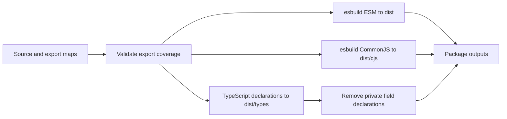

# Development, testing, and package builds

The checkout uses Bun for dependency management and build orchestration, TypeScript for compile-time contracts, and Vitest plus native runtime suites for behavior. [package.json](../../package.json), [Vitest configuration](../../vitest.config.ts), and [CI](../../.github/workflows/ci.yml) are the operational sources of truth. Commands here describe repository workflows; this documentation run does not establish that those test suites have passed.

## Set up the checkout

```sh
bun install --frozen-lockfile
```

The contribution guide uses that install command and asks contributors to pass `bun run test`. `.tool-versions` pins the runtimes used by CI setup actions. The current checkout lists Node 24.7.0, Bun 1.2.19, and Deno 2.4.5 there, while package.json's packageManager field names Bun 1.2.20. Be aware of that recorded difference when reproducing a toolchain issue; the Node engines field is a package compatibility declaration rather than the CI version matrix.

## Choose a check for the behavior changed

| Task | Command or test location |
| --- | --- |
| Main repository check | `bun run test` runs spec TypeScript checking, then Vitest. |
| One core behavior suite | `bunx vitest --run --project main src/compose.test.ts --coverage.enabled=false` |
| Watch tests | `bun run test:watch` |
| Formatting and lint | `bun run format`, `bun run lint`, `bun run editorconfig-checker` |
| Package outputs and declarations | `bun run build` |
| Native Bun | `bun run test:bun` |
| Native Deno and Deno JSX modes | `bun run test:deno` |
| Host integration projects | `bun run test:node`, `test:workerd`, `test:fastly`, `test:lambda`, `test:lambda-edge` |

Replace the focused file with the suite owning the affected contract. Run the spec compiler too when modifying TypeScript inference: a passing runtime test alone does not verify route, validator, or client types. `tsconfig.spec.json` uses strict inherited options, `noEmit`, and `hono/jsx` automatic JSX compilation.

Vitest's `main` project includes source and build tests while excluding sandbox and `*.case.test.*` files. Router case files are imported into implementation-specific suites rather than discovered directly. Two additional JSX projects exercise DOM tests with server and DOM JSX import sources. Coverage is enabled globally and excludes compile-only types, runtime-tests, benchmarks, and other non-core targets. A focused command can disable coverage explicitly as shown above.

Runtime projects are also discovered from `runtime-tests/*/vitest.config.ts`. Native Bun and Deno scripts run outside that Vitest project mechanism. CI builds package output before Node, Fastly, workerd, Lambda, and Lambda@Edge tests; follow that order when those suites depend on built imports. The aggregate `test:all` script combines the general test script with native Deno and Bun tests; inspect the script/project configuration when selecting a smaller set.

## Understand package construction

[build/build.ts](../../build/build.ts) runs under Bun and first validates package.json and jsr.json export coverage in both directions. It gathers TypeScript entrypoints, excluding the configured test and legacy patterns, then produces three outputs concurrently:



The ESM configuration uses an import-resolution plugin that rewrites internal references with `.js` extensions and marks those references external, preserving the module layout. CommonJS output uses its own format and output directory. The declaration build excludes source test files. A parser-based postprocessing step removes private identifier property declarations while preserving other declarations.

The top-level build script clears `dist`, invokes the build program, and copies a `type: commonjs` package marker into `dist/cjs` and `dist/types`. Its postbuild script runs publint. Package exports map import, require, and types consumers to those separate outputs; JSR exports point to TypeScript source. Avoid editing generated dist files as the implementation of a public API change.

## Add or change a public export

Update the source implementation and its focused behavior/type coverage, then keep the npm export map, typesVersions compatibility entries where applicable, and jsr.json aligned. [validateExports](../../build/validate-exports.ts) checks key coverage, including wildcard coverage; it does not prove that exported code behaves correctly. [Export validation tests](../../build/validate-exports.test.ts) and [declaration cleanup tests](../../build/remove-private-fields.test.ts) verify the build utilities themselves.

Use [typed-client documentation](typed-client.md) when an export changes inferred route/response types, and [runtime adapters](../integrations/runtime-adapters.md) when a public helper exposes host capabilities.

## CI and release context

The main CI job installs with the frozen lockfile, checks format/lint/editorconfig, builds, and runs tests. Additional jobs exercise native runtimes, JSX modes, JSR publishing validation, and Node 20/22/24 integration. Coverage artifacts from the main, Bun, and Deno jobs are combined for upload. Performance checks cover bundle size, type-check workload, and HTTP benchmarks; `benchmarks/routers` distinguishes matching from initialization-related measurements.

The [release workflow](../../.github/workflows/release.yml) is triggered by tags and owns publication to npm and JSR. Local package validation and publishing are different steps. Refer to [CONTRIBUTING](../../docs/CONTRIBUTING.md) for contribution expectations and [quickstart](../quickstart.md) for the documentation task map.
