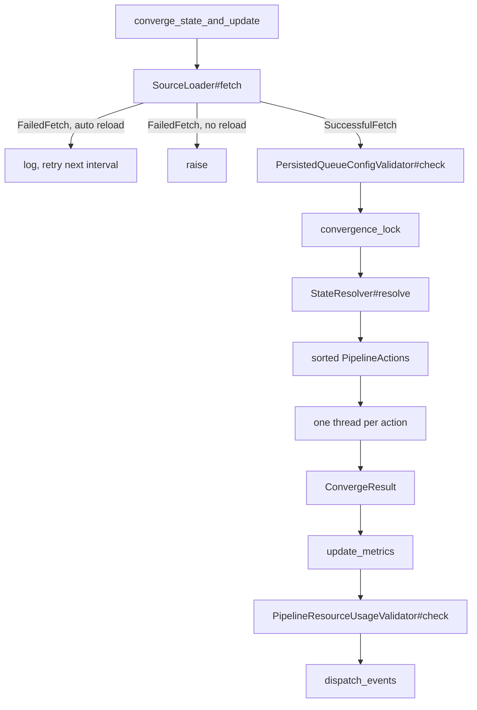

## Overview

`LogStash::Agent` owns everything a Logstash process runs besides the CLI: the pipelines, the HTTP API server, the metric collector and pollers, the pipeline bus, and the health observer. Its central job is convergence: fetch the desired pipeline configs, compare them with the pipelines that exist, and run the actions that close the gap. The same routine handles startup, automatic reload, `SIGHUP`, the x-pack central management source, and shutdown (which converges toward an empty set). How the configs are produced is on [[Pipeline Configuration Sources]]; what a single pipeline does when it is created or shut down is on [[Pipeline Lifecycle]].

Sources: [logstash-core/lib/logstash/agent.rb:48-124](repo://logstash-core/lib/logstash/agent.rb#L48-L124)

## What the agent builds

The constructor reads `config.reload.automatic` and `config.reload.interval` (converted from nanoseconds to seconds so sub-second intervals survive), creates a `HealthObserver`, the `PipelineBus` used by [[Pipeline-to-Pipeline Communication]], an empty `PipelinesRegistry`, and the web server object (not started yet, see [[Monitoring API]]). It then sets up a metric collector (a `NullMetric` when `metric.collect` is false), starts the `PeriodicPollers` ([[Periodic Pollers and System Monitors]]), creates the `StateResolver`, registers agent and flow metrics, and fires `after_initialize` through its `EventDispatcher` so hooks registered by plugins can react.

Sources: [logstash-core/lib/logstash/agent.rb:62-124](repo://logstash-core/lib/logstash/agent.rb#L62-L124), [logstash-core/lib/logstash/agent.rb:511-531](repo://logstash-core/lib/logstash/agent.rb#L511-L531)

The agent id is a UUID persisted in `path.data/uuid`. If the file cannot be read a new UUID is generated and written; if it cannot be written the agent keeps an ephemeral one and logs a warning. Monitoring uses this id to recognise the same node across restarts.

Sources: [logstash-core/lib/logstash/agent.rb:284-320](repo://logstash-core/lib/logstash/agent.rb#L284-L320)

## The execute loop

`execute` runs in the runner's `Stud::Task`. It marks the agent running, starts the web server thread if `api.enabled` is true, and converges once; what follows depends on the reload mode.

Sources: [logstash-core/lib/logstash/agent.rb:126-170](repo://logstash-core/lib/logstash/agent.rb#L126-L170), [logstash-core/lib/logstash/agent.rb:482-497](repo://logstash-core/lib/logstash/agent.rb#L482-L497)

- With automatic reload, `Stud.interval(@reload_interval, sleep_then_run: true)` converges again every interval while the agent is not stopped. The loop never exits by itself; the runner stops the task.
- Without automatic reload, it returns `1` if the first convergence created no pipeline. Otherwise it polls every 0.5 s and returns `0` once no pipeline is running or loading, or once only system pipelines (such as x-pack monitoring) remain.

Sources: [logstash-core/lib/logstash/agent.rb:126-170](repo://logstash-core/lib/logstash/agent.rb#L126-L170), [logstash-core/lib/logstash/agent.rb:482-497](repo://logstash-core/lib/logstash/agent.rb#L482-L497)

The second rule is what makes `bin/logstash -e 'input { generator { count => 10 } } ...'` exit after its input finishes: the pipeline terminates, the registry has no running user pipeline, and `execute` returns.

Sources: [logstash-core/lib/logstash/agent.rb:156-164](repo://logstash-core/lib/logstash/agent.rb#L156-L164), [logstash-core/lib/logstash/pipelines_registry.rb:290-310](repo://logstash-core/lib/logstash/pipelines_registry.rb#L290-L310)

## One convergence

Sources: [logstash-core/lib/logstash/agent.rb:221-254](repo://logstash-core/lib/logstash/agent.rb#L221-L254), [logstash-core/lib/logstash/agent.rb:382-467](repo://logstash-core/lib/logstash/agent.rb#L382-L467)

`converge_state_and_update` fetches the configs and stops early on a failed fetch. Before resolving, `PersistedQueueConfigValidator` checks every persisted-queue pipeline: `queue.page_capacity` larger than `queue.max_bytes` raises `BootstrapCheckError`, and insufficient free disk for all queues to reach `max_bytes` produces warnings. After a successful convergence that ran actions, it logs the running and non-running pipeline ids, and `PipelineResourceUsageValidator` estimates heap use as `batch.size × workers × 2 KB` across loaded pipelines and warns above 10% of the maximum heap. Any exception during convergence is logged as "An exception happened when converging configuration" and does not stop the agent.

Sources: [logstash-core/lib/logstash/agent.rb:221-254](repo://logstash-core/lib/logstash/agent.rb#L221-L254), [logstash-core/lib/logstash/persisted_queue_config_validator.rb:32-88](repo://logstash-core/lib/logstash/persisted_queue_config_validator.rb#L32-L88), [logstash-core/lib/logstash/pipeline_resource_usage_validator.rb:22-52](repo://logstash-core/lib/logstash/pipeline_resource_usage_validator.rb#L22-L52)

## Resolving actions

`StateResolver#resolve` compares the fetched configs with the registry.

Sources: [logstash-core/lib/logstash/state_resolver.rb:29-58](repo://logstash-core/lib/logstash/state_resolver.rb#L29-L58)

| Situation | Action |
| --- | --- |
| Config's pipeline id not in the registry | `Create` |
| Pipeline exists and its `PipelineConfig` is not equal to the new one | `Reload` |
| Running or loading pipeline whose id is not in the configs | `StopAndDelete` |
| Terminated pipeline whose id is not in the configs | `Delete` |

Sources: [logstash-core/lib/logstash/state_resolver.rb:29-58](repo://logstash-core/lib/logstash/state_resolver.rb#L29-L58)

Config equality is the `PipelineConfig#equals` described on [[Pipeline Configuration Sources]]: same text hash, same id, same settings. A pipeline whose files did not change is therefore left alone.

Sources: [logstash-core/src/main/java/org/logstash/config/ir/PipelineConfig.java:158-172](repo://logstash-core/src/main/java/org/logstash/config/ir/PipelineConfig.java#L158-L172)

The actions are sorted. `PipelineAction::ORDERING` gives `Create` 100, `Reload` 200, `Stop` 300, `StopAndDelete` 350, `Delete` 400, with the pipeline id breaking ties. A `Create` for a system pipeline negates its priority so that pipelines like x-pack monitoring, which register hooks that user pipelines trigger, sort first.

Sources: [logstash-core/lib/logstash/pipeline_action.rb:25-33](repo://logstash-core/lib/logstash/pipeline_action.rb#L25-L33), [logstash-core/lib/logstash/pipeline_action/base.rb:35-43](repo://logstash-core/lib/logstash/pipeline_action/base.rb#L35-L43), [logstash-core/lib/logstash/pipeline_action/create.rb:38-44](repo://logstash-core/lib/logstash/pipeline_action/create.rb#L38-L44)

## Executing actions

`converge_state` must hold `@convergence_lock`; `resolve_actions` and `converge_state` both `fail` when called without it. It creates a `ConvergeResult` expecting one result per action and starts one thread per action, named `Converge <action>`, then joins them all. The sort order therefore decides start order, not completion order. A thread that raises (even `SystemExit`) records a `FailedAction` built from the exception and its cause.

Sources: [logstash-core/lib/logstash/agent.rb:382-462](repo://logstash-core/lib/logstash/agent.rb#L382-L462)

> [!WARNING]
> `stop_pipeline` and `converge_state_with_resolved_actions` take the same convergence lock. Calling them from a plugin's `initialize` or `register` deadlocks, because a reload already holds the lock while it registers plugins.

Sources: [logstash-core/lib/logstash/agent.rb:256-263](repo://logstash-core/lib/logstash/agent.rb#L256-L263), [logstash-core/lib/logstash/agent.rb:389-396](repo://logstash-core/lib/logstash/agent.rb#L389-L396)

Each action does a small amount of work through the registry.

Sources: [logstash-core/lib/logstash/pipeline_action/create.rb:46-62](repo://logstash-core/lib/logstash/pipeline_action/create.rb#L46-L62), [logstash-core/lib/logstash/pipeline_action/reload.rb:39-78](repo://logstash-core/lib/logstash/pipeline_action/reload.rb#L39-L78), [logstash-core/lib/logstash/pipeline_action/stop.rb:28-34](repo://logstash-core/lib/logstash/pipeline_action/stop.rb#L28-L34), [logstash-core/lib/logstash/pipeline_action/stop_and_delete.rb:28-41](repo://logstash-core/lib/logstash/pipeline_action/stop_and_delete.rb#L28-L41), [logstash-core/lib/logstash/pipeline_action/delete.rb:28-37](repo://logstash-core/lib/logstash/pipeline_action/delete.rb#L28-L37)

| Action | `execute` |
| --- | --- |
| `Create` | Attach a health indicator, build `JavaPipeline.new(config, metric, agent)`, call `registry.create_pipeline` with a block that runs `pipeline.start` |
| `Reload` | Fail if the old pipeline is missing or not reloadable; build an `AbstractPipeline` from the new config to validate it and check it is reloadable; then `registry.reload_pipeline` shuts the old one down and starts a new `JavaPipeline` |
| `Stop` | `registry.terminate_pipeline` calling `pipeline.shutdown` |
| `StopAndDelete` | `Stop`, then `delete_pipeline` and detach the health indicator |
| `Delete` | `delete_pipeline` and detach the health indicator |

Sources: [logstash-core/lib/logstash/pipeline_action/create.rb:46-62](repo://logstash-core/lib/logstash/pipeline_action/create.rb#L46-L62), [logstash-core/lib/logstash/pipeline_action/reload.rb:39-78](repo://logstash-core/lib/logstash/pipeline_action/reload.rb#L39-L78), [logstash-core/lib/logstash/pipeline_action/stop.rb:28-34](repo://logstash-core/lib/logstash/pipeline_action/stop.rb#L28-L34), [logstash-core/lib/logstash/pipeline_action/stop_and_delete.rb:28-41](repo://logstash-core/lib/logstash/pipeline_action/stop_and_delete.rb#L28-L41), [logstash-core/lib/logstash/pipeline_action/delete.rb:28-37](repo://logstash-core/lib/logstash/pipeline_action/delete.rb#L28-L37)

A pipeline is reloadable when `pipeline.reloadable` is true and every input, filter and output answers `reloadable?` true. Validation with an `AbstractPipeline` compiles the new config and instantiates its plugins without opening a queue, so a syntax error leaves the old pipeline running and the reload is recorded as failed.

Sources: [logstash-core/src/main/java/org/logstash/execution/AbstractPipelineExt.java:491-512](repo://logstash-core/src/main/java/org/logstash/execution/AbstractPipelineExt.java#L491-L512), [logstash-core/src/main/java/org/logstash/execution/AbstractPipelineExt.java:292-310](repo://logstash-core/src/main/java/org/logstash/execution/AbstractPipelineExt.java#L292-L310)

> [!NOTE]
> A reload shuts the old pipeline down before the new one starts. If the new pipeline fails to start, the id stays in the registry with the failed pipeline and is retried on the next convergence only if the config changes again.

Sources: [logstash-core/lib/logstash/pipeline_action/reload.rb:60-78](repo://logstash-core/lib/logstash/pipeline_action/reload.rb#L60-L78), [logstash-core/lib/logstash/pipelines_registry.rb:221-244](repo://logstash-core/lib/logstash/pipelines_registry.rb#L221-L244)

## The pipelines registry

`PipelinesRegistry` maps pipeline ids to `PipelineState` objects. Every mutating method takes a per-id mutex from `PipelineStates#get_lock`, so actions on different pipelines run in parallel while two actions on the same id serialise. A `PipelineState` wraps the pipeline, a `loading` flag and a monitor, and derives its status from the pipeline.

Sources: [logstash-core/lib/logstash/pipelines_registry.rb:18-88](repo://logstash-core/lib/logstash/pipelines_registry.rb#L18-L88), [logstash-core/lib/logstash/pipelines_registry.rb:134-138](repo://logstash-core/lib/logstash/pipelines_registry.rb#L134-L138)

| State | Condition |
| --- | --- |
| `loading?` | Inside a create or reload block |
| `running?` | Not loading and pipeline thread not finished |
| `finished?` | Not loading and `run` completed without error |
| `terminated?` | Not loading and pipeline thread finished, whatever the reason |
| `crashed?` | A worker or input raised |

Sources: [logstash-core/lib/logstash/pipelines_registry.rb:18-88](repo://logstash-core/lib/logstash/pipelines_registry.rb#L18-L88), [logstash-core/lib/logstash/pipelines_registry.rb:134-138](repo://logstash-core/lib/logstash/pipelines_registry.rb#L134-L138)

`create_pipeline` refuses an id whose state exists and is not terminated. For a new id it inserts a loading state, runs the block, and removes the state again if the block returned false; for a terminated id it swaps the new pipeline into the old state. `reload_pipeline` sets loading, runs the block, and stores the returned pipeline whether or not it started. `delete_pipeline` only removes terminated states.

Sources: [logstash-core/lib/logstash/pipelines_registry.rb:158-270](repo://logstash-core/lib/logstash/pipelines_registry.rb#L158-L270)

The agent's `pipeline_details`, used by the [[Health Report]], reads the state under its monitor and maps it to `LOADING`, `TERMINATED` (crashed), `RUNNING`, `FINISHED` or `UNKNOWN`, together with the pipeline's worker utilization flow.

Sources: [logstash-core/lib/logstash/agent.rb:172-195](repo://logstash-core/lib/logstash/agent.rb#L172-L195)

## Results, metrics and events

`ConvergeResult` (Java `ConvergeResultExt`) stores each action's result in a concurrent map. `ActionResult.create` normalises what an action returned: `true` becomes `SuccessfulAction`, `false` becomes a `FailedAction` naming the action, an exception becomes `FailedAction.from_exception`, and anything else raises. `success?` is true only when no action failed and every expected action reported.

Sources: [logstash-core/src/main/java/org/logstash/execution/ConvergeResultExt.java:51-141](repo://logstash-core/src/main/java/org/logstash/execution/ConvergeResultExt.java#L51-L141)

`update_metrics` initialises per-pipeline metrics for each `Create`, records reload successes, and for failures increments `stats.reloads.failures` and the pipeline's `reloads.failures`, with `last_error` and `last_failure_timestamp` gauges. `dispatch_events` fires `pipeline_started` for successful creates and `pipeline_stopped` for reloads and stops.

Sources: [logstash-core/lib/logstash/agent.rb:469-480](repo://logstash-core/lib/logstash/agent.rb#L469-L480), [logstash-core/lib/logstash/agent.rb:551-590](repo://logstash-core/lib/logstash/agent.rb#L551-L590)

## Shutdown

`Agent#shutdown` tells the pipeline bus to block on unlisten, so a downstream pipeline does not stop while an upstream one still sends to it, marks the agent stopped, and calls `resolve_actions_and_converge_state([])`. With an empty desired state every pipeline gets `StopAndDelete` or `Delete`, so shutdown goes through the same code, metrics and logging as any other convergence. It then stops the pollers and the web server, killing the server thread if it has not ended after 5 seconds.

Sources: [logstash-core/lib/logstash/agent.rb:272-282](repo://logstash-core/lib/logstash/agent.rb#L272-L282), [logstash-core/lib/logstash/agent.rb:499-540](repo://logstash-core/lib/logstash/agent.rb#L499-L540)
