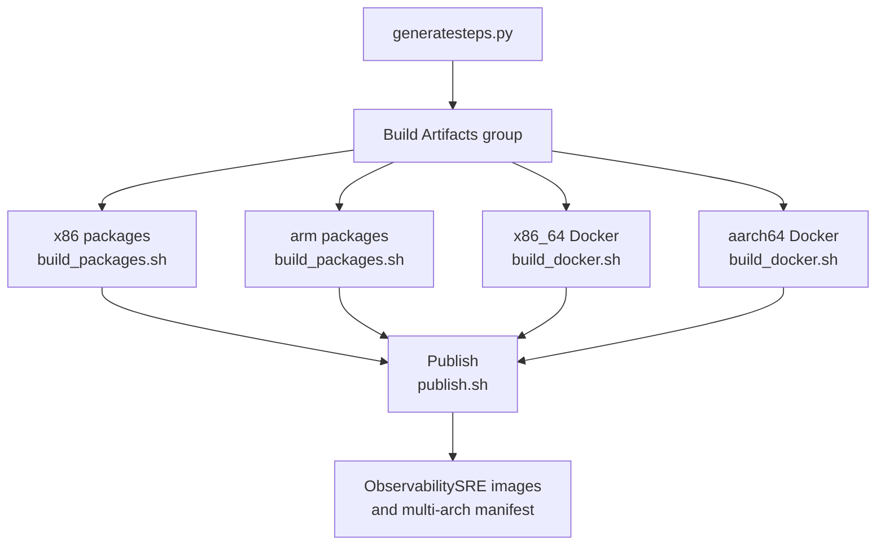

## Overview

Logstash CI runs on Buildkite. Every pipeline is declared as a Backstage resource in `catalog-info.yaml`, which points at a YAML file in `.buildkite/` and sets when it runs: on pull requests, on branch pushes, on a schedule, or when triggered. Pipeline steps call the same `ci/*.sh` scripts and Gradle tasks a developer can run locally, so a CI failure can be reproduced with the command in the step ([[Testing]]). Larger pipelines generate their steps at run time with Python scripts. A handful of GitHub Actions workflows handle repository chores.

Sources: [catalog-info.yaml:231-275](repo://catalog-info.yaml#L231-L275), [.buildkite/pull_request_pipeline.yml:42-61](repo://.buildkite/pull_request_pipeline.yml#L42-L61)

## Pipelines

| Pipeline file | When it runs | What it does |
| --- | --- | --- |
| `pull_request_pipeline.yml` | Every pull request | License checks, unit, integration and x-pack tests, normal and FIPS mode |
| `exhaustive_tests_pipeline.yml` | Pushes to branches (not backport branches), and every other week for release branches | Pull request suite plus OS compatibility and package and Docker acceptance |
| `linux_jdk_matrix_pipeline.yml`, `windows_jdk_matrix_pipeline.yml` | Weekly per branch, or by hand | Tests on chosen OS and JDK combinations |
| `aarch64_pipeline.yml` | Weekly per branch | Tests on ARM |
| `dra_pipeline.yml` | Snapshot daily per branch through the scheduler; staging only when triggered | Builds and publishes release artifacts |
| `benchmark_pipeline.yml`, `benchmark_marathon_pipeline.yml` | Daily (benchmark); marathon only when triggered | Throughput benchmarks |
| `health_report_tests_pipeline.yml` | Daily | Health report API tests ([[Health Report]]) |
| `serverless_integration_pipeline.yml`, `snyk_report_pipeline.yml` | Daily | Tests against serverless Elasticsearch; dependency report to Snyk |
| `jdk_availability_check_pipeline.yml` | Weekly | Checks a newer bundled JDK build exists |
| `supported_plugins_test_pipeline.yml` | Only when triggered | Tests supported plugins against this Logstash |
| `trigger_pipelines.yml` | Schedules | Triggers other pipelines on every active branch |

Sources: [catalog-info.yaml:46-135](repo://catalog-info.yaml#L46-L135), [catalog-info.yaml:137-230](repo://catalog-info.yaml#L137-L230), [catalog-info.yaml:434-530](repo://catalog-info.yaml#L434-L530), [catalog-info.yaml:532-605](repo://catalog-info.yaml#L532-L605), [catalog-info.yaml:606-720](repo://catalog-info.yaml#L606-L720), [catalog-info.yaml:745-805](repo://catalog-info.yaml#L745-L805)

## Pull request pipeline

### Triggering

The Buildkite PR bot builds a pull request when a user with write access (or one of the listed bots) opens or updates it, or comments "build this" or "test this". Changes only to `.github/`, `docs/`, `.mergify.yml`, `.pre-commit-config.yaml` or Markdown files skip CI. The pipeline cancels and skips intermediate builds, so only a PR's latest commit is tested, and has a 120-minute limit.

Sources: [.buildkite/pull-requests.json:1-26](repo://.buildkite/pull-requests.json#L1-L26), [catalog-info.yaml:244-265](repo://catalog-info.yaml#L244-L265)

### Steps

All steps run in parallel, each retried automatically up to three times. Most run in a Logstash CI container image as a non-root user; FIPS-mode variants build `x-pack/distributions/internal/observabilitySRE/docker/Dockerfile` as a test runner on a VM and run the same command inside it with `FEDRAMP_HIGH_MODE=true` or `-PfedrampHighMode=true`.

Sources: [.buildkite/pull_request_pipeline.yml:42-124](repo://.buildkite/pull_request_pipeline.yml#L42-L124), [.buildkite/pull_request_pipeline.yml:163-178](repo://.buildkite/pull_request_pipeline.yml#L163-L178)

| Step | Command |
| --- | --- |
| License check (normal, FIPS) | `ci/license_check.sh -m 4G` |
| Ruby unit tests (normal, FIPS) | `ci/unit_tests.sh ruby`, or `./gradlew rubyTests` |
| Java unit tests (normal, FIPS) | `ci/unit_tests.sh java` with SonarQube coverage, or `./gradlew javaTests` |
| Integration tests, 6 parts (normal, FIPS) | `ci/integration_tests.sh split <n> 6` |
| IT Persistent Queues, 6 parts | Same, with `FEATURE_FLAG=persistent_queues` |
| x-pack unit and integration (normal, FIPS) | `x-pack/ci/unit_tests.sh`, `x-pack/ci/integration_tests.sh` |
| Observability SRE container smoke test | `ci/observabilitySREsmoke_tests.sh` |

Sources: [.buildkite/pull_request_pipeline.yml:4-120](repo://.buildkite/pull_request_pipeline.yml#L4-L120), [.buildkite/pull_request_pipeline.yml:146-178](repo://.buildkite/pull_request_pipeline.yml#L146-L178), [.buildkite/pull_request_pipeline.yml:373-390](repo://.buildkite/pull_request_pipeline.yml#L373-L390), [.buildkite/pull_request_pipeline.yml:487-555](repo://.buildkite/pull_request_pipeline.yml#L487-L555)

`ci/unit_tests.sh` picks the Gradle task from its argument (`java`, `ruby`, or both through `test`), sets `CI=true` and random spec order, and, when `ENABLE_SONARQUBE` is true, adds `jacocoTestReport` and sets `COVERAGE` for Ruby. `BUILD_JAVA_HOME` selects the JDK Gradle uses.

Sources: [ci/unit_tests.sh:1-37](repo://ci/unit_tests.sh#L1-L37)

The integration suite is split into six partitions by `ci/integration_tests.sh split <index> <count>`, which sorts the spec file names and deals them round-robin into partitions, so each step runs a fixed subset and together they run every spec exactly once.

Sources: [ci/integration_tests.sh:24-33](repo://ci/integration_tests.sh#L24-L33), [ci/partition-files.lib.sh:1-45](repo://ci/partition-files.lib.sh#L1-L45)

### Reporting

After the unit tests, a SonarQube step (for pull requests, `main` and release branches) downloads the Ruby `coverage.json` and Java JaCoCo reports and scans the source. Another step annotates the build with the Java JUnit results.

Sources: [.buildkite/pull_request_pipeline.yml:125-145](repo://.buildkite/pull_request_pipeline.yml#L125-L145), [.buildkite/pull_request_pipeline.yml:557-567](repo://.buildkite/pull_request_pipeline.yml#L557-L567)

## Generated pipelines

### Exhaustive tests

The exhaustive pipeline exits early when only `docs/` changed. Otherwise `exhaustive-tests/generate-steps.py` writes the steps and uploads them with `buildkite-agent pipeline upload`. It produces these groups.

Sources: [.buildkite/exhaustive_tests_pipeline.yml:1-39](repo://.buildkite/exhaustive_tests_pipeline.yml#L1-L39)

1. Pull request suite: the whole `pull_request_pipeline.yml`, loaded and embedded.
2. Compatibility / Linux: `ci/unit_tests.sh` on one randomly chosen image per Linux family in `vm-images.json` (or `LINUX_OS`).
3. Compatibility / Windows: `ci\unit_tests.ps1` on one random Windows image (or `WINDOWS_OS`).
4. Acceptance / Packaging: one step builds `.deb` and `.rpm`, then `ci/acceptance_tests.sh` runs on each OS in `ACCEPTANCE_LINUX_OSES`.
5. Acceptance / Docker: `ci/docker_acceptance_tests.sh` for `full`, `oss` and `wolfi`.
6. Observability SRE acceptance tests.

Sources: [.buildkite/scripts/exhaustive-tests/generate-steps.py:13-30](repo://.buildkite/scripts/exhaustive-tests/generate-steps.py#L13-L30), [.buildkite/scripts/exhaustive-tests/generate-steps.py:73-155](repo://.buildkite/scripts/exhaustive-tests/generate-steps.py#L73-L155), [.buildkite/scripts/exhaustive-tests/generate-steps.py:156-241](repo://.buildkite/scripts/exhaustive-tests/generate-steps.py#L156-L241), [.buildkite/scripts/common/vm-images.json:1-13](repo://.buildkite/scripts/common/vm-images.json#L1-L13)

### JDK matrix

When started by hand, the Linux JDK matrix pipeline first asks for operating systems and JDKs (defaults `ubuntu-2204` and `adoptiumjdk_21`); scheduled and triggered runs use the defaults. `jdk-matrix-tests/generate-steps.py` then creates one group per OS and JDK pair with Java and Ruby unit tests, integration tests and PQ integration tests in three parts each, and x-pack unit and integration tests. Each step points `BUILD_JAVA_HOME`, `RUNTIME_JAVA_HOME` and `LS_JAVA_HOME` at the chosen JDK and records pass or fail in a per-group annotation table. The Windows variant runs `ci\unit_tests.ps1` through `launch-command.ps1`.

Sources: [.buildkite/linux_jdk_matrix_pipeline.yml:6-96](repo://.buildkite/linux_jdk_matrix_pipeline.yml#L6-L96), [.buildkite/scripts/jdk-matrix-tests/generate-steps.py:136-230](repo://.buildkite/scripts/jdk-matrix-tests/generate-steps.py#L136-L230)

## Release artifacts (DRA)

`dra_pipeline.yml` runs `dra/generatesteps.py` with `WORKFLOW_TYPE` set to `snapshot` or `staging` by the two pipeline definitions. A snapshot run with `VERSION_QUALIFIER` set becomes a no-op, because prerelease builds have no snapshot workflow. Otherwise the generated pipeline has these stages.

Sources: [.buildkite/dra_pipeline.yml:1-15](repo://.buildkite/dra_pipeline.yml#L1-L15), [.buildkite/scripts/dra/generatesteps.py:182-229](repo://.buildkite/scripts/dra/generatesteps.py#L182-L229), [catalog-info.yaml:150-205](repo://catalog-info.yaml#L150-L205)

Sources: [.buildkite/scripts/dra/generatesteps.py:18-106](repo://.buildkite/scripts/dra/generatesteps.py#L18-L106), [.buildkite/scripts/dra/generatesteps.py:107-180](repo://.buildkite/scripts/dra/generatesteps.py#L107-L180), [.buildkite/scripts/dra/generatesteps.py:182-229](repo://.buildkite/scripts/dra/generatesteps.py#L182-L229)

`build_packages.sh` sets `RELEASE=1` for staging, runs `SKIP_DOCKER=1 rake artifact:all` ([[Packaging and Distribution]]), writes a dependencies CSV with `bin/dependencies-report`, and uploads everything to Buildkite's artifact store. `publish.sh` downloads the artifacts and runs Elastic's `release-manager` image, first to list and then to `collect` the artifacts for the given branch, commit, workflow, version and qualifier, and annotates the build with the summary link.

Sources: [.buildkite/scripts/dra/build_packages.sh:1-44](repo://.buildkite/scripts/dra/build_packages.sh#L1-L44), [.buildkite/scripts/dra/publish.sh:40-111](repo://.buildkite/scripts/dra/publish.sh#L40-L111)

## Scheduling across branches

The Logstash Pipeline Scheduler runs `trigger_pipelines.yml` on schedules from `main`, each naming the pipelines to start in `PIPELINES_TO_TRIGGER`: snapshot DRA daily, the JDK matrices weekly, aarch64 weekly, and the exhaustive pipeline every other week with `main` excluded. `trigger-pipeline-generate-steps.sh` downloads the list of active release branches from `artifacts-api`, removes any in `EXCLUDE_BRANCHES`, and uploads one `trigger` step per pipeline and branch.

Sources: [catalog-info.yaml:545-580](repo://catalog-info.yaml#L545-L580), [.buildkite/scripts/common/trigger-pipeline-generate-steps.sh:15-106](repo://.buildkite/scripts/common/trigger-pipeline-generate-steps.sh#L15-L106)

## Benchmarks and other scheduled checks

The benchmark pipeline runs `benchmark/main.sh` on a 16-CPU VM: Filebeat containers send about 2 GB of `flog`-generated logs to a Logstash snapshot container, over every combination of queue type, worker multiplier and batch size, while a second pipeline polls `/_node/stats` every 30 seconds; results and a summary of events per second and resource use go to an Elasticsearch cluster ([[Monitoring API]]). The tools for local benchmarks are on [[Developer Tools]].

Sources: [.buildkite/benchmark_pipeline.yml:1-13](repo://.buildkite/benchmark_pipeline.yml#L1-L13), [.buildkite/scripts/benchmark/main.sh:1-40](repo://.buildkite/scripts/benchmark/main.sh#L1-L40)

The health report pipeline runs Python scenario tests from `.buildkite/scripts/health-report-tests`; the JDK availability check runs `ci/check_jdk_version_availability.sh`; the Snyk pipeline reports dependencies of `main` and the current release branches.

Sources: [.buildkite/health_report_tests_pipeline.yml:1-19](repo://.buildkite/health_report_tests_pipeline.yml#L1-L19), [.buildkite/scripts/health-report-tests/README.md:1-17](repo://.buildkite/scripts/health-report-tests/README.md#L1-L17), [.buildkite/jdk_availability_check_pipeline.yml:1-13](repo://.buildkite/jdk_availability_check_pipeline.yml#L1-L13), [.buildkite/snyk_report_pipeline.yml:1-14](repo://.buildkite/snyk_report_pipeline.yml#L1-L14)

## GitHub Actions

| Workflow | Purpose |
| --- | --- |
| `pre-commit.yml` | Runs pre-commit hooks on pull requests and pushes to `main`, `8.*` and `9.*` |
| `critical_vulnerability_scan.yml` | Builds the tar distribution and fails on critical vulnerabilities found by an Anchore scan |
| `version_bumps.yml` | For core team members: updates gems by patch, minor or major level, writes the release lock file, and opens a pull request |
| `backport-active.yml`, `mergify-labels-copier.yml` | Backport automation |
| `docs-build.yml`, `lint_docs.yml` | Documentation builds and checks |
| Project board workflows | Add issues to GitHub projects |

Sources: [.github/workflows/pre-commit.yml:1-18](repo://.github/workflows/pre-commit.yml#L1-L18), [.github/workflows/critical_vulnerability_scan.yml:1-25](repo://.github/workflows/critical_vulnerability_scan.yml#L1-L25), [.github/workflows/version_bumps.yml:1-76](repo://.github/workflows/version_bumps.yml#L1-L76), [.github/workflows/backport-active.yml:1-22](repo://.github/workflows/backport-active.yml#L1-L22), [.github/workflows/docs-build.yml:1-20](repo://.github/workflows/docs-build.yml#L1-L20)
