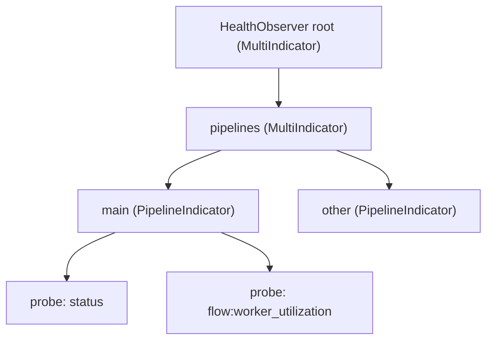

## Overview

`GET /_health_report` answers "is this Logstash healthy, and if not, why?" with a status (`green`, `yellow`, `red` or `unknown`), a one-line symptom, and per-indicator details with diagnoses and impacts. The report is computed on each request by a tree of indicators held by the agent's `HealthObserver`. Today the tree has one branch, `pipelines`, with one indicator per pipeline; each pipeline indicator runs two probes, one on the pipeline's lifecycle state and one on its worker utilization. The same overall status is included as `status` in every other API response ([[Monitoring API]]).

Sources: [logstash-core/src/main/java/org/logstash/health/HealthObserver.java:24-75](repo://logstash-core/src/main/java/org/logstash/health/HealthObserver.java#L24-L75), [logstash-core/lib/logstash/api/commands/default_metadata.rb:24-32](repo://logstash-core/lib/logstash/api/commands/default_metadata.rb#L24-L32)

## Statuses

`Status` is ordered `GREEN`, `UNKNOWN`, `YELLOW`, `RED`, with descriptive names "healthy", "unknown", "concerning" and "unhealthy". `reduce` keeps the more degraded of two statuses, and `Status.Holder` accumulates a reduction starting from green. Every combined status in the tree is computed this way, so one red pipeline makes the whole report red.

Sources: [logstash-core/src/main/java/org/logstash/health/Status.java:23-67](repo://logstash-core/src/main/java/org/logstash/health/Status.java#L23-L67)

## The indicator tree

Sources: [logstash-core/src/main/java/org/logstash/health/HealthObserver.java:30-35](repo://logstash-core/src/main/java/org/logstash/health/HealthObserver.java#L30-L35), [logstash-core/src/main/java/org/logstash/health/PipelineIndicator.java:40-46](repo://logstash-core/src/main/java/org/logstash/health/PipelineIndicator.java#L40-L46)

An `Indicator` produces a report with a status. Two kinds exist.

Sources: [logstash-core/src/main/java/org/logstash/health/Indicator.java:23-31](repo://logstash-core/src/main/java/org/logstash/health/Indicator.java#L23-L31)

- `MultiIndicator` holds named child indicators in a concurrent map. Attaching a different indicator under an existing name, or detaching one that does not match, raises `IllegalArgumentException`. Its report combines the children's statuses and builds a symptom that names them by status, most degraded first, for example "1 indicator is unhealthy (`main`) and 2 indicators are healthy (`a`, `b`)".
- `ProbeIndicator` has an observer that supplies one observation and a set of named probes. Its report runs every probe on the same observation, combines their statuses, collects their diagnoses and impacts, and writes a symptom such as "The pipeline is unhealthy; 1 area is impacted and 1 diagnosis is available".

Sources: [logstash-core/src/main/java/org/logstash/health/MultiIndicator.java:31-115](repo://logstash-core/src/main/java/org/logstash/health/MultiIndicator.java#L31-L115), [logstash-core/src/main/java/org/logstash/health/ProbeIndicator.java:38-134](repo://logstash-core/src/main/java/org/logstash/health/ProbeIndicator.java#L38-L134)

`ReportContext` carries the path from the root during a report and asks whether a node is muted. Its `isMuted` always returns false at present, so nothing is muted.

Sources: [logstash-core/src/main/java/org/logstash/health/ReportContext.java:25-58](repo://logstash-core/src/main/java/org/logstash/health/ReportContext.java#L25-L58)

## Pipeline indicators

### Attachment and observation

The `Create` action attaches a `PipelineIndicator` for the pipeline, first detaching any left over; `StopAndDelete` and `Delete` detach it ([[Agent and Pipeline Convergence]]). Attach and detach failures are logged, not raised.

Sources: [logstash-core/lib/logstash/pipeline_action/create.rb:58-62](repo://logstash-core/lib/logstash/pipeline_action/create.rb#L58-L62), [logstash-core/lib/logstash/pipeline_action/stop_and_delete.rb:28-41](repo://logstash-core/lib/logstash/pipeline_action/stop_and_delete.rb#L28-L41), [logstash-core/src/main/java/org/logstash/health/HealthObserver.java:58-74](repo://logstash-core/src/main/java/org/logstash/health/HealthObserver.java#L58-L74)

Its observation is a `Details` object fetched from the agent through `PipelineDetailsProvider.pipelineDetails(id)`. The agent maps the registry state to `LOADING`, `RUNNING`, `FINISHED`, `TERMINATED` (crashed) or `UNKNOWN` (no such pipeline), and adds the pipeline's `worker_utilization` flow values ([[Flow Metrics]]). In the JSON report, `details` shows `status.state` and, when present, the `flow` values.

Sources: [logstash-core/src/main/java/org/logstash/health/PipelineIndicator.java:52-155](repo://logstash-core/src/main/java/org/logstash/health/PipelineIndicator.java#L52-L155), [logstash-core/src/main/java/org/logstash/health/PipelineIndicator.java:158-178](repo://logstash-core/src/main/java/org/logstash/health/PipelineIndicator.java#L158-L178), [logstash-core/lib/logstash/agent.rb:172-195](repo://logstash-core/lib/logstash/agent.rb#L172-L195)

### Status probe

| State | Status | Diagnosis | Impact severity |
| --- | --- | --- | --- |
| `RUNNING` | green | none | none |
| `LOADING` | yellow | "pipeline is loading" | 1 |
| `FINISHED` | yellow | inputs closed and events processed; configure inputs to keep running if that was not intended | 10 |
| `TERMINATED` | red | not running, likely after an error; check the logs | 1 |
| `UNKNOWN` | unknown | recently deleted or failed to start | 2 |

Sources: [logstash-core/src/main/java/org/logstash/health/PipelineIndicator.java:180-248](repo://logstash-core/src/main/java/org/logstash/health/PipelineIndicator.java#L180-L248)

### Worker utilization probe

The `flow:worker_utilization` probe reads the `last_5_minutes` and `last_1_minute` windows of the pipeline's worker utilization flow. Windows that do not exist yet (during the first minutes after start) are ignored.

Sources: [logstash-core/src/main/java/org/logstash/health/PipelineIndicator.java:250-268](repo://logstash-core/src/main/java/org/logstash/health/PipelineIndicator.java#L250-L268)

| Condition | Status | Diagnosis id suffix |
| --- | --- | --- |
| 5-minute utilization above 99.999% | red | `5m-blocked` |
| 5-minute utilization at least 95% | yellow; "appear to be recovering" when the 1-minute value is at most 80% | `5m-nearly-blocked` |
| 1-minute utilization above 99.999% | yellow | `1m-blocked` |
| 1-minute utilization at least 95% | yellow | `1m-nearly-blocked` |
| otherwise | green | none |

Sources: [logstash-core/src/main/java/org/logstash/health/PipelineIndicator.java:269-335](repo://logstash-core/src/main/java/org/logstash/health/PipelineIndicator.java#L269-L335)

Saturated workers mean the pipeline cannot keep up: inputs will soon see back-pressure. The probe's advice is "address bottleneck or add resources", and the plugin-level `worker_utilization` flows in node stats show which filter or output is responsible.

Sources: [logstash-core/src/main/java/org/logstash/health/PipelineIndicator.java:270-290](repo://logstash-core/src/main/java/org/logstash/health/PipelineIndicator.java#L270-L290), [logstash-core/src/main/java/org/logstash/execution/AbstractPipelineExt.java:719-736](repo://logstash-core/src/main/java/org/logstash/execution/AbstractPipelineExt.java#L719-L736)

## Diagnoses and impacts

A `Diagnosis` has an `id` (such as `logstash:health:pipeline:status:diagnosis:terminated`), a `cause`, an `action` and a `help_url`. An `Impact` has an `id`, a `severity` (lower is more severe), a `description` and impact areas; the only area defined is `pipeline_execution`. Help URLs point at the Logstash reference for the running version (`master` for major version 9 and later) with an anchor per case.

Sources: [logstash-core/src/main/java/org/logstash/health/Diagnosis.java:29-60](repo://logstash-core/src/main/java/org/logstash/health/Diagnosis.java#L29-L60), [logstash-core/src/main/java/org/logstash/health/Impact.java:29-50](repo://logstash-core/src/main/java/org/logstash/health/Impact.java#L29-L50), [logstash-core/src/main/java/org/logstash/health/ImpactArea.java:25-43](repo://logstash-core/src/main/java/org/logstash/health/ImpactArea.java#L25-L43), [logstash-core/src/main/java/org/logstash/health/HelpUrl.java:25-60](repo://logstash-core/src/main/java/org/logstash/health/HelpUrl.java#L25-L60)

## The API response

The `HealthReport` module builds the report through the command factory and returns the node's base information (host, version, address, id, name, ephemeral id, snapshot) merged with `status`, `symptom` and `indicators`, without the usual default metadata.

Sources: [logstash-core/lib/logstash/api/modules/health_report.rb:21-46](repo://logstash-core/lib/logstash/api/modules/health_report.rb#L21-L46), [logstash-core/lib/logstash/api/commands/health_report.rb:23-28](repo://logstash-core/lib/logstash/api/commands/health_report.rb#L23-L28)

`HealthObserver.getStatus` honours one escape hatch: when the system property `logstash.forceApiStatus` is `green`, the status reported in other API responses is always green, while the full health report still shows the real state. Any other value logs a warning and is ignored.

Sources: [logstash-core/src/main/java/org/logstash/health/HealthObserver.java:28-56](repo://logstash-core/src/main/java/org/logstash/health/HealthObserver.java#L28-L56)
