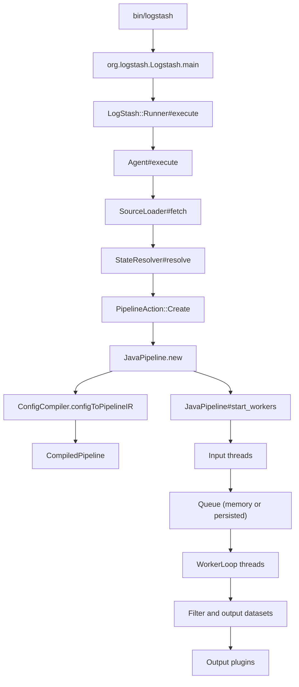

## Overview

Logstash is a server-side data processing engine. It reads events from many sources through input plugins, holds them in a queue, transforms them with filter plugins and sends them on through output plugins. The repository holds `logstash-core` (the engine, written in Java and Ruby running on JRuby), the plugin manager, the x-pack features, and the build, packaging and test tooling. The plugins themselves live in separate gems; only a few ship inside `logstash-core`.

Sources: [README.md:1-35](repo://README.md#L1-L35)

The process is one JVM with one JRuby runtime. `org.logstash.Logstash` starts the runtime and runs `lib/bootstrap/environment.rb`, which loads `LogStash::Runner`; the runner builds an `Agent`, and the agent creates one `JavaPipeline` per configured pipeline. Each pipeline compiles its configuration text into a graph, then into Java code, and runs input threads that write to a queue and worker threads that read batches from it.

Sources: [logstash-core/src/main/java/org/logstash/Logstash.java:163-207](repo://logstash-core/src/main/java/org/logstash/Logstash.java#L163-L207), [logstash-core/lib/logstash/runner.rb:340-372](repo://logstash-core/lib/logstash/runner.rb#L340-L372)

## Parts of the system

| Area | What it does | Page |
| --- | --- | --- |
| Launcher and CLI | `bin/logstash`, JVM options, JRuby boot, CLI flags, signals | [[Startup and the Runner]] |
| Settings | Typed settings from `logstash.yml` and flags | [[Settings and logstash.yml]] |
| Config sources | Reads `-e`, `-f`, `pipelines.yml` into pipeline configs | [[Pipeline Configuration Sources]] |
| Agent | Creates, reloads and stops pipelines to match the configs | [[Agent and Pipeline Convergence]] |
| Secrets | Keystore and `${VAR}` substitution | [[Secret Store and Variable Substitution]] |
| Config parser | Treetop grammar for the config language | [[Configuration Language Parser]] |
| Pipeline IR | Graph of plugins and conditionals | [[Pipeline Intermediate Representation]] |
| Compiled execution | Generated Java datasets that run filters and outputs | [[Compiled Pipeline Execution]] |
| Pipeline runtime | Threads of one pipeline, start and stop | [[Pipeline Lifecycle]] |
| Workers | Batch read, filter, output, flush | [[Worker Loop and Batches]] |
| Stall detection | Reports what blocks a shutdown | [[Shutdown Watcher and Pipeline Reporter]] |
| Pipeline bus | `pipeline` input and output between pipelines | [[Pipeline-to-Pipeline Communication]] |
| Events | Event data, metadata, conversions | [[Event Model]] |
| Field paths | `[a][b]` references and `%{}` interpolation | [[Field References and String Interpolation]] |
| Memory queue | Queue choice and in-memory queue | [[Queue Selection and the Memory Queue]] |
| Persistent queue | Disk-backed queue with acknowledgements | [[Persistent Queue]] |
| Queue tools | `pqcheck`, `pqrepair`, queue upgrade | [[Persistent Queue Maintenance Tools]] |
| DLQ | Events outputs could not deliver | [[Dead Letter Queue]] |
| Ruby plugins | Plugin base classes and config DSL | [[Ruby Plugin Model]] |
| Java plugins | `co.elastic.logstash.api` | [[Java Plugin API]] |
| Plugin loading | Name lookup, factory, delegators | [[Plugin Registry and Factory]] |
| Core plugins | `stdin`, `generator`, `stdout`, `sink`, `uuid`, codecs | [[Built-in Java Plugins]] |
| Plugin manager | `bin/logstash-plugin` | [[Plugin Manager CLI]], [[Plugin Packs and Generator]] |
| Metrics | Counters, gauges, timers, flow rates, pollers | [[Metrics System]], [[Flow Metrics]], [[Periodic Pollers and System Monitors]] |
| HTTP API | Node info, stats, health on port 9600 | [[Monitoring API]], [[Health Report]] |
| Logging | Log4j2 integration, per-pipeline logs | [[Logging]] |
| X-Pack | Monitoring, central management, GeoIP databases | [[X-Pack Extensions and License Checking]], [[X-Pack Monitoring]], [[Centralized Pipeline Management]], [[GeoIP Database Management]] |
| Build and release | Gradle, Rake, packages, Docker, tests, CI | [[Build System]], [[Packaging and Distribution]], [[Testing]], [[Continuous Integration]], [[Developer Tools]] |

Sources: [logstash-core/lib/logstash/agent.rb:62-124](repo://logstash-core/lib/logstash/agent.rb#L62-L124), [logstash-core/lib/logstash/java_pipeline.rb:54-91](repo://logstash-core/lib/logstash/java_pipeline.rb#L54-L91)

## From launch to output

Sources: [logstash-core/lib/logstash/agent.rb:126-170](repo://logstash-core/lib/logstash/agent.rb#L126-L170), [logstash-core/lib/logstash/java_pipeline.rb:260-345](repo://logstash-core/lib/logstash/java_pipeline.rb#L260-L345)

1. The shell launcher builds the classpath and JVM flags, then runs `org.logstash.Logstash`, which creates the JRuby runtime and runs the Ruby bootstrap; [[Startup and the Runner]] covers both.
2. `Runner#execute` validates settings, runs bootstrap checks, locks `path.data`, creates the agent and runs it in a task; see [[Startup and the Runner]] and [[Settings and logstash.yml]].
3. `Agent#execute` calls `converge_state_and_update`, which fetches configs through the `SourceLoader` ([[Pipeline Configuration Sources]]) and asks the `StateResolver` for actions ([[Agent and Pipeline Convergence]]).
4. A `Create` action builds a `JavaPipeline`. Its Java parent `AbstractPipelineExt` compiles the config through the Ruby grammar ([[Configuration Language Parser]]) into a `PipelineIR` ([[Pipeline Intermediate Representation]]) and then builds a `CompiledPipeline` ([[Compiled Pipeline Execution]]).
5. `start_workers` registers outputs and filters, compiles one `WorkerLoop` per worker thread, starts them, and starts the inputs last ([[Pipeline Lifecycle]]).
6. Inputs write events into the queue chosen by `queue.type` ([[Queue Selection and the Memory Queue]], [[Persistent Queue]]); workers read batches and push them through the compiled filters and outputs ([[Worker Loop and Batches]]).

Sources: [logstash-core/lib/logstash/agent.rb:221-254](repo://logstash-core/lib/logstash/agent.rb#L221-L254), [logstash-core/src/main/java/org/logstash/execution/AbstractPipelineExt.java:220-310](repo://logstash-core/src/main/java/org/logstash/execution/AbstractPipelineExt.java#L220-L310)

## Design decisions

### Java engine behind a Ruby surface

The runtime, plugin API and most of the CLI are Ruby, but the hot paths are Java classes exposed to Ruby as JRuby extensions. `RubyUtil` defines the `LogStash` module tree and registers Java classes such as `ShutdownWatcherExt`, the metric classes and the plugin factories under Ruby names, so Ruby code like `JavaPipeline < AbstractPipeline` subclasses a Java class. This keeps the plugin ecosystem, written in Ruby, working while events, queues and execution run as Java.

Sources: [logstash-core/src/main/java/org/logstash/RubyUtil.java:251-295](repo://logstash-core/src/main/java/org/logstash/RubyUtil.java#L251-L295), [logstash-core/lib/logstash/java_pipeline.rb:29-52](repo://logstash-core/lib/logstash/java_pipeline.rb#L29-L52)

### Config compiled twice: to a graph, then to Java

Configuration text is first parsed by the Ruby Treetop grammar into imperative statements, which `ConfigCompiler` turns into input, filter and output graphs combined into a `PipelineIR`. `CompiledPipeline` then compiles the filter and output graph into `Dataset` objects through `DatasetCompiler`, once per worker thread because each execution holds per-thread state. The graph form gives the API a serializable view of the pipeline and a hash for change detection; the compiled form removes interpretation from the per-event path.

Sources: [logstash-core/src/main/java/org/logstash/config/ir/ConfigCompiler.java:56-125](repo://logstash-core/src/main/java/org/logstash/config/ir/ConfigCompiler.java#L56-L125), [logstash-core/src/main/java/org/logstash/config/ir/CompiledPipeline.java:381-437](repo://logstash-core/src/main/java/org/logstash/config/ir/CompiledPipeline.java#L381-L437)

### The agent converges toward fetched state

The agent never applies a config change directly. Every reload, SIGHUP or startup fetches the full set of pipeline configs and lets `StateResolver` diff them against the registry: a missing pipeline gets `Create`, a changed one `Reload`, a running one no longer configured `StopAndDelete`. Actions run in parallel threads under one convergence lock, and their results are gathered in a `ConvergeResult`.

Sources: [logstash-core/lib/logstash/state_resolver.rb:24-58](repo://logstash-core/lib/logstash/state_resolver.rb#L24-L58), [logstash-core/lib/logstash/agent.rb:382-462](repo://logstash-core/lib/logstash/agent.rb#L382-L462)

### Queue type chosen per pipeline

Every pipeline puts a queue between inputs and workers. `QueueFactoryExt.create` reads `queue.type`: `persisted` opens an acked queue under `path.queue/<pipeline id>`, `memory` creates a synchronous queue sized `pipeline.batch.size × pipeline.workers`. Inputs and workers see only the write and read clients, so the rest of the pipeline does not depend on the choice.

Sources: [logstash-core/src/main/java/org/logstash/ackedqueue/QueueFactoryExt.java:67-115](repo://logstash-core/src/main/java/org/logstash/ackedqueue/QueueFactoryExt.java#L67-L115)

### Workers drain, then flush

A worker loops until shutdown is requested, keeps going while the queue still holds events if draining is on (always for the memory queue), and then computes one last empty batch with `flush` and `shutdown` set so that filters holding state can emit it. A batch aborted with `AbortedBatchException` is not acknowledged, so a persisted queue redelivers it.

Sources: [logstash-core/src/main/java/org/logstash/execution/WorkerLoop.java:80-129](repo://logstash-core/src/main/java/org/logstash/execution/WorkerLoop.java#L80-L129), [logstash-core/lib/logstash/java_pipeline.rb:54-63](repo://logstash-core/lib/logstash/java_pipeline.rb#L54-L63)
