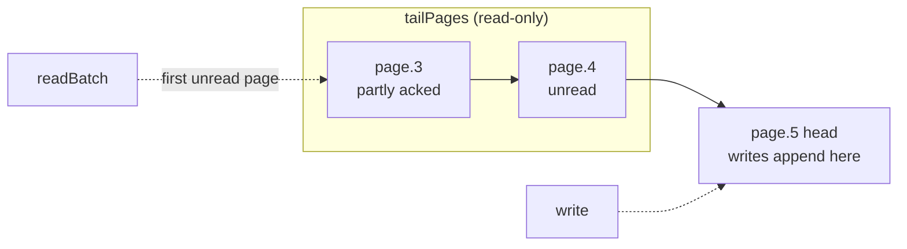

## Overview

With `queue.type: persisted`, a pipeline's queue lives on disk under `path.queue/<pipeline.id>`. Inputs write each event to an append-only, memory-mapped page file before `push` returns; workers read batches and acknowledge them when the batch is done; acknowledged pages are deleted. If Logstash stops or crashes, unacknowledged events are read again at the next start. The queue also gives each pipeline a disk-sized buffer that absorbs bursts and only pushes back on inputs when it is full. The Java class `org.logstash.ackedqueue.Queue` does the work; JRuby wrappers connect it to the pipeline's read and write clients described on [[Queue Selection and the Memory Queue]].

Sources: [logstash-core/src/main/java/org/logstash/ackedqueue/Queue.java:53-131](repo://logstash-core/src/main/java/org/logstash/ackedqueue/Queue.java#L53-L131), [logstash-core/src/main/java/org/logstash/ackedqueue/QueueFactoryExt.java:71-94](repo://logstash-core/src/main/java/org/logstash/ackedqueue/QueueFactoryExt.java#L71-L94)

## On-disk layout

A queue directory holds page files, checkpoint files and a lock file.

Sources: [logstash-core/src/main/java/org/logstash/ackedqueue/io/MmapPageIOV2.java:78-82](repo://logstash-core/src/main/java/org/logstash/ackedqueue/io/MmapPageIOV2.java#L78-L82), [logstash-core/src/main/java/org/logstash/ackedqueue/io/FileCheckpointIO.java:71-72](repo://logstash-core/src/main/java/org/logstash/ackedqueue/io/FileCheckpointIO.java#L71-L72), [logstash-core/src/main/java/org/logstash/ackedqueue/Queue.java:92-94](repo://logstash-core/src/main/java/org/logstash/ackedqueue/Queue.java#L92-L94)

| File | Content |
| --- | --- |
| `page.N` | Data file of page N, preallocated to `queue.page_capacity` and memory-mapped |
| `checkpoint.head` | Checkpoint of the current head page (the one being written), plus the queue-wide first unacked page number |
| `checkpoint.N` | Checkpoint of tail page N (full, read-only) |
| `.lock` | Lock file giving one process exclusive access |

Sources: [logstash-core/src/main/java/org/logstash/ackedqueue/io/MmapPageIOV2.java:78-82](repo://logstash-core/src/main/java/org/logstash/ackedqueue/io/MmapPageIOV2.java#L78-L82), [logstash-core/src/main/java/org/logstash/ackedqueue/io/FileCheckpointIO.java:71-72](repo://logstash-core/src/main/java/org/logstash/ackedqueue/io/FileCheckpointIO.java#L71-L72), [logstash-core/src/main/java/org/logstash/ackedqueue/Queue.java:92-94](repo://logstash-core/src/main/java/org/logstash/ackedqueue/Queue.java#L92-L94)

A page file starts with a one-byte version (2). Each element follows as an 8-byte sequence number, a 4-byte length, the serialized event, and a 4-byte CRC32 of the payload. Events are serialized as CBOR with their metadata ([[Event Model]]). Sequence numbers increase by one across the whole queue, so any element is located by its number.

Sources: [logstash-core/src/main/java/org/logstash/ackedqueue/io/MmapPageIOV2.java:42-48](repo://logstash-core/src/main/java/org/logstash/ackedqueue/io/MmapPageIOV2.java#L42-L48), [logstash-core/src/main/java/org/logstash/ackedqueue/io/MmapPageIOV2.java:313-367](repo://logstash-core/src/main/java/org/logstash/ackedqueue/io/MmapPageIOV2.java#L313-L367), [logstash-core/src/main/java/org/logstash/Event.java:539-545](repo://logstash-core/src/main/java/org/logstash/Event.java#L539-L545)

A checkpoint is a small fixed-size file: version, page number, first unacked page number, first unacked sequence number, minimum sequence number, element count, and a CRC32. `FileCheckpointIO.write` writes it to a `.tmp` file, fsyncs it, and renames it atomically over the old one, so a crash never leaves a half-written checkpoint. With `queue.checkpoint.retry` (default true) a failed rename is retried with exponential backoff, which works around transient errors on Windows.

Sources: [logstash-core/src/main/java/org/logstash/ackedqueue/io/FileCheckpointIO.java:41-128](repo://logstash-core/src/main/java/org/logstash/ackedqueue/io/FileCheckpointIO.java#L41-L128), [logstash-core/src/main/java/org/logstash/ackedqueue/Checkpoint.java:23-71](repo://logstash-core/src/main/java/org/logstash/ackedqueue/Checkpoint.java#L23-L71)

## Head and tail pages

Sources: [logstash-core/src/main/java/org/logstash/ackedqueue/Queue.java:55-66](repo://logstash-core/src/main/java/org/logstash/ackedqueue/Queue.java#L55-L66), [logstash-core/src/main/java/org/logstash/ackedqueue/Queue.java:825-836](repo://logstash-core/src/main/java/org/logstash/ackedqueue/Queue.java#L825-L836)

The queue writes to one head page. When the next element does not fit, the head page is beheaded: checkpointed (with fsync), marked read-only, given its own `checkpoint.N`, and moved to `tailPages`; a new head page `N+1` is created. A head page that is already fully acknowledged is deleted instead. `tailPages` lists every page not yet fully acknowledged, and `unreadTailPages` the subset still to be read. Only the first tail page keeps its memory mapping active.

Sources: [logstash-core/src/main/java/org/logstash/ackedqueue/Queue.java:441-460](repo://logstash-core/src/main/java/org/logstash/ackedqueue/Queue.java#L441-L460), [logstash-core/src/main/java/org/logstash/ackedqueue/Queue.java:502-517](repo://logstash-core/src/main/java/org/logstash/ackedqueue/Queue.java#L502-L517), [logstash-core/src/main/java/org/logstash/ackedqueue/Page.java:234-245](repo://logstash-core/src/main/java/org/logstash/ackedqueue/Page.java#L234-L245)

## Writing

`write(element)` serializes the event outside the lock, then takes the queue's `ReentrantLock` and runs five steps.

Sources: [logstash-core/src/main/java/org/logstash/ackedqueue/Queue.java:410-494](repo://logstash-core/src/main/java/org/logstash/ackedqueue/Queue.java#L410-L494)

1. Refuse if the queue is closed, or if the element is larger than a whole page ("data to be written is bigger than page capacity").
2. Behead and start a new page if the head page lacks space; force-signal waiting readers because a batch never spans pages.
3. Assign the next sequence number, append to the head page, and increment the unread count.
4. Wake a waiting reader when enough data is available.
5. While the queue is full, wait on `notFull`.

Sources: [logstash-core/src/main/java/org/logstash/ackedqueue/Queue.java:410-494](repo://logstash-core/src/main/java/org/logstash/ackedqueue/Queue.java#L410-L494)

The element is written before waiting, never held in memory while blocked: if the process dies while an input waits on a full queue, that event is already on disk. Closing the queue signals `notFull`, so blocked writers return.

Sources: [logstash-core/src/main/java/org/logstash/ackedqueue/Queue.java:419-424](repo://logstash-core/src/main/java/org/logstash/ackedqueue/Queue.java#L419-L424), [logstash-core/src/main/java/org/logstash/ackedqueue/Queue.java:777-808](repo://logstash-core/src/main/java/org/logstash/ackedqueue/Queue.java#L777-L808)

## Capacity and back-pressure

The queue is full when either of two limits is reached; the page size bounds both.

Sources: [logstash-core/src/main/java/org/logstash/ackedqueue/Queue.java:530-549](repo://logstash-core/src/main/java/org/logstash/ackedqueue/Queue.java#L530-L549), [logstash-core/src/main/java/org/logstash/ackedqueue/Queue.java:145-159](repo://logstash-core/src/main/java/org/logstash/ackedqueue/Queue.java#L145-L159), [logstash-core/lib/logstash/environment.rb:85-93](repo://logstash-core/lib/logstash/environment.rb#L85-L93)

| Setting | Default | Limit |
| --- | --- | --- |
| `queue.max_bytes` | `1024mb` | Total bytes written in head and tail pages exceeds it (0 disables) |
| `queue.max_events` | `0` (unlimited) | Unread events reach it |
| `queue.page_capacity` | `64mb` | Size of each page file; must not exceed `max_bytes` |

Sources: [logstash-core/src/main/java/org/logstash/ackedqueue/Queue.java:530-549](repo://logstash-core/src/main/java/org/logstash/ackedqueue/Queue.java#L530-L549), [logstash-core/src/main/java/org/logstash/ackedqueue/Queue.java:145-159](repo://logstash-core/src/main/java/org/logstash/ackedqueue/Queue.java#L145-L159), [logstash-core/lib/logstash/environment.rb:85-93](repo://logstash-core/lib/logstash/environment.rb#L85-L93)

Bytes are freed only when whole pages are acknowledged and deleted, so a queue at `max_bytes` stays full until workers finish a page. On open, `ensureDiskAvailable` checks that the file system has room for the queue to grow to `max_bytes` and fails with "Unable to allocate ... more bytes for persisted queue" otherwise. The agent's `PersistedQueueConfigValidator` checks `page_capacity <= max_bytes` and free space for all persisted pipelines before converging ([[Agent and Pipeline Convergence]]).

Sources: [logstash-core/src/main/java/org/logstash/ackedqueue/Queue.java:904-910](repo://logstash-core/src/main/java/org/logstash/ackedqueue/Queue.java#L904-L910), [logstash-core/lib/logstash/persisted_queue_config_validator.rb:32-88](repo://logstash-core/lib/logstash/persisted_queue_config_validator.rb#L32-L88)

## Reading

`readBatch(limit, timeout)` takes the first unread page (the oldest unread tail page, or the head page). On a head page with nothing left to read, it waits up to `timeout` for writers to provide data. It reads up to `limit` elements from that single page, decrements the unread count, and signals blocked writers if the unread limit had been reached. A tail page read to the end is removed from `unreadTailPages`. Reading happens under the lock; deserialization into events happens afterwards, outside it.

Sources: [logstash-core/src/main/java/org/logstash/ackedqueue/Queue.java:603-702](repo://logstash-core/src/main/java/org/logstash/ackedqueue/Queue.java#L603-L702)

A batch carries the first sequence number and its element count. Because batches never span pages, the elements of one batch are one contiguous range of sequence numbers.

Sources: [logstash-core/src/main/java/org/logstash/ackedqueue/Batch.java:30-66](repo://logstash-core/src/main/java/org/logstash/ackedqueue/Batch.java#L30-L66)

## Acknowledging

Closing a `Batch` calls `queue.ack(firstSeqNum, count)`; closing twice raises "double closing batch". In the pipeline this happens when the worker loop calls `closeBatch` after the outputs returned ([[Worker Loop and Batches]]). `ack` finds the page holding the first sequence number (the head page, or a binary search over tail pages) and flips the bits for the range in the page's `ackedSeqNums` bit set.

Sources: [logstash-core/src/main/java/org/logstash/ackedqueue/Batch.java:55-66](repo://logstash-core/src/main/java/org/logstash/ackedqueue/Batch.java#L55-L66), [logstash-core/src/main/java/org/logstash/ackedqueue/Queue.java:704-756](repo://logstash-core/src/main/java/org/logstash/ackedqueue/Queue.java#L704-L756)

When a tail page becomes fully acknowledged, its data file and checkpoint are deleted, the page leaves `tailPages`, blocked writers are signalled, and the head checkpoint is rewritten with the new first unacked page. Pages can be acknowledged out of order (workers finish batches in any order); a fully acked page in the middle is deleted, while checkpoints between the first unacked page and the head are kept so the sequence of checkpoints stays contiguous.

Sources: [logstash-core/src/main/java/org/logstash/ackedqueue/Page.java:147-180](repo://logstash-core/src/main/java/org/logstash/ackedqueue/Page.java#L147-L180), [logstash-core/src/main/java/org/logstash/ackedqueue/Queue.java:355-371](repo://logstash-core/src/main/java/org/logstash/ackedqueue/Queue.java#L355-L371)

## Durability: checkpoints and fsync

| Setting | Default | Effect |
| --- | --- | --- |
| `queue.checkpoint.writes` | `1024` | After this many writes to the head page, fsync the page and write `checkpoint.head` |
| `queue.checkpoint.acks` | `1024` | After this many acks on a page, write its checkpoint |
| `queue.checkpoint.retry` | `true` | Retry atomic checkpoint renames |

Sources: [logstash-core/src/main/java/org/logstash/ackedqueue/Page.java:87-104](repo://logstash-core/src/main/java/org/logstash/ackedqueue/Page.java#L87-L104), [logstash-core/src/main/java/org/logstash/ackedqueue/Page.java:175-178](repo://logstash-core/src/main/java/org/logstash/ackedqueue/Page.java#L175-L178), [logstash-core/lib/logstash/environment.rb:90-93](repo://logstash-core/lib/logstash/environment.rb#L90-L93)

A head-page checkpoint fsyncs the data file only when elements were written since the last checkpoint; tail pages are read-only, so their checkpoints never fsync data. Setting `queue.checkpoint.writes: 1` fsyncs after every event, trading throughput for the guarantee that a written event survives a power loss; with the default, up to 1024 events written since the last checkpoint rely on the operating system having flushed the memory-mapped page. `queue.checkpoint.interval` is still accepted but has no effect, and the runner logs a deprecation when it is set.

Sources: [logstash-core/src/main/java/org/logstash/ackedqueue/Page.java:182-232](repo://logstash-core/src/main/java/org/logstash/ackedqueue/Page.java#L182-L232), [logstash-core/lib/logstash/runner.rb:280-281](repo://logstash-core/lib/logstash/runner.rb#L280-L281)

## Opening and recovery

`open` takes the directory lock (a second process gets "The queue failed to obtain exclusive access"), upgrades a V1 directory to the V2 format if needed ([[Persistent Queue Maintenance Tools]]), then rebuilds its state from the checkpoints in five steps.

Sources: [logstash-core/src/main/java/org/logstash/ackedqueue/Queue.java:173-260](repo://logstash-core/src/main/java/org/logstash/ackedqueue/Queue.java#L173-L260), [logstash-core/src/main/java/org/logstash/ackedqueue/Queue.java:260-316](repo://logstash-core/src/main/java/org/logstash/ackedqueue/Queue.java#L260-L316), [logstash-core/src/main/java/org/logstash/ackedqueue/Queue.java:318-346](repo://logstash-core/src/main/java/org/logstash/ackedqueue/Queue.java#L318-L346)

1. No `checkpoint.head`: a new queue. Check disk space, create `page.0`, checkpoint it.
2. For each page from the head checkpoint's first unacked page up to the head, read `checkpoint.N`: delete the page if fully acked, otherwise open it as a tail page. Track the highest sequence number seen.
3. If the head checkpoint says fully acked but the head page file is a zero-byte (corrupted) file, delete both and start a new head page.
4. Open the head page with `recover()`, which scans elements and verifies checksums. If the recovered count differs from the checkpoint, trust the data file and log "recovered head data page ... is different than checkpoint".
5. A non-empty recovered head page becomes a tail page and a fresh head page is created, so new writes never append after possibly damaged data.

Sources: [logstash-core/src/main/java/org/logstash/ackedqueue/Queue.java:173-260](repo://logstash-core/src/main/java/org/logstash/ackedqueue/Queue.java#L173-L260), [logstash-core/src/main/java/org/logstash/ackedqueue/Queue.java:260-316](repo://logstash-core/src/main/java/org/logstash/ackedqueue/Queue.java#L260-L316), [logstash-core/src/main/java/org/logstash/ackedqueue/Queue.java:318-346](repo://logstash-core/src/main/java/org/logstash/ackedqueue/Queue.java#L318-L346)

After recovery, everything between the first unacked sequence number and the end is read again. Delivery is therefore at-least-once: events that were sent by an output but whose batch was not acknowledged before a crash are sent a second time.

Sources: [logstash-core/src/main/java/org/logstash/ackedqueue/Queue.java:230-255](repo://logstash-core/src/main/java/org/logstash/ackedqueue/Queue.java#L230-L255), [logstash-core/src/main/java/org/logstash/ackedqueue/Batch.java:55-66](repo://logstash-core/src/main/java/org/logstash/ackedqueue/Batch.java#L55-L66)

## JRuby wrappers

`JRubyWrappedAckedQueueExt` is created by the queue factory with the seven settings, creates a `JRubyAckedQueueExt` around the Java `Queue` and opens it. It hands out a `JrubyAckedWriteClientExt`, whose push writes the event to the queue, and a `JrubyAckedReadClientExt`, whose `readBatch` returns an `AckedReadBatch` and whose batches acknowledge on close. `JRubyAckedQueueExt` also exposes `acked_count`, `unacked_count`, `unread_count`, `persisted_size_in_bytes`, `max_size_in_bytes` and `page_capacity`, which the queue stats and the [[Health Report]] read.

Sources: [logstash-core/src/main/java/org/logstash/ackedqueue/ext/JRubyWrappedAckedQueueExt.java:50-111](repo://logstash-core/src/main/java/org/logstash/ackedqueue/ext/JRubyWrappedAckedQueueExt.java#L50-L111), [logstash-core/src/main/java/org/logstash/ackedqueue/ext/JRubyAckedQueueExt.java:86-174](repo://logstash-core/src/main/java/org/logstash/ackedqueue/ext/JRubyAckedQueueExt.java#L86-L174), [logstash-core/src/main/java/org/logstash/ackedqueue/AckedReadBatch.java:38-97](repo://logstash-core/src/main/java/org/logstash/ackedqueue/AckedReadBatch.java#L38-L97)
