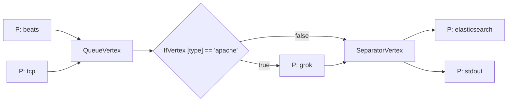

## Overview

The parser described in [[Configuration Language Parser]] produces imperative statements: sequences, parallel groups, plugins and ifs. Logstash does not execute those directly. It converts each section into a directed acyclic graph of vertices (plugins, conditionals, a queue and a separator) and edges (plain or true/false), and wraps the full graph in a `PipelineIR`. The graph is the single description of a pipeline: [[Compiled Pipeline Execution]] walks it to generate code, the API serializes it for Kibana's pipeline viewer, and its hash identifies the pipeline in metrics.

Sources: [logstash-core/src/main/java/org/logstash/config/ir/ConfigCompiler.java:56-77](repo://logstash-core/src/main/java/org/logstash/config/ir/ConfigCompiler.java#L56-L77), [logstash-core/src/main/java/org/logstash/config/ir/PipelineIR.java:30-82](repo://logstash-core/src/main/java/org/logstash/config/ir/PipelineIR.java#L30-L82)

## From parts to one PipelineIR

`ConfigCompiler.compileSources` parses every config part, converts each part's three statements to graphs with `Statement.toGraph(cve)`, and groups the graphs by section. Input graphs from all parts are combined side by side with `Graph.combine`; output graphs likewise. Filter graphs are chained in part order with `Graph.chain`, so filters from `10-a.conf` run before those in `20-b.conf`. The joined source text is kept for hashing.

Sources: [logstash-core/src/main/java/org/logstash/config/ir/ConfigCompiler.java:62-85](repo://logstash-core/src/main/java/org/logstash/config/ir/ConfigCompiler.java#L62-L85), [logstash-core/src/main/java/org/logstash/config/ir/ConfigCompiler.java:112-124](repo://logstash-core/src/main/java/org/logstash/config/ir/ConfigCompiler.java#L112-L124)

The `PipelineIR` constructor then builds the whole graph.

Sources: [logstash-core/src/main/java/org/logstash/config/ir/PipelineIR.java:54-82](repo://logstash-core/src/main/java/org/logstash/config/ir/PipelineIR.java#L54-L82)

1. Copy the input section; its vertices are the roots.
2. Chain a new `QueueVertex` after every input leaf.
3. Chain the filter section after the queue.
4. Chain a `SeparatorVertex("filter_to_output")` after the filter leaves.
5. Chain the output section after the separator.
6. Validate the graph and compute its hash.

Sources: [logstash-core/src/main/java/org/logstash/config/ir/PipelineIR.java:54-82](repo://logstash-core/src/main/java/org/logstash/config/ir/PipelineIR.java#L54-L82)

Sources: [logstash-core/src/main/java/org/logstash/config/ir/PipelineIR.java:54-75](repo://logstash-core/src/main/java/org/logstash/config/ir/PipelineIR.java#L54-L75), [logstash-core/src/main/java/org/logstash/config/ir/imperative/IfStatement.java:102-131](repo://logstash-core/src/main/java/org/logstash/config/ir/imperative/IfStatement.java#L102-L131)

`PipelineIR` offers views used by the runtime: `getInputPluginVertices`, `getFilterPluginVertices`, `getOutputPluginVertices` (by `PluginDefinition.Type`), `getPostQueue` (vertices after the queue in topological order) and `getQueue`.

Sources: [logstash-core/src/main/java/org/logstash/config/ir/PipelineIR.java:84-147](repo://logstash-core/src/main/java/org/logstash/config/ir/PipelineIR.java#L84-L147)

## Statements become graphs

| Statement | `toGraph` result |
| --- | --- |
| `PluginStatement` | A graph with one `PluginVertex` |
| `ComposedSequenceStatement` | Each child's graph chained after the previous one |
| `ComposedParallelStatement` | Children's graphs combined without edges between them |
| `IfStatement` | An `IfVertex` with `true` edges to the true branch's roots and `false` edges to the false branch's roots; an empty graph if both branches are empty |
| `NoopStatement` | An empty graph |

Sources: [logstash-core/src/main/java/org/logstash/config/ir/imperative/PluginStatement.java:56-62](repo://logstash-core/src/main/java/org/logstash/config/ir/imperative/PluginStatement.java#L56-L62), [logstash-core/src/main/java/org/logstash/config/ir/imperative/ComposedSequenceStatement.java:41-50](repo://logstash-core/src/main/java/org/logstash/config/ir/imperative/ComposedSequenceStatement.java#L41-L50), [logstash-core/src/main/java/org/logstash/config/ir/imperative/ComposedParallelStatement.java:41-49](repo://logstash-core/src/main/java/org/logstash/config/ir/imperative/ComposedParallelStatement.java#L41-L49), [logstash-core/src/main/java/org/logstash/config/ir/imperative/IfStatement.java:102-131](repo://logstash-core/src/main/java/org/logstash/config/ir/imperative/IfStatement.java#L102-L131)

When an `IfStatement` becomes an `IfVertex`, its boolean expression passes through `ExpressionSubstitution`, which resolves `${VAR}` values inside it while keeping keystore values masked, as described on [[Secret Store and Variable Substitution]].

Sources: [logstash-core/src/main/java/org/logstash/config/ir/imperative/IfStatement.java:118-120](repo://logstash-core/src/main/java/org/logstash/config/ir/imperative/IfStatement.java#L118-L120), [logstash-core/src/main/java/org/logstash/config/ir/expression/ExpressionSubstitution.java:15-40](repo://logstash-core/src/main/java/org/logstash/config/ir/expression/ExpressionSubstitution.java#L15-L40)

## Graph, vertices and edges

### Graph

`Graph` keeps vertices and edges in insertion-ordered sets plus lookup maps of incoming and outgoing edges per vertex. A vertex belongs to one graph only; `importVertex` copies a vertex owned by another graph. `addEdge` refuses edges whose ends are not in the graph. After each change `refresh` recomputes ranks (breadth-first distance from the roots) and a topological sort, and a cycle raises `InvalidIRException("Graph is not a dag!")`.

Sources: [logstash-core/src/main/java/org/logstash/config/ir/graph/Graph.java:37-125](repo://logstash-core/src/main/java/org/logstash/config/ir/graph/Graph.java#L37-L125), [logstash-core/src/main/java/org/logstash/config/ir/graph/Graph.java:264-287](repo://logstash-core/src/main/java/org/logstash/config/ir/graph/Graph.java#L264-L287)

`Graph.combine` copies every vertex and edge of several graphs into a new one and returns the old-to-new maps. `chain(other)` combines both graphs and connects every partial leaf of the first to every root of the second. A partial leaf is a vertex with an unused outgoing edge type, so chaining after an `if` whose `else` is empty attaches the next statement to the `if`'s free `false` edge.

Sources: [logstash-core/src/main/java/org/logstash/config/ir/graph/Graph.java:128-197](repo://logstash-core/src/main/java/org/logstash/config/ir/graph/Graph.java#L128-L197), [logstash-core/src/main/java/org/logstash/config/ir/graph/Graph.java:315-340](repo://logstash-core/src/main/java/org/logstash/config/ir/graph/Graph.java#L315-L340)

`validate` rejects a non-empty graph with no leaf and any two vertices sharing an id, reporting "Config has duplicate Ids". This is where two plugins configured with the same `id` are caught.

Sources: [logstash-core/src/main/java/org/logstash/config/ir/graph/Graph.java:289-312](repo://logstash-core/src/main/java/org/logstash/config/ir/graph/Graph.java#L289-L312)

### Vertex types

| Vertex | Holds | Outgoing edges |
| --- | --- | --- |
| `PluginVertex` | A `PluginDefinition` (type, name, arguments) | One plain edge |
| `IfVertex` | A `BooleanExpression` | At most one `true` and one `false` `BooleanEdge` |
| `QueueVertex` | Nothing; source `internal:queue` | Plain |
| `SeparatorVertex` | Its id; source `internal` | Plain |

Sources: [logstash-core/src/main/java/org/logstash/config/ir/graph/PluginVertex.java:27-48](repo://logstash-core/src/main/java/org/logstash/config/ir/graph/PluginVertex.java#L27-L48), [logstash-core/src/main/java/org/logstash/config/ir/graph/IfVertex.java:61-78](repo://logstash-core/src/main/java/org/logstash/config/ir/graph/IfVertex.java#L61-L78), [logstash-core/src/main/java/org/logstash/config/ir/graph/QueueVertex.java:28-31](repo://logstash-core/src/main/java/org/logstash/config/ir/graph/QueueVertex.java#L28-L31), [logstash-core/src/main/java/org/logstash/config/ir/graph/SeparatorVertex.java:28-31](repo://logstash-core/src/main/java/org/logstash/config/ir/graph/SeparatorVertex.java#L28-L31)

A `PluginDefinition` has a `Type` of `INPUT`, `FILTER`, `OUTPUT` or `CODEC`, a name and an argument map; its `hashSource` is the class, type, name and JSON-serialized arguments.

Sources: [logstash-core/src/main/java/org/logstash/config/ir/PluginDefinition.java:31-78](repo://logstash-core/src/main/java/org/logstash/config/ir/PluginDefinition.java#L31-L78)

### Vertex ids

A `PluginVertex` takes its explicit id from the plugin's `id` argument. Without one, `getId` computes a digest of the whole graph's hash and the vertex's source metadata, and caches it. Since the source metadata includes file, line, column and text, an unchanged config yields the same generated ids across restarts, which keeps per-plugin metrics stable; editing the file changes them.

Sources: [logstash-core/src/main/java/org/logstash/config/ir/graph/PluginVertex.java:35-39](repo://logstash-core/src/main/java/org/logstash/config/ir/graph/PluginVertex.java#L35-L39), [logstash-core/src/main/java/org/logstash/config/ir/graph/Vertex.java:210-233](repo://logstash-core/src/main/java/org/logstash/config/ir/graph/Vertex.java#L210-L233)

## Expressions

Conditions are trees of `Expression` objects. `EventValueExpression` reads a field by reference, `ValueExpression` holds a constant, and `RegexValueExpression` a pattern. Binary boolean nodes are `And`, `Or`, `Eq`, `Neq`, `Gt`, `Gte`, `Lt`, `Lte`, `In` and `RegexEq`; unary nodes are `Not` and `Truthy`. A `ValueExpression` accepts only null, numbers, strings, lists, Ruby hashes, `Instant` and `SecretVariable`, raising `InvalidIRException` for anything else.

Sources: [logstash-core/src/main/java/org/logstash/config/ir/expression/ValueExpression.java:36-62](repo://logstash-core/src/main/java/org/logstash/config/ir/expression/ValueExpression.java#L36-L62), [logstash-core/src/main/java/org/logstash/config/ir/DSL.java:64-104](repo://logstash-core/src/main/java/org/logstash/config/ir/DSL.java#L64-L104), [logstash-core/src/main/java/org/logstash/config/ir/DSL.java:106-216](repo://logstash-core/src/main/java/org/logstash/config/ir/DSL.java#L106-L216)

## Hashing

A `PipelineIR` hash is the digest of the original source text when there is one, otherwise `Graph.uniqueHash`: the sorted hashes of every vertex's source metadata, skipping queue and separator vertices. The agent records it as the `hash` gauge of the pipeline's config metrics, and the serializer puts it at the top of the graph document.

Sources: [logstash-core/src/main/java/org/logstash/config/ir/PipelineIR.java:77-81](repo://logstash-core/src/main/java/org/logstash/config/ir/PipelineIR.java#L77-L81), [logstash-core/src/main/java/org/logstash/config/ir/graph/Graph.java:433-440](repo://logstash-core/src/main/java/org/logstash/config/ir/graph/Graph.java#L433-L440), [logstash-core/lib/logstash/java_pipeline.rb:282-283](repo://logstash-core/lib/logstash/java_pipeline.rb#L282-L283)

`Graph.sourceComponentEquals` uses `GraphDiff` to compare two graphs structurally. The `algorithms` package also has `BreadthFirst` (ranks), `DepthFirst` and `TopologicalSort`.

Sources: [logstash-core/src/main/java/org/logstash/config/ir/graph/Graph.java:396-406](repo://logstash-core/src/main/java/org/logstash/config/ir/graph/Graph.java#L396-L406), [logstash-core/src/main/java/org/logstash/config/ir/graph/algorithms/TopologicalSort.java:29-45](repo://logstash-core/src/main/java/org/logstash/config/ir/graph/algorithms/TopologicalSort.java#L29-L45)

## Serialized form

`LogStash::Config::LIRSerializer.serialize(lir)` turns the graph into a hash with `hash`, `type: "lir"`, `version` and `graph: { vertices, edges }`. Each vertex has `id`, `explicit_id`, `type` (`plugin`, `if` or `queue`), source `meta`, and for plugins `config_name` and `plugin_type`, for ifs a human-readable `condition`. Separator vertices are dropped and their edges rewired from each incoming vertex to each outgoing one, keeping a boolean edge's `when`. The pipeline stores this document as its `graph` gauge at start, and the node API and x-pack monitoring report it.

Sources: [logstash-core/lib/logstash/config/lir_serializer.rb:23-115](repo://logstash-core/lib/logstash/config/lir_serializer.rb#L23-L115), [logstash-core/lib/logstash/config/lir_serializer.rb:117-154](repo://logstash-core/lib/logstash/config/lir_serializer.rb#L117-L154), [logstash-core/lib/logstash/java_pipeline.rb:273-283](repo://logstash-core/lib/logstash/java_pipeline.rb#L273-L283)
