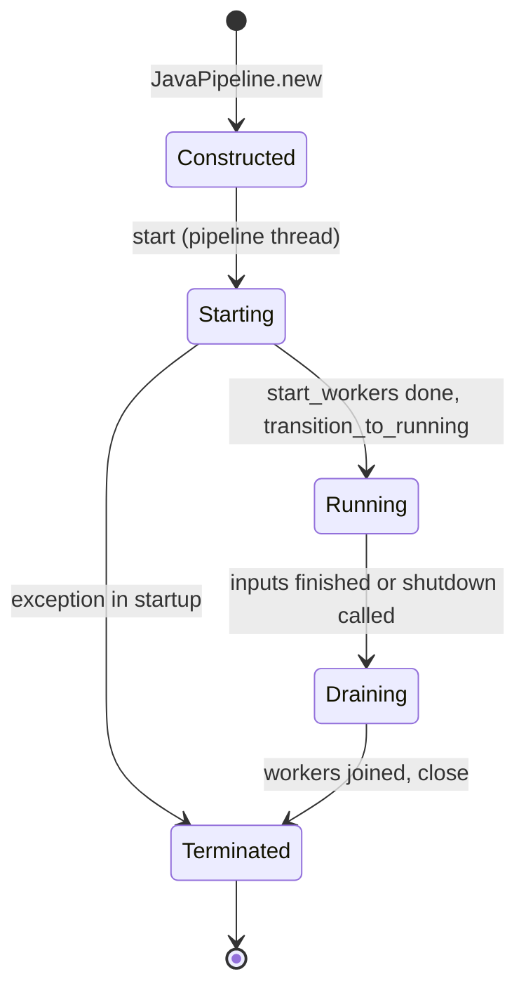

## Overview

A pipeline is one `LogStash::JavaPipeline` object: its own queue, plugins, worker threads and input threads, all running in the shared JVM. It is created by a `Create` or `Reload` action from [[Agent and Pipeline Convergence]], runs until its inputs finish or someone calls `shutdown`, and then closes its plugins and queue. The Ruby class inherits from the Java `AbstractPipelineExt`, which owns construction (config compilation, queue, dead letter queue writer, metrics); the Ruby side owns threads and ordering. This page follows one pipeline from `new` to `close`. What each worker does per batch is on [[Worker Loop and Batches]].

Sources: [logstash-core/lib/logstash/java_pipeline.rb:29-91](repo://logstash-core/lib/logstash/java_pipeline.rb#L29-L91), [logstash-core/src/main/java/org/logstash/execution/AbstractPipelineExt.java:220-290](repo://logstash-core/src/main/java/org/logstash/execution/AbstractPipelineExt.java#L220-L290)

## Construction

`JavaPipeline.new(pipeline_config, metric, agent)` calls the Java `initialize`, which does the work in this order.

Sources: [logstash-core/src/main/java/org/logstash/execution/AbstractPipelineExt.java:220-290](repo://logstash-core/src/main/java/org/logstash/execution/AbstractPipelineExt.java#L220-L290)

1. Create a `PipelineReporterExt` for this pipeline ([[Shutdown Watcher and Pipeline Reporter]]).
2. Read the config string, the config parts and the settings from the `PipelineConfig`; take `pipeline.id` from the settings.
3. Choose the metric: the agent's namespaced metric, or a `NullMetric` when `metric.collect` is false.
4. Compile the parts into a `PipelineIR` with `ConfigCompiler.configToPipelineIR`, using `config.support_escapes` and a `ConfigVariableExpander` ([[Pipeline Intermediate Representation]]).
5. Build a `CompiledPipeline` with a `PluginFactoryExt`, a metrics factory, an execution context factory (which receives the agent and the DLQ writer), the secret store, and a `LogErrorEvaluationListener` ([[Compiled Pipeline Execution]]).
6. Expose the plugin instances as `inputs`, `filters` and `outputs`; with `config.debug` and debug logging, log the graph.

Sources: [logstash-core/src/main/java/org/logstash/execution/AbstractPipelineExt.java:220-290](repo://logstash-core/src/main/java/org/logstash/execution/AbstractPipelineExt.java#L220-L290)

The queue is opened separately. `AbstractPipeline.new` alone is used to validate a config for `-t` and for reloads, and must not touch the queue, so only `JavaPipeline#finish_initialization` calls `open_queue`. That creates the queue through `QueueFactoryExt` ([[Queue Selection and the Memory Queue]]), keeps a write client for inputs and a read client for workers, and attaches event metrics to the read client.

Sources: [logstash-core/src/main/java/org/logstash/execution/AbstractPipelineExt.java:292-328](repo://logstash-core/src/main/java/org/logstash/execution/AbstractPipelineExt.java#L292-L328), [logstash-core/lib/logstash/java_pipeline.rb:54-91](repo://logstash-core/lib/logstash/java_pipeline.rb#L54-L91)

`finish_initialization` also creates the `WorkerObserver`, the `events_filtered` and `events_consumed` counters, and the atomic flags the threads share: `ready`, `running`, `flushing`, `flushRequested`, `shutdownRequested`, `crash_detected`, `outputs_registered`, `finished_execution` and `finished_run`. It decides `@drain_queue`, true when `queue.drain` is set or the queue type is `memory`.

Sources: [logstash-core/lib/logstash/java_pipeline.rb:54-91](repo://logstash-core/lib/logstash/java_pipeline.rb#L54-L91)

The dead letter queue writer is created lazily by `dlq_writer`: a real `DeadLetterQueueWriter` from `DeadLetterQueueFactory` when `dead_letter_queue.enable` is true, using `path.dead_letter_queue`, `max_bytes`, `flush_interval`, `storage_policy` and an optional `retain.age` such as `3d`; a dummy writer otherwise ([[Dead Letter Queue]]).

Sources: [logstash-core/src/main/java/org/logstash/execution/AbstractPipelineExt.java:384-449](repo://logstash-core/src/main/java/org/logstash/execution/AbstractPipelineExt.java#L384-L449)

## States

Sources: [logstash-core/lib/logstash/java_pipeline.rb:133-245](repo://logstash-core/lib/logstash/java_pipeline.rb#L133-L245)

`finished_run` is set only when `run` returns without raising; `finished_execution` is always set when the pipeline thread ends. The registry uses the first to tell a pipeline that finished normally from one that crashed, and the second to know it is terminated ([[Agent and Pipeline Convergence]]).

Sources: [logstash-core/lib/logstash/java_pipeline.rb:77-84](repo://logstash-core/lib/logstash/java_pipeline.rb#L77-L84), [logstash-core/lib/logstash/pipelines_registry.rb:31-58](repo://logstash-core/lib/logstash/pipelines_registry.rb#L31-L58)

## Starting

### The pipeline thread

`start` resets the pipeline's stats, DLQ stats and flow metrics, then starts the pipeline thread named `pipeline.<id>`, which calls `run`, then `close` in an `ensure` block, and logs "Pipeline terminated". The calling thread (the converge action) blocks in `wait_until_started`, polling every 10 ms until the pipeline is running, has finished its run, or its thread has died; it returns false only in the last case.

Sources: [logstash-core/lib/logstash/java_pipeline.rb:133-198](repo://logstash-core/lib/logstash/java_pipeline.rb#L133-L198)

`run` calls `start_workers`, marks the pipeline running, starts the `PeriodicFlush` thread, and then blocks in `monitor_inputs_and_workers`. When that returns, it marks the pipeline stopped, stops the flusher, shuts the workers down and closes.

Sources: [logstash-core/lib/logstash/java_pipeline.rb:200-225](repo://logstash-core/lib/logstash/java_pipeline.rb#L200-L225), [logstash-core/lib/logstash/java_pipeline.rb:503-512](repo://logstash-core/lib/logstash/java_pipeline.rb#L503-L512)

### start_workers

`start_workers` sets things up in a fixed order so that nothing writes to the queue before something reads it.

Sources: [logstash-core/lib/logstash/java_pipeline.rb:247-345](repo://logstash-core/lib/logstash/java_pipeline.rb#L247-L345), [logstash-core/lib/logstash/java_pipeline.rb:617-622](repo://logstash-core/lib/logstash/java_pipeline.rb#L617-L622)

1. Register outputs, then filters (`maybe_setup_out_plugins`, once per pipeline). If any `register` raises, plugins already registered are closed.
2. Compute the worker count with `safe_pipeline_worker_count` and whether to preserve order.
3. Record config gauges: workers, batch size and delay, reload settings, DLQ path, ephemeral id, the IR hash and the serialized graph.
4. Set the read client's batch size and delay.
5. Build one `WorkerLoop` per worker in parallel threads; fail if any returned `nil`.
6. Start each `WorkerLoop` in a `WorkerLoopThread` named `[<id>]>worker<N>`. A worker that raises sets `crash_detected` and logs "Pipeline worker error, the pipeline will be stopped".
7. Start the inputs last. If that fails, mark the crash and shut the workers down.
8. In all cases set `ready`, which `shutdown` waits for.

Sources: [logstash-core/lib/logstash/java_pipeline.rb:247-345](repo://logstash-core/lib/logstash/java_pipeline.rb#L247-L345), [logstash-core/lib/logstash/java_pipeline.rb:617-622](repo://logstash-core/lib/logstash/java_pipeline.rb#L617-L622)

### Worker count and ordering

`safe_pipeline_worker_count` checks every filter's `threadsafe?`. If some are not thread-safe and the user did not set `pipeline.workers`, it uses 1 worker and warns; if the user did set more than 1, it keeps the user's value and warns.

Sources: [logstash-core/lib/logstash/java_pipeline.rb:105-127](repo://logstash-core/lib/logstash/java_pipeline.rb#L105-L127)

`preserve_event_order?` reads `pipeline.ordered`: `auto` preserves order only when the user explicitly set `pipeline.workers` to 1, `true` preserves order and fails the start when there is more than one worker, `false` never preserves order. Ordered pipelines get a `CompiledOrderedExecution`.

Sources: [logstash-core/lib/logstash/java_pipeline.rb:666-679](repo://logstash-core/lib/logstash/java_pipeline.rb#L666-L679)

### Inputs

`start_inputs` clones every threadable input with `threads > 1` so there is one instance per thread, registers all inputs (none start until all have registered), and starts each. A Java input (`JavaInputDelegator`) starts its own thread; a Ruby input runs `inputworker` in a new thread named `[<id>]<plugin>`.

Sources: [logstash-core/lib/logstash/java_pipeline.rb:396-420](repo://logstash-core/lib/logstash/java_pipeline.rb#L396-L420)

`inputworker` calls `plugin.run(queue)`, where the queue is a `JRubyWrappedWriteClientExt` that counts events per input plugin. If `run` raises while the plugin is not stopping, it logs the error, sleeps one second, closes the plugin and retries `run`. An exception during shutdown is ignored. Input failures are thus treated as transient and never stop the pipeline.

Sources: [logstash-core/lib/logstash/java_pipeline.rb:422-449](repo://logstash-core/lib/logstash/java_pipeline.rb#L422-L449), [logstash-core/src/main/java/org/logstash/execution/AbstractPipelineExt.java:791-796](repo://logstash-core/src/main/java/org/logstash/execution/AbstractPipelineExt.java#L791-L796)

## Running and monitoring

`monitor_inputs_and_workers` waits on all input and worker threads with `ThreadsWait`. Input threads ending is normal: the loop waits until none are left. A worker thread ending while inputs remain is a crash.

Sources: [logstash-core/lib/logstash/java_pipeline.rb:355-394](repo://logstash-core/lib/logstash/java_pipeline.rb#L355-L394), [logstash-core/lib/logstash/java_pipeline.rb:681-692](repo://logstash-core/lib/logstash/java_pipeline.rb#L681-L692)

1. Stop the inputs.
2. Wait up to 10 seconds for input threads to end.
3. With a memory queue, inputs may be blocked writing to a queue nobody reads, so for up to 10 more seconds it reads and discards batches, logging "Dropping events to unblock input plugin".
4. Raise "Unable to stop input plugin(s)" if inputs still run.

Sources: [logstash-core/lib/logstash/java_pipeline.rb:355-394](repo://logstash-core/lib/logstash/java_pipeline.rb#L355-L394), [logstash-core/lib/logstash/java_pipeline.rb:681-692](repo://logstash-core/lib/logstash/java_pipeline.rb#L681-L692)

A pipeline whose inputs all finish (a `generator` with a `count`, a `stdin` at end of file) therefore drains and terminates by itself, which is what lets the agent exit when no reload is configured.

Sources: [logstash-core/lib/logstash/java_pipeline.rb:200-225](repo://logstash-core/lib/logstash/java_pipeline.rb#L200-L225), [logstash-core/lib/logstash/agent.rb:152-165](repo://logstash-core/lib/logstash/agent.rb#L152-L165)

## Shutting down

`shutdown` is called from another thread (a `Stop`, `StopAndDelete` or `Reload` action). It returns at once if the pipeline already finished, waits until `ready` so it never races the startup sequence, calls `do_stop` on every input, and then runs a `ShutdownWatcher` that blocks until the pipeline thread is done, reporting stalls along the way ([[Shutdown Watcher and Pipeline Reporter]]). It always clears the pipeline's `plugins`, `events` and `flow` metrics so a reloaded pipeline starts from zero while reload counts and errors survive.

Sources: [logstash-core/lib/logstash/java_pipeline.rb:451-476](repo://logstash-core/lib/logstash/java_pipeline.rb#L451-L476), [logstash-core/lib/logstash/java_pipeline.rb:539-552](repo://logstash-core/lib/logstash/java_pipeline.rb#L539-L552)

Stopping the inputs makes their threads end, `monitor_inputs_and_workers` returns, and the pipeline thread continues in `run`. `shutdown_workers` sets `shutdownRequested`, joins every worker (each drains the queue first when `@drain_queue` is set, then performs a final flush), and closes filters and outputs.

Sources: [logstash-core/lib/logstash/java_pipeline.rb:478-491](repo://logstash-core/lib/logstash/java_pipeline.rb#L478-L491)

`close` (Java) closes the read client, the queue and the DLQ writer, releasing the writer in `DeadLetterQueueFactory` so a reloaded pipeline can open the same directory.

Sources: [logstash-core/src/main/java/org/logstash/execution/AbstractPipelineExt.java:783-789](repo://logstash-core/src/main/java/org/logstash/execution/AbstractPipelineExt.java#L783-L789), [logstash-core/src/main/java/org/logstash/execution/AbstractPipelineExt.java:442-449](repo://logstash-core/src/main/java/org/logstash/execution/AbstractPipelineExt.java#L442-L449)

## Logging context and safety

Every pipeline thread puts `pipeline.id` in the Log4j `ThreadContext` (inputs also put `plugin.id`), which is how [[Logging]] routes messages to per-pipeline files. `inspect` deliberately prints only the id, settings and state flags, because the full object holds the config, which may contain passwords.

Sources: [logstash-core/lib/logstash/java_pipeline.rb:310-325](repo://logstash-core/lib/logstash/java_pipeline.rb#L310-L325), [logstash-core/lib/logstash/java_pipeline.rb:554-565](repo://logstash-core/lib/logstash/java_pipeline.rb#L554-L565)

`LogStash::Pipeline` remains as an alias of `JavaPipeline` for older plugin test helpers in `logstash-devutils`, and `filter` and `flush_filters` exist as empty methods for the same reason.

Sources: [logstash-core/lib/logstash/pipeline.rb:18-23](repo://logstash-core/lib/logstash/pipeline.rb#L18-L23), [logstash-core/lib/logstash/java_pipeline.rb:493-501](repo://logstash-core/lib/logstash/java_pipeline.rb#L493-L501)
