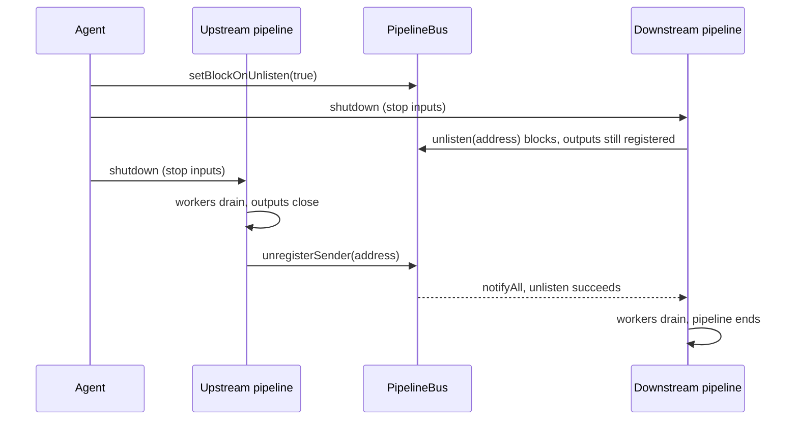

## Overview

Several pipelines in one Logstash process can pass events to each other without a network hop. A `pipeline` output in one pipeline sends to one or more named addresses; a `pipeline` input in another pipeline listens on one address and writes what it receives into its own queue. Between them sits the agent's `PipelineBus`, one per process, which maps addresses to the input listening there and the outputs sending there. This makes distributor, output-isolator and forked-path layouts possible while each pipeline keeps its own queue, workers and settings. The two plugins are written in Ruby and registered as built-ins; the bus is Java.

Sources: [logstash-core/src/main/java/org/logstash/plugins/pipeline/PipelineBus.java:31-115](repo://logstash-core/src/main/java/org/logstash/plugins/pipeline/PipelineBus.java#L31-L115), [logstash-core/lib/logstash/plugins/builtin.rb:18-24](repo://logstash-core/lib/logstash/plugins/builtin.rb#L18-L24), [logstash-core/lib/logstash/agent.rb:77-78](repo://logstash-core/lib/logstash/agent.rb#L77-L78)

```text
# pipelines.yml
- pipeline.id: intake
  config.string: input { beats { port => 5044 } } output { pipeline { send_to => [es, archive] } }
- pipeline.id: es
  config.string: input { pipeline { address => es } } output { elasticsearch { } }
- pipeline.id: archive
  config.string: input { pipeline { address => archive } } output { file { path => "/var/log/archive" } }
```

Sources: [logstash-core/lib/logstash/plugins/builtin/pipeline/input.rb:22-24](repo://logstash-core/lib/logstash/plugins/builtin/pipeline/input.rb#L22-L24), [logstash-core/lib/logstash/plugins/builtin/pipeline/output.rb:21-27](repo://logstash-core/lib/logstash/plugins/builtin/pipeline/output.rb#L21-L27)

## The plugins

### pipeline input

| Option | Type | Notes |
| --- | --- | --- |
| `address` | string, required | Must be unique across all pipelines in the process |

Sources: [logstash-core/lib/logstash/plugins/builtin/pipeline/input.rb:18-24](repo://logstash-core/lib/logstash/plugins/builtin/pipeline/input.rb#L18-L24)

`register` takes the bus from `execution_context.agent.pipeline_bus` and calls `listen(self, address)`. If another input already holds the address, registration fails with "Internal input at '...' already bound! Addresses must be globally unique across pipelines." It records the address as a plugin gauge.

Sources: [logstash-core/lib/logstash/plugins/builtin/pipeline/input.rb:28-39](repo://logstash-core/lib/logstash/plugins/builtin/pipeline/input.rb#L28-L39)

`run` only stores the queue writer it was given, sets `@running` and sleeps in 100 ms steps until stopped: the input has no thread of its own doing work. Events arrive by the sending pipeline's worker thread calling `internalReceive(events)`, which decorates each event (adding `type`, `tags` and `add_field` like any input) and pushes it into this pipeline's queue. It returns `closing` when the input is not running, `completed` when every event was queued, and `failed_at(position, cause)` when the queue raised an interrupt, a `QueueRuntimeException` or an `IOError` part-way through.

Sources: [logstash-core/lib/logstash/plugins/builtin/pipeline/input.rb:41-74](repo://logstash-core/lib/logstash/plugins/builtin/pipeline/input.rb#L41-L74), [logstash-core/src/main/java/org/logstash/plugins/pipeline/ReceiveResponse.java:3-46](repo://logstash-core/src/main/java/org/logstash/plugins/pipeline/ReceiveResponse.java#L3-L46)

Because the receiving queue's `push` runs on the sender's worker thread, a full queue downstream blocks the upstream worker: back-pressure crosses pipelines exactly as it would between an input and its own queue ([[Queue Selection and the Memory Queue]]).

Sources: [logstash-core/lib/logstash/plugins/builtin/pipeline/input.rb:62-69](repo://logstash-core/lib/logstash/plugins/builtin/pipeline/input.rb#L62-L69), [logstash-core/src/main/java/org/logstash/plugins/pipeline/AbstractPipelineBus.java:15-29](repo://logstash-core/src/main/java/org/logstash/plugins/pipeline/AbstractPipelineBus.java#L15-L29)

### pipeline output

| Option | Type | Default | Notes |
| --- | --- | --- | --- |
| `send_to` | list of strings, required | | Addresses to send every event to |
| `ensure_delivery` | boolean | `true` | Retry until the destination accepts the events |

Sources: [logstash-core/lib/logstash/plugins/builtin/pipeline/output.rb:18-27](repo://logstash-core/lib/logstash/plugins/builtin/pipeline/output.rb#L18-L27)

The output has `concurrency :shared`, so all workers call the same instance. `register` calls `registerSender(self, send_to)`; `multi_receive` calls `sendEvents(self, events, ensure_delivery)`; `close` calls `unregisterSender`.

Sources: [logstash-core/lib/logstash/plugins/builtin/pipeline/output.rb:23-44](repo://logstash-core/lib/logstash/plugins/builtin/pipeline/output.rb#L23-L44)

## The bus

`PipelineBus.create()` returns a `PipelineBusV2`; the interface requires every operation to be thread-safe. V2 keeps two structures.

Sources: [logstash-core/src/main/java/org/logstash/plugins/pipeline/PipelineBus.java:41-47](repo://logstash-core/src/main/java/org/logstash/plugins/pipeline/PipelineBus.java#L41-L47), [logstash-core/src/main/java/org/logstash/plugins/pipeline/PipelineBusV2.java:14-26](repo://logstash-core/src/main/java/org/logstash/plugins/pipeline/PipelineBusV2.java#L14-L26), [logstash-core/src/main/java/org/logstash/plugins/pipeline/AddressState.java:30-130](repo://logstash-core/src/main/java/org/logstash/plugins/pipeline/AddressState.java#L30-L130)

- `addressStates`: a concurrent map from address to `AddressState`, which holds the set of registered outputs and the single listening input (volatile).
- `addressStatesBySender`: a cache from each output to the read-only views of the address states it sends to, so `sendEvents` does no lookups by name.

Sources: [logstash-core/src/main/java/org/logstash/plugins/pipeline/PipelineBus.java:41-47](repo://logstash-core/src/main/java/org/logstash/plugins/pipeline/PipelineBus.java#L41-L47), [logstash-core/src/main/java/org/logstash/plugins/pipeline/PipelineBusV2.java:14-26](repo://logstash-core/src/main/java/org/logstash/plugins/pipeline/PipelineBusV2.java#L14-L26), [logstash-core/src/main/java/org/logstash/plugins/pipeline/AddressState.java:30-130](repo://logstash-core/src/main/java/org/logstash/plugins/pipeline/AddressState.java#L30-L130)

All changes to an address go through `AddressStateMapping.mutate`, which runs inside `ConcurrentHashMap.compute`, creates the state on first use, removes it once it has neither input nor outputs, and afterwards calls `notifyAll` on the address's input so that a blocked `unlisten` re-checks. An input can claim an address only if it is free (`assignInputIfMissing`), and only the owning input can release it.

Sources: [logstash-core/src/main/java/org/logstash/plugins/pipeline/PipelineBusV2.java:131-164](repo://logstash-core/src/main/java/org/logstash/plugins/pipeline/PipelineBusV2.java#L131-L164), [logstash-core/src/main/java/org/logstash/plugins/pipeline/AddressState.java:62-96](repo://logstash-core/src/main/java/org/logstash/plugins/pipeline/AddressState.java#L62-L96)

| Operation | Effect |
| --- | --- |
| `registerSender(output, addresses)` | Add the output to each address state; cache the set of states for the output |
| `unregisterSender(output, addresses)` | Remove the output from each address; drop the cache entry |
| `listen(input, address)` | Claim the address; true only if this input now owns it |
| `unlisten(input, address)` | Release the address, blocking or not depending on `blockOnUnlisten` |
| `sendEvents(output, events, ensureDelivery)` | Deliver the events to each of the output's addresses in turn |

Sources: [logstash-core/src/main/java/org/logstash/plugins/pipeline/PipelineBusV2.java:28-90](repo://logstash-core/src/main/java/org/logstash/plugins/pipeline/PipelineBusV2.java#L28-L90)

## Sending events

`sendEvents` ignores an empty batch and fails with "cannot send events from unregistered sender" for an output that never registered. It copies the events into an array to fix their order, then calls `doSendEvents` for each address state.

Sources: [logstash-core/src/main/java/org/logstash/plugins/pipeline/PipelineBusV2.java:28-44](repo://logstash-core/src/main/java/org/logstash/plugins/pipeline/PipelineBusV2.java#L28-L44)

`doSendEvents` sends clones, never the original events, so each destination pipeline can modify its copy freely and an event sent to two addresses becomes two independent events. The loop runs as follows.

Sources: [logstash-core/src/main/java/org/logstash/plugins/pipeline/AbstractPipelineBus.java:15-52](repo://logstash-core/src/main/java/org/logstash/plugins/pipeline/AbstractPipelineBus.java#L15-L52)

1. Clone the events from `lastFailedPosition` on.
2. If an input currently listens, call `internalReceive` and remember the response.
3. If `ensureDelivery` is true and the send did not complete, retry after one second. After a `FAIL` response, advance `lastFailedPosition` by the response's position so events already queued downstream are not sent twice; otherwise log that the address is unavailable ("Maybe the destination pipeline is down or stopping?").
4. With `ensureDelivery` false, a missing or closing input means the events are dropped for that address.

Sources: [logstash-core/src/main/java/org/logstash/plugins/pipeline/AbstractPipelineBus.java:15-52](repo://logstash-core/src/main/java/org/logstash/plugins/pipeline/AbstractPipelineBus.java#L15-L52)

> [!WARNING]
> With the default `ensure_delivery => true`, an output whose destination pipeline is missing, crashed or reloading blocks its worker and retries every second indefinitely. Upstream pipelines stall until the destination comes back.

Sources: [logstash-core/src/main/java/org/logstash/plugins/pipeline/AbstractPipelineBus.java:30-51](repo://logstash-core/src/main/java/org/logstash/plugins/pipeline/AbstractPipelineBus.java#L30-L51), [logstash-core/lib/logstash/plugins/builtin/pipeline/output.rb:27](repo://logstash-core/lib/logstash/plugins/builtin/pipeline/output.rb#L27-L27)

## Shutdown ordering

Connected pipelines must stop senders-first: if a downstream pipeline stopped while an upstream one still sent to it, the upstream outputs would retry forever or drop events. The bus handles this with `blockOnUnlisten`.

Sources: [logstash-core/src/main/java/org/logstash/plugins/pipeline/PipelineBus.java:97-103](repo://logstash-core/src/main/java/org/logstash/plugins/pipeline/PipelineBus.java#L97-L103)

During normal operation (a reload, or a pipeline removed from `pipelines.yml`), `unlisten` is non-blocking: the input releases its address at once. When the whole agent shuts down, `Agent#shutdown` first calls `pipeline_bus.setBlockOnUnlisten(true)` and then stops every pipeline in parallel ([[Agent and Pipeline Convergence]]). Now each input's `stop` blocks in `unlistenBlocking`: it releases the address only when no output is registered there, and otherwise waits on the input object (woken by `mutate`'s `notifyAll` or after 10 seconds) and tries again.

Sources: [logstash-core/src/main/java/org/logstash/plugins/pipeline/PipelineBusV2.java:80-129](repo://logstash-core/src/main/java/org/logstash/plugins/pipeline/PipelineBusV2.java#L80-L129), [logstash-core/lib/logstash/agent.rb:272-282](repo://logstash-core/lib/logstash/agent.rb#L272-L282)



Sources: [logstash-core/src/main/java/org/logstash/plugins/pipeline/PipelineBusV2.java:97-124](repo://logstash-core/src/main/java/org/logstash/plugins/pipeline/PipelineBusV2.java#L97-L124), [logstash-core/lib/logstash/plugins/builtin/pipeline/input.rb:76-81](repo://logstash-core/lib/logstash/plugins/builtin/pipeline/input.rb#L76-L81), [logstash-core/lib/logstash/plugins/builtin/pipeline/output.rb:42-44](repo://logstash-core/lib/logstash/plugins/builtin/pipeline/output.rb#L42-L44)

The input sets `@running` to false only after `unlisten` returns. Events that upstream outputs send while the downstream input waits are still accepted into its queue, and the downstream pipeline drains them before it ends.

Sources: [logstash-core/lib/logstash/plugins/builtin/pipeline/input.rb:76-81](repo://logstash-core/lib/logstash/plugins/builtin/pipeline/input.rb#L76-L81)
