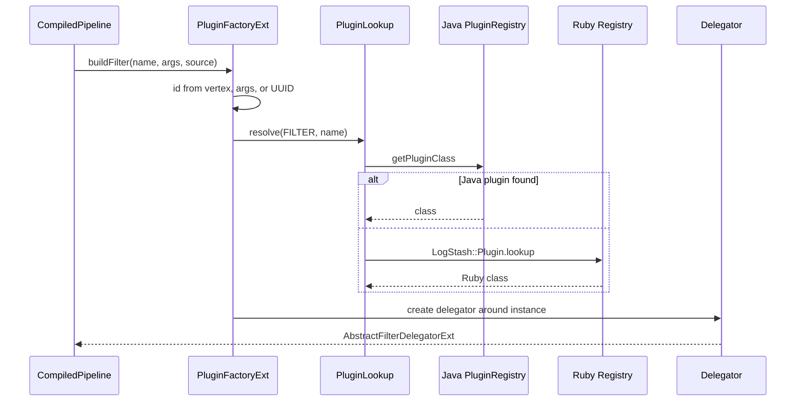

## Overview

A config says `grok { ... }`; the pipeline needs a configured object it can call. Two layers get it there. The plugin registry knows which plugins exist: the Ruby `LogStash::Plugins::Registry` (`LogStash::PLUGIN_REGISTRY`) scans installed gems and loads plugin classes by name, and the Java `PluginRegistry` scans the classpath for `@LogstashPlugin` classes. The plugin factory, `PluginFactoryExt`, is called by `CompiledPipeline` once per plugin vertex: it assigns the plugin's id, resolves the class through `PluginLookup`, builds the instance with an execution context, and wraps filters and outputs in delegators that add metrics and concurrency control. The registry also carries the hooks system that lets universal plugins such as x-pack react to agent and pipeline events.

Sources: [logstash-core/lib/logstash/plugins/registry.rb:24-111](repo://logstash-core/lib/logstash/plugins/registry.rb#L24-L111), [logstash-core/lib/logstash/plugins/registry.rb:128-176](repo://logstash-core/lib/logstash/plugins/registry.rb#L128-L176), [logstash-core/src/main/java/org/logstash/plugins/factory/PluginFactoryExt.java:192-270](repo://logstash-core/src/main/java/org/logstash/plugins/factory/PluginFactoryExt.java#L192-L270)

Sources: [logstash-core/src/main/java/org/logstash/plugins/PluginLookup.java:63-117](repo://logstash-core/src/main/java/org/logstash/plugins/PluginLookup.java#L63-L117), [logstash-core/src/main/java/org/logstash/config/ir/CompiledPipeline.java:193-209](repo://logstash-core/src/main/java/org/logstash/config/ir/CompiledPipeline.java#L193-L209)

## The Ruby registry

### Setup at startup

`PLUGIN_REGISTRY.setup!` runs when `runner.rb` loads ([[Startup and the Runner]]). It loads x-pack's `logstash_registry.rb` unless running OSS, then `load_available_plugins`, then `execute_universal_plugins`.

Sources: [logstash-core/lib/logstash/plugins/registry.rb:128-147](repo://logstash-core/lib/logstash/plugins/registry.rb#L128-L147), [logstash-core/lib/logstash/runner.rb:233-238](repo://logstash-core/lib/logstash/runner.rb#L233-L238)

`load_available_plugins` registers the built-in `pipeline` input and output, then walks every installed gem whose gemspec metadata has `logstash_plugin`. A gem name such as `logstash-filter-grok` is split into type `filter` and name `grok`. Gems marked `java_plugin` must contain exactly one jar named after the gem and version, which is remembered for classloader isolation. A gem that ships a `logstash_registry.rb` file has it required, so the plugin can register hooks or universal plugins; errors there are logged, not fatal.

Sources: [logstash-core/lib/logstash/plugins/registry.rb:33-89](repo://logstash-core/lib/logstash/plugins/registry.rb#L33-L89), [logstash-core/lib/logstash/plugins/registry.rb:149-176](repo://logstash-core/lib/logstash/plugins/registry.rb#L149-L176), [logstash-core/lib/logstash/plugins/builtin.rb:18-24](repo://logstash-core/lib/logstash/plugins/builtin.rb#L18-L24)

### Lookup

Plugin classes are mostly not loaded until a config uses them. `lookup(type, name)` returns a registered class, or falls back to `legacy_lookup`, which tries four things in turn.

Sources: [logstash-core/lib/logstash/plugins/registry.rb:178-235](repo://logstash-core/lib/logstash/plugins/registry.rb#L178-L235), [logstash-core/lib/logstash/plugins/registry.rb:279-308](repo://logstash-core/lib/logstash/plugins/registry.rb#L279-L308)

1. Searches the `LogStash::Filters` (or `Inputs`, `Outputs`, `Codecs`) namespace for a class whose `config_name` matches, or a Java class whose simple name matches the name without underscores.
2. If that fails, runs `require "logstash/filters/<name>"` and searches again.
3. If still missing and the name is an alias, loads the original plugin instead.
4. Raises `LoadError` "The plugin is not installed" if nothing matched, otherwise caches the class with `lazy_add`.

Sources: [logstash-core/lib/logstash/plugins/registry.rb:178-235](repo://logstash-core/lib/logstash/plugins/registry.rb#L178-L235), [logstash-core/lib/logstash/plugins/registry.rb:279-308](repo://logstash-core/lib/logstash/plugins/registry.rb#L279-L308)

`lookup_pipeline_plugin` adds a check that the class really is the plugin or alias requested, and turns failures into `PluginLoadingError`, which surfaces as a configuration error.

Sources: [logstash-core/lib/logstash/plugins/registry.rb:237-245](repo://logstash-core/lib/logstash/plugins/registry.rb#L237-L245)

### Java plugins from gems and classloader isolation

When a registered class is a Java class and `pipeline.plugin_classloaders` is true, `add_plugin` loads it again through a `PluginClassLoader` over the plugin's own jar, so plugins with conflicting dependency versions can coexist. Otherwise it uses the class from the shared classpath.

Sources: [logstash-core/lib/logstash/plugins/registry.rb:310-334](repo://logstash-core/lib/logstash/plugins/registry.rb#L310-L334)

### Aliases

Aliases are defined in `AliasRegistry.yml`. The build signs that file with a `#CHECKSUM` header and copies it as `plugin_aliases.yml` into the Java resources and the plugin manager; `AliasRegistry` loads the classpath copy and warns when the checksum does not match. The definitions currently map the input name `elastic_agent` to the `beats` input, and lists text replacements to apply to the original plugin's documentation for the alias. Both registries consult it: the Ruby one when a name cannot be loaded directly, the Java one when adding aliased names to its maps.

Sources: [logstash-core/src/main/resources/org/logstash/plugins/AliasRegistry.yml:1-9](repo://logstash-core/src/main/resources/org/logstash/plugins/AliasRegistry.yml#L1-L9), [logstash-core/src/main/java/org/logstash/plugins/AliasRegistry.java:161-205](repo://logstash-core/src/main/java/org/logstash/plugins/AliasRegistry.java#L161-L205), [logstash-core/src/main/java/org/logstash/plugins/AliasRegistry.java:240-262](repo://logstash-core/src/main/java/org/logstash/plugins/AliasRegistry.java#L240-L262), [build.gradle:196-234](repo://build.gradle#L196-L234), [logstash-core/src/main/java/org/logstash/plugins/discovery/PluginRegistry.java:113-121](repo://logstash-core/src/main/java/org/logstash/plugins/discovery/PluginRegistry.java#L113-L121)

## The Java registry and PluginLookup

`org.logstash.plugins.discovery.PluginRegistry` is a lazily created singleton. On creation it scans the classpath under `org.logstash.plugins` with the Reflections library for classes annotated `@LogstashPlugin`, and files each into the inputs, filters, outputs or codecs map by the interface it implements. The scan runs on one thread because concurrent Reflections scans can close each other's jar files.

Sources: [logstash-core/src/main/java/org/logstash/plugins/discovery/PluginRegistry.java:53-118](repo://logstash-core/src/main/java/org/logstash/plugins/discovery/PluginRegistry.java#L53-L118)

`PluginLookup.resolve(type, name)` asks the Java registry first and the Ruby registry second. It returns the class and its language (Java or Ruby), and validates Java classes against the plugin API with `PluginValidator`, failing with "Java plugin '...' is incompatible with the current Logstash plugin API" ([[Java Plugin API]]).

Sources: [logstash-core/src/main/java/org/logstash/plugins/PluginLookup.java:45-137](repo://logstash-core/src/main/java/org/logstash/plugins/PluginLookup.java#L45-L137)

## The plugin factory

### Ids

`AbstractPipelineExt` creates one `PluginFactoryExt` per pipeline with the `PipelineIR`, a metrics factory, an execution context factory and the filter delegator class ([[Pipeline Lifecycle]]). For each plugin, `plugin(type, name, args, source)` first settles the id, taking the first of three sources that yields one.

Sources: [logstash-core/src/main/java/org/logstash/plugins/factory/PluginFactoryExt.java:93-115](repo://logstash-core/src/main/java/org/logstash/plugins/factory/PluginFactoryExt.java#L93-L115), [logstash-core/src/main/java/org/logstash/plugins/factory/PluginFactoryExt.java:290-359](repo://logstash-core/src/main/java/org/logstash/plugins/factory/PluginFactoryExt.java#L290-L359)

1. The id of the graph vertex whose source metadata matches (explicit `id` or the generated hash, see [[Pipeline Intermediate Representation]]).
2. Otherwise an `id` argument.
3. Otherwise, for codecs only, a random UUID.

Sources: [logstash-core/src/main/java/org/logstash/plugins/factory/PluginFactoryExt.java:93-115](repo://logstash-core/src/main/java/org/logstash/plugins/factory/PluginFactoryExt.java#L93-L115), [logstash-core/src/main/java/org/logstash/plugins/factory/PluginFactoryExt.java:290-359](repo://logstash-core/src/main/java/org/logstash/plugins/factory/PluginFactoryExt.java#L290-L359)

The id is expanded for `${VAR}` references from the environment (not the keystore). A missing id raises "Could not determine ID", and an id already used in this pipeline raises "Two plugins have the id '...', please fix this conflict".

Sources: [logstash-core/src/main/java/org/logstash/plugins/factory/PluginFactoryExt.java:205-225](repo://logstash-core/src/main/java/org/logstash/plugins/factory/PluginFactoryExt.java#L205-L225), [logstash-core/src/main/java/org/logstash/plugins/factory/PluginFactoryExt.java:305-309](repo://logstash-core/src/main/java/org/logstash/plugins/factory/PluginFactoryExt.java#L305-L309)

### Building Ruby plugins

For a Ruby class the factory adds `id` to the args and creates an `ExecutionContext` holding the pipeline, the agent and a per-plugin DLQ writer ([[Dead Letter Queue]]). What it builds next depends on the plugin type.

Sources: [logstash-core/src/main/java/org/logstash/plugins/factory/PluginFactoryExt.java:227-260](repo://logstash-core/src/main/java/org/logstash/plugins/factory/PluginFactoryExt.java#L227-L260), [logstash-core/src/main/java/org/logstash/plugins/factory/ExecutionContextFactoryExt.java:49-61](repo://logstash-core/src/main/java/org/logstash/plugins/factory/ExecutionContextFactoryExt.java#L49-L61)

- Outputs become an `OutputDelegatorExt` with the output strategy registry.
- Filters become a `FilterDelegatorExt`.
- Inputs and codecs are instantiated directly, get a `name` gauge and their metric namespace.

Sources: [logstash-core/src/main/java/org/logstash/plugins/factory/PluginFactoryExt.java:227-260](repo://logstash-core/src/main/java/org/logstash/plugins/factory/PluginFactoryExt.java#L227-L260), [logstash-core/src/main/java/org/logstash/plugins/factory/ExecutionContextFactoryExt.java:49-61](repo://logstash-core/src/main/java/org/logstash/plugins/factory/ExecutionContextFactoryExt.java#L49-L61)

Instances are created through `ContextualizerExt.initializePlugin`, which prepends a module to the plugin class so the execution context is set before the plugin's own `initialize` runs. A plugin can therefore use `execution_context` inside `initialize`.

Sources: [logstash-core/src/main/java/org/logstash/plugins/factory/ContextualizerExt.java:23-80](repo://logstash-core/src/main/java/org/logstash/plugins/factory/ContextualizerExt.java#L23-L80)

### Building Java plugins

For a Java class the factory picks the `InputPluginCreator`, `FilterPluginCreator`, `OutputPluginCreator` or `CodecPluginCreator`, builds a `Context` with metrics and DLQ access, unwraps codec arguments to Java `Codec`s, and lets the creator instantiate, validate and wrap the plugin in its Java delegator ([[Java Plugin API]]).

Sources: [logstash-core/src/main/java/org/logstash/plugins/factory/PluginFactoryExt.java:261-288](repo://logstash-core/src/main/java/org/logstash/plugins/factory/PluginFactoryExt.java#L261-L288)

## Delegators

### Filter delegators

`AbstractFilterDelegatorExt.multi_filter` counts `events.in`, times the call into `duration_in_millis`, and counts non-cancelled results as `events.out`. `flush` forwards to the plugin and counts flushed events as output. `has_flush` and `periodic_flush` tell the compiled pipeline whether and when to call `flush` ([[Compiled Pipeline Execution]]).

Sources: [logstash-core/src/main/java/org/logstash/config/ir/compiler/AbstractFilterDelegatorExt.java:125-175](repo://logstash-core/src/main/java/org/logstash/config/ir/compiler/AbstractFilterDelegatorExt.java#L125-L175)

### Output delegators and strategies

`AbstractOutputDelegatorExt.multi_receive` counts `events.in`, times the output, and counts `events.out`. The Ruby `OutputDelegatorExt` asks the output class for its `concurrency` and gets the matching strategy class from the registry that `RubyUtil` fills with `shared`, `legacy` and `single`.

Sources: [logstash-core/src/main/java/org/logstash/config/ir/compiler/AbstractOutputDelegatorExt.java:114-124](repo://logstash-core/src/main/java/org/logstash/config/ir/compiler/AbstractOutputDelegatorExt.java#L114-L124), [logstash-core/src/main/java/org/logstash/config/ir/compiler/OutputDelegatorExt.java:47-111](repo://logstash-core/src/main/java/org/logstash/config/ir/compiler/OutputDelegatorExt.java#L47-L111), [logstash-core/src/main/java/org/logstash/RubyUtil.java:386-400](repo://logstash-core/src/main/java/org/logstash/RubyUtil.java#L386-L400)

| Strategy | Instances | Concurrency |
| --- | --- | --- |
| `shared` | One | Called concurrently by all workers |
| `single` | One | `synchronized`: one batch at a time |
| `legacy` | `workers` instances (1 by default) in a blocking queue | Each batch takes an instance from the queue and returns it |

Sources: [logstash-core/src/main/java/org/logstash/config/ir/compiler/OutputStrategyExt.java:168-239](repo://logstash-core/src/main/java/org/logstash/config/ir/compiler/OutputStrategyExt.java#L168-L239), [logstash-core/src/main/java/org/logstash/config/ir/compiler/OutputStrategyExt.java:241-310](repo://logstash-core/src/main/java/org/logstash/config/ir/compiler/OutputStrategyExt.java#L241-L310)

Because `legacy` is the default for outputs that declare nothing, and the base class forbids `workers` other than 1, an undeclared output is effectively serialised like `single` ([[Ruby Plugin Model]]).

Sources: [logstash-core/src/main/java/org/logstash/config/ir/compiler/OutputStrategyExt.java:182-224](repo://logstash-core/src/main/java/org/logstash/config/ir/compiler/OutputStrategyExt.java#L182-L224), [logstash-core/lib/logstash/outputs/base.rb:42-79](repo://logstash-core/lib/logstash/outputs/base.rb#L42-L79)

## Hooks and universal plugins

`HooksRegistry` (Java `HooksRegistryExt`) connects emitters with listeners. An emitter registers its scope (a class such as `LogStash::Runner` or `LogStash::Agent`) together with its `EventDispatcher`; a plugin registers hook objects for a scope. Whenever either side registers, the registry adds every hook to the matching dispatcher, so the order of registration does not matter.

Sources: [logstash-core/src/main/java/org/logstash/plugins/HooksRegistryExt.java:41-130](repo://logstash-core/src/main/java/org/logstash/plugins/HooksRegistryExt.java#L41-L130)

`EventDispatcher#fire(:name, *args)` calls `name(emitter, *args)` on every listener that responds to it. The runner fires `before_bootstrap_checks`, `after_bootstrap_checks`, `before_agent` and `after_agent`; the agent fires `after_initialize`, `pipeline_started` and `pipeline_stopped` ([[Agent and Pipeline Convergence]]).

Sources: [logstash-core/src/main/java/org/logstash/execution/EventDispatcherExt.java:88-100](repo://logstash-core/src/main/java/org/logstash/execution/EventDispatcherExt.java#L88-L100), [logstash-core/lib/logstash/runner.rb:304-329](repo://logstash-core/lib/logstash/runner.rb#L304-L329), [logstash-core/lib/logstash/agent.rb:469-480](repo://logstash-core/lib/logstash/agent.rb#L469-L480)

A universal plugin is registered with type `:universal`. The registry instantiates it at registration and, in `execute_universal_plugins`, calls its `register_hooks(hooks)` and `additionals_settings(settings)`. This is how x-pack adds its settings before `logstash.yml` values are validated and installs its hooks ([[X-Pack Extensions and License Checking]]). `UniversalPluginExt` provides empty defaults for both methods.

Sources: [logstash-core/lib/logstash/plugins/registry.rb:101-111](repo://logstash-core/lib/logstash/plugins/registry.rb#L101-L111), [logstash-core/lib/logstash/plugins/registry.rb:134-138](repo://logstash-core/lib/logstash/plugins/registry.rb#L134-L138), [logstash-core/src/main/java/org/logstash/plugins/UniversalPluginExt.java:32-54](repo://logstash-core/src/main/java/org/logstash/plugins/UniversalPluginExt.java#L32-L54)
