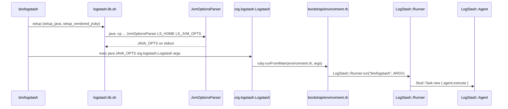

## Overview

Starting Logstash crosses four layers before any pipeline exists: a shell launcher that finds Java and computes JVM flags, a Java `main` that creates the single JRuby runtime, a Ruby bootstrap that sets up Bundler, and `LogStash::Runner`, the Clamp command that turns flags and `logstash.yml` into settings, runs checks, and hands control to the agent. This page follows that path and ends where [[Agent and Pipeline Convergence]] begins. How each setting is typed and validated is on [[Settings and logstash.yml]].

Sources: [bin/logstash:1-60](repo://bin/logstash#L1-L60), [lib/bootstrap/environment.rb:79-91](repo://lib/bootstrap/environment.rb#L79-L91)

## Launch sequence

Sources: [bin/logstash.lib.sh:150-198](repo://bin/logstash.lib.sh#L150-L198), [logstash-core/src/main/java/org/logstash/Logstash.java:163-207](repo://logstash-core/src/main/java/org/logstash/Logstash.java#L163-L207), [lib/bootstrap/environment.rb:79-91](repo://lib/bootstrap/environment.rb#L79-L91)

## The shell launcher

`bin/logstash` resolves symlinks to find its own directory, sources `bin/logstash.lib.sh` and calls `setup`. A `-V` or `--version` argument is answered in the shell from `versions.yml` without starting a JVM; anything else ends in `exec "${JAVACMD}" ${JAVA_OPTS} -cp "${CLASSPATH}" org.logstash.Logstash "$@"`.

Sources: [bin/logstash:1-60](repo://bin/logstash#L1-L60)

`logstash.lib.sh` exports `LOGSTASH_HOME` and `LS_HOME`, builds the classpath from `vendor/jruby/lib/jruby.jar` plus every jar in `logstash-core/lib/jars`, and remembers a `jvm.options` found under a `--path.settings` argument. `setup_java` picks the Java binary in this order: `JAVACMD` if set, `LS_JAVA_HOME`, the bundled JDK under `jdk/` (`jdk.app/Contents/Home` on macOS), then `java` on the `PATH`. It unsets `JAVA_TOOL_OPTIONS`, warns that `JAVA_OPTS` is ignored, and points to `LS_JAVA_OPTS` instead. `setup_vendored_jruby` fails early if `vendor/jruby/bin/jruby` is missing and sets `GEM_HOME` and `GEM_PATH` to `vendor/bundle/jruby/3.1.0` unless `LS_GEM_HOME` or `LS_GEM_PATH` override them.

Sources: [bin/logstash.lib.sh:44-91](repo://bin/logstash.lib.sh#L44-L91), [bin/logstash.lib.sh:93-186](repo://bin/logstash.lib.sh#L93-L186)

## JVM options

`JvmOptionsParser` runs as a separate short-lived JVM and prints the final flags. It exits if Java is older than 17. It reads the first readable file of `LS_JVM_OPTS`, `/etc/logstash/jvm.options` and `config/jvm.options`, then appends `LS_JAVA_OPTS` split on spaces, then the mandatory options, and finally adds `-Dio.netty.allocator.maxOrder=11` unless some option already sets it. The options are kept in a `LinkedHashSet`, so `LS_JAVA_OPTS` lands after the file's lines and wins where the JVM takes the last value.

Sources: [tools/jvm-options-parser/src/main/java/org/logstash/launchers/JvmOptionsParser.java:106-207](repo://tools/jvm-options-parser/src/main/java/org/logstash/launchers/JvmOptionsParser.java#L106-L207)

Each line of `jvm.options` may carry a Java version prefix: `-Xss4m` applies always, `17:-Xfoo` only to Java 17, `17-:-Xfoo` to 17 and later, `11-16:-Xfoo` to that range. `${VAR}` and `${VAR:default}` are replaced from the environment before the line is matched. Comments and blank lines are skipped; any other malformed line is reported with its line number.

Sources: [tools/jvm-options-parser/src/main/java/org/logstash/launchers/JvmOptionsParser.java:284-300](repo://tools/jvm-options-parser/src/main/java/org/logstash/launchers/JvmOptionsParser.java#L284-L300), [tools/jvm-options-parser/src/main/java/org/logstash/launchers/JvmOptionsParser.java:368-423](repo://tools/jvm-options-parser/src/main/java/org/logstash/launchers/JvmOptionsParser.java#L368-L423)

The mandatory list adds `-Djruby.regexp.interruptible=true`, which lets a stuck regular expression be interrupted, plus the `--add-exports` and `--add-opens` flags newer JDKs need for JRuby and the Java compiler API used by [[Compiled Pipeline Execution]].

Sources: [tools/jvm-options-parser/src/main/java/org/logstash/launchers/JvmOptionsParser.java:54-67](repo://tools/jvm-options-parser/src/main/java/org/logstash/launchers/JvmOptionsParser.java#L54-L67)

## The Java entry point

`org.logstash.Logstash.main` requires `LS_HOME`, installs a default uncaught-exception handler, and builds a `RubyInstanceConfig` whose script is `lib/bootstrap/environment.rb` followed by the user's arguments. `run` refuses to continue if the new runtime is not the global `RubyUtil.RUBY`, because much of the Java code reaches Ruby through that constant.

Sources: [logstash-core/src/main/java/org/logstash/Logstash.java:80-127](repo://logstash-core/src/main/java/org/logstash/Logstash.java#L80-L127), [logstash-core/src/main/java/org/logstash/Logstash.java:163-207](repo://logstash-core/src/main/java/org/logstash/Logstash.java#L163-L207), [logstash-core/src/main/java/org/logstash/Logstash.java:263-270](repo://logstash-core/src/main/java/org/logstash/Logstash.java#L263-L270)

A Ruby `SystemExit` with a non-zero status, or any other Ruby exception, becomes an `IllegalStateException` prefixed "Logstash stopped processing because of an error". A `Bundler::ProductionError` gets a message telling developers to use `--enable-local-plugin-development`. Fatal JVM errors stop the process with `Runtime.halt` so shutdown hooks do not run.

Sources: [logstash-core/src/main/java/org/logstash/Logstash.java:173-220](repo://logstash-core/src/main/java/org/logstash/Logstash.java#L173-L220), [logstash-core/src/main/java/org/logstash/Logstash.java:291-305](repo://logstash-core/src/main/java/org/logstash/Logstash.java#L291-L305)

| Error | Exit status |
| --- | --- |
| `InternalError` | 128 |
| `OutOfMemoryError` | 127 |
| `StackOverflowError` | 126 |
| `UnknownError` | 125 |
| `IOError` | 124 |
| `LinkageError` | 123 |
| other `Error` | 120 |
| any other `Throwable` | 1 (`System.exit`) |

Sources: [logstash-core/src/main/java/org/logstash/Logstash.java:80-150](repo://logstash-core/src/main/java/org/logstash/Logstash.java#L80-L150), [logstash-core/src/main/java/org/logstash/Logstash.java:173-220](repo://logstash-core/src/main/java/org/logstash/Logstash.java#L173-L220), [logstash-core/src/main/java/org/logstash/Logstash.java:280-305](repo://logstash-core/src/main/java/org/logstash/Logstash.java#L280-L305)

## Ruby bootstrap

When run as the main script, `environment.rb` calls `LogStash::Bundler.setup!` without the `build` and `development` groups, allowing Gemfile changes only with `--enable-local-plugin-development`, then requires `logstash/runner` and exits with the status of `LogStash::Runner.run`. The same file defines `LogStash::Environment` paths such as `vendor/bundle` and `Gemfile`, and `oss_only?`, which is true when `OSS=true` or the `x-pack` folder is missing.

Sources: [lib/bootstrap/environment.rb:26-91](repo://lib/bootstrap/environment.rb#L26-L91)

Loading `runner.rb` sets `LogStash::OSS` the same way and, when x-pack is present, puts `x-pack/lib` first on the load path. At class load the runner registers `path.settings` and `path.logs` (they depend on `LOGSTASH_HOME`), copies the settings into `SYSTEM_SETTINGS`, and calls `LogStash::PLUGIN_REGISTRY.setup!` so plugins that register hooks, such as the x-pack extensions, are loaded before any command runs.

Sources: [logstash-core/lib/logstash/runner.rb:22-32](repo://logstash-core/lib/logstash/runner.rb#L22-L32), [logstash-core/lib/logstash/runner.rb:54-66](repo://logstash-core/lib/logstash/runner.rb#L54-L66), [logstash-core/lib/logstash/runner.rb:233-238](repo://logstash-core/lib/logstash/runner.rb#L233-L238), [logstash-core/lib/logstash/util/settings_helper.rb:32-43](repo://logstash-core/lib/logstash/util/settings_helper.rb#L32-L43)

## Command-line flags

`LogStash::Runner` is a `Clamp::StrictCommand`. Logstash's Clamp patch replaces the generated accessors so each option reads and writes `LogStash::SETTINGS` under its `attribute_name`: `-w` sets `pipeline.workers`, `-f` sets `path.config`. Clamp's default-from-environment is disabled, so settings come only from defaults, the YAML file and flags. The hidden `--setting`/`-S KEY=VALUE` option sets any registered setting, and an empty value resets it. Deprecated flags (`--verbose`, `--debug`, `--quiet`) queue a deprecation message and set `log.level` instead.

Sources: [logstash-core/lib/logstash/patches/clamp.rb:22-110](repo://logstash-core/lib/logstash/patches/clamp.rb#L22-L110), [logstash-core/lib/logstash/runner.rb:213-231](repo://logstash-core/lib/logstash/runner.rb#L213-L231)

| Flag | Setting |
| --- | --- |
| `-n`, `--node.name` | `node.name` |
| `-f`, `--path.config` | `path.config` |
| `-e`, `--config.string` | `config.string` |
| `-w`, `--pipeline.workers` | `pipeline.workers` |
| `-b`, `--pipeline.batch.size` | `pipeline.batch.size` |
| `-u`, `--pipeline.batch.delay` | `pipeline.batch.delay` |
| `-p`, `--path.plugins` | `path.plugins` (multivalued) |
| `-l`, `--path.logs` | `path.logs` |
| `-t`, `--config.test_and_exit` | `config.test_and_exit` |
| `-r`, `--config.reload.automatic` | `config.reload.automatic` |
| `-i`, `--interactive` | Start `irb` or `pry` instead of the agent |
| `--path.settings` | Directory holding `logstash.yml` |

Sources: [logstash-core/lib/logstash/runner.rb:67-177](repo://logstash-core/lib/logstash/runner.rb#L67-L177), [logstash-core/lib/logstash/runner.rb:200-212](repo://logstash-core/lib/logstash/runner.rb#L200-L212)

## Runner execution

`Runner#run` first calls `SettingsHelper.from_yaml`, which finds the settings directory from `--path.settings`, `--path.settings=`, or `LS_SETTINGS_DIR`, sets `keystore.file` next to it, and loads `logstash.yml`. A missing file only warns; a YAML syntax error aborts unless the user asked for `--help`. Clamp then parses the flags and calls `execute`.

Sources: [logstash-core/lib/logstash/runner.rb:242-257](repo://logstash-core/lib/logstash/runner.rb#L242-L257), [logstash-core/lib/logstash/util/settings_helper.rb:45-88](repo://logstash-core/lib/logstash/util/settings_helper.rb#L45-L88)

`execute` runs these steps in order, returning `1` at the first failure.

Sources: [logstash-core/lib/logstash/runner.rb:259-262](repo://logstash-core/lib/logstash/runner.rb#L259-L262)

1. `post_process` the settings and refuse to run as root unless `allow_superuser` is true.
2. Reject a Log4j2 configuration that uses a JavaScript script appender or filter.
3. Apply `pipeline.buffer.type` to Netty's `io.netty.noPreferDirect` unless that property is already set, and log queued deprecations.
4. Answer `--version`, log the Logstash and JRuby versions, and check the Jackson stream limits.
5. Create the `EventDispatcher`, register it with the hooks registry, `validate_all` settings, and fire `before_bootstrap_checks`.
6. Set the global `FieldReference` escape style from `config.field_reference.escape_style` ([[Field References and String Interpolation]]).
7. Run the bootstrap checks (by default `DefaultConfig`, which checks nothing now), fire `after_bootstrap_checks`, and add `path.plugins` directories.
8. Ask each config source whether its settings conflict; report conflicts, or "missing configuration" if no source is usable ([[Pipeline Configuration Sources]]).
9. With `-t`, fetch the configs, build each `JavaPipeline` without starting it, print `Configuration OK`, and exit `0`.
10. Lock `path.data/.lock` with `FileLockFactory`, create the agent between `before_agent` and `after_agent` events, trap signals, and run `agent.execute` in a `Stud::Task`.

Sources: [logstash-core/lib/logstash/runner.rb:259-360](repo://logstash-core/lib/logstash/runner.rb#L259-L360), [logstash-core/lib/logstash/runner.rb:361-395](repo://logstash-core/lib/logstash/runner.rb#L361-L395), [logstash-core/lib/logstash/bootstrap_check/default_config.rb:18-25](repo://logstash-core/lib/logstash/bootstrap_check/default_config.rb#L18-L25)

When the agent task returns, the runner calls `agent.shutdown`, shuts Log4j down to flush messages, and returns the agent's status. A held lock produces the "locked data path" fatal message; `ensure` removes the traps and releases the lock.

Sources: [logstash-core/lib/logstash/runner.rb:396-430](repo://logstash-core/lib/logstash/runner.rb#L396-L430)

## Signals

| Signal | Effect |
| --- | --- |
| `SIGHUP` | `agent.converge_state_and_update`: reload configs now (not trapped on Windows) |
| `SIGTERM` | Stop the agent task |
| `SIGINT` (first) | Stop the agent task, warn after 5 seconds that shutdown is slow |
| `SIGINT` (second) | `exit!(1)`, ending the JVM at once |

Sources: [logstash-core/lib/logstash/runner.rb:534-563](repo://logstash-core/lib/logstash/runner.rb#L534-L563), [logstash-core/lib/logstash/runner.rb:388-397](repo://logstash-core/lib/logstash/runner.rb#L388-L397)

Stopping the agent task makes `Stud.stop?` true in the agent thread; the agent then stops its pipelines as described in [[Agent and Pipeline Convergence]], and a pipeline that does not stop in time is reported by the [[Shutdown Watcher and Pipeline Reporter]].

Sources: [logstash-core/lib/logstash/agent.rb:126-170](repo://logstash-core/lib/logstash/agent.rb#L126-L170)
