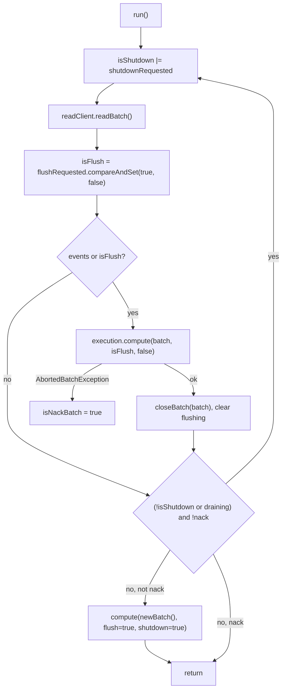

## Overview

Each pipeline worker thread runs one `org.logstash.execution.WorkerLoop`. The loop reads a batch of events from the queue's read client, pushes it through the compiled filters and outputs, acknowledges it, and repeats until the pipeline asks it to stop. It is the hot path of Logstash: everything between the queue and an output plugin happens inside `WorkerLoop.run`. [[Pipeline Lifecycle]] creates the loops and joins them; [[Compiled Pipeline Execution]] supplies the code each loop calls; the queue pages explain what a read client does underneath.

Sources: [logstash-core/src/main/java/org/logstash/execution/WorkerLoop.java:30-73](repo://logstash-core/src/main/java/org/logstash/execution/WorkerLoop.java#L30-L73), [logstash-core/lib/logstash/java_pipeline.rb:588-615](repo://logstash-core/lib/logstash/java_pipeline.rb#L588-L615)

## What a worker is given

`JavaPipeline#init_worker_loop` passes everything the loop needs as constructor arguments: the shared read client, the `CompiledPipeline`, the `WorkerObserver`, the pipeline's `events_consumed` and `events_filtered` counters, the three signal flags `flushRequested`, `flushing` and `shutdownRequested`, and two booleans, `drainQueue` and `preserveEventOrder`. The constructor builds this worker's own execution with `compiledPipeline.buildExecution(preserveEventOrder)` and wraps it in an `ObservedExecution`, so the worker never shares dataset buffers with another thread.

Sources: [logstash-core/lib/logstash/java_pipeline.rb:588-615](repo://logstash-core/lib/logstash/java_pipeline.rb#L588-L615), [logstash-core/src/main/java/org/logstash/execution/WorkerLoop.java:53-73](repo://logstash-core/src/main/java/org/logstash/execution/WorkerLoop.java#L53-L73)

## The loop

Sources: [logstash-core/src/main/java/org/logstash/execution/WorkerLoop.java:75-129](repo://logstash-core/src/main/java/org/logstash/execution/WorkerLoop.java#L75-L129)

Each iteration.

Sources: [logstash-core/src/main/java/org/logstash/execution/WorkerLoop.java:76-96](repo://logstash-core/src/main/java/org/logstash/execution/WorkerLoop.java#L76-L96), [logstash-core/src/main/java/org/logstash/execution/WorkerLoop.java:126-128](repo://logstash-core/src/main/java/org/logstash/execution/WorkerLoop.java#L126-L128)

1. Latch shutdown: once `shutdownRequested` has been seen, `isShutdown` stays true.
2. Read a batch. The read client waits up to `pipeline.batch.delay` milliseconds to fill up to `pipeline.batch.size` events, so a batch may be smaller than the size, or empty.
3. Take a pending flush request atomically with `compareAndSet(true, false)`, so exactly one worker handles each request.
4. If the batch has events or a flush was taken, add the batch size to `events_consumed`, compute, add it to `events_filtered`, and close the batch. When this iteration flushed, reset `flushing` so the next periodic flush can be requested.
5. Continue while not shut down, or while draining (`drainQueue` is true and the queue is not empty), and while no batch was aborted.

Sources: [logstash-core/src/main/java/org/logstash/execution/WorkerLoop.java:76-96](repo://logstash-core/src/main/java/org/logstash/execution/WorkerLoop.java#L76-L96), [logstash-core/src/main/java/org/logstash/execution/WorkerLoop.java:126-128](repo://logstash-core/src/main/java/org/logstash/execution/WorkerLoop.java#L126-L128)

When the loop ends normally, the worker computes one more, empty batch from `readClient.newBatch()` with both `flush` and `shutdown` set. Filters that aggregate across events (multiline, aggregate and the like) receive their final `flush(final: true)` here and their last events still reach the outputs ([[Compiled Pipeline Execution]] shows how the generated code calls `flush`).

Sources: [logstash-core/src/main/java/org/logstash/execution/WorkerLoop.java:98-104](repo://logstash-core/src/main/java/org/logstash/execution/WorkerLoop.java#L98-L104)

Any other exception is rethrown as `IllegalStateException`. The Ruby `WorkerLoopThread` catches it, marks the pipeline as crashed and logs "Pipeline worker error, the pipeline will be stopped"; the pipeline's monitor loop then stops the inputs ([[Pipeline Lifecycle]]).

Sources: [logstash-core/src/main/java/org/logstash/execution/WorkerLoop.java:105-108](repo://logstash-core/src/main/java/org/logstash/execution/WorkerLoop.java#L105-L108), [logstash-core/lib/logstash/java_pipeline.rb:310-327](repo://logstash-core/lib/logstash/java_pipeline.rb#L310-L327)

## Aborted batches

A plugin can throw `AbortedBatchException` during compute to say "do not acknowledge this batch". `abortableCompute` catches it, logs "Received signal to abort processing current batch. Terminating pipeline worker", and returns `true`. The loop then skips `closeBatch` and the final flush and ends. Because the batch was never closed, a persisted queue keeps its events unacknowledged and delivers them again after restart. Nothing in `logstash-core` throws this exception itself; it is there for plugins.

Sources: [logstash-core/src/main/java/org/logstash/execution/WorkerLoop.java:110-124](repo://logstash-core/src/main/java/org/logstash/execution/WorkerLoop.java#L110-L124), [logstash-core/src/main/java/org/logstash/execution/AbortedBatchException.java:1-7](repo://logstash-core/src/main/java/org/logstash/execution/AbortedBatchException.java#L1-L7)

## Draining

`drainQueue` is true when `queue.drain` is set or the pipeline uses the memory queue. With it, a worker that has seen the shutdown signal keeps reading until the queue is empty, so a memory queue never loses events that inputs already accepted. With a persisted queue and `queue.drain: false`, workers stop after their current batch and the remaining events stay on disk for the next start. `JavaPipeline#worker_threads_draining?` exposes whether any worker is still draining, which the [[Shutdown Watcher and Pipeline Reporter]] uses to avoid reporting a busy drain as a stall.

Sources: [logstash-core/lib/logstash/java_pipeline.rb:62](repo://logstash-core/lib/logstash/java_pipeline.rb#L62-L62), [logstash-core/lib/logstash/java_pipeline.rb:571-573](repo://logstash-core/lib/logstash/java_pipeline.rb#L571-L573), [logstash-core/src/main/java/org/logstash/execution/WorkerLoop.java:126-128](repo://logstash-core/src/main/java/org/logstash/execution/WorkerLoop.java#L126-L128)

## Periodic flush

`PeriodicFlush` is a single-threaded scheduler named `logstash-pipeline-flush` started by the pipeline once it is running. Every 5 seconds it tries `flushing.compareAndSet(false, true)` and, if no flush is in progress, sets `flushRequested`. One worker picks the request up on its next iteration, even with an empty batch, and clears `flushing` after the computation. A flush therefore never overlaps another, and filters with periodic flush see at most one flush call every 5 seconds. Closing waits up to 10 seconds for the scheduler to stop.

Sources: [logstash-core/src/main/java/org/logstash/execution/PeriodicFlush.java:30-67](repo://logstash-core/src/main/java/org/logstash/execution/PeriodicFlush.java#L30-L67), [logstash-core/lib/logstash/java_pipeline.rb:503-512](repo://logstash-core/lib/logstash/java_pipeline.rb#L503-L512)

## Batches

`QueueBatch` is the unit a worker handles: `filteredSize()`, `events()`, `to_a()` and `close()`. The memory queue's `MemoryReadBatch` wraps a plain collection and its `close` does nothing; `to_a` skips cancelled events, while `events()` returns them all, because no event is cancelled before the filters run. The persisted queue's batch acknowledges its events on `close`, as described on [[Persistent Queue]].

Sources: [logstash-core/src/main/java/org/logstash/execution/QueueBatch.java:27-35](repo://logstash-core/src/main/java/org/logstash/execution/QueueBatch.java#L27-L35), [logstash-core/src/main/java/org/logstash/execution/MemoryReadBatch.java:30-80](repo://logstash-core/src/main/java/org/logstash/execution/MemoryReadBatch.java#L30-L80)

`QueueReadClientBase` is the shared parent of the memory and persisted read clients. It holds the batch size (default 125) and wait time (default 50 ms), set by `set_batch_dimensions` from the pipeline settings. `startMetrics` records each batch in `inflightBatches` keyed by the reading thread's id, and `closeBatch` closes the batch and removes it, so at any moment the map shows the batch each worker is processing. The pipeline reporter reads it to count in-flight events.

Sources: [logstash-core/src/main/java/org/logstash/execution/QueueReadClientBase.java:44-136](repo://logstash-core/src/main/java/org/logstash/execution/QueueReadClientBase.java#L44-L136), [logstash-core/src/main/java/org/logstash/execution/QueueReadClientBase.java:190-196](repo://logstash-core/src/main/java/org/logstash/execution/QueueReadClientBase.java#L190-L196)

Since every worker reads from the same client, `pipeline.batch.size × pipeline.workers` bounds the events in flight in filters and outputs; the memory queue's capacity is sized from the same product ([[Queue Selection and the Memory Queue]]).

Sources: [logstash-core/lib/logstash/java_pipeline.rb:266-293](repo://logstash-core/lib/logstash/java_pipeline.rb#L266-L293), [logstash-core/src/main/java/org/logstash/ackedqueue/QueueFactoryExt.java:95-105](repo://logstash-core/src/main/java/org/logstash/ackedqueue/QueueFactoryExt.java#L95-L105)

## Metrics around each compute

`WorkerObserver` wraps each computation. It times it into `duration_in_millis` and, afterwards, adds the batch size to `filtered` and the number of events sent to outputs to `out`. Each update goes to two namespaces at once: the process-wide `events` and the pipeline's `stats.pipelines.<id>.events`. Those counters feed the throughput and worker utilization rates on [[Flow Metrics]].

Sources: [logstash-core/src/main/java/org/logstash/execution/WorkerObserver.java:20-63](repo://logstash-core/src/main/java/org/logstash/execution/WorkerObserver.java#L20-L63), [logstash-core/src/main/java/org/logstash/execution/ObservedExecution.java:12-19](repo://logstash-core/src/main/java/org/logstash/execution/ObservedExecution.java#L12-L19)

The read client keeps the same `out`, `filtered` and duration counters for the older Ruby pipeline and the RSpec helpers through `add_filtered_metrics`, `add_output_metrics` and `execute_with_timers`; the Java worker loop counts through `WorkerObserver` instead.

Sources: [logstash-core/src/main/java/org/logstash/execution/QueueReadClientBase.java:170-224](repo://logstash-core/src/main/java/org/logstash/execution/QueueReadClientBase.java#L170-L224)
