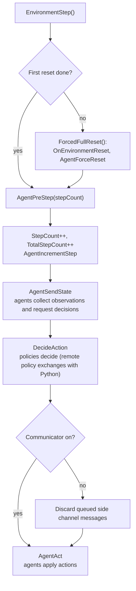

## Overview

The `Academy` is the one object in a Unity scene that knows about every agent. It is a lazily created singleton that, on first use, tries to connect to a Python trainer, registers the built-in side channels, and then advances all agents together, one environment step at a time. Agents never step themselves: they subscribe to the Academy's events, and the Academy fires those events in a fixed order so that no agent acts on a decision before every other agent has had the chance to request one.

Sources: [com.unity.ml-agents/Runtime/Academy.cs:116-132](repo://com.unity.ml-agents/Runtime/Academy.cs#L116-L132), [com.unity.ml-agents/Runtime/Academy.cs:199-239](repo://com.unity.ml-agents/Runtime/Academy.cs#L199-L239)

This page follows the Academy from creation to shutdown. What an agent does inside each event is on [[Agents and Episodes]], and the messages exchanged with Python are on [[Communication Protocol]].

Sources: [com.unity.ml-agents/Runtime/Agent.cs:495-499](repo://com.unity.ml-agents/Runtime/Agent.cs#L495-L499)

## Creation and initialization

`Academy.Instance` returns the value of a static `Lazy<Academy>`, so the Academy is created the first time anything reads it, usually an agent's `OnEnable`. `Academy.IsInitialized` tells whether that has happened yet without creating it. The protected constructor subscribes `Dispose` to `Application.quitting`, registers `RpcCommunicator.Create` with the `CommunicatorFactory` on Editor and standalone platforms (unless something registered a communicator already), calls `LazyInitialize`, and in the Editor disposes itself when play mode is about to start from edit mode.

Sources: [com.unity.ml-agents/Runtime/Academy.cs:116-132](repo://com.unity.ml-agents/Runtime/Academy.cs#L116-L132), [com.unity.ml-agents/Runtime/Academy.cs:251-295](repo://com.unity.ml-agents/Runtime/Academy.cs#L251-L295)

`InitializeEnvironment` does the real setup once, in six steps.

Sources: [com.unity.ml-agents/Runtime/Academy.cs:288-295](repo://com.unity.ml-agents/Runtime/Academy.cs#L288-L295)

1. It records the communication protocol version (`k_ApiVersion`, `1.5.0`) and the package version (`3.0.0`) as timer metadata.
2. It turns on automatic stepping (see below).
3. It registers the `EngineConfigurationChannel` and `TrainingAnalyticsSideChannel`, and creates the `EnvironmentParameters` and `StatsRecorder`, each of which registers its own side channel.
4. It reads the port to connect to and, if there is one, asks `CommunicatorFactory.Create` for a communicator.
5. It calls `Communicator.Initialize` with the versions, the port and the C# capabilities. On success it seeds `UnityEngine.Random` with the seed Python sent, keeps that seed for inference, stores `NumAreas` and the trainer's capabilities. On failure or exception it logs that it will perform inference instead and sets `Communicator` to null.
6. With a communicator, it subscribes to its quit and reset commands; it then resets all its events to empty delegates.

Sources: [com.unity.ml-agents/Runtime/Academy.cs:421-510](repo://com.unity.ml-agents/Runtime/Academy.cs#L421-L510)

`IsCommunicatorOn` is simply `Communicator != null`, so after a failed handshake every part of the package behaves as if no trainer exists. [[Behavior Parameters and Policies]] uses it to decide whether an agent gets a remote policy.

Sources: [com.unity.ml-agents/Runtime/Academy.cs:143-146](repo://com.unity.ml-agents/Runtime/Academy.cs#L143-L146)

## Finding the trainer

### Port selection

`ReadPortFromArgs` looks for `--mlagents-port <n>` on the command line; that is the flag `UnityEnvironment` passes when it launches an executable. When the flag is missing or malformed, a player build returns -1 and never tries to connect. In the Editor it returns the editor port from the package settings when **Connect to Trainer** is on, and -1 otherwise. `CommunicatorFactory.Enabled` can switch communication off entirely: `Create` then returns null.

Sources: [com.unity.ml-agents/Runtime/Academy.cs:364-392](repo://com.unity.ml-agents/Runtime/Academy.cs#L364-L392), [com.unity.ml-agents/Runtime/Communicator/CommunicatorFactory.cs:11-53](repo://com.unity.ml-agents/Runtime/Communicator/CommunicatorFactory.cs#L11-L53)

### Package settings

`MLAgentsSettings` is a `ScriptableObject` with two fields, `ConnectTrainer` (default `true`) and `EditorPort` (default 5004); changing either notifies `MLAgentsSettingsManager.OnSettingsChange`. The settings appear in **Project Settings > ML-Agents** as "Connect to Trainer" and "Editor Training Port".

Sources: [com.unity.ml-agents/Runtime/MLAgentsSettings.cs:8-40](repo://com.unity.ml-agents/Runtime/MLAgentsSettings.cs#L8-L40), [com.unity.ml-agents/Editor/MLAgentsSettingsProvider.cs:140-150](repo://com.unity.ml-agents/Editor/MLAgentsSettingsProvider.cs#L140-L150)

`MLAgentsSettingsManager.Settings` loads the settings lazily. In the Editor it uses the asset stored in `EditorBuildSettings` under the key `com.unity.ml-agents.settings`, or a fresh default instance. In a player it uses the first loaded `MLAgentsSettings` object; `MLAgentsSettingsBuildProvider` makes that work by adding the settings asset to the player's preloaded assets before a build and removing it afterwards.

Sources: [com.unity.ml-agents/Runtime/MLAgentsSettingsManager.cs:14-92](repo://com.unity.ml-agents/Runtime/MLAgentsSettingsManager.cs#L14-L92), [com.unity.ml-agents/Editor/MLAgentsSettingsBuildProvider.cs:10-36](repo://com.unity.ml-agents/Editor/MLAgentsSettingsBuildProvider.cs#L10-L36)

## The environment step

### Event order

`EnvironmentStep` is the heartbeat of the simulation. Each call fires the events below in order.

Sources: [com.unity.ml-agents/Runtime/Academy.cs:568-604](repo://com.unity.ml-agents/Runtime/Academy.cs#L568-L604)

Sources: [com.unity.ml-agents/Runtime/Academy.cs:557-604](repo://com.unity.ml-agents/Runtime/Academy.cs#L557-L604)

| Event | Visibility | Who listens | Purpose |
| --- | --- | --- | --- |
| `AgentPreStep` | public | user code, `DecisionRequester` | Runs before anything else in the step, with the current step count |
| `AgentIncrementStep` | internal | `Agent.AgentIncrementStep` | Advances each agent's step counter |
| `AgentSendState` | internal | `Agent.SendInfo` | Agents that requested a decision collect observations and hand them to their policy |
| `DecideAction` | internal | `Agent.DecideAction` | Policies produce actions; the remote policy sends one batched message to Python and waits for the reply |
| `AgentAct` | internal | `Agent.AgentStep` | Agents apply their latest actions |
| `AgentForceReset` | internal | `Agent._AgentReset` | A full reset was requested |
| `OnEnvironmentReset` | public | user code | Reset the scene when the Academy resets |
| `DestroyAction` | internal | agents, policies | The Academy is being disposed |

Sources: [com.unity.ml-agents/Runtime/Academy.cs:205-239](repo://com.unity.ml-agents/Runtime/Academy.cs#L205-L239), [com.unity.ml-agents/Runtime/Agent.cs:495-499](repo://com.unity.ml-agents/Runtime/Agent.cs#L495-L499), [com.unity.ml-agents/Runtime/Policies/RemotePolicy.cs:64-70](repo://com.unity.ml-agents/Runtime/Policies/RemotePolicy.cs#L64-L70)

### Why the order matters

The order is what keeps agents in lock step. All agents send state before any policy decides, which lets the remote policy batch every agent's observations into a single message; `RpcCommunicator.DecideBatch` sends at most once per step, guarded by `m_NeedCommunicateThisStep`. Only after all decisions are in do agents act.

Sources: [com.unity.ml-agents/Runtime/Academy.cs:583-602](repo://com.unity.ml-agents/Runtime/Academy.cs#L583-L602), [com.unity.ml-agents/Runtime/Communicator/RpcCommunicator.cs:320-329](repo://com.unity.ml-agents/Runtime/Communicator/RpcCommunicator.cs#L320-L329)

When no trainer is connected, side channel messages queued by game code would grow forever, so the step drains the outgoing queue with `SideChannelManager.GetSideChannelMessage()` and discards it. See [[Side Channels]].

Sources: [com.unity.ml-agents/Runtime/Academy.cs:593-597](repo://com.unity.ml-agents/Runtime/Academy.cs#L593-L597)

### Recursion guard

`EnvironmentStep` runs inside a `RecursionChecker`. If game code calls `EnvironmentStep()` or `EndEpisode()` from within a callback such as `CollectObservations` or `OnActionReceived`, the nested call throws a `UnityAgentsException` that names the cause instead of corrupting the step.

Sources: [com.unity.ml-agents/Runtime/Academy.cs:170-171](repo://com.unity.ml-agents/Runtime/Academy.cs#L170-L171), [com.unity.ml-agents/Runtime/RecursionChecker.cs:5-33](repo://com.unity.ml-agents/Runtime/RecursionChecker.cs#L5-L33)

## Automatic and manual stepping

By default the Academy steps during physics updates. `EnableAutomaticStepping` creates a hidden `AcademyFixedUpdateStepper` GameObject marked `DontDestroyOnLoad`, whose `FixedUpdate` calls `Academy.Instance.EnvironmentStep()`. A stepper that does not belong to the current Academy, for example one left over from a previous run, destroys itself instead.

Sources: [com.unity.ml-agents/Runtime/Academy.cs:29-46](repo://com.unity.ml-agents/Runtime/Academy.cs#L29-L46), [com.unity.ml-agents/Runtime/Academy.cs:301-318](repo://com.unity.ml-agents/Runtime/Academy.cs#L301-L318), [com.unity.ml-agents/Runtime/Academy.cs:683-686](repo://com.unity.ml-agents/Runtime/Academy.cs#L683-L686)

Setting `AutomaticSteppingEnabled = false` destroys the stepper; the game must then call `Academy.Instance.EnvironmentStep()` itself, for example in a turn-based game that steps once per turn.

Sources: [com.unity.ml-agents/Runtime/Academy.cs:324-362](repo://com.unity.ml-agents/Runtime/Academy.cs#L324-L362)

## Resets and commands from Python

The first `EnvironmentStep` performs a forced full reset. Later resets come from Python: when a reset command arrives, `RpcCommunicator` clears the agents waiting for decisions and raises `ResetCommandReceived`, which the Academy handles with `ForcedFullReset`. That resets the step count, increments `EpisodeCount`, invokes `OnEnvironmentReset` and then `AgentForceReset`. A quit command stops play mode in the Editor and calls `Application.Quit()`.

Sources: [com.unity.ml-agents/Runtime/Academy.cs:512-562](repo://com.unity.ml-agents/Runtime/Academy.cs#L512-L562), [com.unity.ml-agents/Runtime/Academy.cs:606-614](repo://com.unity.ml-agents/Runtime/Academy.cs#L606-L614), [com.unity.ml-agents/Runtime/Communicator/RpcCommunicator.cs:290-313](repo://com.unity.ml-agents/Runtime/Communicator/RpcCommunicator.cs#L290-L313)

The Academy exposes three counters: `EpisodeCount` (number of Academy resets), `StepCount` (steps since the last reset) and `TotalStepCount` (all steps).

Sources: [com.unity.ml-agents/Runtime/Academy.cs:525-550](repo://com.unity.ml-agents/Runtime/Academy.cs#L525-L550)

## Services the Academy provides

### Environment parameters and stats

`Academy.Instance.EnvironmentParameters` reads float values that Python sets: `GetWithDefault(key, default)`, `RegisterCallback(key, action)` to be told when a value changes, and `Keys()`. It is a thin wrapper over an `EnvironmentParametersChannel` that it registers on creation. `Academy.Instance.StatsRecorder` sends custom metrics to the trainer's TensorBoard output. See [[Curriculum and Environment Parameters]] and [[Stats and TensorBoard]].

Sources: [com.unity.ml-agents/Runtime/EnvironmentParameters.cs:15-69](repo://com.unity.ml-agents/Runtime/EnvironmentParameters.cs#L15-L69), [com.unity.ml-agents/Runtime/Academy.cs:394-416](repo://com.unity.ml-agents/Runtime/Academy.cs#L394-L416)

### Shared model runners

Agents that use the same ONNX model on the same device share one `ModelRunner`: `GetOrCreateModelRunner` looks for an existing runner with that model and device, and otherwise creates one seeded with `m_InferenceSeed`, incrementing the seed for the next. Sharing lets the runner batch inference across agents; see [[Inference with Sentis]].

Sources: [com.unity.ml-agents/Runtime/Academy.cs:628-639](repo://com.unity.ml-agents/Runtime/Academy.cs#L628-L639)

### Training area replication

`TrainingAreaReplicator` is a component that clones a `baseArea` GameObject so one executable holds several training areas. On `Awake` it computes a 3D grid big enough for `numAreas` (each side the cube root rounded up); when a trainer is connected, `numAreas` comes from `Academy.Instance.NumAreas`, the value of `mlagents-learn --num-areas`. On `OnEnable` it instantiates the copies `separation` units apart. With `buildOnly` set, it replicates only in standalone players, not in the Editor.

Sources: [com.unity.ml-agents/Runtime/Areas/TrainingAreaReplicator.cs:10-124](repo://com.unity.ml-agents/Runtime/Areas/TrainingAreaReplicator.cs#L10-L124)

## Shutdown

`Dispose` runs when the application quits or the Editor enters play mode again. It disables automatic stepping, fires `DestroyAction`, disposes the communicator, unregisters the environment-parameter and stats channels and every custom side channel, disposes all model runners, clears the events, writes the timer tree to JSON (see [[Profiling with Hierarchical Timers]]) and replaces the `Lazy<Academy>` so the next access creates a fresh Academy.

Sources: [com.unity.ml-agents/Runtime/Academy.cs:644-678](repo://com.unity.ml-agents/Runtime/Academy.cs#L644-L678)
