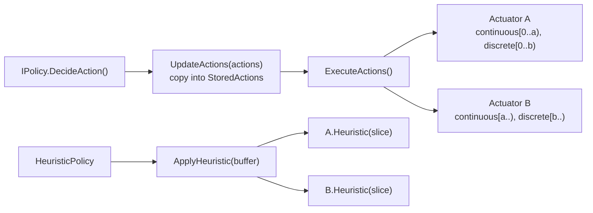

## Overview

Actions travel the opposite way from observations: a policy produces one flat block of continuous floats and discrete integers per agent, and that block has to be split among the pieces of game code that act on it. Actuators are those pieces. Each `IActuator` declares the actions it needs with an `ActionSpec`, receives its slice of every decision, can supply heuristic actions, and can mask discrete actions that are not allowed. The agent's own `OnActionReceived` is itself wrapped in an actuator, so a hand-written agent and a component-based one go through the same path.

Sources: [com.unity.ml-agents/Runtime/Actuators/IActuator.cs:6-41](repo://com.unity.ml-agents/Runtime/Actuators/IActuator.cs#L6-L41), [com.unity.ml-agents/Runtime/Agent.cs:1063-1087](repo://com.unity.ml-agents/Runtime/Agent.cs#L1063-L1087)

The `ActuatorManager` owns an agent's actuators, combines their specs into the one the policy sees, and splits decisions back out. When it is called during a step is described in [[Agents and Episodes]]; integrations built on actuators are on [[Input System Integration]] and [[Match-3 Integration]].

Sources: [com.unity.ml-agents/Runtime/Actuators/ActuatorManager.cs:12-107](repo://com.unity.ml-agents/Runtime/Actuators/ActuatorManager.cs#L12-L107)

## Describing actions: ActionSpec

`ActionSpec` declares a number of continuous actions and a list of discrete branches, each branch with its own size. An agent may mix both kinds. `NumDiscreteActions` is the number of branches and `SumOfDiscreteBranchSizes` the total number of choices across them, which is the length of the action mask. `MakeContinuous(n)` and `MakeDiscrete(sizes...)` build single-kind specs.

Sources: [com.unity.ml-agents/Runtime/Actuators/ActionSpec.cs:10-79](repo://com.unity.ml-agents/Runtime/Actuators/ActionSpec.cs#L10-L79)

`Combine(specs...)` adds up the continuous counts and concatenates the branch sizes in order. `CheckAllContinuousOrDiscrete` throws when a spec has both kinds; it exists for trainers that cannot handle mixed actions.

Sources: [com.unity.ml-agents/Runtime/Actuators/ActionSpec.cs:85-135](repo://com.unity.ml-agents/Runtime/Actuators/ActionSpec.cs#L85-L135)

## Carrying actions: ActionBuffers and ActionSegment

`ActionBuffers` is a readonly struct with two views, `ContinuousActions` (`ActionSegment<float>`) and `DiscreteActions` (`ActionSegment<int>`). `ActionBuffers.Empty` has zero-length segments. `FromActionSpec(spec, float[])` splits a flat float array into continuous values and truncated integers, which is how recorded or received actions are unpacked; `Clear()` zeroes both segments.

Sources: [com.unity.ml-agents/Runtime/Actuators/IActionReceiver.cs:11-128](repo://com.unity.ml-agents/Runtime/Actuators/IActionReceiver.cs#L11-L128)

`ActionSegment<T>` is a window `(Array, Offset, Length)` onto a shared array, similar to `ArraySegment<T>`. Writing `segment[i]` writes into the shared array, which is what lets the manager hand each actuator its own slice of a single buffer without copying. Debug builds check that the window fits in the array, and the indexer throws for an index outside the window.

Sources: [com.unity.ml-agents/Runtime/Actuators/ActionSegment.cs:15-118](repo://com.unity.ml-agents/Runtime/Actuators/ActionSegment.cs#L15-L118)

## The actuator interfaces

### Interface summary

| Type | Members | Role |
| --- | --- | --- |
| `IActionReceiver` | `OnActionReceived(ActionBuffers)`, `WriteDiscreteActionMask(IDiscreteActionMask)` | Receives actions and masks discrete ones |
| `IHeuristicProvider` | `Heuristic(in ActionBuffers)` | Writes actions when no model or trainer decides |
| `IActuator` | both of the above, plus `ActionSpec`, `Name`, `ResetData()` | A unit of action handling |
| `ActuatorComponent` | `CreateActuators()`, `ActionSpec` | `MonoBehaviour` that creates actuators at agent start-up |
| `IDiscreteActionMask` | `SetActionEnabled(branch, actionIndex, isEnabled)` | Lets an actuator disable discrete actions |

Sources: [com.unity.ml-agents/Runtime/Actuators/IActionReceiver.cs:163-191](repo://com.unity.ml-agents/Runtime/Actuators/IActionReceiver.cs#L163-L191), [com.unity.ml-agents/Runtime/Actuators/IHeuristicProvider.cs:7-17](repo://com.unity.ml-agents/Runtime/Actuators/IHeuristicProvider.cs#L7-L17), [com.unity.ml-agents/Runtime/Actuators/IActuator.cs:6-25](repo://com.unity.ml-agents/Runtime/Actuators/IActuator.cs#L6-L25), [com.unity.ml-agents/Runtime/Actuators/ActuatorComponent.cs:9-24](repo://com.unity.ml-agents/Runtime/Actuators/ActuatorComponent.cs#L9-L24), [com.unity.ml-agents/Runtime/Actuators/IDiscreteActionMask.cs:6-25](repo://com.unity.ml-agents/Runtime/Actuators/IDiscreteActionMask.cs#L6-L25)

### VectorActuator

`VectorActuator` adapts any `IActionReceiver` (and optionally an `IHeuristicProvider`) into an actuator. It forwards `OnActionReceived`, `Heuristic` and `WriteDiscreteActionMask` to them and keeps the last actions it received. Its name gets a suffix from its spec: `-Discrete`, `-Continuous`, or `-Continuous-<n>-Discrete-<m>`. The agent creates an `AgentVectorActuator`, a subclass used only for analytics, from `BrainParameters.ActionSpec` with itself as receiver and heuristic provider; that is how `Agent.OnActionReceived`, `Agent.Heuristic` and `Agent.WriteDiscreteActionMask` are called.

Sources: [com.unity.ml-agents/Runtime/Actuators/VectorActuator.cs:8-104](repo://com.unity.ml-agents/Runtime/Actuators/VectorActuator.cs#L8-L104), [com.unity.ml-agents/Runtime/Agent.cs:94-107](repo://com.unity.ml-agents/Runtime/Agent.cs#L94-L107), [com.unity.ml-agents/Runtime/Agent.cs:1075-1081](repo://com.unity.ml-agents/Runtime/Agent.cs#L1075-L1081)

## ActuatorManager

### Building the list

The agent builds its manager during initialization: the vector actuator first, then every actuator created by `ActuatorComponent`s on the GameObject (or its children when `UseChildActuators` is on). Each `Add` updates running totals of continuous actions, discrete branches and branch sizes.

Sources: [com.unity.ml-agents/Runtime/Agent.cs:1063-1087](repo://com.unity.ml-agents/Runtime/Agent.cs#L1063-L1087), [com.unity.ml-agents/Runtime/Actuators/ActuatorManager.cs:347-393](repo://com.unity.ml-agents/Runtime/Actuators/ActuatorManager.cs#L347-L393)

### Freezing the layout

The first call that needs buffers runs `ReadyActuatorsForExecution`. It asserts in debug builds that actuator names are unique, sorts actuators by name (invariant culture) so the action layout is the same on every machine, allocates `StoredActions` with one slot per continuous action and per discrete branch, computes the combined `ActionSpec` and creates the discrete action mask. After this point, adding, removing or replacing actuators is a failed assertion, since it would change the layout the policy was built for.

Sources: [com.unity.ml-agents/Runtime/Actuators/ActuatorManager.cs:70-150](repo://com.unity.ml-agents/Runtime/Actuators/ActuatorManager.cs#L70-L150), [com.unity.ml-agents/Runtime/Actuators/ActuatorManager.cs:323-341](repo://com.unity.ml-agents/Runtime/Actuators/ActuatorManager.cs#L323-L341), [com.unity.ml-agents/Runtime/Actuators/ActuatorManager.cs:412-497](repo://com.unity.ml-agents/Runtime/Actuators/ActuatorManager.cs#L412-L497)

The combined spec is what `BehaviorParameters.GeneratePolicy` receives and what Python sees as the behavior's action spec. Because sorting happens by name, the agent's own `VectorActuator-...` actions are not necessarily first.

Sources: [com.unity.ml-agents/Runtime/Agent.cs:506-506](repo://com.unity.ml-agents/Runtime/Agent.cs#L506-L506), [com.unity.ml-agents/Runtime/Actuators/ActuatorManager.cs:97-106](repo://com.unity.ml-agents/Runtime/Actuators/ActuatorManager.cs#L97-L106)

### Dispatch



Sources: [com.unity.ml-agents/Runtime/Actuators/ActuatorManager.cs:159-255](repo://com.unity.ml-agents/Runtime/Actuators/ActuatorManager.cs#L159-L255), [com.unity.ml-agents/Runtime/Actuators/ActuatorManager.cs:262-300](repo://com.unity.ml-agents/Runtime/Actuators/ActuatorManager.cs#L262-L300)

`UpdateActions` copies the policy's continuous and discrete arrays into `StoredActions`, clearing a part when the policy returned none and asserting when sizes differ. `ExecuteActions`, called when the agent acts, walks the sorted actuators and gives each an `ActionBuffers` of `ActionSegment`s over `StoredActions`, advancing a continuous and a discrete offset by the actuator's counts; actuators with no actions are skipped. `ApplyHeuristic` does the same walk over the heuristic policy's output buffer and calls `Heuristic` on each actuator, so each heuristic writes straight into its own slice.

Sources: [com.unity.ml-agents/Runtime/Actuators/ActuatorManager.cs:159-255](repo://com.unity.ml-agents/Runtime/Actuators/ActuatorManager.cs#L159-L255), [com.unity.ml-agents/Runtime/Actuators/ActuatorManager.cs:262-300](repo://com.unity.ml-agents/Runtime/Actuators/ActuatorManager.cs#L262-L300)

`ResetData`, called when an episode resets, clears the stored actions, calls `ResetData` on every actuator and resets the mask.

Sources: [com.unity.ml-agents/Runtime/Actuators/ActuatorManager.cs:306-318](repo://com.unity.ml-agents/Runtime/Actuators/ActuatorManager.cs#L306-L318)

## Discrete action masking

Masking prevents a policy from choosing actions that make no sense right now, such as moving into a wall in GridWorld. Each time the agent sends state, `WriteActionMask` resets the mask and calls `WriteDiscreteActionMask` on every actuator with discrete actions, first setting `CurrentBranchOffset` to the number of branches before it. An actuator therefore always addresses its own branches starting from 0.

Sources: [com.unity.ml-agents/Runtime/Actuators/ActuatorManager.cs:197-212](repo://com.unity.ml-agents/Runtime/Actuators/ActuatorManager.cs#L197-L212), [com.unity.ml-agents/Runtime/Agent.cs:1122-1127](repo://com.unity.ml-agents/Runtime/Agent.cs#L1122-L1127)

`ActuatorDiscreteActionMask` stores one `bool` per discrete choice across all branches, where `true` means masked. `SetActionEnabled(branch, index, false)` sets the flag at the branch's starting index (a cumulative sum of branch sizes) plus `index`. Debug builds throw for a branch or index out of range, and `GetMask` throws if every action of some branch is masked, since the policy would have nothing to choose. The mask array stays null until something is masked, and the agent copies it into `AgentInfo.discreteActionMasks`.

Sources: [com.unity.ml-agents/Runtime/Actuators/ActuatorDiscreteActionMask.cs:9-95](repo://com.unity.ml-agents/Runtime/Actuators/ActuatorDiscreteActionMask.cs#L9-L95), [com.unity.ml-agents/Runtime/Actuators/ActuatorDiscreteActionMask.cs:100-148](repo://com.unity.ml-agents/Runtime/Actuators/ActuatorDiscreteActionMask.cs#L100-L148)

GridWorld's agent masks movement off the edges of its grid:

Sources: [Project/Assets/ML-Agents/Examples/GridWorld/Scripts/GridAgent.cs:88-106](repo://Project/Assets/ML-Agents/Examples/GridWorld/Scripts/GridAgent.cs#L88-L106)

```csharp
    public override void WriteDiscreteActionMask(IDiscreteActionMask actionMask)
    {
        // Mask the necessary actions if selected by the user.
        if (maskActions)
        {
            // Prevents the agent from picking an action that would make it collide with a wall
            var positionX = (int)transform.localPosition.x;
            var positionZ = (int)transform.localPosition.z;
            var maxPosition = (int)m_ResetParams.GetWithDefault("gridSize", 5f) - 1;

            if (positionX == 0)
            {
                actionMask.SetActionEnabled(0, k_Left, false);
            }

            if (positionX == maxPosition)
            {
                actionMask.SetActionEnabled(0, k_Right, false);
            }
```

Sources: [Project/Assets/ML-Agents/Examples/GridWorld/Scripts/GridAgent.cs:88-106](repo://Project/Assets/ML-Agents/Examples/GridWorld/Scripts/GridAgent.cs#L88-L106)

On the trainer side, the categorical distributions push masked logits to a large negative value so those actions are never sampled; see [[Policies and Network Architecture]].

Sources: [ml-agents/mlagents/trainers/torch_entities/distributions.py:219-237](repo://ml-agents/mlagents/trainers/torch_entities/distributions.py#L219-L237)

## Writing a custom actuator

A custom actuator implements `IActuator` and is returned from an `ActuatorComponent`. The component's `ActionSpec` must match what its actuators declare, since the inspector and model checks read it before the actuators exist. The Basic example's `BasicActuatorComponent` declares one discrete branch of three actions with `ActionSpec.MakeDiscrete(3)`; its `BasicActuator` moves the controller in `OnActionReceived`, reads the horizontal input axis in `Heuristic`, and leaves `WriteDiscreteActionMask` empty.

Sources: [com.unity.ml-agents/Runtime/Actuators/ActuatorComponent.cs:9-24](repo://com.unity.ml-agents/Runtime/Actuators/ActuatorComponent.cs#L9-L24), [Project/Assets/ML-Agents/Examples/Basic/Scripts/BasicActuatorComponent.cs:1-99](repo://Project/Assets/ML-Agents/Examples/Basic/Scripts/BasicActuatorComponent.cs#L1-L99)
