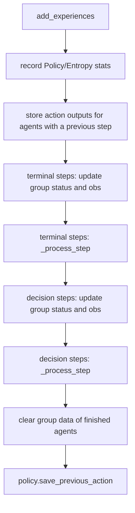

## Overview

Unity returns data per step and per behavior: a batch of agents that need actions and a batch of agents that just finished. Trainers want something else: for each agent, a contiguous run of experiences (observation, action, reward, next observation) that they can turn into advantages and gradients. The `AgentProcessor` sits between the two. It keeps a running history per agent, pairs each new observation with the action that led to it, cuts the history into `Trajectory` objects at the time horizon or the end of an episode, and pushes them onto a queue that the trainer reads. Trainers convert trajectories into `AgentBuffer`s, the column-oriented store all algorithms train from.

Sources: [ml-agents/mlagents/trainers/agent_processor.py:36-88](repo://ml-agents/mlagents/trainers/agent_processor.py#L36-L88), [ml-agents/mlagents/trainers/trajectory.py:136-153](repo://ml-agents/mlagents/trainers/trajectory.py#L136-L153)

One `AgentManager` exists per behavior id; [[Trainer Controller and Environment Managers]] shows where it is created and fed. What trainers do with the buffers is on [[Trainer Architecture]].

Sources: [ml-agents/mlagents/trainers/trainer_controller.py:143-155](repo://ml-agents/mlagents/trainers/trainer_controller.py#L143-L155)

## Identifiers

Agent ids from Unity are unique only within one environment process, so the processor works with global ids: `get_global_agent_id(worker_id, agent_id)` returns `agent_<worker>-<id>` and `get_global_group_id` returns `group_<worker>-<id>`. Behavior ids are the fully qualified `name?team=N` strings; `BehaviorIdentifiers.from_name_behavior_id` splits them into brain name and team id, and `create_name_behavior_id` builds them.

Sources: [ml-agents/mlagents/trainers/behavior_id_utils.py:1-64](repo://ml-agents/mlagents/trainers/behavior_id_utils.py#L1-L64)

## What arrives each step

`add_experiences(decision_steps, terminal_steps, worker_id, previous_action)` receives one behavior's step results from one worker together with the `ActionInfo` the policy produced for the previous step of that worker. `ActionInfo` holds the raw `action`, the `env_action` actually sent to Unity, an `outputs` dictionary with everything the policy computed (`action`, `log_probs`, `entropy`, ...) and the `agent_ids` it was computed for.

Sources: [ml-agents/mlagents/trainers/agent_processor.py:90-103](repo://ml-agents/mlagents/trainers/agent_processor.py#L90-L103), [ml-agents/mlagents/trainers/action_info.py:1-25](repo://ml-agents/mlagents/trainers/action_info.py#L1-L25)

## Processing a step

### Step order

Sources: [ml-agents/mlagents/trainers/agent_processor.py:90-157](repo://ml-agents/mlagents/trainers/agent_processor.py#L90-L157)

The order matters. Every entry of the policy's `entropy` output is recorded as a `Policy/Entropy` stat. Action outputs are stored only for agents that already have a last step, since an agent that just reset has no observation that the action answered. Terminal steps are processed before decision steps because an agent can appear in both in the same step (it finished and immediately began a new episode), and the old episode must be closed before the new one starts. Group information is gathered for all agents of a batch before any of them is processed, so each agent sees its teammates' latest state. Finally the action is saved as the "previous action" input for recurrent or previous-action-aware policies.

Sources: [ml-agents/mlagents/trainers/agent_processor.py:103-157](repo://ml-agents/mlagents/trainers/agent_processor.py#L103-L157)

### From a step to an experience

`_process_step` looks up the agent's last decision step and the action outputs of the policy for it. If both exist, the new step is the consequence of that action, and it builds an `AgentExperience` from them:

Sources: [ml-agents/mlagents/trainers/agent_processor.py:214-246](repo://ml-agents/mlagents/trainers/agent_processor.py#L214-L246)

| Field | Source |
| --- | --- |
| `obs` | the observation of the previous decision step |
| `action`, `action_probs` | that agent's row of the stored action and log-probabilities |
| `action_mask` | the mask of the previous decision step |
| `prev_action` | the action before that, from the policy |
| `memory` | the policy's previous memory for the agent, if recurrent |
| `reward` | the reward reported in the new step |
| `done`, `interrupted` | whether the new step is terminal, and whether it was cut short |
| `group_status`, `group_reward` | teammates' latest statuses and the group reward |

Sources: [ml-agents/mlagents/trainers/agent_processor.py:236-276](repo://ml-agents/mlagents/trainers/agent_processor.py#L236-L276), [ml-agents/mlagents/trainers/trajectory.py:14-43](repo://ml-agents/mlagents/trainers/trajectory.py#L14-L43)

The experience is appended to the agent's buffer and its reward added to the episode total. When the buffer reaches `max_trajectory_length` (the behavior's `time_horizon`) or the step is terminal, the processor builds a `Trajectory` with the buffered steps, the new observation as `next_obs`, the teammates' current observations as `next_group_obs`, the global agent id and behavior id, puts it on every subscribed trajectory queue and empties the buffer.

Sources: [ml-agents/mlagents/trainers/agent_processor.py:277-303](repo://ml-agents/mlagents/trainers/agent_processor.py#L277-L303)

On a terminal step it also records `Environment/Episode Length` and cleans up everything held for the agent: its experience buffer, stored action outputs, last step, counters, and the policy's previous action and memories.

Sources: [ml-agents/mlagents/trainers/agent_processor.py:304-330](repo://ml-agents/mlagents/trainers/agent_processor.py#L304-L330)

### Group bookkeeping

For agents with a non-zero group id, `_add_group_status_and_obs` stores an `AgentStatus` (previous observation, reward, action, done) under the global group id and records the agent's current observation. Each experience's `group_status` lists every other member's status; each trajectory's `next_group_obs` lists the others' current observations. Finished agents are removed from these maps only after all of the step's experiences are built. See [[Multi-Agent Groups]].

Sources: [ml-agents/mlagents/trainers/agent_processor.py:159-212](repo://ml-agents/mlagents/trainers/agent_processor.py#L159-L212), [ml-agents/mlagents/trainers/agent_processor.py:143-148](repo://ml-agents/mlagents/trainers/agent_processor.py#L143-L148)

### Ending episodes from outside

`end_episode()` drops every agent's partial data without emitting trajectories. The environment manager calls it on all managers before a reset, for example when a curriculum lesson changes, so experiences from before the reset are never joined to observations after it.

Sources: [ml-agents/mlagents/trainers/agent_processor.py:342-349](repo://ml-agents/mlagents/trainers/agent_processor.py#L342-L349), [ml-agents/mlagents/trainers/env_manager.py:63-69](repo://ml-agents/mlagents/trainers/env_manager.py#L63-L69)

## AgentManager and its queues

`AgentManager` is the `AgentProcessor` the controller uses. It owns two `AgentManagerQueue`s, thin wrappers over `queue.Queue` that raise `AgentManagerQueue.Empty` from `get_nowait`:

Sources: [ml-agents/mlagents/trainers/agent_processor.py:352-412](repo://ml-agents/mlagents/trainers/agent_processor.py#L352-L412)

| Queue | Direction | Size |
| --- | --- | --- |
| `trajectory_queue` | processor to trainer | 20 when the trainer is threaded, unbounded otherwise |
| `policy_queue` | trainer to environment manager | unbounded |

Sources: [ml-agents/mlagents/trainers/agent_processor.py:415-439](repo://ml-agents/mlagents/trainers/agent_processor.py#L415-L439)

The bounded trajectory queue applies back-pressure: a threaded trainer that falls behind blocks the environment loop instead of letting trajectories pile up. The policy queue is unbounded to avoid deadlocks, and the environment manager drains it before every step, keeping only the newest policy.

Sources: [ml-agents/mlagents/trainers/agent_processor.py:429-438](repo://ml-agents/mlagents/trainers/agent_processor.py#L429-L438), [ml-agents/mlagents/trainers/env_manager.py:112-122](repo://ml-agents/mlagents/trainers/env_manager.py#L112-L122)

`record_environment_stats` forwards stats sent by the environment's `StatsRecorder`. `AVERAGE`, `SUM` and `HISTOGRAM` values are added; `MOST_RECENT` values are set, and only from worker 0 so parallel environments do not overwrite each other. See [[Stats and TensorBoard]].

Sources: [ml-agents/mlagents/trainers/agent_processor.py:441-469](repo://ml-agents/mlagents/trainers/agent_processor.py#L441-L469)

## Trajectory to AgentBuffer

`Trajectory.to_agentbuffer()` lays the experiences out as columns, one row per step. For each step it writes the observation and the next observation (the following step's, or `next_obs` for the last), the actions and log-probabilities split into continuous and discrete parts, the next actions (zeros after the last step), `done`, the environment reward, the previous action, the memory if any, and a `masks` value of 1. Action masks are inverted to "1 means allowed" and padded with 1. Group data (teammate observations, actions, next actions, rewards, dones and the group reward) is written into list-valued columns.

Sources: [ml-agents/mlagents/trainers/trajectory.py:145-239](repo://ml-agents/mlagents/trainers/trajectory.py#L145-L239), [ml-agents/mlagents/trainers/trajectory.py:241-291](repo://ml-agents/mlagents/trainers/trajectory.py#L241-L291)

Three properties summarize how the trajectory ended: `done_reached` (last step terminal), `interrupted` (last step cut short, so value should be bootstrapped) and `all_group_dones_reached` (every teammate done too).

Sources: [ml-agents/mlagents/trainers/trajectory.py:293-313](repo://ml-agents/mlagents/trainers/trajectory.py#L293-L313)

## AgentBuffer

### Keys

`AgentBuffer` is a mutable mapping from keys to `AgentBufferField`s, which are lists of arrays. Keys are typed rather than strings: `BufferKey` members for fixed fields, `(ObservationKeyPrefix, index)` for the i-th observation (`obs`, `next_obs`, `group_obs`, `next_group_obs`), and `(RewardSignalKeyPrefix, name)` for per-reward-signal fields (`rewards`, `value_estimates`, `returns`, `advantage`, `baselines`). `ObsUtil`, `GroupObsUtil` and `RewardSignalUtil` build these keys.

Sources: [ml-agents/mlagents/trainers/buffer.py:25-95](repo://ml-agents/mlagents/trainers/buffer.py#L25-L95), [ml-agents/mlagents/trainers/trajectory.py:46-133](repo://ml-agents/mlagents/trainers/trajectory.py#L46-L133)

### Fields

`append(element, padding_value)` adds a row and remembers how the field should be padded. `get_batch(batch_size, training_length, sequential)` returns the last rows in sequences of `training_length`: non-overlapping with padding at the front (sequential, used for recurrent training) or as overlapping windows. `padded_to_batch(pad_value)` turns a field into a numpy array; for list-valued group fields it returns one array per teammate slot, padding steps with fewer teammates (with `NaN` for group observations).

Sources: [ml-agents/mlagents/trainers/buffer.py:97-201](repo://ml-agents/mlagents/trainers/buffer.py#L97-L201), [ml-agents/mlagents/trainers/buffer.py:209-251](repo://ml-agents/mlagents/trainers/buffer.py#L209-L251)

### Buffer operations

| Method | Use |
| --- | --- |
| `resequence_and_append(target, key_list, batch_size, training_length)` | Append a trajectory's buffer to the trainer's update buffer, padded into sequences for LSTMs |
| `shuffle(sequence_length, key_list)` | Shuffle whole sequences, the same permutation for every field |
| `make_mini_batch(start, end)` | Slice a contiguous minibatch |
| `sample_mini_batch(batch_size, sequence_length)` | Sample random sequences (off-policy replay) |
| `truncate(max_length, sequence_length)` | Keep the newest rows, a whole number of sequences |
| `save_to_file`, `load_from_file` | Store the buffer in HDF5 (SAC's replay buffer) |
| `num_experiences` | Number of rows |

Sources: [ml-agents/mlagents/trainers/buffer.py:383-463](repo://ml-agents/mlagents/trainers/buffer.py#L383-L463), [ml-agents/mlagents/trainers/buffer.py:465-521](repo://ml-agents/mlagents/trainers/buffer.py#L465-L521)

`check_length` verifies that a set of fields has the same number of rows; `shuffle` and `resequence_and_append` raise `BufferException` otherwise, which catches a field that a trainer forgot to fill.

Sources: [ml-agents/mlagents/trainers/buffer.py:361-404](repo://ml-agents/mlagents/trainers/buffer.py#L361-L404), [ml-agents/mlagents/trainers/buffer.py:480-507](repo://ml-agents/mlagents/trainers/buffer.py#L480-L507)
