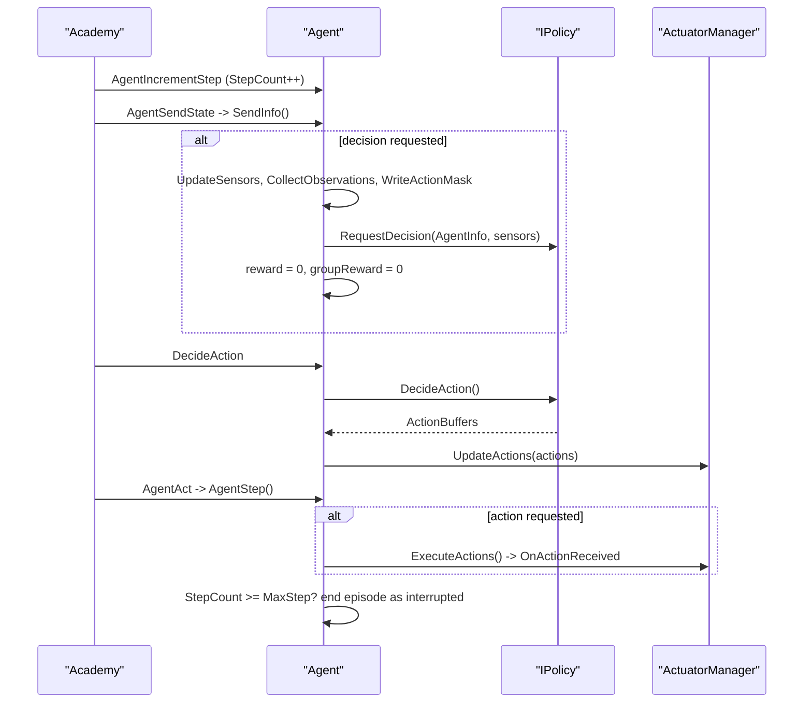

## Overview

`Agent` is the `MonoBehaviour` you subclass to turn a GameObject into something that learns. It gathers observations, receives actions, accumulates rewards and marks the end of episodes; everything else (which policy decides, how observations are encoded, how they reach Python) is delegated. An `Agent` requires a `BehaviorParameters` component on the same GameObject and runs early in the frame (`DefaultExecutionOrder(-50)`).

Sources: [com.unity.ml-agents/Runtime/Agent.cs:201-225](repo://com.unity.ml-agents/Runtime/Agent.cs#L201-L225)

An agent does nothing on its own clock. It subscribes to the Academy's step events, and in each step it collects observations only if it requested a decision and applies actions only if it requested an action. The event order is described in [[Academy and the Environment Step Loop]]; the policy behind `m_Brain` is chosen as described in [[Behavior Parameters and Policies]].

Sources: [com.unity.ml-agents/Runtime/Agent.cs:495-499](repo://com.unity.ml-agents/Runtime/Agent.cs#L495-L499), [com.unity.ml-agents/Runtime/Agent.cs:1372-1414](repo://com.unity.ml-agents/Runtime/Agent.cs#L1372-L1414)

## Methods to override

| Method | Called | Use it to |
| --- | --- | --- |
| `Initialize()` | once, from `LazyInitialize`, after actuators and the policy exist | cache components and read settings |
| `OnEpisodeBegin()` | at every reset of the agent | put the agent and its surroundings in a start state |
| `CollectObservations(VectorSensor sensor)` | each time the agent sends state, and once more when it is done | add vector observations to `sensor` |
| `WriteDiscreteActionMask(IDiscreteActionMask actionMask)` | right after `CollectObservations` | disable discrete actions that are not allowed now |
| `OnActionReceived(ActionBuffers actions)` | when the agent acts | apply continuous and discrete actions, give rewards, end episodes |
| `Heuristic(in ActionBuffers actionsOut)` | when the heuristic policy decides | write actions from player input or scripted logic |

Sources: [com.unity.ml-agents/Runtime/Agent.cs:912-912](repo://com.unity.ml-agents/Runtime/Agent.cs#L912-L912), [com.unity.ml-agents/Runtime/Agent.cs:975-978](repo://com.unity.ml-agents/Runtime/Agent.cs#L975-L978), [com.unity.ml-agents/Runtime/Agent.cs:1208-1210](repo://com.unity.ml-agents/Runtime/Agent.cs#L1208-L1210), [com.unity.ml-agents/Runtime/Agent.cs:1251-1251](repo://com.unity.ml-agents/Runtime/Agent.cs#L1251-L1251), [com.unity.ml-agents/Runtime/Agent.cs:1321-1329](repo://com.unity.ml-agents/Runtime/Agent.cs#L1321-L1329)

The base `Heuristic` only logs a warning and leaves the action buffers as they are. `ScaleAction(rawAction, min, max)` maps an action in `[-1, 1]` linearly onto `[min, max]` for use in `OnActionReceived`.

Sources: [com.unity.ml-agents/Runtime/Agent.cs:975-978](repo://com.unity.ml-agents/Runtime/Agent.cs#L975-L978), [com.unity.ml-agents/Runtime/Agent.cs:1362-1367](repo://com.unity.ml-agents/Runtime/Agent.cs#L1362-L1367)

## Initialization

`Awake` registers the gRPC communicator with `CommunicatorFactory` on Editor and standalone platforms if no communicator is registered yet. `OnEnable` calls `LazyInitialize`, which does its work once per enable, in the steps below.

Sources: [com.unity.ml-agents/Runtime/Agent.cs:378-410](repo://com.unity.ml-agents/Runtime/Agent.cs#L378-L410)

1. Takes a new id from `EpisodeIdCounter`, a static counter that hands out increasing integers, and finds the `BehaviorParameters`.
2. Subscribes `AgentIncrementStep`, `SendInfo`, `DecideAction`, `AgentStep` and `_AgentReset` to the Academy's events (creating the Academy if needed).
3. Builds the actuators: an `AgentVectorActuator` that forwards to this agent's `OnActionReceived` and `Heuristic`, plus every `ActuatorComponent` on the GameObject (or its children when `UseChildActuators` is set), all held by an `ActuatorManager`.
4. Asks `BehaviorParameters.GeneratePolicy` for the policy, using the combined action spec of all actuators.
5. Calls your `Initialize()`, then builds the sensors.
6. Allocates `AgentInfo.storedActions` sized to the combined action spec.
7. Calls `OnEpisodeBegin()` only if the Academy has already stepped; otherwise the Academy's first forced reset will call it, so the agent never begins two episodes at once.

Sources: [com.unity.ml-agents/Runtime/Agent.cs:378-410](repo://com.unity.ml-agents/Runtime/Agent.cs#L378-L410), [com.unity.ml-agents/Runtime/Agent.cs:480-533](repo://com.unity.ml-agents/Runtime/Agent.cs#L480-L533), [com.unity.ml-agents/Runtime/Agent.cs:1063-1087](repo://com.unity.ml-agents/Runtime/Agent.cs#L1063-L1087), [com.unity.ml-agents/Runtime/EpisodeIdCounter.cs:1-11](repo://com.unity.ml-agents/Runtime/EpisodeIdCounter.cs#L1-L11)

`InitializeSensors` assembles the sensor list in three parts: reflection sensors for fields and properties marked `[Observable]` (unless `ObservableAttributeHandling` is `Ignore`), the sensors created by every `SensorComponent` on the GameObject or its children, and, when `BrainParameters.VectorObservationSize` is above zero, a `VectorSensor` for `CollectObservations`, wrapped in a `StackingSensor` when `NumStackedVectorObservations` is above one. The list is then sorted by sensor name so observation order is deterministic; debug builds assert that names are unique. See [[Sensors and Observations]].

Sources: [com.unity.ml-agents/Runtime/Agent.cs:984-1048](repo://com.unity.ml-agents/Runtime/Agent.cs#L984-L1048)

## Requesting decisions and actions

### Decision and action flags

An agent takes part in a step only when asked. `RequestDecision()` sets both the decision and the action flag; `RequestAction()` sets only the action flag, so the agent repeats its last action without consulting the policy.

Sources: [com.unity.ml-agents/Runtime/Agent.cs:855-887](repo://com.unity.ml-agents/Runtime/Agent.cs#L855-L887)

### Per-step flow

Sources: [com.unity.ml-agents/Runtime/Agent.cs:1092-1148](repo://com.unity.ml-agents/Runtime/Agent.cs#L1092-L1148), [com.unity.ml-agents/Runtime/Agent.cs:1372-1414](repo://com.unity.ml-agents/Runtime/Agent.cs#L1372-L1414)

### Building AgentInfo

`SendInfoToBrain` throws if the agent was never initialized (the usual cause is an `OnEnable` override that does not call `base.OnEnable()`) and returns silently when there is no policy. It copies the actions currently stored in the actuators into `AgentInfo.storedActions` (or clears them when the previous info was terminal), updates the sensors, runs `CollectObservations` inside a recursion guard and `WriteActionMask`. It then fills the rest of `AgentInfo`: the discrete action mask, the reward and group reward accumulated since the last decision, `done = false`, the episode id and group id. Finally it hands the info and sensors to the policy and to every attached `DemonstrationWriter`.

Sources: [com.unity.ml-agents/Runtime/Agent.cs:1092-1148](repo://com.unity.ml-agents/Runtime/Agent.cs#L1092-L1148)

| `AgentInfo` field | Meaning |
| --- | --- |
| `storedActions` | the actions taken since the previous decision |
| `discreteActionMasks` | `true` for masked discrete actions, concatenated across branches |
| `reward`, `groupReward` | rewards accumulated since the previous decision |
| `done`, `maxStepReached` | whether this is the last step of an episode, and whether it was cut short |
| `episodeId` | the agent's id, which Python uses to identify the agent |
| `groupId` | the multi-agent group id, 0 when the agent has no group |

Sources: [com.unity.ml-agents/Runtime/Agent.cs:19-88](repo://com.unity.ml-agents/Runtime/Agent.cs#L19-L88)

### DecisionRequester

Most agents do not call `RequestDecision` themselves; they add a `DecisionRequester`. On `Awake` it subscribes to `Academy.AgentPreStep`, and before each step it requests a decision when `AcademyStepCount % DecisionPeriod == DecisionStep`, and requests an action on every step when `TakeActionsBetweenDecisions` is on. `DecisionPeriod` ranges from 1 to 20 (default 5) and `DecisionStep` offsets agents that share a period. Both checks are virtual (`ShouldRequestDecision`, `ShouldRequestAction`), so a subclass can request decisions on its own schedule.

Sources: [com.unity.ml-agents/Runtime/DecisionRequester.cs:20-133](repo://com.unity.ml-agents/Runtime/DecisionRequester.cs#L20-L133)

## Rewards

`AddReward(increment)` adds to the reward of the current step and to the cumulative episode reward; `SetReward(reward)` replaces the step reward and corrects the cumulative total by the difference. Both run `Utilities.DebugCheckNanAndInfinity` on the value. The step reward is reset to zero each time the agent sends a decision, so a reward given between decisions is reported with the next one. `GetCumulativeReward()` returns the episode total.

Sources: [com.unity.ml-agents/Runtime/Agent.cs:735-789](repo://com.unity.ml-agents/Runtime/Agent.cs#L735-L789), [com.unity.ml-agents/Runtime/Agent.cs:1372-1382](repo://com.unity.ml-agents/Runtime/Agent.cs#L1372-L1382)

Group rewards are set only by a multi-agent group through the internal `SetGroupReward` and `AddGroupReward`; see [[Multi-Agent Groups]].

Sources: [com.unity.ml-agents/Runtime/Agent.cs:770-780](repo://com.unity.ml-agents/Runtime/Agent.cs#L770-L780)

## Ending episodes

An episode ends in one of three ways, each recorded as a `DoneReason`.

Sources: [com.unity.ml-agents/Runtime/Agent.cs:538-554](repo://com.unity.ml-agents/Runtime/Agent.cs#L538-L554)

| Cause | API | `maxStepReached` | Counts as completed |
| --- | --- | --- | --- |
| The task ended (success or failure) | `EndEpisode()` | `false` | yes |
| The episode was cut short | `EpisodeInterrupted()`, or `StepCount >= MaxStep` with `MaxStep > 0` | `true` | yes |
| The agent was disabled or its model changed | `OnDisable`, `SetModel` | `false` | no |

Sources: [com.unity.ml-agents/Runtime/Agent.cs:538-554](repo://com.unity.ml-agents/Runtime/Agent.cs#L538-L554), [com.unity.ml-agents/Runtime/Agent.cs:806-835](repo://com.unity.ml-agents/Runtime/Agent.cs#L806-L835), [com.unity.ml-agents/Runtime/Agent.cs:1390-1403](repo://com.unity.ml-agents/Runtime/Agent.cs#L1390-L1403)

The difference between the first two matters to training: an interrupted episode tells the trainer the final state was not terminal, so it should still bootstrap a value from it (see [[Agent Processor and Trajectories]]).

Sources: [com.unity.ml-agents/Runtime/Agent.cs:596-608](repo://com.unity.ml-agents/Runtime/Agent.cs#L596-L608)

`NotifyAgentDone` sends a final observation immediately rather than waiting for the next decision, so Python learns about the end in the same step. It does nothing if the info is already marked done. Otherwise it fills `AgentInfo` with `done = true`, updates sensors, calls `CollectObservations` one last time, calls `RequestDecision` on the policy and records the step to demonstration writers. It then resets sensors, increments `CompletedEpisodes` and publishes the cumulative reward as a `<Behavior>.CumulativeReward` timer gauge (except when disabled), and clears rewards, request flags and stored actions.

Sources: [com.unity.ml-agents/Runtime/Agent.cs:596-644](repo://com.unity.ml-agents/Runtime/Agent.cs#L596-L644), [com.unity.ml-agents/Runtime/Agent.cs:791-795](repo://com.unity.ml-agents/Runtime/Agent.cs#L791-L795)

`EndEpisode` and `EpisodeInterrupted` then call `_AgentReset`, which resets actuator data, sets `StepCount` to 0 and calls `OnEpisodeBegin` inside a recursion guard. The same `_AgentReset` runs when the Academy forces a full reset.

Sources: [com.unity.ml-agents/Runtime/Agent.cs:831-835](repo://com.unity.ml-agents/Runtime/Agent.cs#L831-L835), [com.unity.ml-agents/Runtime/Agent.cs:1344-1352](repo://com.unity.ml-agents/Runtime/Agent.cs#L1344-L1352)

> [!WARNING]
> Calling `EndEpisode()` from inside `CollectObservations()` or `OnEpisodeBegin()` re-enters a guarded method and throws `UnityAgentsException`. End episodes from `OnActionReceived` or game logic instead.

Sources: [com.unity.ml-agents/Runtime/Agent.cs:339-340](repo://com.unity.ml-agents/Runtime/Agent.cs#L339-L340), [com.unity.ml-agents/Runtime/RecursionChecker.cs:15-26](repo://com.unity.ml-agents/Runtime/RecursionChecker.cs#L15-L26)

## Disabling and swapping models

`OnDisable` clears demonstration writers and, if the Academy still exists, unsubscribes from its events and ends the episode with reason `Disabled`. It then disposes sensors that implement `IDisposable`, disposes the policy and raises `OnAgentDisabled`, which multi-agent groups use to drop the agent. Checking `Academy.IsInitialized` first avoids recreating an Academy that is being shut down.

Sources: [com.unity.ml-agents/Runtime/Agent.cs:574-594](repo://com.unity.ml-agents/Runtime/Agent.cs#L574-L594), [com.unity.ml-agents/Runtime/Agent.cs:1050-1061](repo://com.unity.ml-agents/Runtime/Agent.cs#L1050-L1061)

`SetModel(behaviorName, model, inferenceDevice)` switches an agent to another behavior or ONNX model at run time, as the WallJump example does per wall height. If nothing changed it returns; otherwise it ends the current episode as `Disabled`, writes the new values into `BehaviorParameters` and regenerates the policy.

Sources: [com.unity.ml-agents/Runtime/Agent.cs:664-693](repo://com.unity.ml-agents/Runtime/Agent.cs#L664-L693)

## Serialization upgrade

`MaxStep` used to live in a nested `AgentParameters` struct. `OnBeforeSerialize` and `OnAfterDeserialize` copy the old value into `MaxStep` once, the first time a scene saved by an older version is loaded, and set `hasUpgradedFromAgentParameters` so the copy never repeats.

Sources: [com.unity.ml-agents/Runtime/Agent.cs:214-273](repo://com.unity.ml-agents/Runtime/Agent.cs#L214-L273), [com.unity.ml-agents/Runtime/Agent.cs:432-472](repo://com.unity.ml-agents/Runtime/Agent.cs#L432-L472)
