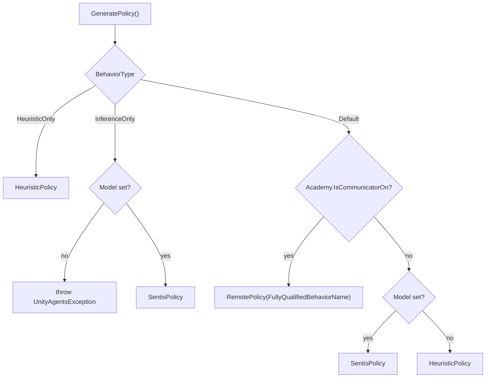

## Overview

Every agent needs a `BehaviorParameters` component. It names the agent's behavior, describes the shape of its vector observations and actions (`BrainParameters`), holds an optional ONNX model, and decides which policy produces the agent's actions: the Python trainer, the model, or the agent's own `Heuristic`. Agents that share a behavior name share a trainer in Python and, with a model, a batched model runner in Unity.

Sources: [com.unity.ml-agents/Runtime/Policies/BehaviorParameters.cs:71-156](repo://com.unity.ml-agents/Runtime/Policies/BehaviorParameters.cs#L71-L156)

The policy is the only thing an agent talks to when it decides. [[Agents and Episodes]] shows when the agent calls it; this page explains how it is chosen and what each implementation does.

Sources: [com.unity.ml-agents/Runtime/Agent.cs:506-506](repo://com.unity.ml-agents/Runtime/Agent.cs#L506-L506)

## Component fields

| Property | Default | Meaning |
| --- | --- | --- |
| `BehaviorName` | `"My Behavior"` | Key for the trainer in Python and for the `behaviors` section of the training YAML |
| `TeamId` | 0 | Team for self-play; part of the fully qualified name |
| `BrainParameters` | vector size 1, no actions | Size and stacking of the `CollectObservations` vector, and the `ActionSpec` of the agent's own actions |
| `Model` | none | ONNX `ModelAsset` used for inference |
| `InferenceDevice` | `Default` | `Default`, `ComputeShader`, `Burst` or `PixelShader` |
| `BehaviorType` | `Default` | `Default`, `HeuristicOnly` or `InferenceOnly` |
| `DeterministicInference` | `false` | Take the most likely action instead of sampling, during inference in Unity |
| `UseChildSensors`, `UseChildActuators` | `true` | Also collect sensor and actuator components from child GameObjects |
| `ObservableAttributeHandling` | `Ignore` | Whether `[Observable]` members create sensors: `Ignore`, `ExcludeInherited` or `ExamineAll` |

Sources: [com.unity.ml-agents/Runtime/Policies/BehaviorParameters.cs:13-63](repo://com.unity.ml-agents/Runtime/Policies/BehaviorParameters.cs#L13-L63), [com.unity.ml-agents/Runtime/Policies/BehaviorParameters.cs:91-156](repo://com.unity.ml-agents/Runtime/Policies/BehaviorParameters.cs#L91-L156), [com.unity.ml-agents/Runtime/Policies/BehaviorParameters.cs:159-214](repo://com.unity.ml-agents/Runtime/Policies/BehaviorParameters.cs#L159-L214), [com.unity.ml-agents/Runtime/Policies/SentisPolicy.cs:13-35](repo://com.unity.ml-agents/Runtime/Policies/SentisPolicy.cs#L13-L35)

Setting `Model`, `InferenceDevice`, `BehaviorType` or `BehaviorName` from code calls `UpdateAgentPolicy`, which makes the agent on the same GameObject regenerate its policy and raises `OnPolicyUpdated` with whether the agent is now in heuristic mode.

Sources: [com.unity.ml-agents/Runtime/Policies/BehaviorParameters.cs:105-150](repo://com.unity.ml-agents/Runtime/Policies/BehaviorParameters.cs#L105-L150), [com.unity.ml-agents/Runtime/Policies/BehaviorParameters.cs:283-292](repo://com.unity.ml-agents/Runtime/Policies/BehaviorParameters.cs#L283-L292)

## Behavior names and teams

The name sent to Python is `FullyQualifiedBehaviorName`, the behavior name followed by `?team=<TeamId>`. On the Python side, `BehaviorIdentifiers.from_name_behavior_id` parses that string as a URL: the path is the brain name and the `team` query parameter is the team id, defaulting to 0. The trainer is keyed by the brain name, so all teams of a behavior share one trainer, while each team gets its own policy. That is what lets [[Self-Play]] train one team while the other plays a frozen snapshot.

Sources: [com.unity.ml-agents/Runtime/Policies/BehaviorParameters.cs:219-222](repo://com.unity.ml-agents/Runtime/Policies/BehaviorParameters.cs#L219-L222), [ml-agents/mlagents/trainers/behavior_id_utils.py:9-50](repo://ml-agents/mlagents/trainers/behavior_id_utils.py#L9-L50)

## Choosing a policy

`GeneratePolicy(actionSpec, actuatorManager)` is called by the agent during initialization and whenever its policy is reloaded. The `actionSpec` is the combined spec of all the agent's actuators, not only `BrainParameters.ActionSpec`.

Sources: [com.unity.ml-agents/Runtime/Policies/BehaviorParameters.cs:229-263](repo://com.unity.ml-agents/Runtime/Policies/BehaviorParameters.cs#L229-L263), [com.unity.ml-agents/Runtime/Agent.cs:506-506](repo://com.unity.ml-agents/Runtime/Agent.cs#L506-L506)

Sources: [com.unity.ml-agents/Runtime/Policies/BehaviorParameters.cs:229-263](repo://com.unity.ml-agents/Runtime/Policies/BehaviorParameters.cs#L229-L263)

With `Default`, a connected trainer always wins: an agent that has a model still trains when `mlagents-learn` is running, and falls back to its model, then to its heuristic, when no trainer answered the Academy's handshake. `IsInHeuristicMode()` reports the same decision for the inspector and for actuators that behave differently under a heuristic: `HeuristicOnly`, or `Default` with no model and no connected communicator.

Sources: [com.unity.ml-agents/Runtime/Policies/BehaviorParameters.cs:247-281](repo://com.unity.ml-agents/Runtime/Policies/BehaviorParameters.cs#L247-L281)

## The IPolicy contract

`IPolicy` has two methods and is internal to the package. `RequestDecision(AgentInfo info, List<ISensor> sensors)` is called when an agent sends state; it may buffer the request. `DecideAction()` is called once per agent in the Academy's decide phase and returns the actions for that agent by readonly reference. Splitting the two lets a policy batch all agents' requests and evaluate them together on the first `DecideAction` of the step.

Sources: [com.unity.ml-agents/Runtime/Policies/IPolicy.cs:14-31](repo://com.unity.ml-agents/Runtime/Policies/IPolicy.cs#L14-L31)

## The three policies

### RemotePolicy

`RemotePolicy` hands decisions to the Python trainer. Its constructor takes the Academy's communicator and subscribes the fully qualified behavior name with its action spec, which is how Python learns the behavior exists. `RequestDecision` remembers the agent's id and calls `Communicator.PutObservations` with the info and sensors. `DecideAction` calls `Communicator.DecideBatch()`, which sends one message for all agents per step and waits for the reply, then fetches this agent's actions with `GetActions`; an agent with no actions gets `ActionBuffers.Empty`. On its first request it also reports the behavior's sensors and actuators to training analytics. See [[Communication Protocol]] and [[Usage Analytics]].

Sources: [com.unity.ml-agents/Runtime/Policies/RemotePolicy.cs:14-76](repo://com.unity.ml-agents/Runtime/Policies/RemotePolicy.cs#L14-L76)

### SentisPolicy

`SentisPolicy` runs an ONNX model locally. Its constructor asks `Academy.GetOrCreateModelRunner` for a runner keyed by model and device, so every agent with the same model shares one runner. `RequestDecision` calls `ModelRunner.PutObservations`, and `DecideAction` calls `ModelRunner.DecideBatch()` (which runs the model once for all queued agents) and then `GetAction(agentId)`. It reports the model to inference analytics on first use. The runner itself is described in [[Inference with Sentis]].

Sources: [com.unity.ml-agents/Runtime/Policies/SentisPolicy.cs:42-143](repo://com.unity.ml-agents/Runtime/Policies/SentisPolicy.cs#L42-L143), [com.unity.ml-agents/Runtime/Academy.cs:628-639](repo://com.unity.ml-agents/Runtime/Academy.cs#L628-L639)

### HeuristicPolicy

`HeuristicPolicy` asks the agent's actuators for actions. It allocates one `ActionBuffers` sized to the action spec. `RequestDecision` records whether the agent is done and that a decision was requested. `DecideAction` clears the buffers and calls `ActuatorManager.ApplyHeuristic` only when a decision was requested and the agent is not done; otherwise it returns the previous actions.

Sources: [com.unity.ml-agents/Runtime/Policies/HeuristicPolicy.cs:14-57](repo://com.unity.ml-agents/Runtime/Policies/HeuristicPolicy.cs#L14-L57)

`RequestDecision` also steps every sensor even though nothing reads the result. Uncompressed sensors write into a `NullList` that discards every value, and compressed sensors produce and drop their compressed bytes. This keeps sensors with internal state, such as stacking sensors, behaving the same under a heuristic as under training.

Sources: [com.unity.ml-agents/Runtime/Policies/HeuristicPolicy.cs:63-140](repo://com.unity.ml-agents/Runtime/Policies/HeuristicPolicy.cs#L63-L140)

## BrainParameters

`BrainParameters` describes the part of the agent's interface that lives on the agent itself. `VectorObservationSize` (default 1) and `NumStackedVectorObservations` (1 to 50) size the `VectorSensor` that `CollectObservations` writes into. `ActionSpec` declares the continuous actions and discrete branches received by `OnActionReceived`; other actuators add their own specs on top. `VectorActionDescriptions` holds optional labels for the inspector.

Sources: [com.unity.ml-agents/Runtime/Policies/BrainParameters.cs:35-91](repo://com.unity.ml-agents/Runtime/Policies/BrainParameters.cs#L35-L91), [com.unity.ml-agents/Runtime/Agent.cs:1018-1033](repo://com.unity.ml-agents/Runtime/Agent.cs#L1018-L1033)

Before mixed action spaces existed, an agent had either `VectorActionSize` continuous actions or `VectorActionSize` discrete branches, chosen by `VectorActionSpaceType`. Both fields are now obsolete. On serialization, `UpdateToActionSpec` converts them into an `ActionSpec` once (guarded by `hasUpgradedBrainParametersWithActionSpec`), and `SyncDeprecatedActionFields` keeps them in step with the `ActionSpec` for code that still reads them; a spec with both kinds of action sets `VectorActionSize` to null.

Sources: [com.unity.ml-agents/Runtime/Policies/BrainParameters.cs:11-23](repo://com.unity.ml-agents/Runtime/Policies/BrainParameters.cs#L11-L23), [com.unity.ml-agents/Runtime/Policies/BrainParameters.cs:128-190](repo://com.unity.ml-agents/Runtime/Policies/BrainParameters.cs#L128-L190)

## Inspector model checks

The Behavior Parameters inspector validates the assigned model against the agent as configured. `DisplayFailedModelChecks` rebuilds the agent's sensors, gathers its actuator components, sums the size of `[Observable]` sensors (showing a warning for each unsupported member), loads the model and runs `SentisModelParamLoader.CheckModel`. Each failed check appears as an info, warning or error box, so a model trained with different observation or action shapes is flagged before you press Play.

Sources: [com.unity.ml-agents/Editor/BehaviorParametersEditor.cs:105-180](repo://com.unity.ml-agents/Editor/BehaviorParametersEditor.cs#L105-L180)
