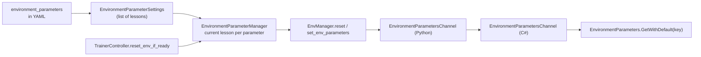

## Overview

Environment parameters let the training configuration change the scene without rebuilding it: the size of a grid, the height of a wall, the mass of a ball. They serve two purposes. Randomization draws values from a distribution so the policy learns to handle variety. Curriculum learning starts with an easy setting and moves to harder lessons as the agent improves. Both are declared under `environment_parameters` in the YAML, decided in Python by the `EnvironmentParameterManager`, and delivered to Unity over the environment parameters side channel, where game code reads them through `Academy.Instance.EnvironmentParameters`.

Sources: [ml-agents/mlagents/trainers/environment_parameter_manager.py:14-48](repo://ml-agents/mlagents/trainers/environment_parameter_manager.py#L14-L48), [com.unity.ml-agents/Runtime/EnvironmentParameters.cs:15-69](repo://com.unity.ml-agents/Runtime/EnvironmentParameters.cs#L15-L69)



Sources: [ml-agents/mlagents/trainers/trainer_controller.py:208-227](repo://ml-agents/mlagents/trainers/trainer_controller.py#L208-L227), [ml-agents/mlagents/trainers/subprocess_env_manager.py:434-457](repo://ml-agents/mlagents/trainers/subprocess_env_manager.py#L434-L457)

## Declaring parameters

Every parameter is normalized into a list of lessons, and a plain constant or sampler is a single lesson with no completion criteria. The YAML forms are described on [[Training Configuration]]. The WallJump curriculum, for example, raises the big wall in stages, each a uniform range, advancing on training progress of the `BigWallJump` behavior:

Sources: [ml-agents/mlagents/trainers/settings.py:558-594](repo://ml-agents/mlagents/trainers/settings.py#L558-L594)

```yaml
environment_parameters:
  big_wall_height:
    curriculum:
      - name: Lesson0 # The '-' is important as this is a list
        completion_criteria:
          measure: progress
          behavior: BigWallJump
          signal_smoothing: true
          min_lesson_length: 100
          threshold: 0.1
        value:
          sampler_type: uniform
          sampler_parameters:
            min_value: 0.0
            max_value: 4.0
      - name: Lesson1 # This is the start of the second lesson
        completion_criteria:
          measure: progress
          behavior: BigWallJump
          signal_smoothing: true
          min_lesson_length: 100
          threshold: 0.3
        value:
          sampler_type: uniform
          sampler_parameters:
            min_value: 4.0
            max_value: 7.0
```

Sources: [config/ppo/WallJump_curriculum.yaml:50-76](repo://config/ppo/WallJump_curriculum.yaml#L50-L76)

The agent reads the value with a default for when no trainer is connected:

Sources: [Project/Assets/ML-Agents/Examples/WallJump/Scripts/WallJumpAgent.cs:334-366](repo://Project/Assets/ML-Agents/Examples/WallJump/Scripts/WallJumpAgent.cs#L334-L366)

```csharp
var height = m_ResetParams.GetWithDefault("big_wall_height", 8);
```

Sources: [Project/Assets/ML-Agents/Examples/WallJump/Scripts/WallJumpAgent.cs:334-366](repo://Project/Assets/ML-Agents/Examples/WallJump/Scripts/WallJumpAgent.cs#L334-L366)

## Completion criteria

`CompletionCriteriaSettings` decides when a lesson is done:

Sources: [ml-agents/mlagents/trainers/settings.py:455-471](repo://ml-agents/mlagents/trainers/settings.py#L455-L471)

| Field | Default | Meaning |
| --- | --- | --- |
| `behavior` | required | Which behavior's trainer is measured |
| `measure` | `reward` | `reward` (mean recent episode return) or `progress` (step / max_steps) |
| `threshold` | 0.0 | Value to exceed; must be in `[0, 1]` for `progress` |
| `min_lesson_length` | 0 | Episodes that must complete in the lesson before it can end |
| `signal_smoothing` | true | Smooth the reward measure across checks |
| `require_reset` | false | Reset the environment when this lesson ends |

Sources: [ml-agents/mlagents/trainers/settings.py:455-488](repo://ml-agents/mlagents/trainers/settings.py#L455-L488)

`need_increment(progress, reward_buffer, smoothing)` returns false until the reward buffer holds `min_lesson_length` episodes. For `progress` it then compares the fraction of `max_steps` done with the threshold. For `reward` it takes the mean of the buffer (ignoring NaN), and with smoothing blends it as `0.25 * previous + 0.75 * mean` and keeps the blend for next time, then compares with the threshold.

Sources: [ml-agents/mlagents/trainers/settings.py:489-513](repo://ml-agents/mlagents/trainers/settings.py#L489-L513)

The reward buffer is the trainer's deque of most recent episode returns. Its length is set when the trainer is created, from `get_minimum_reward_buffer_size`: the largest `min_lesson_length` among lessons measuring that behavior, so the mean always covers the required number of episodes.

Sources: [ml-agents/mlagents/trainers/environment_parameter_manager.py:62-77](repo://ml-agents/mlagents/trainers/environment_parameter_manager.py#L62-L77), [ml-agents/mlagents/trainers/trainer/trainer_factory.py:97-113](repo://ml-agents/mlagents/trainers/trainer/trainer_factory.py#L97-L113), [ml-agents/mlagents/trainers/trainer/rl_trainer.py:70-82](repo://ml-agents/mlagents/trainers/trainer/rl_trainer.py#L70-L82)

## EnvironmentParameterManager

The manager stores each parameter's current lesson number in `GlobalTrainingStatus` under `lesson_num`, so it survives `--resume` through `training_status.json`. On creation it sets every parameter to lesson 0 unless restoring, and gives every sampler without an explicit seed the run seed plus an offset, so samplers are reproducible but not identical to each other.

Sources: [ml-agents/mlagents/trainers/environment_parameter_manager.py:33-60](repo://ml-agents/mlagents/trainers/environment_parameter_manager.py#L33-L60)

| Method | Returns |
| --- | --- |
| `get_current_samplers()` | Parameter name to the sampler settings of its current lesson |
| `get_current_lesson_number()` | Parameter name to its lesson index |
| `log_current_lesson(name)` | Logs lesson name and value for one or all parameters |
| `update_lessons(steps, max_steps, reward_buffers)` | `(any lesson changed, environment must reset)` |

Sources: [ml-agents/mlagents/trainers/environment_parameter_manager.py:79-133](repo://ml-agents/mlagents/trainers/environment_parameter_manager.py#L79-L133)

`update_lessons` looks at each parameter whose current lesson has completion criteria and is not the last. If the criteria's behavior has a trainer, it evaluates `need_increment` with that trainer's progress and reward buffer, stores the new smoothed value, and on success moves to the next lesson, logs it and flags a reset if the lesson asked for one.

Sources: [ml-agents/mlagents/trainers/environment_parameter_manager.py:135-186](repo://ml-agents/mlagents/trainers/environment_parameter_manager.py#L135-L186)

## When new values reach Unity

The controller calls `update_lessons` after every environment step. When a lesson changes, every trainer's reward buffer is cleared so the next lesson is judged on its own episodes. If a reset is required, the environment manager resets all environments with the new samplers, sending them before the reset command. Otherwise the samplers are only sent, and the scene picks them up the next time it reads them. The initial reset of the run also sends the samplers of the starting lessons. Each training step, every trainer reports `Environment/Lesson Number/<parameter>`.

Sources: [ml-agents/mlagents/trainers/trainer_controller.py:96-107](repo://ml-agents/mlagents/trainers/trainer_controller.py#L96-L107), [ml-agents/mlagents/trainers/trainer_controller.py:208-246](repo://ml-agents/mlagents/trainers/trainer_controller.py#L208-L246)

In each environment worker, every setting's `apply(key, channel)` queues the matching side channel message: `ConstantSettings` sends a float, the sampler settings send their type, arguments and seed. Messages leave with the next exchange with Unity. See [[Side Channels]].

Sources: [ml-agents/mlagents/trainers/subprocess_env_manager.py:200-203](repo://ml-agents/mlagents/trainers/subprocess_env_manager.py#L200-L203), [ml-agents/mlagents/trainers/settings.py:338-451](repo://ml-agents/mlagents/trainers/settings.py#L338-L451), [ml-agents-envs/mlagents_envs/side_channel/environment_parameters_channel.py:34-100](repo://ml-agents-envs/mlagents_envs/side_channel/environment_parameters_channel.py#L34-L100)

## Sampling in Unity

Sampling happens in Unity, not in Python. The C# `EnvironmentParametersChannel` stores a `Func<float>` per key: a closure returning the constant, or a sampler built by `SamplerFactory` with the seed Python sent. `GetWithDefault` invokes it, so each read of a sampled parameter draws a new value, while a constant returns the same value every time. Code that wants one value per episode should read the parameter once in `OnEpisodeBegin`.

Sources: [com.unity.ml-agents/Runtime/SideChannels/EnvironmentParametersChannel.cs:59-120](repo://com.unity.ml-agents/Runtime/SideChannels/EnvironmentParametersChannel.cs#L59-L120)

| Sampler | Draw |
| --- | --- |
| Uniform | `min + U(0, 1) * (max - min)` from `System.Random(seed)` |
| Gaussian | `RandomNormal(seed, mean, stddev)` |
| Multi-range uniform | Pick an interval with probability proportional to its width (using `Multinomial(seed + 1)`), then draw uniformly inside it |

Sources: [com.unity.ml-agents/Runtime/Sampler.cs:11-67](repo://com.unity.ml-agents/Runtime/Sampler.cs#L11-L67)

Float messages also call the callback registered for the key with `EnvironmentParameters.RegisterCallback`, which suits parameters that must rebuild part of the scene when they change; GridWorld's `GridSettings` registers one for `gridSize`. `Keys()` lists every parameter received so far.

Sources: [com.unity.ml-agents/Runtime/SideChannels/EnvironmentParametersChannel.cs:59-72](repo://com.unity.ml-agents/Runtime/SideChannels/EnvironmentParametersChannel.cs#L59-L72), [com.unity.ml-agents/Runtime/EnvironmentParameters.cs:39-63](repo://com.unity.ml-agents/Runtime/EnvironmentParameters.cs#L39-L63), [Project/Assets/ML-Agents/Examples/GridWorld/Scripts/GridSettings.cs:1-17](repo://Project/Assets/ML-Agents/Examples/GridWorld/Scripts/GridSettings.cs#L1-L17)

> [!NOTE]
> Sampler callbacks are not invoked: only float parameters trigger `RegisterCallback` handlers.

Sources: [com.unity.ml-agents/Runtime/SideChannels/EnvironmentParametersChannel.cs:63-101](repo://com.unity.ml-agents/Runtime/SideChannels/EnvironmentParametersChannel.cs#L63-L101)
