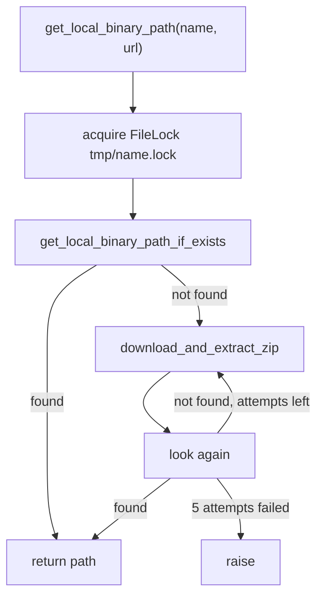

## Overview

The Unity Environment Registry lets Python code run prebuilt Unity environments by name, without installing the Unity Editor or building a scene. A registry maps identifiers such as `3DBall` to entries; an entry knows where to download a platform-specific executable and how to start a `UnityEnvironment` from it. The package ships a `default_registry` populated from a remote manifest, and the [[Gym and PettingZoo Wrappers]] expose each of its entries as a PettingZoo factory.

Sources: [ml-agents-envs/mlagents_envs/registry/unity_env_registry.py:11-32](repo://ml-agents-envs/mlagents_envs/registry/unity_env_registry.py#L11-L32), [ml-agents-envs/mlagents_envs/registry/unity_env_registry.py:122-126](repo://ml-agents-envs/mlagents_envs/registry/unity_env_registry.py#L122-L126)

```python
from mlagents_envs.registry import default_registry

env = default_registry["3DBall"].make()
```

Sources: [ml-agents-envs/mlagents_envs/registry/__init__.py:1-4](repo://ml-agents-envs/mlagents_envs/registry/__init__.py#L1-L4), [ml-agents-envs/mlagents_envs/registry/unity_env_registry.py:27-31](repo://ml-agents-envs/mlagents_envs/registry/unity_env_registry.py#L27-L31)

## The registry

`UnityEnvRegistry` is a read-only `Mapping` from identifier to `BaseRegistryEntry`. `register(entry)` adds an entry under its identifier, replacing any earlier entry with the same name. `clear()` empties it.

Sources: [ml-agents-envs/mlagents_envs/registry/unity_env_registry.py:11-46](repo://ml-agents-envs/mlagents_envs/registry/unity_env_registry.py#L11-L46), [ml-agents-envs/mlagents_envs/registry/unity_env_registry.py:93-99](repo://ml-agents-envs/mlagents_envs/registry/unity_env_registry.py#L93-L99)

## Manifests and lazy loading

`register_from_yaml(path_or_url)` only records the manifest location and marks the registry unsynchronized. The manifests are read the first time the registry is indexed, measured or iterated: `_load_all_manifests` loads each remote (paths starting with `http`) or local YAML file and registers a `RemoteRegistryEntry` for every item of its `environments` list. Importing the package therefore costs no network access; the first lookup does.

Sources: [ml-agents-envs/mlagents_envs/registry/unity_env_registry.py:48-91](repo://ml-agents-envs/mlagents_envs/registry/unity_env_registry.py#L48-L91), [ml-agents-envs/mlagents_envs/registry/unity_env_registry.py:101-119](repo://ml-agents-envs/mlagents_envs/registry/unity_env_registry.py#L101-L119)

The manifest format is a list of single-key mappings, each identifier mapping to its fields:

Sources: [ml-agents-envs/mlagents_envs/registry/unity_env_registry.py:52-77](repo://ml-agents-envs/mlagents_envs/registry/unity_env_registry.py#L52-L77)

```yaml
environments:
- <identifier of the first environment>:
    expected_reward: <expected reward of the environment>
    description: | <a multi line description of the environment>
      <continued multi line description>
    linux_url: <The url for the Linux executable zip file>
    darwin_url: <The url for the OSX executable zip file>
    win_url: <The url for the Windows executable zip file>
```

Sources: [ml-agents-envs/mlagents_envs/registry/unity_env_registry.py:58-66](repo://ml-agents-envs/mlagents_envs/registry/unity_env_registry.py#L58-L66)

`default_registry` registers one manifest, `https://storage.googleapis.com/mlagents-test-environments/1.1.0/manifest.yaml`. Looking up a missing identifier raises `KeyError`.

Sources: [ml-agents-envs/mlagents_envs/registry/unity_env_registry.py:101-126](repo://ml-agents-envs/mlagents_envs/registry/unity_env_registry.py#L101-L126)

## Entries

`BaseRegistryEntry` holds an `identifier`, an `expected_reward` (the cumulative reward at which the task counts as solved) and a human-readable `description`, and declares an abstract `make(**kwargs) -> BaseEnv`. Custom entries, for example one that launches a local build, subclass it and register with `register`.

Sources: [ml-agents-envs/mlagents_envs/registry/base_registry_entry.py:6-56](repo://ml-agents-envs/mlagents_envs/registry/base_registry_entry.py#L6-L56)

`RemoteRegistryEntry` adds a download URL per platform (`linux_url`, `darwin_url`, `win_url`), optional extra command-line arguments and an optional temporary directory. Each URL must point to a `.zip` containing one folder with a single executable at its root. `make(**kwargs)` picks the URL for the current platform (raising `FileNotFoundError` if there is none), gets a local executable path, drops any `file_name` argument, merges the caller's `additional_args` with the entry's own, and returns `UnityEnvironment(file_name=path, **kwargs)`. Every other `UnityEnvironment` argument, such as `worker_id`, `no_graphics` or `side_channels`, passes straight through.

Sources: [ml-agents-envs/mlagents_envs/registry/remote_registry_entry.py:9-75](repo://ml-agents-envs/mlagents_envs/registry/remote_registry_entry.py#L9-L75)

## Downloading and caching binaries

`binary_utils.get_local_binary_path(name, url)` returns a cached executable when there is one and downloads it otherwise.

Sources: [ml-agents-envs/mlagents_envs/registry/binary_utils.py:27-67](repo://ml-agents-envs/mlagents_envs/registry/binary_utils.py#L27-L67)



Sources: [ml-agents-envs/mlagents_envs/registry/binary_utils.py:27-67](repo://ml-agents-envs/mlagents_envs/registry/binary_utils.py#L27-L67)

The whole lookup runs under a `FileLock` named after the environment, so several processes (for example parallel environment workers) asking for the same binary wait for one download instead of racing. Download and extraction are retried up to five times, logging a warning after each failure and re-raising the last one.

Sources: [ml-agents-envs/mlagents_envs/registry/binary_utils.py:36-60](repo://ml-agents-envs/mlagents_envs/registry/binary_utils.py#L36-L60)

## Cache layout

Files live under `<tmp>/ml-agents-binaries/`, where `<tmp>` is the entry's override, `/tmp` on macOS or the system temp directory otherwise. Zips are downloaded into `tmp/` and extracted into `binaries/<name>-<md5 of url>`. Including the URL hash in the folder name means a manifest that points an identifier at a new build gets a fresh download rather than the stale cache.

Sources: [ml-agents-envs/mlagents_envs/registry/binary_utils.py:107-140](repo://ml-agents-envs/mlagents_envs/registry/binary_utils.py#L107-L140), [ml-agents-envs/mlagents_envs/registry/binary_utils.py:154-158](repo://ml-agents-envs/mlagents_envs/registry/binary_utils.py#L154-L158)

`get_local_binary_path_if_exists` searches that folder recursively for `*.x86_64` on Linux, `*.app` on macOS or `*.exe` on Windows, skipping `UnityCrashHandler64`. If a candidate fails `validate_environment_path`, it deletes it and reports nothing found, which triggers a fresh download.

Sources: [ml-agents-envs/mlagents_envs/registry/binary_utils.py:70-104](repo://ml-agents-envs/mlagents_envs/registry/binary_utils.py#L70-L104)

## Download and extraction

`download_and_extract_zip` removes any previous extraction, streams the zip in 8 KB blocks with a 30-second connection timeout and a terminal progress bar, extracts it with another progress bar, deletes the zip and sets mode 755 on every extracted file so the executable can run. HTTP errors are re-raised with the URL appended to the reason. Remote manifests are fetched the same way into a temporary YAML file that is deleted after parsing with `yaml.safe_load`.

Sources: [ml-agents-envs/mlagents_envs/registry/binary_utils.py:143-195](repo://ml-agents-envs/mlagents_envs/registry/binary_utils.py#L143-L195), [ml-agents-envs/mlagents_envs/registry/binary_utils.py:212-259](repo://ml-agents-envs/mlagents_envs/registry/binary_utils.py#L212-L259)
