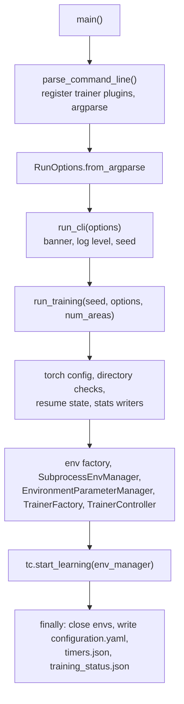

## Overview

`mlagents-learn` is the command that runs training. It is the `console_scripts` entry point `mlagents.trainers.learn:main`, and its job is assembly: turn the command line and the YAML file into one `RunOptions` object, prepare the results folder, build the environment manager, trainer factory and trainer controller, hand control to the controller, and write the run's records when it stops. The training loop itself is on [[Trainer Controller and Environment Managers]], and the meaning of every configuration field on [[Training Configuration]].

Sources: [ml-agents/setup.py:78-85](repo://ml-agents/setup.py#L78-L85), [ml-agents/mlagents/trainers/learn.py:51-143](repo://ml-agents/mlagents/trainers/learn.py#L51-L143)

Sources: [ml-agents/mlagents/trainers/learn.py:51-143](repo://ml-agents/mlagents/trainers/learn.py#L51-L143), [ml-agents/mlagents/trainers/learn.py:208-270](repo://ml-agents/mlagents/trainers/learn.py#L208-L270)

## Parsing options

### Plugin registration

`parse_command_line` first registers trainer plugins, so trainer types from installed plugins are known before the configuration is structured, then parses `argv` with the parser built in `cli_utils` and converts the result with `RunOptions.from_argparse`.

Sources: [ml-agents/mlagents/trainers/learn.py:51-56](repo://ml-agents/mlagents/trainers/learn.py#L51-L56)

### Command-line flags

| Flag | Default | Setting |
| --- | --- | --- |
| `trainer_config_path` (positional) | none | YAML file to load |
| `--env` | none (Editor) | `env_settings.env_path` |
| `--run-id` | `ppo` | `checkpoint_settings.run_id` |
| `--resume`, `--force`, `--initialize-from RUN_ID`, `--inference` | off | checkpoint settings |
| `--results-dir` | `results` | `checkpoint_settings.results_dir` |
| `--seed` | -1 (random) | `env_settings.seed` |
| `--base-port`, `--num-envs`, `--num-areas` | 5005, 1, 1 | environment settings |
| `--timeout-wait` | 60 | seconds to wait for each Unity instance to start |
| `--max-lifetime-restarts`, `--restarts-rate-limit-n`, `--restarts-rate-limit-period-s` | 10, 1, 60 | how often a crashed environment may be restarted |
| `--env-args ...` | none | remaining arguments are passed to the executable |
| `--width`, `--height`, `--quality-level`, `--time-scale`, `--target-frame-rate`, `--capture-frame-rate` | 84, 84, 5, 20, -1, 60 | engine settings |
| `--no-graphics`, `--no-graphics-monitor` | off | engine settings |
| `--torch-device` | auto | `torch_settings.device` |
| `--deterministic` | off | take the mean or most likely action in every behavior |
| `--debug` | off | debug logging |

Sources: [ml-agents/mlagents/trainers/cli_utils.py:63-130](repo://ml-agents/mlagents/trainers/cli_utils.py#L63-L130), [ml-agents/mlagents/trainers/cli_utils.py:131-200](repo://ml-agents/mlagents/trainers/cli_utils.py#L131-L200), [ml-agents/mlagents/trainers/cli_utils.py:204-317](repo://ml-agents/mlagents/trainers/cli_utils.py#L204-L317)

`--load` and `--train` are hidden, deprecated aliases that still work with a warning; `--torch` and `--tensorflow` only warn that they were removed.

Sources: [ml-agents/mlagents/trainers/cli_utils.py:12-22](repo://ml-agents/mlagents/trainers/cli_utils.py#L12-L22), [ml-agents/mlagents/trainers/cli_utils.py:77-83](repo://ml-agents/mlagents/trainers/cli_utils.py#L77-L83), [ml-agents/mlagents/trainers/learn.py:242-251](repo://ml-agents/mlagents/trainers/learn.py#L242-L251)

### Merging the CLI with the YAML

The YAML file and the command line describe the same `RunOptions`, and the command line wins, but only for flags the user actually typed. That is what the custom argparse actions are for: `DetectDefault` and `DetectDefaultStoreTrue` record each explicitly given argument in `DetectDefault.non_default_args`, and `StoreConfigFile` removes the config path from the namespace so it is not mistaken for a setting.

Sources: [ml-agents/mlagents/trainers/cli_utils.py:24-60](repo://ml-agents/mlagents/trainers/cli_utils.py#L24-L60)

`RunOptions.from_argparse` loads the YAML (raising `TrainerConfigError` for a missing file, a non-UTF-8 file or a YAML syntax error), rejects top-level keys that are not `RunOptions` fields, then copies each explicitly given argument into the matching sub-dictionary (`checkpoint_settings`, `env_settings`, `engine_settings` or `torch_settings`, or the top level). It then structures the dictionary, resolves conflicts between resume and initialization, and applies `--deterministic` to every behavior's network settings.

Sources: [ml-agents/mlagents/trainers/settings.py:893-962](repo://ml-agents/mlagents/trainers/settings.py#L893-L962), [ml-agents/mlagents/trainers/cli_utils.py:320-344](repo://ml-agents/mlagents/trainers/cli_utils.py#L320-L344)

Without a config file, behaviors that appear in the scene get default `TrainerSettings` with a warning. With one, a behavior missing from it is an error unless `default_settings` is set.

Sources: [ml-agents/mlagents/trainers/settings.py:740-756](repo://ml-agents/mlagents/trainers/settings.py#L740-L756), [ml-agents/mlagents/trainers/settings.py:912-918](repo://ml-agents/mlagents/trainers/settings.py#L912-L918)

When both resume and initialize-from are set, `prioritize_resume_init` keeps the one given on the command line; when both come from the YAML, resume wins. Each case logs a warning.

Sources: [ml-agents/mlagents/trainers/settings.py:786-810](repo://ml-agents/mlagents/trainers/settings.py#L786-L810)

## Starting the run

### Banner and seed

`run_cli` prints the banner and versions (ml-agents, ml-agents-envs, communicator API, PyTorch), sets the log level, logs the full configuration at debug level, records version metadata in the timer tree and, when the seed is -1, draws a random seed between 0 and 9999. It then calls `run_training`.

Sources: [ml-agents/mlagents/trainers/learn.py:43-48](repo://ml-agents/mlagents/trainers/learn.py#L43-L48), [ml-agents/mlagents/trainers/learn.py:208-266](repo://ml-agents/mlagents/trainers/learn.py#L208-L266)

### Set-up steps

`run_training` does its set-up inside a `run_training.setup` timer:

Sources: [ml-agents/mlagents/trainers/learn.py:59-71](repo://ml-agents/mlagents/trainers/learn.py#L59-L71)

1. `set_torch_config` picks the device: the `--torch-device` value, or CUDA when available and CPU otherwise. On CUDA it makes that the default device; it always sets the default dtype to `float32`.
2. `validate_existing_directories` checks `results/<run-id>`: it must not exist unless `--resume` or `--force` is given, it must exist with `--resume`, and the `--initialize-from` folder must exist.
3. It creates `run_logs/`. On resume it loads `run_logs/training_status.json`; with `--initialize-from` it sets each behavior's `init_path` to `<init dir>/<behavior>/checkpoint.pt` (or the file named in the behavior's own `init_path`) and checks that the file exists and ends in `.pt`.
4. It registers the stats writers from all `mlagents.stats_writer` plugins with `StatsReporter`.
5. It builds the environment factory, the `SubprocessEnvManager` with `num_envs` workers, the `EnvironmentParameterManager`, the `TrainerFactory` and the `TrainerController`.

Sources: [ml-agents/mlagents/trainers/learn.py:66-134](repo://ml-agents/mlagents/trainers/learn.py#L66-L134), [ml-agents/mlagents/torch_utils/torch.py:44-63](repo://ml-agents/mlagents/torch_utils/torch.py#L44-L63), [ml-agents/mlagents/trainers/directory_utils.py:7-76](repo://ml-agents/mlagents/trainers/directory_utils.py#L7-L76)

### The environment factory

`create_environment_factory` returns a closure that each worker process calls with its `worker_id` and side channels. It creates a `UnityEnvironment` with seed `seed + worker_id`, so parallel environments differ, and passes the absolute run-logs path so each player writes `Player-<worker_id>.log` there. Without `--env` the base port is `None`, which makes `UnityEnvironment` connect to the Editor port. `num_envs` above 1 without `--env` is rejected when the settings are validated.

Sources: [ml-agents/mlagents/trainers/learn.py:97-109](repo://ml-agents/mlagents/trainers/learn.py#L97-L109), [ml-agents/mlagents/trainers/learn.py:175-205](repo://ml-agents/mlagents/trainers/learn.py#L175-L205), [ml-agents/mlagents/trainers/settings.py:813-836](repo://ml-agents/mlagents/trainers/settings.py#L813-L836)

### Training and inference modes

The `TrainerFactory` is told to train unless `--inference` is set and to load models when `--resume` is set; the controller gets the same train flag and the run seed. With `--inference --resume`, the run loads the saved models and steps the environment without updating them.

Sources: [ml-agents/mlagents/trainers/learn.py:116-134](repo://ml-agents/mlagents/trainers/learn.py#L116-L134), [ml-agents/mlagents/trainers/cli_utils.py:145-152](repo://ml-agents/mlagents/trainers/cli_utils.py#L145-L152)

## Shutting down

`tc.start_learning(env_manager)` returns when every trainer reaches its step budget, or on Ctrl+C. Either way the `finally` block closes all environments and writes three files.

Sources: [ml-agents/mlagents/trainers/learn.py:136-143](repo://ml-agents/mlagents/trainers/learn.py#L136-L143)

| File | Contents |
| --- | --- |
| `results/<run-id>/configuration.yaml` | The resolved `RunOptions` as YAML, including defaults |
| `results/<run-id>/run_logs/timers.json` | The hierarchical timer tree ([[Profiling with Hierarchical Timers]]) |
| `results/<run-id>/run_logs/training_status.json` | `GlobalTrainingStatus` state |

Sources: [ml-agents/mlagents/trainers/learn.py:146-172](repo://ml-agents/mlagents/trainers/learn.py#L146-L172)

Because `configuration.yaml` holds every resolved field, it can be passed back as the config file to reproduce a run.

Sources: [ml-agents/mlagents/trainers/learn.py:146-157](repo://ml-agents/mlagents/trainers/learn.py#L146-L157)

## Training status for resume

Some state cannot live in a model checkpoint: the current curriculum lesson, the list of checkpoints, the final model, a self-play ELO. `GlobalTrainingStatus` stores it in a class-level dictionary keyed by category (usually the behavior name) and `StatusType` (`lesson_num`, `checkpoints`, `final_checkpoint`, `elo`), through `set_parameter_state` and `get_parameter_state`.

Sources: [ml-agents/mlagents/trainers/training_status.py:18-23](repo://ml-agents/mlagents/trainers/training_status.py#L18-L23), [ml-agents/mlagents/trainers/training_status.py:55-118](repo://ml-agents/mlagents/trainers/training_status.py#L55-L118)

`save_state` adds a metadata block with the status format version, the ML-Agents version and the PyTorch version. `load_state` warns when either version differs from the running one, warns when the file is missing, and raises `TrainerError` when the metadata block is absent.

Sources: [ml-agents/mlagents/trainers/training_status.py:26-97](repo://ml-agents/mlagents/trainers/training_status.py#L26-L97)

## CPU threads

Importing `mlagents.torch_utils` limits PyTorch to half the available CPUs, at least 1 and at most 4, and sets `KMP_BLOCKTIME=0`. The CPU count honors cgroup quotas (and, on Kubernetes, CPU shares divided by 1024), so a container limited to two cores gets one thread rather than half of the host.

Sources: [ml-agents/mlagents/torch_utils/torch.py:30-38](repo://ml-agents/mlagents/torch_utils/torch.py#L30-L38), [ml-agents/mlagents/torch_utils/cpu_utils.py:6-41](repo://ml-agents/mlagents/torch_utils/cpu_utils.py#L6-L41)

## mlagents-run-experiment

`mlagents-run-experiment <file>` is an alternative entry point that takes a complete `RunOptions` as a single YAML or JSON file, with no other flags. It loads the file, registers trainer plugins and calls `run_cli(RunOptions.from_dict(...))`, so it follows the same lifecycle from the banner on.

Sources: [ml-agents/mlagents/trainers/run_experiment.py:1-31](repo://ml-agents/mlagents/trainers/run_experiment.py#L1-L31), [ml-agents/setup.py:78-85](repo://ml-agents/setup.py#L78-L85)
