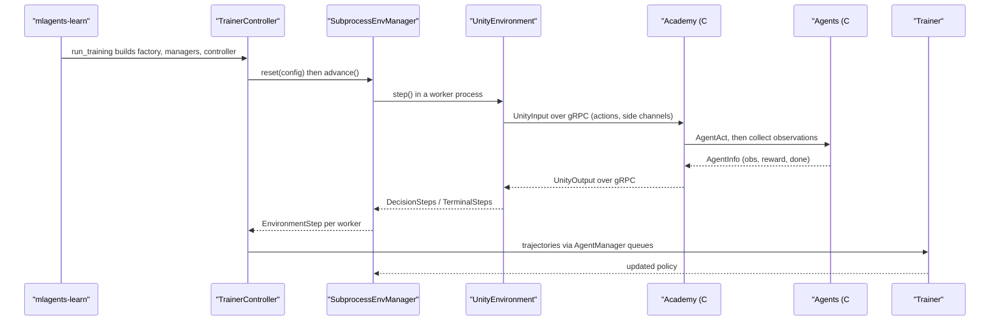

## Overview

The Unity ML-Agents Toolkit turns Unity scenes into environments for training intelligent agents. It has three shipped parts: a Unity package (`com.unity.ml-agents`) that you add to a project to define agents, their observations, actions and rewards; a Python package (`mlagents_envs`) that launches and talks to a Unity environment; and a Python package (`mlagents`) that trains PyTorch policies against that environment and exports them as ONNX models that the Unity package runs with Unity's inference engine.

Sources: [com.unity.ml-agents/package.json:1-13](repo://com.unity.ml-agents/package.json#L1-L13), [ml-agents-envs/setup.py:36-69](repo://ml-agents-envs/setup.py#L36-L69), [ml-agents/setup.py:39-92](repo://ml-agents/setup.py#L39-L92)

The Unity package is version 3.0.0, targets Unity 6000.0 and depends on `com.unity.ai.inference` (Sentis) for running models. Both Python packages require Python 3.10 and pin `mlagents` to the exact same version of `mlagents_envs`. The `mlagents` package installs four commands: `mlagents-learn`, `mlagents-run-experiment`, `mlagents-push-to-hf` and `mlagents-load-from-hf`.

Sources: [com.unity.ml-agents/package.json:1-13](repo://com.unity.ml-agents/package.json#L1-L13), [ml-agents/setup.py:55-85](repo://ml-agents/setup.py#L55-L85)

## Parts of the toolkit

| Area | What it does | Page |
| --- | --- | --- |
| Academy | Singleton that connects to Python and steps every agent in lock step | [[Academy and the Environment Step Loop]] |
| Agent | Component that collects observations, receives actions and rewards, and runs episodes | [[Agents and Episodes]] |
| Behavior and policies | Chooses whether an agent is driven by Python, an ONNX model or a heuristic | [[Behavior Parameters and Policies]] |
| Sensors | Produce observations: vectors, cameras, rays, grids, buffers | [[Sensors and Observations]], [[Built-in Sensors]], [[Grid Sensors]] |
| Actuators | Turn continuous and discrete actions into game behaviour, with action masking | [[Actuators and Actions]] |
| Multi-agent groups | Group rewards and episodes for cooperative agents | [[Multi-Agent Groups]] |
| Inference | Runs a trained ONNX model inside Unity | [[Inference with Sentis]] |
| Protocol | Protobuf messages and gRPC between Unity and Python | [[Communication Protocol]] |
| Side channels | Extra data (engine settings, parameters, stats) next to the RL data | [[Side Channels]] |
| Python environment API | `UnityEnvironment`, gym and PettingZoo wrappers, registry | [[Low-Level Python API (UnityEnvironment)]], [[Gym and PettingZoo Wrappers]], [[Environment Registry]] |
| Training entry point | `mlagents-learn` parses options and assembles the training run | [[mlagents-learn CLI and Run Lifecycle]], [[Training Configuration]] |
| Training loop | Steps environments, assembles trajectories, feeds trainers | [[Trainer Controller and Environment Managers]], [[Agent Processor and Trajectories]], [[Trainer Architecture]] |
| Algorithms | PPO, SAC, MA-POCA, self-play, reward signals, imitation | [[PPO Trainer]], [[SAC Trainer]], [[POCA Multi-Agent Trainer]], [[Self-Play]], [[Reward Signals]], [[Demonstrations and Imitation Learning]] |
| Networks | Policies, encoders, attention | [[Policies and Network Architecture]], [[Observation Encoders and Attention]] |
| Outputs | Checkpoints, ONNX export, TensorBoard metrics | [[Model Saving and ONNX Export]], [[Stats and TensorBoard]] |
| Extension | Trainer and stats-writer plugins, Input System, Match-3, Hugging Face | [[Trainer and Stats Writer Plugins]], [[Input System Integration]], [[Match-3 Integration]], [[Hugging Face Integration]] |

Sources: [ml-agents/mlagents/trainers/learn.py:59-143](repo://ml-agents/mlagents/trainers/learn.py#L59-L143), [com.unity.ml-agents/Runtime/Academy.cs:421-499](repo://com.unity.ml-agents/Runtime/Academy.cs#L421-L499)

## Main training flow

A training run starts in Python and drives Unity one step at a time. The diagram follows one `mlagents-learn` run from its entry point to the agents in the scene and back.

Sources: [ml-agents/mlagents/trainers/learn.py:269-270](repo://ml-agents/mlagents/trainers/learn.py#L269-L270)

Sources: [ml-agents/mlagents/trainers/learn.py:59-143](repo://ml-agents/mlagents/trainers/learn.py#L59-L143), [ml-agents/mlagents/trainers/trainer_controller.py:167-252](repo://ml-agents/mlagents/trainers/trainer_controller.py#L167-L252), [com.unity.ml-agents/Runtime/Academy.cs:568-604](repo://com.unity.ml-agents/Runtime/Academy.cs#L568-L604)

1. `mlagents-learn` parses the command line and YAML into `RunOptions`, then `run_training` creates the environment factory, a `SubprocessEnvManager`, a `TrainerFactory` and a `TrainerController` ([[mlagents-learn CLI and Run Lifecycle]], [[Training Configuration]]).
2. `TrainerController.start_learning` resets the environments and loops on `advance` until every trainer reaches its step budget ([[Trainer Controller and Environment Managers]]).
3. Each environment worker owns a `UnityEnvironment`, which launches the Unity executable or connects to the Editor and exchanges protobuf messages with it ([[Low-Level Python API (UnityEnvironment)]], [[Communication Protocol]]).
4. In Unity, `Academy.EnvironmentStep` runs the agents' pre-step, sends their state, asks their policies to decide, then makes them act ([[Academy and the Environment Step Loop]], [[Agents and Episodes]]).
5. The returned steps go to an `AgentManager`, which turns them into trajectories ([[Agent Processor and Trajectories]]).
6. The trainer consumes trajectories, updates its networks and pushes the new policy back for acting ([[Trainer Architecture]], [[PPO Trainer]]).

Sources: [ml-agents/mlagents/trainers/learn.py:51-143](repo://ml-agents/mlagents/trainers/learn.py#L51-L143), [ml-agents/mlagents/trainers/trainer_controller.py:115-159](repo://ml-agents/mlagents/trainers/trainer_controller.py#L115-L159)

## Design decisions

### One versioned protocol shared by both sides

Unity and Python are separate processes that share only the protobuf messages in `protobuf-definitions`. Both sides carry a communication API version (`1.5.0` in `UnityEnvironment.API_VERSION` and `Academy.k_ApiVersion`), and Python refuses to connect when the major versions differ. This lets the Unity package and the Python packages ship on their own schedules: new features are added as capability flags instead of breaking the major version.

Sources: [ml-agents-envs/mlagents_envs/environment.py:55-110](repo://ml-agents-envs/mlagents_envs/environment.py#L55-L110), [com.unity.ml-agents/Runtime/Academy.cs:421-486](repo://com.unity.ml-agents/Runtime/Academy.cs#L421-L486)

### Unity falls back to inference when no trainer answers

The Academy tries to reach a trainer only when a port is given on the command line or the Editor connection is enabled. If the first message exchange fails, it logs that it "will perform inference instead" and drops the communicator, so the same scene works for training and for shipping a game with trained models.

Sources: [com.unity.ml-agents/Runtime/Academy.cs:433-499](repo://com.unity.ml-agents/Runtime/Academy.cs#L433-L499)

### Trainers are keyed by behavior name

A Unity scene may contain several behaviors, and agents announce them as they appear. The `TrainerController` creates one trainer per brain name the first time a behavior id shows up, and one policy and `AgentManager` per full behavior id (name plus team), so self-play teams share a trainer while getting their own policies.

Sources: [ml-agents/mlagents/trainers/trainer_controller.py:115-159](repo://ml-agents/mlagents/trainers/trainer_controller.py#L115-L159), [ml-agents/mlagents/trainers/trainer_controller.py:254-268](repo://ml-agents/mlagents/trainers/trainer_controller.py#L254-L268)

### Trainers and stats writers are plugins

The built-in PPO, SAC and POCA trainers are registered through the same `mlagents.trainer_type` entry point that third-party packages use, and stats writers go through `mlagents.stats_writer`. A plugin that throws while loading is logged and skipped rather than stopping the run. See [[Trainer and Stats Writer Plugins]].

Sources: [ml-agents/mlagents/plugins/trainer_type.py:17-72](repo://ml-agents/mlagents/plugins/trainer_type.py#L17-L72), [ml-agents/setup.py:79-92](repo://ml-agents/setup.py#L79-L92)

### Trained models leave Python as ONNX

Each checkpoint writes a PyTorch `.pt` file and an `.onnx` export with the tensor names the Unity inference code expects, so a model trained in Python runs in Unity without Python. See [[Model Saving and ONNX Export]] and [[Inference with Sentis]].

Sources: [ml-agents/mlagents/trainers/model_saver/torch_model_saver.py:49-70](repo://ml-agents/mlagents/trainers/model_saver/torch_model_saver.py#L49-L70), [ml-agents/mlagents/trainers/torch_entities/model_serialization.py:154-173](repo://ml-agents/mlagents/trainers/torch_entities/model_serialization.py#L154-L173)

## Repository layout

| Folder | Contents |
| --- | --- |
| `com.unity.ml-agents` | The Unity package: `Runtime`, `Editor`, `Tests`, package docs |
| `ml-agents-envs` | `mlagents_envs` Python package and its tests |
| `ml-agents` | `mlagents` trainer package and its tests |
| `ml-agents-trainer-plugin`, `ml-agents-plugin-examples` | Example A2C/DQN trainer plugin and example stats writer |
| `protobuf-definitions` | `.proto` files and scripts that generate the C# and Python bindings |
| `config` | Training YAML files for the example environments (`ppo`, `sac`, `poca`, `imitation`) |
| `Project` | Unity project with the example environments |
| `DevProject`, `PerformanceProject` | Unity projects used for package development and performance tests |
| `utils`, `.github`, `.yamato` | Validation scripts and CI definitions |

Sources: [ml-agents/setup.py:39-55](repo://ml-agents/setup.py#L39-L55), [ml-agents-envs/setup.py:36-55](repo://ml-agents-envs/setup.py#L36-L55), [protobuf-definitions/make.sh:1-53](repo://protobuf-definitions/make.sh#L1-L53)
