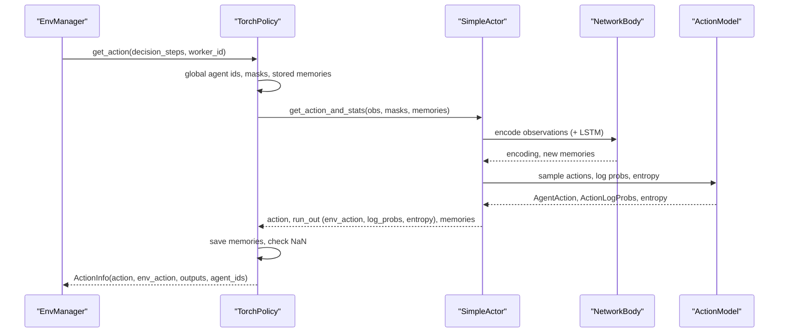

## Overview

A policy maps a batch of observations to actions. On the training side it is a `TorchPolicy` wrapping an actor network; the trainers' optimizers add critics and other networks around it. The actor is built from three layers of modules: an `ObservationEncoder` that turns every observation into a vector, a `NetworkBody` that combines them through fully connected layers (optionally conditioned on goals and followed by an LSTM), and an `ActionModel` that turns the encoding into continuous and discrete action distributions. Critics reuse the same `NetworkBody` with value heads on top.

Sources: [ml-agents/mlagents/trainers/policy/torch_policy.py:20-61](repo://ml-agents/mlagents/trainers/policy/torch_policy.py#L20-L61), [ml-agents/mlagents/trainers/torch_entities/networks.py:173-251](repo://ml-agents/mlagents/trainers/torch_entities/networks.py#L173-L251)

The encoders themselves (vector normalization, visual CNNs, attention over entities, goal conditioning) are on [[Observation Encoders and Attention]]. This page follows a decision from `DecisionSteps` to an `ActionTuple` and back to the log-probabilities the optimizers need.

Sources: [ml-agents/mlagents/trainers/torch_entities/networks.py:33-70](repo://ml-agents/mlagents/trainers/torch_entities/networks.py#L33-L70)

## Policy and TorchPolicy

### Per-agent state

`Policy` holds the behavior spec, network settings and seed, and the per-agent state that must persist between decisions: the LSTM memory (`memory_dict` and the one before it, `previous_memory_dict`) and the previous discrete action, all keyed by global agent id. When memory is configured it sets `m_size` and `sequence_length` from the settings. `check_nan_action` raises if a continuous action contains NaN.

Sources: [ml-agents/mlagents/trainers/policy/policy.py:21-126](repo://ml-agents/mlagents/trainers/policy/policy.py#L21-L126)

### Construction

`TorchPolicy` creates the actor from the class and keyword arguments its trainer passes (`SimpleActor` or `SharedActorCritic`) and moves it to the default device. It keeps the configured memory size for export (`export_memory_size`) while using the actor's actual memory size for training. A `GlobalSteps` module stores the step count as a non-trainable parameter, so it is saved and restored with checkpoints. `get_modules` returns the actor as `Policy` and the step counter.

Sources: [ml-agents/mlagents/trainers/policy/torch_policy.py:21-69](repo://ml-agents/mlagents/trainers/policy/torch_policy.py#L21-L69), [ml-agents/mlagents/trainers/policy/torch_policy.py:140-173](repo://ml-agents/mlagents/trainers/policy/torch_policy.py#L140-L173), [ml-agents/mlagents/trainers/torch_entities/networks.py:746-761](repo://ml-agents/mlagents/trainers/torch_entities/networks.py#L746-L761)

### Acting

Sources: [ml-agents/mlagents/trainers/policy/torch_policy.py:71-138](repo://ml-agents/mlagents/trainers/policy/torch_policy.py#L71-L138), [ml-agents/mlagents/trainers/torch_entities/networks.py:629-650](repo://ml-agents/mlagents/trainers/torch_entities/networks.py#L629-L650)

`get_action` returns an empty `ActionInfo` when no agent asked for a decision. Otherwise it converts agent ids to global ids and calls `evaluate`, which builds the action mask (all ones without a mask, otherwise `1 - mask` concatenated across branches), retrieves each agent's stored memory, and runs the actor without gradients. The outputs are converted to numpy: `action` as an `ActionTuple`, `log_probs` as a `LogProbsTuple`, `entropy`, and `memory_out` with a recurrent network. The new memories are saved for the next decision.

Sources: [ml-agents/mlagents/trainers/policy/torch_policy.py:71-138](repo://ml-agents/mlagents/trainers/policy/torch_policy.py#L71-L138)

Two versions of the action are returned. `action` is the raw sample, stored in trajectories so log-probabilities can be recomputed; `env_action` is what is sent to Unity, with continuous values clamped to `[-3, 3]` and divided by 3 when the action model clips (it does unless tanh squashing is on).

Sources: [ml-agents/mlagents/trainers/torch_entities/networks.py:629-650](repo://ml-agents/mlagents/trainers/torch_entities/networks.py#L629-L650), [ml-agents/mlagents/trainers/torch_entities/agent_action.py:47-61](repo://ml-agents/mlagents/trainers/torch_entities/agent_action.py#L47-L61)

### Weights

`get_weights` returns a deep copy of the actor's state dict and `load_weights` loads one. The self-play ghost trainer uses these to swap opponent snapshots ([[Self-Play]]).

Sources: [ml-agents/mlagents/trainers/policy/torch_policy.py:163-170](repo://ml-agents/mlagents/trainers/policy/torch_policy.py#L163-L170)

## NetworkBody

`NetworkBody` encodes all observations with an `ObservationEncoder`, optionally concatenates an action vector (used by SAC's Q networks), and passes the result through a body encoder: a `ConditionalEncoder` when there are goal-signal observations and `goal_conditioning_type` is `hyper`, otherwise a `LinearEncoder` of `num_layers` layers of `hidden_units`. With memory, the encoding is reshaped to `(batch, sequence_length, hidden_units)` and run through an LSTM whose output size is `memory_size / 2`. Normalization statistics can be updated from a buffer or copied from another network.

Sources: [ml-agents/mlagents/trainers/torch_entities/networks.py:173-251](repo://ml-agents/mlagents/trainers/torch_entities/networks.py#L173-L251)

## Actors

`Actor` is the interface the optimizers use: `get_action_and_stats` (sample actions and return their log-probabilities and entropy), `get_stats` (log-probabilities and entropy of given actions, used to compute PPO's ratio), `update_normalization`, and `forward`, which is reserved for ONNX export ([[Model Saving and ONNX Export]]).

Sources: [ml-agents/mlagents/trainers/torch_entities/networks.py:506-568](repo://ml-agents/mlagents/trainers/torch_entities/networks.py#L506-L568)

| Class | Structure | Used by |
| --- | --- | --- |
| `SimpleActor` | `NetworkBody` + `ActionModel` | PPO, POCA, SAC |
| `SharedActorCritic` | `SimpleActor` + `ValueHeads` on the same encoding; also a `Critic` | PPO with `shared_critic` |

Sources: [ml-agents/mlagents/trainers/torch_entities/networks.py:571-669](repo://ml-agents/mlagents/trainers/torch_entities/networks.py#L571-L669), [ml-agents/mlagents/trainers/torch_entities/networks.py:711-743](repo://ml-agents/mlagents/trainers/torch_entities/networks.py#L711-L743)

`SimpleActor` also stores export metadata as non-trainable parameters: the model version (3), the memory size, the continuous action count and the discrete branch sizes.

Sources: [ml-agents/mlagents/trainers/torch_entities/networks.py:571-620](repo://ml-agents/mlagents/trainers/torch_entities/networks.py#L571-L620)

## Critics

`Critic` declares `critic_pass(inputs, memories, sequence_length)`, returning one value tensor per reward stream and the critic memories. `ValueNetwork` is a `NetworkBody` with `ValueHeads`, one linear head per stream name (one stream per reward signal), and optional action input and multiple outputs per stream, which SAC uses for its Q networks. POCA's critic is a separate multi-agent network ([[POCA Multi-Agent Trainer]]).

Sources: [ml-agents/mlagents/trainers/torch_entities/networks.py:429-503](repo://ml-agents/mlagents/trainers/torch_entities/networks.py#L429-L503), [ml-agents/mlagents/trainers/torch_entities/decoders.py:7-22](repo://ml-agents/mlagents/trainers/torch_entities/decoders.py#L7-L22)

## ActionModel and distributions

### Sampling and evaluation

`ActionModel` holds a `GaussianDistribution` for continuous actions and a `MultiCategoricalDistribution` for discrete branches, either or both depending on the action spec. Its `forward` builds the distributions from the encoding, samples (or, with `deterministic`, takes the mean and the most likely class), and returns an `AgentAction`, `ActionLogProbs` and the entropy summed across actions. `evaluate` returns log-probabilities and summed entropy for given actions.

Sources: [ml-agents/mlagents/trainers/torch_entities/action_model.py:29-113](repo://ml-agents/mlagents/trainers/torch_entities/action_model.py#L29-L113), [ml-agents/mlagents/trainers/torch_entities/action_model.py:149-164](repo://ml-agents/mlagents/trainers/torch_entities/action_model.py#L149-L164), [ml-agents/mlagents/trainers/torch_entities/action_model.py:219-231](repo://ml-agents/mlagents/trainers/torch_entities/action_model.py#L219-L231)

### Continuous actions

`GaussianDistribution` has a linear layer for the mean and either a state-independent learned log-sigma (PPO, POCA) or a linear layer for log-sigma clamped to `[-20, 2]` (`conditional_sigma`, SAC). With `tanh_squash` (SAC) it returns a `TanhGaussianDistInstance` that squashes samples into `(-1, 1)` and corrects log-probabilities by the tanh Jacobian; otherwise a plain Gaussian.

Sources: [ml-agents/mlagents/trainers/torch_entities/distributions.py:59-114](repo://ml-agents/mlagents/trainers/torch_entities/distributions.py#L59-L114), [ml-agents/mlagents/trainers/torch_entities/distributions.py:152-197](repo://ml-agents/mlagents/trainers/torch_entities/distributions.py#L152-L197)

### Discrete actions

`MultiCategoricalDistribution` has one linear layer per branch. The action mask is split per branch, and masked logits are replaced by `logits * mask - 1e8 * (1 - mask)` so masked actions get effectively zero probability. Each branch becomes a `CategoricalDistInstance` that samples with `torch.multinomial`, takes `argmax` deterministically, and exposes `all_log_prob` for the whole branch (SAC needs it).

Sources: [ml-agents/mlagents/trainers/torch_entities/distributions.py:117-149](repo://ml-agents/mlagents/trainers/torch_entities/distributions.py#L117-L149), [ml-agents/mlagents/trainers/torch_entities/distributions.py:200-248](repo://ml-agents/mlagents/trainers/torch_entities/distributions.py#L200-L248)

## AgentAction and ActionLogProbs

`AgentAction` pairs a continuous tensor with a list of per-branch discrete tensors. It converts to an `ActionTuple` for the environment, reads actions back from a buffer (`from_buffer`, and `group_from_buffer` for teammates), and flattens into continuous values plus one-hot discrete actions (`to_flat`) for networks that take actions as input. `ActionLogProbs` holds the matching log-probabilities, plus every branch's full log-probabilities, with the same buffer conversions and a `flatten` used by the PPO ratio.

Sources: [ml-agents/mlagents/trainers/torch_entities/agent_action.py:11-70](repo://ml-agents/mlagents/trainers/torch_entities/agent_action.py#L11-L70), [ml-agents/mlagents/trainers/torch_entities/agent_action.py:115-157](repo://ml-agents/mlagents/trainers/torch_entities/agent_action.py#L115-L157), [ml-agents/mlagents/trainers/torch_entities/action_log_probs.py:34-118](repo://ml-agents/mlagents/trainers/torch_entities/action_log_probs.py#L34-L118)
