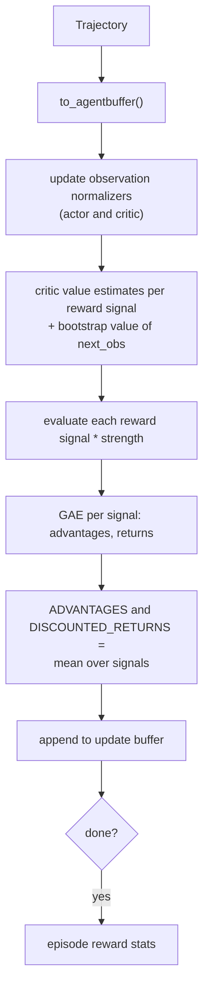

## Overview

PPO (Proximal Policy Optimization) is the default trainer (`trainer_type: ppo`). It is on-policy: it gathers a buffer of experience with the current policy, computes advantages for it, takes several epochs of minibatch gradient steps with a clipped objective that keeps the new policy close to the old one, and then discards the buffer. The implementation splits into `PPOTrainer`, which turns each trajectory into training targets, and `TorchPPOOptimizer`, which owns the critic and computes the loss. The update loop (epochs, minibatches, advantage normalization) is shared with POCA in `OnPolicyTrainer`, described on [[Trainer Architecture]].

Sources: [ml-agents/mlagents/trainers/ppo/trainer.py:30-66](repo://ml-agents/mlagents/trainers/ppo/trainer.py#L30-L66), [ml-agents/mlagents/trainers/ppo/optimizer_torch.py:35-93](repo://ml-agents/mlagents/trainers/ppo/optimizer_torch.py#L35-L93), [ml-agents/mlagents/trainers/trainer/on_policy_trainer.py:59-115](repo://ml-agents/mlagents/trainers/trainer/on_policy_trainer.py#L59-L115)

## Hyperparameters

| Field | Default | Role |
| --- | --- | --- |
| `batch_size` | 1024 | Experiences per gradient step |
| `buffer_size` | 10240 | Experiences collected before an update |
| `num_epoch` | 3 | Passes over the buffer per update |
| `learning_rate` | 3e-4 | Adam learning rate |
| `beta` | 5e-3 | Entropy bonus weight |
| `epsilon` | 0.2 | Clipping range for the policy ratio and value change |
| `lambd` | 0.95 | GAE lambda |
| `shared_critic` | false | Use the actor network for value estimates too |
| `learning_rate_schedule`, `beta_schedule`, `epsilon_schedule` | linear | Decay schedules |

Sources: [ml-agents/mlagents/trainers/ppo/optimizer_torch.py:24-32](repo://ml-agents/mlagents/trainers/ppo/optimizer_torch.py#L24-L32), [ml-agents/mlagents/trainers/settings.py:156-166](repo://ml-agents/mlagents/trainers/settings.py#L156-L166)

## Processing a trajectory

### Steps

Each trajectory from the [[Agent Processor and Trajectories]] goes through `PPOTrainer._process_trajectory`, which fills in everything the update will need.

Sources: [ml-agents/mlagents/trainers/ppo/trainer.py:68-165](repo://ml-agents/mlagents/trainers/ppo/trainer.py#L68-L165)

Sources: [ml-agents/mlagents/trainers/ppo/trainer.py:68-165](repo://ml-agents/mlagents/trainers/ppo/trainer.py#L68-L165)

### Value estimates and bootstrapping

`TorchOptimizer.get_trajectory_value_estimates` runs the critic over the whole trajectory without gradients and returns, for each reward signal, the value of every step and the value of the observation after the trajectory. If the trajectory ended in a true terminal state, that next value is set to zero for every signal that does not set `ignore_done`, so returns are not bootstrapped past the end of an episode. The trainer passes `done_reached and not interrupted`, which means an episode cut short by `MaxStep` is still bootstrapped, as described on [[Agents and Episodes]].

Sources: [ml-agents/mlagents/trainers/optimizer/torch_optimizer.py:141-211](repo://ml-agents/mlagents/trainers/optimizer/torch_optimizer.py#L141-L211), [ml-agents/mlagents/trainers/ppo/trainer.py:86-106](repo://ml-agents/mlagents/trainers/ppo/trainer.py#L86-L106)

With a recurrent critic, the critic memory at the end of each trajectory is kept per agent so the next trajectory of that agent continues from it. `_evaluate_by_sequence` evaluates the trajectory sequence by sequence (the last one possibly shorter) and records the memory at the start of each sequence; these are stored as `critic_memory` so the update can replay the critic from the same states.

Sources: [ml-agents/mlagents/trainers/optimizer/torch_optimizer.py:66-133](repo://ml-agents/mlagents/trainers/optimizer/torch_optimizer.py#L66-L133), [ml-agents/mlagents/trainers/ppo/trainer.py:96-97](repo://ml-agents/mlagents/trainers/ppo/trainer.py#L96-L97)

### Rewards, advantages and returns

Every reward signal is evaluated on the trajectory and multiplied by its strength; the environment reward and each signal's total are added to the per-agent running totals for episode stats. For each signal, `get_gae` computes generalized advantage estimates with that signal's `gamma` and the trainer's `lambd`, and the return target is advantage plus value estimate. Both are stored per signal, and the averages across signals become `advantages` and `discounted_returns`, which the policy loss uses. Mean value estimates are reported as `Policy/<Signal> Value Estimate`.

Sources: [ml-agents/mlagents/trainers/ppo/trainer.py:108-159](repo://ml-agents/mlagents/trainers/ppo/trainer.py#L108-L159), [ml-agents/mlagents/trainers/trainer/trainer_utils.py:20-33](repo://ml-agents/mlagents/trainers/trainer/trainer_utils.py#L20-L33)

## The optimizer

### Critic and schedules

`TorchPPOOptimizer` creates a separate `ValueNetwork` critic with one value head per reward signal, or reuses the actor when `shared_critic` is set (the actor is then a `SharedActorCritic`). A single Adam optimizer covers actor and critic parameters. Learning rate, epsilon and beta each have a `DecayedValue`: constant, or decaying linearly over `max_steps` to 1e-10, 0.1 and 1e-5 respectively.

Sources: [ml-agents/mlagents/trainers/ppo/optimizer_torch.py:46-93](repo://ml-agents/mlagents/trainers/ppo/optimizer_torch.py#L46-L93), [ml-agents/mlagents/trainers/torch_entities/utils.py:63-122](repo://ml-agents/mlagents/trainers/torch_entities/utils.py#L63-L122)

### Loss

For each minibatch, `update` reads the decayed values at the policy's current step, re-evaluates the log-probabilities and entropy of the stored actions with the current actor, and the values with the current critic, starting each sequence from the stored actor and critic memories. The loss is:

Sources: [ml-agents/mlagents/trainers/ppo/optimizer_torch.py:99-179](repo://ml-agents/mlagents/trainers/ppo/optimizer_torch.py#L99-L179)

| Term | Computation |
| --- | --- |
| Policy loss | `-mean(min(r * A, clip(r, 1 - eps, 1 + eps) * A))` with `r = exp(log_prob - old_log_prob)` |
| Value loss | per signal `mean(max((R - V)^2, (R - V_clipped)^2))` with `V_clipped = V_old + clip(V - V_old, -eps, eps)`, averaged over signals |
| Total | `policy_loss + 0.5 * value_loss - beta * mean(entropy)` |

Sources: [ml-agents/mlagents/trainers/torch_entities/utils.py:400-452](repo://ml-agents/mlagents/trainers/torch_entities/utils.py#L400-L452), [ml-agents/mlagents/trainers/ppo/optimizer_torch.py:162-179](repo://ml-agents/mlagents/trainers/ppo/optimizer_torch.py#L162-L179)

All means are masked by the `masks` column, so padding inserted to complete LSTM sequences does not contribute. The optimizer sets the decayed learning rate, back-propagates and steps, and returns `Losses/Policy Loss` (as an absolute value), `Losses/Value Loss`, `Policy/Learning Rate`, `Policy/Epsilon` and `Policy/Beta`.

Sources: [ml-agents/mlagents/trainers/ppo/optimizer_torch.py:164-197](repo://ml-agents/mlagents/trainers/ppo/optimizer_torch.py#L164-L197)

### Saved modules

`get_modules` returns the Adam optimizer, the critic and every reward provider's modules, which the model saver adds to the checkpoint alongside the policy ([[Model Saving and ONNX Export]]).

Sources: [ml-agents/mlagents/trainers/ppo/optimizer_torch.py:199-207](repo://ml-agents/mlagents/trainers/ppo/optimizer_torch.py#L199-L207)

## The shared TorchOptimizer base

`Optimizer` only declares `update(batch, num_sequences)` and a `reward_signals` dictionary. `TorchOptimizer` adds what every PyTorch trainer needs: it creates the reward providers from the trainer settings, keyed by name ([[Reward Signals]]), creates a `BCModule` when `behavioral_cloning` is configured ([[Demonstrations and Imitation Learning]]), provides `update_reward_signals` to update every provider on a minibatch, and implements the value estimation above in terms of an abstract `critic`.

Sources: [ml-agents/mlagents/trainers/optimizer/optimizer.py:7-24](repo://ml-agents/mlagents/trainers/optimizer/optimizer.py#L7-L24), [ml-agents/mlagents/trainers/optimizer/torch_optimizer.py:23-64](repo://ml-agents/mlagents/trainers/optimizer/torch_optimizer.py#L23-L64), [ml-agents/mlagents/trainers/optimizer/torch_optimizer.py:135-139](repo://ml-agents/mlagents/trainers/optimizer/torch_optimizer.py#L135-L139)

## Policy creation

`PPOTrainer.create_policy` builds a `TorchPolicy` whose actor is a `SimpleActor` (or `SharedActorCritic` with one value stream per reward signal when `shared_critic` is on), without state-conditional sigma or tanh squashing of continuous actions. Network details are on [[Policies and Network Architecture]].

Sources: [ml-agents/mlagents/trainers/ppo/trainer.py:172-201](repo://ml-agents/mlagents/trainers/ppo/trainer.py#L172-L201)
