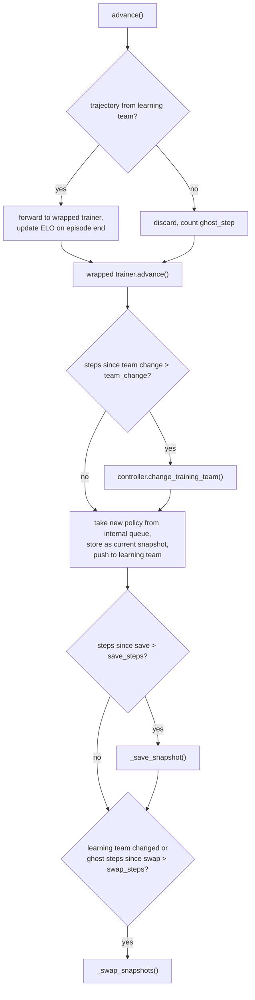

## Overview

Self-play trains agents for adversarial games, where the opponent is another copy of the agent being trained. Training both sides at once makes the target move constantly; training against only the latest opponent can make the policy forget how to beat older strategies. ML-Agents takes the standard approach: at any time only one team learns, while the other teams play fixed snapshots of past policies drawn from a window, and the learning team rotates periodically. Progress is tracked with an ELO rating.

Sources: [ml-agents/mlagents/trainers/ghost/trainer.py:28-40](repo://ml-agents/mlagents/trainers/ghost/trainer.py#L28-L40), [ml-agents/mlagents/trainers/ghost/controller.py:9-30](repo://ml-agents/mlagents/trainers/ghost/controller.py#L9-L30)

Self-play is turned on per behavior with a `self_play` block in the configuration. The `TrainerFactory` then wraps the behavior's normal trainer (PPO, SAC or POCA) in a `GhostTrainer`, and all ghost trainers in a run share one `GhostController`. Teams are distinguished by `BehaviorParameters.TeamId`, which makes each team a separate behavior id (`name?team=N`) with its own policy and agent manager but the same brain name and trainer ([[Behavior Parameters and Policies]]).

Sources: [ml-agents/mlagents/trainers/trainer/trainer_factory.py:121-131](repo://ml-agents/mlagents/trainers/trainer/trainer_factory.py#L121-L131), [ml-agents/mlagents/trainers/trainer/trainer_factory.py:54-54](repo://ml-agents/mlagents/trainers/trainer/trainer_factory.py#L54-L54), [ml-agents/mlagents/trainers/behavior_id_utils.py:22-50](repo://ml-agents/mlagents/trainers/behavior_id_utils.py#L22-L50)

## Settings

| Field | Default | Meaning |
| --- | --- | --- |
| `save_steps` | 20000 | Learning-team steps between snapshots of the current policy |
| `team_change` | `5 * save_steps` | Learning-team steps before another team becomes the learning team |
| `swap_steps` | 2000 | Ghost steps between choosing a new opponent snapshot |
| `window` | 10 | Number of past snapshots kept |
| `play_against_latest_model_ratio` | 0.5 | Probability of facing the current policy rather than a past snapshot |
| `initial_elo` | 1200.0 | Starting ELO |

Sources: [ml-agents/mlagents/trainers/settings.py:598-611](repo://ml-agents/mlagents/trainers/settings.py#L598-L611)

The constructor warns when `play_against_latest_model_ratio` is outside `[0, 1]`, and when `team_change` exceeds `max_steps`, because in an asymmetric game the other side would then never face a trained opponent.

Sources: [ml-agents/mlagents/trainers/ghost/trainer.py:84-107](repo://ml-agents/mlagents/trainers/ghost/trainer.py#L84-L107)

## How the GhostTrainer wraps a trainer

### Policies

`create_policy` creates the policy for a team through the wrapped trainer and registers the team with the controller. The first team seen becomes the wrapped trainer's team: a second policy is created and added to the wrapped trainer (the one actually trained), its weights become the current snapshot and are copied into the team's policy, and a first snapshot is saved. Policies for other teams just copy the wrapped trainer's weights. Every team's policy is therefore a separate object whose weights the ghost trainer overwrites when needed.

Sources: [ml-agents/mlagents/trainers/ghost/trainer.py:336-386](repo://ml-agents/mlagents/trainers/ghost/trainer.py#L336-L386)

### Queues

The ghost trainer interposes its own queues. For the wrapped team it creates an internal trajectory queue and an internal policy queue and subscribes the wrapped trainer to them; the queues connected to the environment are kept per team and brain name.

Sources: [ml-agents/mlagents/trainers/ghost/trainer.py:435-480](repo://ml-agents/mlagents/trainers/ghost/trainer.py#L435-L480)

## The advance loop

Sources: [ml-agents/mlagents/trainers/ghost/trainer.py:219-319](repo://ml-agents/mlagents/trainers/ghost/trainer.py#L219-L319)

Trajectories from the learning team are forwarded to the wrapped trainer; trajectories from other teams are dropped, but their length is added to `ghost_step`. Snapshots and team changes are measured in the wrapped trainer's steps, while opponent swaps are measured in ghost steps, so every team trains for the same number of its own steps.

Sources: [ml-agents/mlagents/trainers/ghost/trainer.py:223-251](repo://ml-agents/mlagents/trainers/ghost/trainer.py#L223-L251), [ml-agents/mlagents/trainers/ghost/trainer.py:109-113](repo://ml-agents/mlagents/trainers/ghost/trainer.py#L109-L113)

After advancing the wrapped trainer, any new policy it published becomes the current snapshot. If the learning team did not change, the snapshot is loaded into the learning team's policy and pushed to the environment. If the learning team changed to a team this ghost trainer manages, the current snapshot is pushed to that team's policies, so the newly learning team starts from the latest weights.

Sources: [ml-agents/mlagents/trainers/ghost/trainer.py:259-305](repo://ml-agents/mlagents/trainers/ghost/trainer.py#L259-L305)

## Snapshots and opponents

`_save_snapshot` writes the current weights into a ring of `window` slots, together with the current ELO. `_swap_snapshots` chooses, for each non-learning team, a random past snapshot with probability `1 - play_against_latest_model_ratio` or the current policy otherwise, loads it into that team's policies and pushes them to the environment. The index of the chosen opponent is remembered for ELO updates.

Sources: [ml-agents/mlagents/trainers/ghost/trainer.py:388-433](repo://ml-agents/mlagents/trainers/ghost/trainer.py#L388-L433)

## The GhostController

The controller holds the current learning team and a queue of the others. `subscribe_team_id` makes the first team seen the learning team and queues the rest. `change_training_team` rotates the queue and sets a flag that `should_reset` returns once; the [[Trainer Controller and Environment Managers]] checks it after each step and fully resets the environments when the team changed, so no episode mixes the old and new assignments.

Sources: [ml-agents/mlagents/trainers/ghost/controller.py:17-73](repo://ml-agents/mlagents/trainers/ghost/controller.py#L17-L73), [ml-agents/mlagents/trainers/trainer_controller.py:221-225](repo://ml-agents/mlagents/trainers/trainer_controller.py#L221-L225)

## ELO

When a learning-team trajectory ends with the whole group done and not interrupted, the ghost trainer decides the result from the last step's reward plus group reward: positive is a win (1.0), negative a loss (0.0), zero a draw (0.5). The game must therefore be designed so the final reward signals the outcome.

Sources: [ml-agents/mlagents/trainers/ghost/trainer.py:190-217](repo://ml-agents/mlagents/trainers/ghost/trainer.py#L190-L217)

`compute_elo_rating_changes` gets the opponent's rating from the other team's ghost trainer, computes the expected score `10^(R/400) / (10^(R/400) + 10^(R_opp/400))`, and returns `result - expected`. The learning policy's rating rises by that amount and the opponent snapshot's falls by it. The rating is reported as `Self-play/ELO`, shown by the console writer, and saved in `training_status.json` on `save_model` so a resumed run continues from it.

Sources: [ml-agents/mlagents/trainers/ghost/controller.py:75-103](repo://ml-agents/mlagents/trainers/ghost/controller.py#L75-L103), [ml-agents/mlagents/trainers/ghost/trainer.py:133-188](repo://ml-agents/mlagents/trainers/ghost/trainer.py#L133-L188), [ml-agents/mlagents/trainers/ghost/trainer.py:327-334](repo://ml-agents/mlagents/trainers/ghost/trainer.py#L327-L334)

## What is forwarded

`get_step`, `reward_buffer`, `end_episode` and `save_model` are forwarded to the wrapped trainer, and the ghost trainer shares its stats reporter, setting the self-play property so ELO appears in the console. Only the wrapped trainer's model is saved.

Sources: [ml-agents/mlagents/trainers/ghost/trainer.py:79-82](repo://ml-agents/mlagents/trainers/ghost/trainer.py#L79-L82), [ml-agents/mlagents/trainers/ghost/trainer.py:143-159](repo://ml-agents/mlagents/trainers/ghost/trainer.py#L143-L159), [ml-agents/mlagents/trainers/ghost/trainer.py:321-334](repo://ml-agents/mlagents/trainers/ghost/trainer.py#L321-L334)
