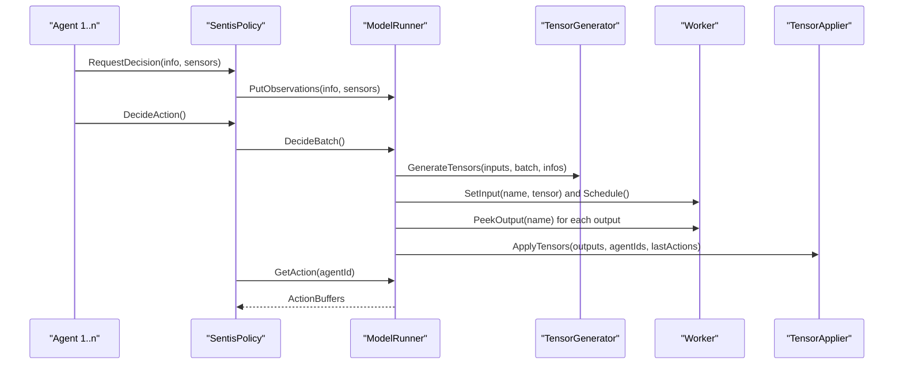

## Overview

When an agent has an ONNX model and no trainer is connected, its actions come from running that model inside Unity with the Unity inference engine (`Unity.InferenceEngine`, the Sentis package). The inference code turns the same `AgentInfo` and sensors that would have gone to Python into input tensors, runs the network once for every agent that asked for a decision this step, and turns the output tensors back into `ActionBuffers`. It only depends on tensor names that the Python exporter writes (see [[Model Saving and ONNX Export]]).

Sources: [com.unity.ml-agents/Runtime/Inference/ModelRunner.cs:16-130](repo://com.unity.ml-agents/Runtime/Inference/ModelRunner.cs#L16-L130), [com.unity.ml-agents/Runtime/Inference/TensorNames.cs:6-49](repo://com.unity.ml-agents/Runtime/Inference/TensorNames.cs#L6-L49)

`SentisPolicy` is the entry point: [[Behavior Parameters and Policies]] explains when it is chosen. It asks the Academy for a `ModelRunner` keyed by model and inference device, so all agents using one model share one runner and are evaluated in one batch.

Sources: [com.unity.ml-agents/Runtime/Policies/SentisPolicy.cs:83-138](repo://com.unity.ml-agents/Runtime/Policies/SentisPolicy.cs#L83-L138), [com.unity.ml-agents/Runtime/Academy.cs:628-639](repo://com.unity.ml-agents/Runtime/Academy.cs#L628-L639)

## Per-step flow

Sources: [com.unity.ml-agents/Runtime/Inference/ModelRunner.cs:173-265](repo://com.unity.ml-agents/Runtime/Inference/ModelRunner.cs#L173-L265), [com.unity.ml-agents/Runtime/Policies/SentisPolicy.cs:101-138](repo://com.unity.ml-agents/Runtime/Policies/SentisPolicy.cs#L101-L138)

`PutObservations` validates sensor shapes in debug builds, queues the `(AgentInfo, sensors)` pair, and appends the agent id to an ordered list that fixes each agent's row in the batch. It also creates an empty entry for the agent in the last-actions dictionary, or removes the entry when the agent is done, since a done agent takes no action.

Sources: [com.unity.ml-agents/Runtime/Inference/ModelRunner.cs:173-197](repo://com.unity.ml-agents/Runtime/Inference/ModelRunner.cs#L173-L197)

`DecideBatch` returns immediately when nothing is queued, so only the first agent's `DecideAction` in a step runs the model and the rest find the batch already done. On the first real batch it sets up observation generators from the first agent's sensors. It then generates the input tensors, binds them to the Sentis `Worker` by name, calls `Schedule()`, reads every output with `PeekOutput`, applies the outputs to the last-actions dictionary and clears the queue. `GetAction(agentId)` returns the stored actions, or `ActionBuffers.Empty` for an unknown agent.

Sources: [com.unity.ml-agents/Runtime/Inference/ModelRunner.cs:199-265](repo://com.unity.ml-agents/Runtime/Inference/ModelRunner.cs#L199-L265)

## Loading a model

### Creating the worker

The `ModelRunner` constructor loads the `ModelAsset` with `ModelLoader.Load`, reads its metadata with `SentisModelInfo`, and throws `UnityAgentsException` if the version check fails with an error. It maps the inference device to a Sentis backend and creates the `Worker`.

Sources: [com.unity.ml-agents/Runtime/Inference/ModelRunner.cs:54-130](repo://com.unity.ml-agents/Runtime/Inference/ModelRunner.cs#L54-L130)

| `InferenceDevice` | Sentis `BackendType` |
| --- | --- |
| `Default` | `CPU` |
| `Burst` | `CPU` |
| `ComputeShader` | `GPUCompute` |
| `PixelShader` | `GPUPixel` |

Sources: [com.unity.ml-agents/Runtime/Inference/ModelRunner.cs:90-108](repo://com.unity.ml-agents/Runtime/Inference/ModelRunner.cs#L90-L108), [com.unity.ml-agents/Runtime/Policies/SentisPolicy.cs:13-35](repo://com.unity.ml-agents/Runtime/Policies/SentisPolicy.cs#L13-L35)

### Reading model metadata

The exported graph carries its own metadata as constant outputs: `version_number`, `memory_size`, `continuous_action_output_shape` and `discrete_action_output_shape`. `SentisModelInfo` reads them by building a CPU worker, feeding zero-filled inputs of the declared shapes, running the model once and copying every output. From those it caches the input and output names, the API version, the memory size, which action outputs exist and their sizes.

Sources: [com.unity.ml-agents/Runtime/Inference/SentisModelInfo.cs:37-146](repo://com.unity.ml-agents/Runtime/Inference/SentisModelInfo.cs#L37-L146)

With `DeterministicInference` on, the action output names become `deterministic_continuous_actions` and `deterministic_discrete_actions`: otherwise the sampled `continuous_actions` and `discrete_actions` are used. Very old models without these outputs fall back to the deprecated `action` output and `is_continuous_control` flag.

Sources: [com.unity.ml-agents/Runtime/Inference/SentisModelInfo.cs:233-300](repo://com.unity.ml-agents/Runtime/Inference/SentisModelInfo.cs#L233-L300), [com.unity.ml-agents/Runtime/Inference/TensorNames.cs:18-32](repo://com.unity.ml-agents/Runtime/Inference/TensorNames.cs#L18-L32)

### Model versions

`SentisModelParamLoader.ModelApiVersion` names the two supported layouts. `MLAgents1_0` (version 2) splits observations into `vector_observation` and `visual_observation_<i>` inputs; `MLAgents2_0` (version 3) names every observation `obs_<i>` by sensor index and treats recurrent memory as an ordinary input and output. `CheckModelVersion` rejects models older or newer than these, and also rejects version-2 models that use memory, since their recurrent inputs are no longer supported.

Sources: [com.unity.ml-agents/Runtime/Inference/SentisModelParamLoader.cs:15-111](repo://com.unity.ml-agents/Runtime/Inference/SentisModelParamLoader.cs#L15-L111)

## Building inputs: TensorGenerator

`TensorGenerator` maps each model input name to an `IGenerator` that fills that tensor for a batch. `GenerateTensors` walks the model's inputs (sorted by name) and throws for any input it has no generator for, so a model expecting an input the agent cannot provide fails loudly.

Sources: [com.unity.ml-agents/Runtime/Inference/TensorGenerator.cs:19-91](repo://com.unity.ml-agents/Runtime/Inference/TensorGenerator.cs#L19-L91), [com.unity.ml-agents/Runtime/Inference/TensorGenerator.cs:164-176](repo://com.unity.ml-agents/Runtime/Inference/TensorGenerator.cs#L164-L176)

| Input | Generator | Fills it with |
| --- | --- | --- |
| `obs_<i>` (v2) | `ObservationGenerator` | sensor `i` written through an `ObservationWriter` targeting the tensor row |
| `vector_observation` (v1) | one shared `ObservationGenerator` | all rank-1 sensors concatenated |
| `visual_observation_<k>` (v1) | `ObservationGenerator` | the k-th rank-3 sensor |
| `recurrent_in` | `RecurrentInputGenerator` | the agent's stored memory, or zeros for a new or finished agent |
| `prev_action` | `PreviousActionInputGenerator` | the agent's previous discrete actions |
| `action_masks` | `ActionMaskInputGenerator` | 1 for allowed, 0 for masked discrete actions |
| `epsilon` | `RandomNormalInputGenerator` | seeded normal noise |
| `batch_size`, `sequence_length` | `BatchSizeGenerator`, `SequenceLengthGenerator` | constants for legacy models |

Sources: [com.unity.ml-agents/Runtime/Inference/TensorGenerator.cs:94-151](repo://com.unity.ml-agents/Runtime/Inference/TensorGenerator.cs#L94-L151), [com.unity.ml-agents/Runtime/Inference/GeneratorImpl.cs:72-170](repo://com.unity.ml-agents/Runtime/Inference/GeneratorImpl.cs#L72-L170), [com.unity.ml-agents/Runtime/Inference/GeneratorImpl.cs:172-226](repo://com.unity.ml-agents/Runtime/Inference/GeneratorImpl.cs#L172-L226)

`ObservationGenerator` resizes the tensor to the batch and, for each agent, points the shared `ObservationWriter` at that agent's row and calls `Write` on its sensors in turn. Done agents get zeros instead, because their sensors may refer to objects that were already destroyed. This is the same `Write` the sensor uses for training, which is what keeps training and inference inputs identical.

Sources: [com.unity.ml-agents/Runtime/Inference/GeneratorImpl.cs:228-271](repo://com.unity.ml-agents/Runtime/Inference/GeneratorImpl.cs#L228-L271), [com.unity.ml-agents/Runtime/Sensors/ObservationWriter.cs:72-79](repo://com.unity.ml-agents/Runtime/Sensors/ObservationWriter.cs#L72-L79)

## Applying outputs: TensorApplier

`TensorApplier` maps each output name to an `IApplier`. If the model does not support mixed action spaces, it first calls `ActionSpec.CheckAllContinuousOrDiscrete`. Unknown outputs throw, like unknown inputs.

Sources: [com.unity.ml-agents/Runtime/Inference/TensorApplier.cs:16-110](repo://com.unity.ml-agents/Runtime/Inference/TensorApplier.cs#L16-L110)

| Output | Applier | Effect |
| --- | --- | --- |
| continuous action output | `ContinuousActionOutputApplier` | copies row `i` into agent `i`'s continuous actions |
| discrete action output (v2) | `DiscreteActionOutputApplier` | copies the integer actions the model already sampled |
| discrete action output (v1) | `LegacyDiscreteActionOutputApplier` | samples each branch from log-probabilities with a seeded `Multinomial` |
| `recurrent_out` | `MemoryOutputApplier` | stores the new memory for the agent's next step |

Sources: [com.unity.ml-agents/Runtime/Inference/ApplierImpl.cs:14-103](repo://com.unity.ml-agents/Runtime/Inference/ApplierImpl.cs#L14-L103), [com.unity.ml-agents/Runtime/Inference/ApplierImpl.cs:105-187](repo://com.unity.ml-agents/Runtime/Inference/ApplierImpl.cs#L105-L187), [com.unity.ml-agents/Runtime/Inference/ApplierImpl.cs:189-226](repo://com.unity.ml-agents/Runtime/Inference/ApplierImpl.cs#L189-L226)

Appliers write only for agents still present in the last-actions dictionary, so done agents receive no actions, and they allocate an `ActionBuffers` from the action spec the first time an agent's entry is empty. Rows follow the order in which agents called `PutObservations`.

Sources: [com.unity.ml-agents/Runtime/Inference/ApplierImpl.cs:23-56](repo://com.unity.ml-agents/Runtime/Inference/ApplierImpl.cs#L23-L56), [com.unity.ml-agents/Runtime/Inference/ModelRunner.cs:184-196](repo://com.unity.ml-agents/Runtime/Inference/ModelRunner.cs#L184-L196)

## Memories

Recurrent models keep per-agent state between decisions in a dictionary shared by the generator and the applier. `MemoryOutputApplier` stores each agent's `recurrent_out` after a batch, and `RecurrentInputGenerator` feeds it back as `recurrent_in` on the next one. When an agent's info is marked done, its memory is dropped and the next episode starts from zeros.

Sources: [com.unity.ml-agents/Runtime/Inference/GeneratorImpl.cs:72-129](repo://com.unity.ml-agents/Runtime/Inference/GeneratorImpl.cs#L72-L129), [com.unity.ml-agents/Runtime/Inference/ApplierImpl.cs:189-226](repo://com.unity.ml-agents/Runtime/Inference/ApplierImpl.cs#L189-L226)

## Model validation

`SentisModelParamLoader.CheckModel` compares a model with an agent's configuration and returns a list of failed checks, each `Info`, `Warning` or `Error`. Without a model it returns a single info ("cannot run inference", or "But can still train" unless the behavior is Inference Only). Otherwise it checks the expected tensors and the version, then, according to the version, checks that the model's inputs exist for the agent's sensors, memory and action masks and that their shapes match, and finally checks the action output shapes against `BrainParameters` and the actuator components. The Behavior Parameters inspector shows these results.

Sources: [com.unity.ml-agents/Runtime/Inference/SentisModelParamLoader.cs:126-207](repo://com.unity.ml-agents/Runtime/Inference/SentisModelParamLoader.cs#L126-L207), [com.unity.ml-agents/Editor/BehaviorParametersEditor.cs:157-180](repo://com.unity.ml-agents/Editor/BehaviorParametersEditor.cs#L157-L180)

## Disposal

`ModelRunner.Dispose` disposes the worker and every input tensor it created. The Academy disposes all runners when it shuts down; see [[Academy and the Environment Step Loop]].

Sources: [com.unity.ml-agents/Runtime/Inference/ModelRunner.cs:152-160](repo://com.unity.ml-agents/Runtime/Inference/ModelRunner.cs#L152-L160), [com.unity.ml-agents/Runtime/Academy.cs:658-666](repo://com.unity.ml-agents/Runtime/Academy.cs#L658-L666)
