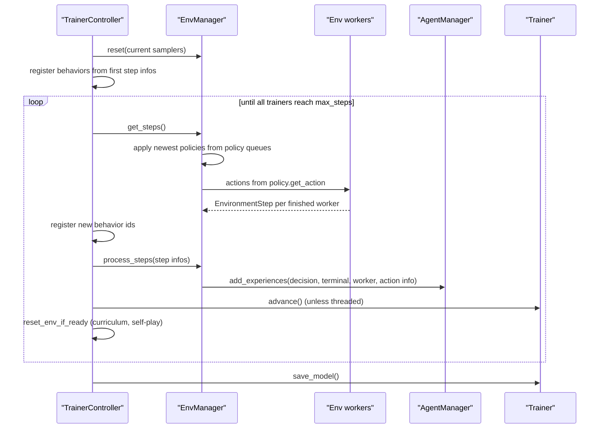

## Overview

Once `mlagents-learn` has built its objects ([[mlagents-learn CLI and Run Lifecycle]]), two of them run the training loop. The `TrainerController` owns the trainers, one per behavior, and decides when to stop, reset or change environment parameters. The environment manager owns the Unity environments: it asks the current policies for actions, steps the environments and hands the results to one `AgentManager` per behavior. `SubprocessEnvManager` runs each environment in its own process so several Unity instances step in parallel; `SimpleEnvManager` runs a single environment in-process and is used for tests.

Sources: [ml-agents/mlagents/trainers/trainer_controller.py:34-69](repo://ml-agents/mlagents/trainers/trainer_controller.py#L34-L69), [ml-agents/mlagents/trainers/env_manager.py:39-43](repo://ml-agents/mlagents/trainers/env_manager.py#L39-L43), [ml-agents/mlagents/trainers/simple_env_manager.py:13-17](repo://ml-agents/mlagents/trainers/simple_env_manager.py#L13-L17)

What happens to the step results after an `AgentManager` receives them is on [[Agent Processor and Trajectories]]; what a trainer does with trajectories is on [[Trainer Architecture]].

Sources: [ml-agents/mlagents/trainers/env_manager.py:132-157](repo://ml-agents/mlagents/trainers/env_manager.py#L132-L157)

## The main loop

Sources: [ml-agents/mlagents/trainers/trainer_controller.py:167-252](repo://ml-agents/mlagents/trainers/trainer_controller.py#L167-L252), [ml-agents/mlagents/trainers/env_manager.py:100-157](repo://ml-agents/mlagents/trainers/env_manager.py#L100-L157)

`start_learning` creates the output folder, performs the initial reset with the current environment-parameter samplers, logs the current lessons and loops while `_not_done_training()` is true: some trainer still wants to train, or the run is in inference mode, or no trainer exists yet. Each iteration calls `advance`, and then, for each environment step processed, `reset_env_if_ready`. When the loop ends it stops the trainer threads.

Sources: [ml-agents/mlagents/trainers/trainer_controller.py:96-113](repo://ml-agents/mlagents/trainers/trainer_controller.py#L96-L113), [ml-agents/mlagents/trainers/trainer_controller.py:167-179](repo://ml-agents/mlagents/trainers/trainer_controller.py#L167-L179)

`advance` gets new steps from the environment manager, registers any behavior ids not seen before, passes the steps on, sets an `Environment/Lesson Number/<param>` stat on every trainer, and calls `advance()` on every trainer that is not threaded. It returns the number of environment steps processed.

Sources: [ml-agents/mlagents/trainers/trainer_controller.py:229-252](repo://ml-agents/mlagents/trainers/trainer_controller.py#L229-L252)

## Creating trainers for new behaviors

Behaviors are discovered from the data. `_register_new_behaviors` collects the behavior ids in a list of step infos and creates a trainer and manager for each new one. `_create_trainer_and_manager` parses the id into brain name and team, creates the trainer with `TrainerFactory.generate(brain_name)` if this brain has none yet (starting a daemon thread for it when `threaded` is set, and telling the environment manager that training started), then always:

Sources: [ml-agents/mlagents/trainers/trainer_controller.py:115-136](repo://ml-agents/mlagents/trainers/trainer_controller.py#L115-L136), [ml-agents/mlagents/trainers/trainer_controller.py:254-268](repo://ml-agents/mlagents/trainers/trainer_controller.py#L254-L268)

1. creates a policy for this behavior id from the behavior spec and adds it to the trainer;
2. creates an `AgentManager` with that policy, the trainer's stats reporter and its `time_horizon`;
3. registers the manager and policy with the environment manager;
4. connects the manager's policy queue to the trainer as a publisher and its trajectory queue as a subscription.

Sources: [ml-agents/mlagents/trainers/trainer_controller.py:137-159](repo://ml-agents/mlagents/trainers/trainer_controller.py#L137-L159)

This is why two teams of the same behavior in self-play share one trainer but have separate policies and managers.

Sources: [ml-agents/mlagents/trainers/behavior_id_utils.py:22-40](repo://ml-agents/mlagents/trainers/behavior_id_utils.py#L22-L40)

## Resets driven by training

After each environment step, `reset_env_if_ready` asks the `EnvironmentParameterManager` whether any curriculum lesson should advance, passing each trainer's step count, `max_steps` and reward buffer. If a lesson changed, every trainer's reward buffer is cleared. If the lesson change requires a reset, or the self-play `GhostController` swapped the learning team, the environments are fully reset with the new parameters and every trainer ends its episodes. Otherwise a lesson change only sends the new parameters to the running environments. See [[Curriculum and Environment Parameters]] and [[Self-Play]].

Sources: [ml-agents/mlagents/trainers/trainer_controller.py:202-227](repo://ml-agents/mlagents/trainers/trainer_controller.py#L202-L227)

## Stopping and saving

A `KeyboardInterrupt` or a `UnityCommunicatorStoppedException` ends training quietly. A `UnityCommunicationException` or `UnityEnvironmentException` is re-raised after cleanup so the process exits with an error. In every case the trainer threads are joined and, in training mode, every trainer saves its model, which exports the final ONNX file ([[Model Saving and ONNX Export]]). Saving is skipped on a process whose rank is set and not 0.

Sources: [ml-agents/mlagents/trainers/trainer_controller.py:71-81](repo://ml-agents/mlagents/trainers/trainer_controller.py#L71-L81), [ml-agents/mlagents/trainers/trainer_controller.py:180-200](repo://ml-agents/mlagents/trainers/trainer_controller.py#L180-L200)

`join_threads` sets `kill_trainers`, which ends each thread's `trainer_update_func` loop, waits up to a second per thread, and merges each thread's timer tree and gauges into the main thread's under `trainer_threads`.

Sources: [ml-agents/mlagents/trainers/trainer_controller.py:270-297](repo://ml-agents/mlagents/trainers/trainer_controller.py#L270-L297)

## The EnvManager base class

`EnvManager` holds a policy and an `AgentManager` per behavior id and defines the loop in terms of three abstract operations: `_step`, `_reset_env` and `set_env_parameters`, plus `training_behaviors` and `close`.

Sources: [ml-agents/mlagents/trainers/env_manager.py:39-98](repo://ml-agents/mlagents/trainers/env_manager.py#L39-L98)

An `EnvironmentStep` is what one worker produced: the `(DecisionSteps, TerminalSteps)` of every behavior, the worker id, the `ActionInfo` that produced it per behavior, and the environment stats collected by the stats side channel.

Sources: [ml-agents/mlagents/trainers/env_manager.py:24-36](repo://ml-agents/mlagents/trainers/env_manager.py#L24-L36)

`reset` tells every agent manager to end its episodes, then stores the reset results as `first_step_infos` instead of processing them. They are processed at the start of the next `get_steps`, which lets the controller create the agent managers for behaviors discovered in the reset before their first data arrives.

Sources: [ml-agents/mlagents/trainers/env_manager.py:63-69](repo://ml-agents/mlagents/trainers/env_manager.py#L63-L69), [ml-agents/mlagents/trainers/env_manager.py:100-111](repo://ml-agents/mlagents/trainers/env_manager.py#L100-L111)

Before stepping, `get_steps` drains every agent manager's policy queue and keeps only the newest policy. Draining also unblocks a trainer waiting on that queue. `_process_step_infos` then passes each behavior's results and action info to its agent manager with `add_experiences`, along with the environment stats; data for a behavior with no manager is logged and skipped.

Sources: [ml-agents/mlagents/trainers/env_manager.py:112-157](repo://ml-agents/mlagents/trainers/env_manager.py#L112-L157)

## SubprocessEnvManager

### Workers

The constructor starts `num_envs` worker processes. Each `create_worker` call opens a `Pipe`, pickles the environment factory with `cloudpickle` (plain pickling of closures fails on Windows) and starts a `Process` running `worker()`. All workers share one `step_queue` for step results; other replies go back over each worker's pipe.

Sources: [ml-agents/mlagents/trainers/subprocess_env_manager.py:246-297](repo://ml-agents/mlagents/trainers/subprocess_env_manager.py#L246-L297)

The worker creates the side channels (environment parameters, engine configuration from the run options, stats, and on worker 0 only, training analytics), builds the `UnityEnvironment` through the factory and serves commands until told to close.

Sources: [ml-agents/mlagents/trainers/subprocess_env_manager.py:116-175](repo://ml-agents/mlagents/trainers/subprocess_env_manager.py#L116-L175)

| Command | Worker action |
| --- | --- |
| `STEP` | Set the received actions for behaviors with agents, step, put a `StepResponse` (results, timer tree, stats) on the step queue, reset its timers |
| `RESET` | Reset the environment and reply with the results |
| `BEHAVIOR_SPECS` | Reply with the environment's behavior specs |
| `ENVIRONMENT_PARAMETERS` | Apply each parameter setting through the environment parameters channel |
| `TRAINING_STARTED` | Send the trainer settings through the training analytics channel |
| `CLOSE` | Leave the loop, close the environment, put `CLOSED` on the queue |

Sources: [ml-agents/mlagents/trainers/subprocess_env_manager.py:51-76](repo://ml-agents/mlagents/trainers/subprocess_env_manager.py#L51-L76), [ml-agents/mlagents/trainers/subprocess_env_manager.py:175-243](repo://ml-agents/mlagents/trainers/subprocess_env_manager.py#L175-L243)

### Stepping asynchronously

Actions are computed in the main process: `_take_step` calls `policy.get_action(decision_steps, worker_id)` for each behavior of the worker's previous step. `_queue_steps` sends a `STEP` to every worker that is not already waiting. `_step` then polls the step queue until at least one result is in, taking at most one result per worker, and returns. Workers that have not finished keep running; they are picked up on a later call. Training therefore proceeds at the pace of the fastest environments rather than waiting for the slowest.

Sources: [ml-agents/mlagents/trainers/subprocess_env_manager.py:299-305](repo://ml-agents/mlagents/trainers/subprocess_env_manager.py#L299-L305), [ml-agents/mlagents/trainers/subprocess_env_manager.py:406-432](repo://ml-agents/mlagents/trainers/subprocess_env_manager.py#L406-L432), [ml-agents/mlagents/trainers/subprocess_env_manager.py:538-546](repo://ml-agents/mlagents/trainers/subprocess_env_manager.py#L538-L546)

`_postprocess_steps` wraps each response into an `EnvironmentStep` with the action info that produced it, remembers it as the worker's previous step, and merges the workers' timer trees under a `workers` node of the main timer.

Sources: [ml-agents/mlagents/trainers/subprocess_env_manager.py:509-536](repo://ml-agents/mlagents/trainers/subprocess_env_manager.py#L509-L536)

### Resetting and parameters

`_reset_env` first drains results from workers still stepping, sends the environment parameters, sends `RESET` to all workers so they reset in parallel, and then collects each reply in order. `set_env_parameters` remembers the configuration (to reuse after a restart) and sends it to every worker.

Sources: [ml-agents/mlagents/trainers/subprocess_env_manager.py:434-457](repo://ml-agents/mlagents/trainers/subprocess_env_manager.py#L434-L457)

### Restarting crashed environments

A worker whose environment raises puts `ENV_EXITED` with the exception on the step queue. `_step` reacts by calling `_restart_failed_workers`: it drains the queue for up to a minute to collect every other failure and pause the remaining workers, then restarts each failed worker if the error is a Unity communication, timeout, environment or stopped exception and the worker still has restart quota. Other exceptions, or exhausted quota, are re-raised. After restarting it resets all environments with the last parameters, discarding in-flight trajectories.

Sources: [ml-agents/mlagents/trainers/subprocess_env_manager.py:307-374](repo://ml-agents/mlagents/trainers/subprocess_env_manager.py#L307-L374)

The quota combines a lifetime limit (`--max-lifetime-restarts`, default 10) and a rate limit (`--restarts-rate-limit-n` restarts per `--restarts-rate-limit-period-s` seconds, default 1 per 60); -1 disables either.

Sources: [ml-agents/mlagents/trainers/subprocess_env_manager.py:376-404](repo://ml-agents/mlagents/trainers/subprocess_env_manager.py#L376-L404)

### Closing

`close` asks every worker to close, then reads the step queue for up to 10 seconds until each worker reports `CLOSED`. Any worker still alive after that is terminated and logged as an error.

Sources: [ml-agents/mlagents/trainers/subprocess_env_manager.py:481-507](repo://ml-agents/mlagents/trainers/subprocess_env_manager.py#L481-L507)

## SimpleEnvManager

`SimpleEnvManager` implements the same interface around one `BaseEnv` and an `EnvironmentParametersChannel` in the current process. `_step` computes actions from the previous step with the policies, sets them, steps and returns a single `EnvironmentStep` for worker 0; `set_env_parameters` sends floats directly and applies sampler settings through the channel. The test helper `check_env_trains.py` uses it to train against the Python-only environments of `simple_test_envs.py` ([[Testing and Continuous Integration]]).

Sources: [ml-agents/mlagents/trainers/simple_env_manager.py:13-84](repo://ml-agents/mlagents/trainers/simple_env_manager.py#L13-L84), [ml-agents/mlagents/trainers/tests/check_env_trains.py:60-80](repo://ml-agents/mlagents/trainers/tests/check_env_trains.py#L60-L80)
