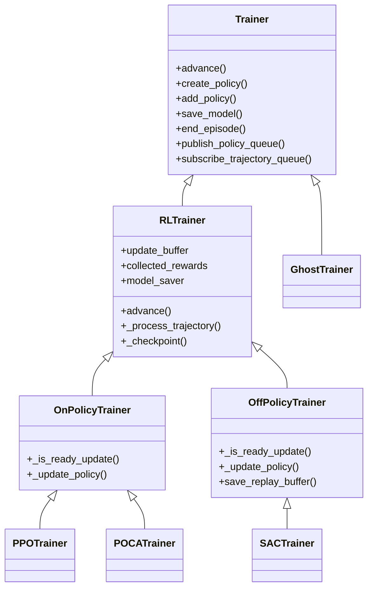

## Overview

A trainer owns the learning for one behavior: it reads trajectories, decides when to update, runs the algorithm's optimizer, keeps track of steps, rewards, summaries and checkpoints, and publishes the updated policy back to the environment loop. The concrete algorithms (PPO, SAC, POCA, and plugin trainers such as A2C and DQN) share most of this through a small class hierarchy, so each only implements how trajectories are turned into training data and how an update is computed.

Sources: [ml-agents/mlagents/trainers/trainer/trainer.py:19-51](repo://ml-agents/mlagents/trainers/trainer/trainer.py#L19-L51), [ml-agents/mlagents/trainers/trainer/rl_trainer.py:35-59](repo://ml-agents/mlagents/trainers/trainer/rl_trainer.py#L35-L59)

Sources: [ml-agents/mlagents/trainers/trainer/on_policy_trainer.py:21-57](repo://ml-agents/mlagents/trainers/trainer/on_policy_trainer.py#L21-L57), [ml-agents/mlagents/trainers/trainer/off_policy_trainer.py:26-79](repo://ml-agents/mlagents/trainers/trainer/off_policy_trainer.py#L26-L79), [ml-agents/mlagents/trainers/ghost/trainer.py:1-60](repo://ml-agents/mlagents/trainers/ghost/trainer.py#L1-L60)

## Trainer: the contract with the controller

`Trainer` stores the brain name, settings, training and load flags, artifact path (`results/<run-id>/<behavior>`), a `StatsReporter` for the behavior, a step counter, a bounded `reward_buffer` of recent episode returns, and the policies it trains keyed by behavior id. It also holds the queues: `subscribe_trajectory_queue` adds an input queue and `publish_policy_queue` an output queue, both wired by the [[Trainer Controller and Environment Managers]].

Sources: [ml-agents/mlagents/trainers/trainer/trainer.py:22-51](repo://ml-agents/mlagents/trainers/trainer/trainer.py#L22-L51), [ml-agents/mlagents/trainers/trainer/trainer.py:164-179](repo://ml-agents/mlagents/trainers/trainer/trainer.py#L164-L179)

| Member | Purpose |
| --- | --- |
| `advance()` | Consume trajectories and update when ready |
| `create_policy(behavior_id, behavior_spec)` | Build a policy for a behavior id |
| `add_policy(behavior_id, policy)` | Take ownership of a policy and set up the optimizer |
| `save_model()` | Write the final model |
| `end_episode()` | React to a forced environment reset |
| `should_still_train` | `is_training and step <= max_steps`; the controller stops when no trainer still trains |
| `threaded` | Whether the controller runs `advance` in a separate thread |
| `get_trainer_name()` | The `trainer_type` string this class registers under |

Sources: [ml-agents/mlagents/trainers/trainer/trainer.py:53-162](repo://ml-agents/mlagents/trainers/trainer/trainer.py#L53-L162), [ml-agents/mlagents/trainers/trainer/trainer.py:181-183](repo://ml-agents/mlagents/trainers/trainer/trainer.py#L181-L183)

## RLTrainer: the shared machinery

### State

`RLTrainer` is the base for trainers that learn from reward signals. Its constructor creates the `update_buffer`, a `collected_rewards` table (cumulative reward per agent, for the environment and for each reward signal), and a `TorchModelSaver` ([[Model Saving and ONNX Export]]), and records the trainer settings as a hyperparameters property on the stats reporter.

Sources: [ml-agents/mlagents/trainers/trainer/rl_trainer.py:40-59](repo://ml-agents/mlagents/trainers/trainer/rl_trainer.py#L40-L59), [ml-agents/mlagents/trainers/trainer/rl_trainer.py:117-124](repo://ml-agents/mlagents/trainers/trainer/rl_trainer.py#L117-L124)

### advance

`advance` drains every subscribed trajectory queue, reading at most as many items as the queue holds when it starts, and calls `_process_trajectory` on each. A threaded trainer that found nothing sleeps for 0.1 ms. Then, if the trainer still trains and `_is_ready_update()` says so, it calls `_update_policy()`; when that reports an update, it puts the updated policy on every policy queue.

Sources: [ml-agents/mlagents/trainers/trainer/rl_trainer.py:278-305](repo://ml-agents/mlagents/trainers/trainer/rl_trainer.py#L278-L305)

### Processing a trajectory

Subclasses override `_process_trajectory` to compute values, advantages or rewards and append the trajectory to the update buffer, and call the base version. The base version writes a summary or checkpoint if this trajectory carries the step count past the next `summary_freq` or `checkpoint_interval` boundary, then increments the step count by the trajectory's length (on both the trainer and the policy) and sets the `Step` stat. Doing the check before incrementing makes summaries and checkpoints land on exact multiples of their intervals.

Sources: [ml-agents/mlagents/trainers/trainer/rl_trainer.py:188-236](repo://ml-agents/mlagents/trainers/trainer/rl_trainer.py#L188-L236), [ml-agents/mlagents/trainers/trainer/rl_trainer.py:253-264](repo://ml-agents/mlagents/trainers/trainer/rl_trainer.py#L253-L264)

`_append_to_update_buffer` re-sequences the trajectory's buffer by the network's `sequence_length` (1 without memory) and appends it, but only while still training, so an inference run does not grow the buffer forever. `_warn_if_group_reward` warns once when a non-multi-agent trainer receives group rewards.

Sources: [ml-agents/mlagents/trainers/trainer/rl_trainer.py:238-276](repo://ml-agents/mlagents/trainers/trainer/rl_trainer.py#L238-L276)

### Episode statistics

When an agent's episode ends, `_update_end_episode_stats` reports its environment return as `Environment/Cumulative Reward` (histogram aggregation), adds it to the list used for the checkpoint's mean reward and to the front of `reward_buffer` (which curricula read), and reports each reward signal's total as `Policy/<Name> Reward`. `end_episode` zeroes all running totals when the environment is force-reset.

Sources: [ml-agents/mlagents/trainers/trainer/rl_trainer.py:61-94](repo://ml-agents/mlagents/trainers/trainer/rl_trainer.py#L61-L94)

### Checkpoints and the final model

`_checkpoint` asks the model saver for a checkpoint at the current step and registers it with `ModelCheckpointManager`, which keeps at most `keep_checkpoints`. `save_model` makes a last checkpoint, copies its ONNX file to `<behavior>.onnx` and records it as the final checkpoint in the training status. Both warn that only the first policy is saved if a trainer holds several.

Sources: [ml-agents/mlagents/trainers/trainer/rl_trainer.py:126-178](repo://ml-agents/mlagents/trainers/trainer/rl_trainer.py#L126-L178)

## OnPolicyTrainer

On-policy algorithms collect a buffer of fresh experience, train on it, and discard it. `_is_ready_update` is true once the update buffer holds more than `buffer_size` experiences.

Sources: [ml-agents/mlagents/trainers/trainer/on_policy_trainer.py:59-65](repo://ml-agents/mlagents/trainers/trainer/on_policy_trainer.py#L59-L65)

`_update_policy` rounds `batch_size` down to a multiple of the sequence length (at least one sequence), normalizes the stored advantages to zero mean and unit variance, then for `num_epoch` epochs shuffles the buffer by sequence and runs `optimizer.update` and `optimizer.update_reward_signals` on each consecutive minibatch. Stats are averaged across minibatches. If a behavioral cloning module exists it runs its own update. Finally the buffer is cleared.

Sources: [ml-agents/mlagents/trainers/trainer/on_policy_trainer.py:67-115](repo://ml-agents/mlagents/trainers/trainer/on_policy_trainer.py#L67-L115)

`add_policy` warns if a second policy arrives without self-play (several teams of one behavior), keeps the policy, creates the optimizer through the subclass's `create_optimizer`, sets up reward tracking per reward signal, registers policy and optimizer with the model saver and initializes or loads them, and restores the step count from the policy.

Sources: [ml-agents/mlagents/trainers/trainer/on_policy_trainer.py:117-144](repo://ml-agents/mlagents/trainers/trainer/on_policy_trainer.py#L117-L144)

## OffPolicyTrainer

Off-policy algorithms keep a replay buffer and update at a fixed ratio of updates to environment steps. `_is_ready_update` requires at least `batch_size` experiences and at least `buffer_init_steps` steps.

Sources: [ml-agents/mlagents/trainers/trainer/off_policy_trainer.py:126-134](repo://ml-agents/mlagents/trainers/trainer/off_policy_trainer.py#L126-L134)

`_update_policy` loops while `(step - buffer_init_steps) / update_steps > steps_per_update`: each iteration samples a random minibatch of sequences, evaluates every reward signal on it (scaled by its strength), calls `optimizer.update` and increments `update_steps`. It then truncates the buffer to 80% of `buffer_size` if it grew past `buffer_size` (cutting extra so truncation is rare), and updates the reward signals on their own schedule, `reward_signal_steps_per_update`.

Sources: [ml-agents/mlagents/trainers/trainer/off_policy_trainer.py:182-263](repo://ml-agents/mlagents/trainers/trainer/off_policy_trainer.py#L182-L263)

With `save_replay_buffer`, every checkpoint and the final save also write the buffer to `last_replay_buffer.hdf5` in the artifact folder, and `maybe_load_replay_buffer` reloads it on resume (warning and starting empty if it cannot). On `add_policy` the update counters are set from the restored step so the update ratio continues where it left off.

Sources: [ml-agents/mlagents/trainers/trainer/off_policy_trainer.py:81-149](repo://ml-agents/mlagents/trainers/trainer/off_policy_trainer.py#L81-L149), [ml-agents/mlagents/trainers/trainer/off_policy_trainer.py:151-180](repo://ml-agents/mlagents/trainers/trainer/off_policy_trainer.py#L151-L180)

## Return and advantage helpers

`trainer_utils` holds the estimators the trainers use when processing trajectories: `discount_rewards` (discounted sum, bootstrapped from `value_next`), `get_gae` (generalized advantage estimation from rewards and value estimates with `gamma` and `lambd`) and `lambda_return` (TD(lambda) returns, used by POCA).

Sources: [ml-agents/mlagents/trainers/trainer/trainer_utils.py:4-45](repo://ml-agents/mlagents/trainers/trainer/trainer_utils.py#L4-L45)

## Creating trainers and policies

`TrainerFactory` is built once with the per-behavior settings, output path, train and load flags, seed and the environment parameter manager. It also owns the single `GhostController` shared by all self-play trainers.

Sources: [ml-agents/mlagents/trainers/trainer/trainer_factory.py:17-54](repo://ml-agents/mlagents/trainers/trainer/trainer_factory.py#L17-L54)

`generate(behavior_name)` looks the trainer class up in `all_trainer_types` by `trainer_type` (raising `TrainerConfigError` for an unknown type) and constructs it with the behavior name, a reward buffer length taken from the curriculum's minimum lesson length, the settings, flags, seed and artifact path. When `self_play` is configured, the trainer is wrapped in a `GhostTrainer` ([[Self-Play]]). Because the lookup goes through the plugin registry, a plugin trainer is created exactly like a built-in one ([[Trainer and Stats Writer Plugins]]).

Sources: [ml-agents/mlagents/trainers/trainer/trainer_factory.py:56-131](repo://ml-agents/mlagents/trainers/trainer/trainer_factory.py#L56-L131)

Each algorithm's `create_policy` builds a `TorchPolicy` from the seed, the behavior spec and the network settings, choosing the actor class. PPO, for example, uses a `SimpleActor` without conditional sigma or tanh squashing, or a `SharedActorCritic` with one value stream per reward signal when `shared_critic` is set. See [[Policies and Network Architecture]].

Sources: [ml-agents/mlagents/trainers/ppo/trainer.py:172-201](repo://ml-agents/mlagents/trainers/ppo/trainer.py#L172-L201)
