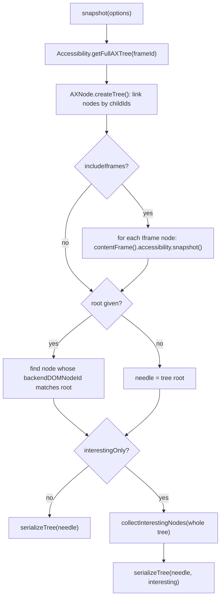

## Overview

`page.accessibility.snapshot()` returns the page as assistive technology sees it: a tree of roles, names, values and states instead of DOM elements. Chrome's own accessibility tree is much larger than what screen readers present, so by default Puppeteer filters it down to the "interesting" nodes, roughly as platform accessibility layers do. The `Accessibility` class asks the browser for the full tree of one frame over CDP, rebuilds it as `AXNode` objects, filters it, and serializes it to `SerializedAXNode` objects. Querying the accessibility tree for elements (`aria/` selectors) is a separate path described in [[Selectors and Query Handlers]].

Sources: [packages/puppeteer-core/src/cdp/Accessibility.ts:115-148](repo://packages/puppeteer-core/src/cdp/Accessibility.ts#L115-L148)

Every frame has its own `Accessibility` object bound to its main realm and frame id, and `page.accessibility` is the main frame's. Both the CDP and the BiDi frame classes create it; it sends its commands through the realm environment's CDP client.

Sources: [packages/puppeteer-core/src/api/Page.ts:916-918](repo://packages/puppeteer-core/src/api/Page.ts#L916-L918), [packages/puppeteer-core/src/cdp/Frame.ts:81-81](repo://packages/puppeteer-core/src/cdp/Frame.ts#L81-L81), [packages/puppeteer-core/src/bidi/Frame.ts:118-118](repo://packages/puppeteer-core/src/bidi/Frame.ts#L118-L118)

## Taking a snapshot

### Options

| Option | Default | Effect |
| --- | --- | --- |
| `interestingOnly` | `true` | Drop nodes that assistive technology would not expose |
| `root` | the document | Return only the subtree of this element |
| `includeIframes` | `false` | Snapshot each iframe and attach it under its `Iframe` node |

Sources: [packages/puppeteer-core/src/cdp/Accessibility.ts:96-114](repo://packages/puppeteer-core/src/cdp/Accessibility.ts#L96-L114)

### The snapshot flow



Sources: [packages/puppeteer-core/src/cdp/Accessibility.ts:189-266](repo://packages/puppeteer-core/src/cdp/Accessibility.ts#L189-L266)

`snapshot` sends `Accessibility.getFullAXTree` for its frame and, when a `root` is given, resolves the root's `backendNodeId` with `DOM.describeNode`. `AXNode.createTree` wraps every protocol node, links children through `childIds`, and treats the first node as the root.

Sources: [packages/puppeteer-core/src/cdp/Accessibility.ts:197-213](repo://packages/puppeteer-core/src/cdp/Accessibility.ts#L197-L213), [packages/puppeteer-core/src/cdp/Accessibility.ts:635-652](repo://packages/puppeteer-core/src/cdp/Accessibility.ts#L635-L652)

With `includeIframes`, the tree is walked. For each node with role `Iframe`, the iframe element is adopted from its backend node id, its content frame is found, and that frame's own `accessibility.snapshot(options)` is stored on the node as `iframeSnapshot`. Nested frames are therefore snapshotted recursively with the same options.

Sources: [packages/puppeteer-core/src/cdp/Accessibility.ts:214-244](repo://packages/puppeteer-core/src/cdp/Accessibility.ts#L214-L244)

The result is `null` when the tree is empty, when no node matches `root`, or when the root node itself is filtered out as uninteresting.

Sources: [packages/puppeteer-core/src/cdp/Accessibility.ts:237-265](repo://packages/puppeteer-core/src/cdp/Accessibility.ts#L237-L265)

## Which nodes are interesting

### The rules

`collectInterestingNodes` walks the whole tree, not only the subtree under `root`, and tracks whether it is inside a control. A node is interesting when it is not ignored, not hidden and not of role `Ignored`, and one of these holds:

Sources: [packages/puppeteer-core/src/cdp/Accessibility.ts:294-309](repo://packages/puppeteer-core/src/cdp/Accessibility.ts#L294-L309), [packages/puppeteer-core/src/cdp/Accessibility.ts:438-488](repo://packages/puppeteer-core/src/cdp/Accessibility.ts#L438-L488)

- it is focusable or richly editable;
- it has a control role (`button`, `checkbox`, `combobox`, `listbox`, `menuitem`, `radio`, `slider`, `tab`, `textbox`, `treeitem` and others);
- it is not inside a control, is a leaf, and has a name.

Sources: [packages/puppeteer-core/src/cdp/Accessibility.ts:294-309](repo://packages/puppeteer-core/src/cdp/Accessibility.ts#L294-L309), [packages/puppeteer-core/src/cdp/Accessibility.ts:438-488](repo://packages/puppeteer-core/src/cdp/Accessibility.ts#L438-L488)

A node with an iframe snapshot is always kept. The walk stops descending at leaves, so the children of a leaf are never collected.

Sources: [packages/puppeteer-core/src/cdp/Accessibility.ts:294-309](repo://packages/puppeteer-core/src/cdp/Accessibility.ts#L294-L309), [packages/puppeteer-core/src/cdp/Accessibility.ts:438-488](repo://packages/puppeteer-core/src/cdp/Accessibility.ts#L438-L488)

### What counts as a leaf

`isLeafNode` decides where a subtree collapses into one node:

Sources: [packages/puppeteer-core/src/cdp/Accessibility.ts:347-378](repo://packages/puppeteer-core/src/cdp/Accessibility.ts#L347-L378), [packages/puppeteer-core/src/cdp/Accessibility.ts:393-436](repo://packages/puppeteer-core/src/cdp/Accessibility.ts#L393-L436)

1. A node without children is a leaf.
2. Plain text fields (`textbox`, `searchbox`, or editable but not rich text) and text-only objects (`StaticText`, `InlineTextBox`, `text`, `LineBreak`) are leaves; their children are implementation details.
3. Roles whose children are only presentational are leaves: `img`, `image`, `graphics-symbol`, `doc-cover`, `Meter`, `scrollbar`, `slider`, `separator`, `progressbar`.
4. Following Android's heuristics, a node with a focusable descendant is not a leaf, while a focusable node with a name, or a heading with a name, is.

Sources: [packages/puppeteer-core/src/cdp/Accessibility.ts:347-378](repo://packages/puppeteer-core/src/cdp/Accessibility.ts#L347-L378), [packages/puppeteer-core/src/cdp/Accessibility.ts:393-436](repo://packages/puppeteer-core/src/cdp/Accessibility.ts#L393-L436)

A button whose label is a text node therefore appears as one `button` node with a `name`, not as a button with a `StaticText` child.

Sources: [packages/puppeteer-core/src/cdp/Accessibility.ts:467-488](repo://packages/puppeteer-core/src/cdp/Accessibility.ts#L467-L488)

### Serializing the filtered tree

`serializeTree` serializes children first. A node outside the interesting set returns its serialized children in its place, so uninteresting wrappers disappear and their interesting descendants move up to the nearest interesting ancestor. An iframe snapshot is appended as the last child of its `Iframe` node.

Sources: [packages/puppeteer-core/src/cdp/Accessibility.ts:268-292](repo://packages/puppeteer-core/src/cdp/Accessibility.ts#L268-L292)

## The SerializedAXNode shape

### Properties

`serialize` reads the protocol node's properties, name, value and description into a map and copies them into typed fields:

Sources: [packages/puppeteer-core/src/cdp/Accessibility.ts:490-543](repo://packages/puppeteer-core/src/cdp/Accessibility.ts#L490-L543), [packages/puppeteer-core/src/cdp/Accessibility.ts:545-633](repo://packages/puppeteer-core/src/cdp/Accessibility.ts#L545-L633), [packages/puppeteer-core/src/cdp/Accessibility.ts:16-91](repo://packages/puppeteer-core/src/cdp/Accessibility.ts#L16-L91)

| Kind | Fields | Rule |
| --- | --- | --- |
| Always | `role` | `Unknown` when missing |
| Strings | `name`, `value`, `description`, `keyshortcuts`, `roledescription`, `valuetext` | Copied when present |
| Booleans | `disabled`, `expanded`, `focused`, `modal`, `multiline`, `multiselectable`, `readonly`, `required`, `selected` | Only included when true; `focused` is skipped on `RootWebArea` |
| Tristates | `checked`, `pressed` | `true`, `false` or `'mixed'` |
| Numbers | `level`, `valuemin`, `valuemax` | Copied when present |
| Tokens | `autocomplete`, `haspopup`, `invalid`, `orientation` | Omitted when empty or `'false'` |
| Children | `children` | Only when non-empty |

Sources: [packages/puppeteer-core/src/cdp/Accessibility.ts:490-543](repo://packages/puppeteer-core/src/cdp/Accessibility.ts#L490-L543), [packages/puppeteer-core/src/cdp/Accessibility.ts:545-633](repo://packages/puppeteer-core/src/cdp/Accessibility.ts#L545-L633), [packages/puppeteer-core/src/cdp/Accessibility.ts:16-91](repo://packages/puppeteer-core/src/cdp/Accessibility.ts#L16-L91)

`RootWebArea` reports whether its frame has focus, not whether the root itself is focused, which is why `focused` is skipped for it.

Sources: [packages/puppeteer-core/src/cdp/Accessibility.ts:570-576](repo://packages/puppeteer-core/src/cdp/Accessibility.ts#L570-L576)

### From a node back to the DOM

Each serialized node has an `elementHandle()` method. It adopts the node's backend DOM node id into the frame's main realm and returns an `ElementHandle`, or `null` when the accessibility node has no DOM node ([[Element Handles]]).

Sources: [packages/puppeteer-core/src/cdp/Accessibility.ts:505-515](repo://packages/puppeteer-core/src/cdp/Accessibility.ts#L505-L515)

The class's own example walks a snapshot to find the focused node:

Sources: [packages/puppeteer-core/src/cdp/Accessibility.ts:173-184](repo://packages/puppeteer-core/src/cdp/Accessibility.ts#L173-L184)

```ts
const snapshot = await page.accessibility.snapshot();
const node = findFocusedNode(snapshot);
console.log(node && node.name);

function findFocusedNode(node) {
  if (node.focused) return node;
  for (const child of node.children || []) {
    const foundNode = findFocusedNode(child);
    return foundNode;
  }
  return null;
}
```

Sources: [packages/puppeteer-core/src/cdp/Accessibility.ts:173-184](repo://packages/puppeteer-core/src/cdp/Accessibility.ts#L173-L184)
