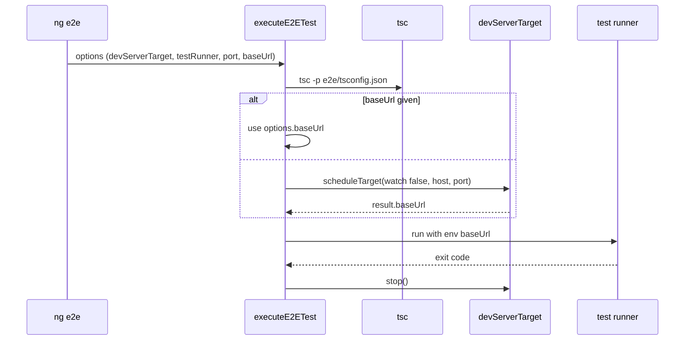

## Overview

`@puppeteer/ng-schematics` adds Puppeteer end-to-end tests to an Angular CLI workspace. `ng add @puppeteer/ng-schematics` installs Puppeteer and a test runner, generates a small test harness in an `e2e` folder, and registers an Angular builder. That builder compiles the tests, starts the app's dev server, and runs the tests against it when the developer types `ng e2e`. The package has three schematics, `ng-add`, `e2e` (one more test file) and `config` (a Puppeteer configuration file), and one builder, `puppeteer`.

Sources: [packages/ng-schematics/README.md:1-30](repo://packages/ng-schematics/README.md#L1-L30), [packages/ng-schematics/src/schematics/collection.json:1-20](repo://packages/ng-schematics/src/schematics/collection.json#L1-L20)

## ng add

### Choosing a test runner

The only option is `--test-runner` (alias `-t`): `jasmine` (the default), `jest`, `mocha` or `node` for Node's built-in test runner. Without it, the CLI prompts with a list.

Sources: [packages/ng-schematics/src/schematics/ng-add/schema.json:1-37](repo://packages/ng-schematics/src/schematics/ng-add/schema.json#L1-L37), [packages/ng-schematics/src/schematics/utils/types.ts:7-16](repo://packages/ng-schematics/src/schematics/utils/types.ts#L7-L16)

### The rule chain

`ngAdd` chains five rules:

Sources: [packages/ng-schematics/src/schematics/ng-add/index.ts:39-135](repo://packages/ng-schematics/src/schematics/ng-add/index.ts#L39-L135), [packages/ng-schematics/src/schematics/utils/packages.ts:35-64](repo://packages/ng-schematics/src/schematics/utils/packages.ts#L35-L64), [packages/ng-schematics/src/schematics/utils/packages.ts:105-126](repo://packages/ng-schematics/src/schematics/utils/packages.ts#L105-L126)

1. **addDependencies**: always `puppeteer`, plus `jasmine`; `jest` and `@types/jest`; `mocha` and `@types/mocha`; or `@types/node`, depending on the runner. Each version is the `latest` dist-tag from the npm registry (falling back to the string `latest` on any error). They are added as dev dependencies, and an install task is scheduled with scripts allowed, so Puppeteer's postinstall downloads the browser ([[Configuration and Browser Download]]).
2. **addCommonFiles**: renders `files/common` into each application project.
3. **addOtherFiles**: renders the runner-specific `files/<runner>` (for example `jest.config.js` or `.mocharc.js`).
4. **updateScripts**: with a single application project, adds a `package.json` script that runs the e2e target.
5. **updateAngularConfig**: registers the builder in `angular.json` for every application project.

Sources: [packages/ng-schematics/src/schematics/ng-add/index.ts:39-135](repo://packages/ng-schematics/src/schematics/ng-add/index.ts#L39-L135), [packages/ng-schematics/src/schematics/utils/packages.ts:35-64](repo://packages/ng-schematics/src/schematics/utils/packages.ts#L35-L64), [packages/ng-schematics/src/schematics/utils/packages.ts:105-126](repo://packages/ng-schematics/src/schematics/utils/packages.ts#L105-L126)

### Target name: e2e or puppeteer

If no application project has an `e2e` architect target yet, the new target is called `e2e`, so `ng e2e` runs Puppeteer. If one already exists (another e2e tool), the target is called `puppeteer` instead, and the package script becomes `ng run <project>:puppeteer`.

Sources: [packages/ng-schematics/src/schematics/utils/files.ts:137-152](repo://packages/ng-schematics/src/schematics/utils/files.ts#L137-L152), [packages/ng-schematics/src/schematics/ng-add/index.ts:80-98](repo://packages/ng-schematics/src/schematics/ng-add/index.ts#L80-L98)

The `angular.json` entry points at the builder, passes the project's `serve` target and the test runner, and adds a `production` configuration that serves the production build:

Sources: [packages/ng-schematics/src/schematics/utils/packages.ts:150-189](repo://packages/ng-schematics/src/schematics/utils/packages.ts#L150-L189)

```ts
{
  name,
  value: {
    builder: '@puppeteer/ng-schematics:puppeteer',
    options: {
      devServerTarget: `${project}:serve`,
      testRunner: options.testRunner,
    },
    configurations: {
      production: {
        devServerTarget: `${project}:serve:production`,
      },
    },
  },
},
```

Sources: [packages/ng-schematics/src/schematics/utils/packages.ts:150-189](repo://packages/ng-schematics/src/schematics/utils/packages.ts#L150-L189)

`package.json` dependencies and scripts are only added when a key does not exist yet, while the `angular.json` target is overwritten.

Sources: [packages/ng-schematics/src/schematics/utils/packages.ts:66-103](repo://packages/ng-schematics/src/schematics/utils/packages.ts#L66-L103), [packages/ng-schematics/src/schematics/utils/packages.ts:128-153](repo://packages/ng-schematics/src/schematics/utils/packages.ts#L128-L153)

## Generated files

### Template rendering

`addFilesSingle` renders a template folder into a project with Angular's `applyTemplates`. The templates receive the runner, the project name, `strings` helpers such as `dasherize`, the path back to the workspace, the path of the project's `tsconfig.json` from the `e2e` folder, and a `baseUrl`. The `baseUrl` is computed from the project's `serve` options: `https` when `ssl` is set, `localhost`, and the configured port (4200 unless the serve target sets another).

Sources: [packages/ng-schematics/src/schematics/utils/files.ts:22-108](repo://packages/ng-schematics/src/schematics/utils/files.ts#L22-L108)

### The test harness

The common files include `e2e/tests/utils.ts` with two helpers. `setupBrowserHooks(path)` launches Puppeteer once per suite (`beforeAll` or `before`, depending on the runner), opens a fresh page and navigates to `baseUrl + path` before each test, and closes the page and browser afterwards. `getBrowserState()` returns `{browser, page, baseUrl}`. The base URL comes from the `baseUrl` environment variable when set, which the builder provides.

Sources: [packages/ng-schematics/src/schematics/ng-add/files/common/e2e/tests/utils.ts.template:1-56](repo://packages/ng-schematics/src/schematics/ng-add/files/common/e2e/tests/utils.ts.template#L1-L56)

The first test checks that the app shows its project name, using a P-selector locator ([[Locators]], [[Selectors and Query Handlers]]):

Sources: [packages/ng-schematics/src/schematics/ng-add/files/common/e2e/tests/app.__ext@dasherize__.ts.template:9-13](repo://packages/ng-schematics/src/schematics/ng-add/files/common/e2e/tests/app.__ext@dasherize__.ts.template#L9-L13)

```ts
describe('App test', function () {
  setupBrowserHooks();
  it('is running', async function () {
    const {page} = getBrowserState();
    const element = await page.locator('::-p-text(<%= project %>)').wait();
```

Sources: [packages/ng-schematics/src/schematics/ng-add/files/common/e2e/tests/app.__ext@dasherize__.ts.template:9-13](repo://packages/ng-schematics/src/schematics/ng-add/files/common/e2e/tests/app.__ext@dasherize__.ts.template#L9-L13)

Test files are named `*.e2e.ts`, except for the Node test runner, which uses `*.test.ts` because it does not support glob patterns and looks for `*.test.js` files.

Sources: [packages/ng-schematics/src/schematics/ng-add/index.ts:100-113](repo://packages/ng-schematics/src/schematics/ng-add/index.ts#L100-L113), [packages/ng-schematics/src/schematics/e2e/index.ts:103-116](repo://packages/ng-schematics/src/schematics/e2e/index.ts#L103-L116)

## The e2e and config schematics

`ng generate @puppeteer/ng-schematics:e2e "<TestName>"` adds one test file. It accepts `--project`/`-p`, `--name`/`-n` and `--route`/`-r` (a leading `/` is removed). It picks the only application project, the named one, or the one at the workspace root. It then reads the runner and port from that project's `e2e` or `puppeteer` target, and throws when neither uses the Puppeteer builder.

Sources: [packages/ng-schematics/src/schematics/e2e/index.ts:26-118](repo://packages/ng-schematics/src/schematics/e2e/index.ts#L26-L118), [packages/ng-schematics/README.md:36-42](repo://packages/ng-schematics/README.md#L36-L42)

`ng generate @puppeteer/ng-schematics:config` writes an empty `.puppeteerrc.mjs`, typed as Puppeteer's `Configuration`, at the workspace root for project-specific settings.

Sources: [packages/ng-schematics/src/schematics/config/index.ts:19-39](repo://packages/ng-schematics/src/schematics/config/index.ts#L19-L39), [packages/ng-schematics/src/schematics/config/files/.puppeteerrc.mjs:1-4](repo://packages/ng-schematics/src/schematics/config/files/.puppeteerrc.mjs#L1-L4)

## The puppeteer builder

### What ng e2e runs



Sources: [packages/ng-schematics/src/builders/puppeteer/index.ts:154-234](repo://packages/ng-schematics/src/builders/puppeteer/index.ts#L154-L234)

`executeE2ETest` first compiles the tests with `tsc -p e2e/tsconfig.json`. It then either uses `options.baseUrl` or schedules the dev server target without watching, on the configured `port` (or the serve target's port), and fails with `Failed to spawn server! Stopping tests...` if it does not start. It runs the runner with the server's URL in the `baseUrl` environment variable, reports success or failure, and always stops the server.

Sources: [packages/ng-schematics/src/builders/puppeteer/index.ts:154-232](repo://packages/ng-schematics/src/builders/puppeteer/index.ts#L154-L232), [packages/ng-schematics/src/builders/puppeteer/schema.json:1-30](repo://packages/ng-schematics/src/builders/puppeteer/schema.json#L1-L30)

### Runner commands

| Runner | Command |
| --- | --- |
| Jasmine | `jasmine --config=./e2e/jasmine.json` |
| Jest | `jest -c e2e/jest.config.js` |
| Mocha | `mocha --config=./e2e/.mocharc.js` |
| Node | `node --test --test-reporter spec e2e/build/**/*.e2e.js` |

Sources: [packages/ng-schematics/src/builders/puppeteer/index.ts:31-50](repo://packages/ng-schematics/src/builders/puppeteer/index.ts#L31-L50)

Commands run in the project's root with `stdio: 'inherit'` and a shell. Except for `node`, the executable is resolved to `node_modules/.bin/<command>` relative to the project root, with one `../` per path segment for nested projects. A non-zero exit fails the build with `Please look at the output above to determine the issue!`.

Sources: [packages/ng-schematics/src/builders/puppeteer/index.ts:52-130](repo://packages/ng-schematics/src/builders/puppeteer/index.ts#L52-L130)

To run tests while `ng serve` is already using the default port, set `port` in the builder options, as the README describes.

Sources: [packages/ng-schematics/README.md:44-60](repo://packages/ng-schematics/README.md#L44-L60)
