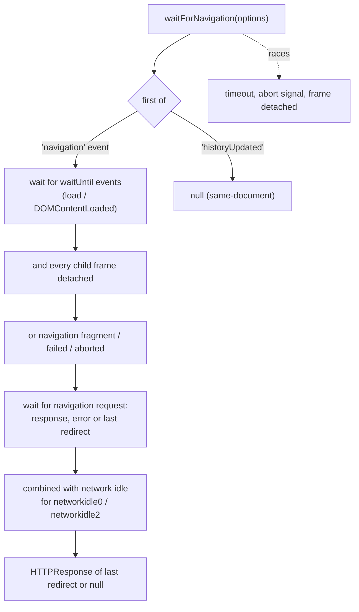

## Overview

The classes in `src/bidi` implement the abstract Puppeteer API ([[Browsers, Browser Contexts and Targets]], [[Pages]], [[Frames and Navigation]]) on top of the spec-shaped objects of `bidi/core` ([[WebDriver BiDi Core Layer]]). Each public object wraps one core object: `BidiBrowser` wraps the core `Browser`, `BidiBrowserContext` a `UserContext`, `BidiPage` and `BidiFrame` a `BrowsingContext`, `BidiFrameRealm` a `WindowRealm`, and `BidiHTTPRequest` a core `Request`. The adapters translate core events into page events, serialize values for `script.callFunction`, and compose core events into Puppeteer concepts such as "navigation finished". The core layer deliberately leaves that composition to them. Where BiDi has no equivalent, the adapters fall back to raw CDP when it is available, or throw `UnsupportedOperation`.

Sources: [packages/puppeteer-core/src/bidi/Browser.ts:54-148](repo://packages/puppeteer-core/src/bidi/Browser.ts#L54-L148), [packages/puppeteer-core/src/bidi/Page.ts:77-133](repo://packages/puppeteer-core/src/bidi/Page.ts#L77-L133), [packages/puppeteer-core/src/bidi/Frame.ts:80-119](repo://packages/puppeteer-core/src/bidi/Frame.ts#L80-L119)

## Browser and contexts

### Creating the browser

`BidiBrowser.create` opens a core `Session` with capabilities built from the user's `capabilities` plus Puppeteer's own, which take precedence: `acceptInsecureCerts`, an `ignore` default user-prompt handler, `webSocketUrl: true`, and `goog:prerenderingDisabled`. It subscribes to the `browsingContext`, `network`, `log`, `script` and `input` modules, plus some `goog:cdp.*` events except on Firefox, and leaves out the network subscriptions when `networkEnabled` is false. It then registers a 20 MB response data collector, ignoring protocol errors from implementations without one, and wraps every existing user context in a `BidiBrowserContext`.

Sources: [packages/puppeteer-core/src/bidi/Browser.ts:57-148](repo://packages/puppeteer-core/src/bidi/Browser.ts#L57-L148)

`version()` and `userAgent()` come from the session capabilities. `close()` sends `browser.close`, runs the launcher's close callback and disposes the connection; `disconnect()` ends the session. When a launched browser process exits, the core browser is disposed as closed. `wsEndpoint()` is the connection URL.

Sources: [packages/puppeteer-core/src/bidi/Browser.ts:140-148](repo://packages/puppeteer-core/src/bidi/Browser.ts#L140-L148), [packages/puppeteer-core/src/bidi/Browser.ts:182-245](repo://packages/puppeteer-core/src/bidi/Browser.ts#L182-L245), [packages/puppeteer-core/src/bidi/Browser.ts:247-302](repo://packages/puppeteer-core/src/bidi/Browser.ts#L247-L302)

### Contexts, pages and synthetic targets

BiDi has no target concept. `BidiBrowserContext` creates a `BidiPage` for every top-level browsing context of its user context, existing or new, and synthesizes targets from page events: a `BidiPageTarget` per page, a `BidiFrameTarget` per attached frame and a `BidiWorkerTarget` per worker. It emits `targetcreated`, `targetchanged` (on frame navigation) and `targetdestroyed`, which the browser re-emits. When a new browsing context has an opener, the opener's page emits `popup`.

Sources: [packages/puppeteer-core/src/bidi/BrowserContext.ts:88-182](repo://packages/puppeteer-core/src/bidi/BrowserContext.ts#L88-L182), [packages/puppeteer-core/src/bidi/Browser.ts:186-212](repo://packages/puppeteer-core/src/bidi/Browser.ts#L186-L212)

`newPage()` creates a `tab` browsing context and returns the page the event produced, then applies the default viewport (silently skipping browsers that cannot set one). `close()` removes the user context; the default context cannot be closed. `overridePermissions` sets every known permission to granted or denied for the origin through `permissions.setPermission`, and `clearPermissionOverrides` sets them back to `prompt`. Cookies go through `storage.getCookies` and `storage.setCookie`, partitioned by user context.

Sources: [packages/puppeteer-core/src/bidi/BrowserContext.ts:184-218](repo://packages/puppeteer-core/src/bidi/BrowserContext.ts#L184-L218), [packages/puppeteer-core/src/bidi/BrowserContext.ts:230-302](repo://packages/puppeteer-core/src/bidi/BrowserContext.ts#L230-L302)

### Trusted emitters

`BidiBrowser`, `BidiBrowserContext` and `BidiPage` each hold a private `trustedEmitter` decorated with `@bubble()`. Internal code emits on it, and the decorator forwards every event to the public object; when the object closes, its trusted emitter's listeners are removed with `removeAllListeners`.

Sources: [packages/puppeteer-core/src/bidi/Browser.ts:127-161](repo://packages/puppeteer-core/src/bidi/Browser.ts#L127-L161), [packages/puppeteer-core/src/bidi/BrowserContext.ts:59-60](repo://packages/puppeteer-core/src/bidi/BrowserContext.ts#L59-L60), [packages/puppeteer-core/src/util/decorators.ts:173-210](repo://packages/puppeteer-core/src/util/decorators.ts#L173-L210)

## Pages and frames

### BidiPage

A `BidiPage` owns the top-level `BidiFrame` and creates its keyboard, mouse and touchscreen (which send `input.performActions`), plus `Tracing`, `Coverage` and a CDP `EmulationManager` over the frame's `BidiCdpSession` ([[BiDi Connection and BiDi over CDP]]). It emits `close` when its browsing context closes. Settings with a BiDi command use it (viewport, cache behaviour, JavaScript enabled, geolocation, time zone); others use the CDP emulation manager and need CDP support; a few, such as drag interception and service worker bypass, throw `UnsupportedOperation`.

Sources: [packages/puppeteer-core/src/bidi/Page.ts:77-133](repo://packages/puppeteer-core/src/bidi/Page.ts#L77-L133), [packages/puppeteer-core/src/bidi/Page.ts:328-400](repo://packages/puppeteer-core/src/bidi/Page.ts#L328-L400), [packages/puppeteer-core/src/bidi/Page.ts:738-745](repo://packages/puppeteer-core/src/bidi/Page.ts#L738-L745), [packages/puppeteer-core/src/bidi/Input.ts:280-292](repo://packages/puppeteer-core/src/bidi/Input.ts#L280-L292)

### BidiFrame events

A `BidiFrame` translates its browsing context's events into page events:

Sources: [packages/puppeteer-core/src/bidi/Frame.ts:121-170](repo://packages/puppeteer-core/src/bidi/Frame.ts#L121-L170), [packages/puppeteer-core/src/bidi/Frame.ts:171-249](repo://packages/puppeteer-core/src/bidi/Frame.ts#L171-L249)

| Core event | Page event |
| --- | --- |
| child `browsingcontext` | Creates a child `BidiFrame`; `frameattached` |
| `closed` | `framedetached`; closes the frame's CDP sessions |
| `request` | `BidiHTTPRequest` (emits `request`); `requestfinished` or `requestfailed` on success or error |
| `navigation` ending as `fragment` | `framenavigated` |
| `DOMContentLoaded` | `domcontentloaded` and `framenavigated` |
| `load` | `load` |
| `userprompt` | `dialog` with a `BidiDialog` |
| `log` of type `console` | `console` with a `ConsoleMessage` built from the arguments |
| `log` of type `javascript` | `pageerror` with an `Error` whose stack is rebuilt from the call frames |
| `worker` | `workercreated`, and `workerdestroyed` when the realm is destroyed |

Sources: [packages/puppeteer-core/src/bidi/Frame.ts:121-170](repo://packages/puppeteer-core/src/bidi/Frame.ts#L121-L170), [packages/puppeteer-core/src/bidi/Frame.ts:171-249](repo://packages/puppeteer-core/src/bidi/Frame.ts#L171-L249)

The frame tree comes straight from the browsing context tree: `childFrames()` maps the context's children, `parentFrame()` is the parent frame, and `detached` is true once the browsing context is closed.

Sources: [packages/puppeteer-core/src/bidi/Frame.ts:272-295](repo://packages/puppeteer-core/src/bidi/Frame.ts#L272-L295), [packages/puppeteer-core/src/bidi/Frame.ts:477-479](repo://packages/puppeteer-core/src/bidi/Frame.ts#L477-L479)

### Navigation

`goto(url)` runs `waitForNavigation` and `browsingContext.navigate(url, 'interactive')` in parallel; navigation errors for HTTP status failures, cancelled navigations and navigations aborted by another navigation are ignored, and other errors are rewritten to include the URL and timeout. `waitForNavigation` composes core events with RxJS:

Sources: [packages/puppeteer-core/src/bidi/Frame.ts:313-355](repo://packages/puppeteer-core/src/bidi/Frame.ts#L313-L355), [packages/puppeteer-core/src/bidi/Frame.ts:373-471](repo://packages/puppeteer-core/src/bidi/Frame.ts#L373-L471)

Sources: [packages/puppeteer-core/src/bidi/Frame.ts:313-355](repo://packages/puppeteer-core/src/bidi/Frame.ts#L313-L355), [packages/puppeteer-core/src/bidi/Frame.ts:373-471](repo://packages/puppeteer-core/src/bidi/Frame.ts#L373-L471)

`networkidle0` and `networkidle2` reuse the page's in-flight request counter (`Page.waitForNetworkIdle$`) with 500 ms of idle time and a concurrency of 0 or 2 ([[Pages]]). `setContent` writes the document and waits for the same load and network-idle conditions.

Sources: [packages/puppeteer-core/src/bidi/Frame.ts:357-371](repo://packages/puppeteer-core/src/bidi/Frame.ts#L357-L371), [packages/puppeteer-core/src/bidi/Frame.ts:516-589](repo://packages/puppeteer-core/src/bidi/Frame.ts#L516-L589)

## Evaluation and realms

### Two realms per frame

Each `BidiFrame` has a `default` realm (the page's) and an `internal` realm, a sandbox named `__puppeteer_internal_<random>` created with `createWindowRealm`. They are Puppeteer's main and isolated realms. When the core realm emits `updated` after a navigation, the Puppeteer realm drops its cached `PuppeteerUtil` handle and document handle and re-runs its pending waits; when it is destroyed, pending waits fail with the reason ([[Waiting for Conditions]]).

Sources: [packages/puppeteer-core/src/bidi/Frame.ts:109-118](repo://packages/puppeteer-core/src/bidi/Frame.ts#L109-L118), [packages/puppeteer-core/src/bidi/Realm.ts:45-80](repo://packages/puppeteer-core/src/bidi/Realm.ts#L45-L80), [packages/puppeteer-core/src/bidi/Realm.ts:285-308](repo://packages/puppeteer-core/src/bidi/Realm.ts#L285-L308)

### Evaluating

`BidiRealm.#evaluate` mirrors the CDP version ([[JavaScript Evaluation and Handles]]): it adds the same `sourceURL` comment, then sends `script.evaluate` for strings or `script.callFunction` for functions, with `awaitPromise` and `userActivation`. For `evaluateHandle` it asks for `resultOwnership: root` and no serialization depth, so the result stays a remote reference; for `evaluate` it asks for no ownership and deserializes the value. An `exception` result becomes an evaluation error. Results of type `node` or `window` in a frame realm become `BidiElementHandle`s, everything else `BidiJSHandle`s.

Sources: [packages/puppeteer-core/src/bidi/Realm.ts:82-140](repo://packages/puppeteer-core/src/bidi/Realm.ts#L82-L140), [packages/puppeteer-core/src/bidi/Realm.ts:141-205](repo://packages/puppeteer-core/src/bidi/Realm.ts#L141-L205)

### Serializing values

| Direction | Code | Rules |
| --- | --- | --- |
| Node to page | `BidiSerializer.serialize` | Primitives, `-0`/`NaN`/`±Infinity`, `bigint`, arrays, plain objects (checked for cycles), `RegExp` and `Date`; functions, symbols and class instances throw `UnserializableError` |
| Handles to page | `BidiRealm.serialize` | A handle is sent as its remote reference; handles from another frame or from a worker in a page (or the reverse) throw |
| Page to Node | `BidiDeserializer.deserialize` | Arrays, sets, objects, maps, `RegExp`, dates, special numbers, `bigint`; promises become `{}`; unsupported types become `undefined` |

Sources: [packages/puppeteer-core/src/bidi/Serializer.ts:20-126](repo://packages/puppeteer-core/src/bidi/Serializer.ts#L20-L126), [packages/puppeteer-core/src/bidi/Realm.ts:207-238](repo://packages/puppeteer-core/src/bidi/Realm.ts#L207-L238), [packages/puppeteer-core/src/bidi/Deserializer.ts:16-92](repo://packages/puppeteer-core/src/bidi/Deserializer.ts#L16-L92)

`adoptHandle` re-evaluates the node in the target realm, and `transferHandle` does the same and disposes the original. Disposing handles sends `script.disown`. `adoptBackendNode` needs CDP: it resolves the node with `DOM.resolveNode` in the realm's CDP execution context and re-evaluates it to get a BiDi shared id.

Sources: [packages/puppeteer-core/src/bidi/Realm.ts:240-279](repo://packages/puppeteer-core/src/bidi/Realm.ts#L240-L279), [packages/puppeteer-core/src/bidi/Realm.ts:354-372](repo://packages/puppeteer-core/src/bidi/Realm.ts#L354-L372)

### Exposed functions through channels

BiDi has no CDP-style binding. `ExposableFunction` uses a script channel instead: a function declaration that defines `globalThis[name]` as a function returning a promise and passing `[resolve, reject, args]` to a channel argument named `__puppeteer__<frameId>_page_exposeFunction_<name>`. It is installed as a preload script and evaluated immediately in the frame and all its descendants. Each call arrives as a `script.message` event on the connection. The handler finds the frame and realm, reads the arguments (element handles as handles, everything else as JSON values), calls the Node function, and settles the page-side promise through the `resolve` or `reject` handle. The ARIA query bindings used by selectors are installed the same way.

Sources: [packages/puppeteer-core/src/bidi/ExposedFunction.ts:33-129](repo://packages/puppeteer-core/src/bidi/ExposedFunction.ts#L33-L129), [packages/puppeteer-core/src/bidi/ExposedFunction.ts:135-210](repo://packages/puppeteer-core/src/bidi/ExposedFunction.ts#L135-L210), [packages/puppeteer-core/src/bidi/Realm.ts:310-344](repo://packages/puppeteer-core/src/bidi/Realm.ts#L310-L344)

Removing an exposed function deletes the global in each frame and removes the preload scripts.

Sources: [packages/puppeteer-core/src/bidi/ExposedFunction.ts:232-258](repo://packages/puppeteer-core/src/bidi/ExposedFunction.ts#L232-L258), [packages/puppeteer-core/src/bidi/Frame.ts:481-505](repo://packages/puppeteer-core/src/bidi/Frame.ts#L481-L505)

## Network and interception

### Requests

A `BidiHTTPRequest` wraps a core `Request` and emits `request` when created. Interception is enabled on it when the core request is blocked. Redirects create a new `BidiHTTPRequest` that shares the redirect chain, and the response is built when the core request succeeds. The resource type and post data come from Chrome's `goog:` fields and need CDP support. Interception then goes through the same `finalizeInterceptions` and cooperative voting as on CDP ([[Network Requests and Interception]]), ending in `network.continueRequest`, `network.failRequest` or `network.provideResponse`.

Sources: [packages/puppeteer-core/src/bidi/HTTPRequest.ts:28-140](repo://packages/puppeteer-core/src/bidi/HTTPRequest.ts#L28-L140), [packages/puppeteer-core/src/bidi/HTTPRequest.ts:239-297](repo://packages/puppeteer-core/src/bidi/HTTPRequest.ts#L239-L297)

### Intercepts

The page keeps independent intercepts, each added with `browsingContext.addIntercept` when first needed and removed when no longer needed: one in the `beforeRequestSent` phase for `setRequestInterception(true)`, one in the same phase while extra HTTP headers are set, one more while a user agent is set with `setUserAgent`, and one in the `authRequired` phase for `authenticate`. A request paused while such headers are configured gets an internal handler that continues it with the merged headers at priority 0. Authentication provides the credentials once per request and cancels on a second challenge.

Sources: [packages/puppeteer-core/src/bidi/Page.ts:672-737](repo://packages/puppeteer-core/src/bidi/Page.ts#L672-L737), [packages/puppeteer-core/src/bidi/Page.ts:160-174](repo://packages/puppeteer-core/src/bidi/Page.ts#L160-L174), [packages/puppeteer-core/src/bidi/HTTPRequest.ts:99-108](repo://packages/puppeteer-core/src/bidi/HTTPRequest.ts#L99-L108), [packages/puppeteer-core/src/bidi/HTTPRequest.ts:146-171](repo://packages/puppeteer-core/src/bidi/HTTPRequest.ts#L146-L171), [packages/puppeteer-core/src/bidi/HTTPRequest.ts:298-320](repo://packages/puppeteer-core/src/bidi/HTTPRequest.ts#L298-L320)
