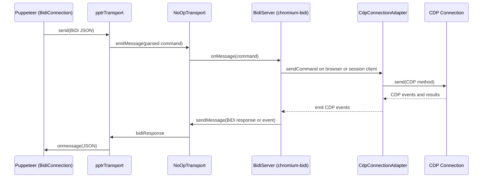

## Overview

Every WebDriver BiDi message Puppeteer sends or receives goes through a `BidiConnection`, the BiDi counterpart of the CDP `Connection` ([[CDP Connection and Sessions]]). It numbers commands, matches results and errors to them, and emits events by method name. The connection can sit on two kinds of transport. With Firefox it uses a WebSocket to the browser's own BiDi endpoint. With Chrome it uses an in-process translator: `connectBidiOverCdp` starts the `chromium-bidi` mapper inside Node, feeds it Puppeteer's BiDi commands, and lets it drive Chrome over an existing CDP connection. The `BidiCdpSession` class then lets BiDi-mode code reach raw CDP when the browser supports it. [[Connecting to a Browser and Transports]] and [[Launching Browsers]] describe when each path is chosen.

Sources: [packages/puppeteer-core/src/bidi/Connection.ts:48-74](repo://packages/puppeteer-core/src/bidi/Connection.ts#L48-L74), [packages/puppeteer-core/src/bidi/BidiOverCdp.ts:26-64](repo://packages/puppeteer-core/src/bidi/BidiOverCdp.ts#L26-L64)

## BidiConnection

### Commands

`send(method, params, timeout?)` is typed against the BiDi command map of `bidi/core` ([[WebDriver BiDi Core Layer]]), extended with three Chrome-specific commands: `goog:cdp.sendCommand`, `goog:cdp.getSession` and `goog:cdp.resolveRealm`. It uses the same `CallbackRegistry` as CDP, so each command gets an id, a timeout (`protocolTimeout`, 180 seconds by default) and a pre-built error with the caller's stack. The message is `{id, method, params}`, logged under `puppeteer:webDriverBiDi:SEND ►`. A closed connection rejects with `ConnectionClosedError`.

Sources: [packages/puppeteer-core/src/bidi/Connection.ts:24-43](repo://packages/puppeteer-core/src/bidi/Connection.ts#L24-L43), [packages/puppeteer-core/src/bidi/Connection.ts:98-115](repo://packages/puppeteer-core/src/bidi/Connection.ts#L98-L115), [packages/puppeteer-core/src/bidi/core/Connection.ts:14-35](repo://packages/puppeteer-core/src/bidi/core/Connection.ts#L14-L35)

### Incoming messages

After the optional `slowMo` delay, each message is parsed and dispatched by its `type`:

Sources: [packages/puppeteer-core/src/bidi/Connection.ts:120-168](repo://packages/puppeteer-core/src/bidi/Connection.ts#L120-L168), [packages/puppeteer-core/src/bidi/Connection.ts:84-96](repo://packages/puppeteer-core/src/bidi/Connection.ts#L84-L96), [packages/puppeteer-core/src/bidi/Connection.ts:203-213](repo://packages/puppeteer-core/src/bidi/Connection.ts#L203-L213)

| `type` | Handling |
| --- | --- |
| `success` | Resolve the callback with the whole message (`{result, …}`) |
| `error` with an id | Reject the callback with `<error> <message> <stacktrace>`, keeping `<error>: <message>` as the original message |
| `event` whose method starts with `goog:cdp.` | Emit the inner CDP event on the `BidiCdpSession` registered for its session id |
| other `event` | Emit under its method name on the connection and every emitter added with `pipeTo` |
| not BiDi, but with an id | Reject with `Message is not in BiDi protocol format` |

Sources: [packages/puppeteer-core/src/bidi/Connection.ts:120-168](repo://packages/puppeteer-core/src/bidi/Connection.ts#L120-L168), [packages/puppeteer-core/src/bidi/Connection.ts:84-96](repo://packages/puppeteer-core/src/bidi/Connection.ts#L84-L96), [packages/puppeteer-core/src/bidi/Connection.ts:203-213](repo://packages/puppeteer-core/src/bidi/Connection.ts#L203-L213)

The last case matters when connecting: the BiDi connector first sends `session.status` on a fresh transport, and a CDP-only endpoint answers with a CDP-shaped error, which arrives here as a protocol error and makes the connector fall back to BiDi over CDP.

Sources: [packages/puppeteer-core/src/bidi/Connection.ts:158-167](repo://packages/puppeteer-core/src/bidi/Connection.ts#L158-L167), [packages/puppeteer-core/src/bidi/BrowserConnector.ts:71-96](repo://packages/puppeteer-core/src/bidi/BrowserConnector.ts#L71-L96)

### Closing

`unbind()` marks the connection closed, replaces the transport callbacks with no-ops, and rejects every pending command; it runs when the transport closes. `dispose()` also closes the transport. Unbinding without closing lets the connector reuse the same transport for a CDP connection after a failed probe. The `Session` in `bidi/core` re-emits all of the connection's events through its `@bubble()` accessor, which is how the core objects receive them.

Sources: [packages/puppeteer-core/src/bidi/Connection.ts:175-197](repo://packages/puppeteer-core/src/bidi/Connection.ts#L175-L197), [packages/puppeteer-core/src/bidi/BrowserConnector.ts:95-105](repo://packages/puppeteer-core/src/bidi/BrowserConnector.ts#L95-L105), [packages/puppeteer-core/src/bidi/core/Session.ts:43-52](repo://packages/puppeteer-core/src/bidi/core/Session.ts#L43-L52)

## BiDi over CDP

### The in-process mapper

Chrome speaks CDP natively. To use the BiDi API with it, Puppeteer runs `chromium-bidi`'s `BidiServer` (the mapper) inside the Node process:

Sources: [packages/puppeteer-core/src/bidi/BidiOverCdp.ts:26-64](repo://packages/puppeteer-core/src/bidi/BidiOverCdp.ts#L26-L64), [packages/puppeteer-core/src/bidi/BidiOverCdp.ts:179-209](repo://packages/puppeteer-core/src/bidi/BidiOverCdp.ts#L179-L209)

Sources: [packages/puppeteer-core/src/bidi/BidiOverCdp.ts:26-64](repo://packages/puppeteer-core/src/bidi/BidiOverCdp.ts#L26-L64), [packages/puppeteer-core/src/bidi/BidiOverCdp.ts:179-209](repo://packages/puppeteer-core/src/bidi/BidiOverCdp.ts#L179-L209)

`connectBidiOverCdp(cdp)` builds a fake Puppeteer-side transport whose `send` parses the JSON and hands the command to a `NoOpTransport`, the mapper's input. Everything the mapper sends back comes out of the `NoOpTransport` as a `bidiResponse` event and is fed to the `BidiConnection` as a string. The `BidiConnection` is created with the CDP connection's URL, `slowMo` delay and timeout. `BidiServer.createAndStart` then starts the mapper with the CDP adapter, the browser-level client and a logger that writes to the `bidi:<prefix>` debug namespace. Closing the fake transport closes the mapper, the adapters and the CDP connection.

Sources: [packages/puppeteer-core/src/bidi/BidiOverCdp.ts:19-64](repo://packages/puppeteer-core/src/bidi/BidiOverCdp.ts#L19-L64)

### Adapting CDP for the mapper

The mapper expects its own CDP client interface. `CdpConnectionAdapter` provides it: `browserClient()` wraps the CDP `Connection`, and `getCdpClient(sessionId)` wraps the `CdpCDPSession` for that id, creating one `CDPClientAdapter` per session. Each adapter forwards every event of its client (`on('*')`) to the mapper and passes `sendCommand` through to `send`. Once an adapter is closed, commands resolve to nothing and errors are swallowed, and `isCloseError` recognises Puppeteer's `TargetCloseError`.

Sources: [packages/puppeteer-core/src/bidi/BidiOverCdp.ts:70-172](repo://packages/puppeteer-core/src/bidi/BidiOverCdp.ts#L70-L172)

### Where it is used

`launch({protocol: 'webDriverBiDi'})` with Chrome first opens a normal CDP connection (pipe or WebSocket) and then calls `connectBidiOverCdp` on it. `connect({protocol: 'webDriverBiDi'})` does the same after its probe finds a CDP endpoint, refusing Firefox in that mode. In both cases the CDP connection is passed to `BidiBrowser` as `cdpConnection`, and closing the browser sends CDP `Browser.close`.

Sources: [packages/puppeteer-core/src/node/BrowserLauncher.ts:361-382](repo://packages/puppeteer-core/src/node/BrowserLauncher.ts#L361-L382), [packages/puppeteer-core/src/bidi/BrowserConnector.ts:98-123](repo://packages/puppeteer-core/src/bidi/BrowserConnector.ts#L98-L123)

## Raw CDP from BiDi mode

### cdpSupported

A `BidiBrowser` has `cdpSupported` set when it was created with a CDP connection, that is, over BiDi over CDP. Only then does it subscribe to a set of `goog:cdp.*` events next to the BiDi modules, so CDP-based features such as coverage, tracing and screencast receive their events. Page features branch on `cdpSupported`: `setOfflineMode` and `emulateNetworkConditions` throw `UnsupportedOperation` without it, `setUserAgent` rejects `userAgentMetadata`, `setViewport` and `setCacheEnabled` fall back to BiDi commands, and `frame.createCDPSession()` opens a real session on the underlying CDP connection.

Sources: [packages/puppeteer-core/src/bidi/Browser.ts:57-108](repo://packages/puppeteer-core/src/bidi/Browser.ts#L57-L108), [packages/puppeteer-core/src/bidi/Browser.ts:174-180](repo://packages/puppeteer-core/src/bidi/Browser.ts#L174-L180), [packages/puppeteer-core/src/bidi/Page.ts:145-160](repo://packages/puppeteer-core/src/bidi/Page.ts#L145-L160), [packages/puppeteer-core/src/bidi/Page.ts:745-775](repo://packages/puppeteer-core/src/bidi/Page.ts#L745-L775), [packages/puppeteer-core/src/bidi/Frame.ts:507-514](repo://packages/puppeteer-core/src/bidi/Frame.ts#L507-L514)

### BidiCdpSession

Every `BidiFrame` has a `client` of type `BidiCdpSession`. When CDP is supported, the session asks the mapper for the frame's CDP session id with `goog:cdp.getSession` (unless an id was given), and registers itself in the static `BidiCdpSession.sessions` map under that id. That map is where the connection delivers `goog:cdp.*` events.

Sources: [packages/puppeteer-core/src/bidi/CDPSession.ts:20-57](repo://packages/puppeteer-core/src/bidi/CDPSession.ts#L20-L57), [packages/puppeteer-core/src/bidi/Frame.ts:96-108](repo://packages/puppeteer-core/src/bidi/Frame.ts#L96-L108)

`send(method, params)` waits for the session id and tunnels the command as `goog:cdp.sendCommand {method, params, session}` over the BiDi connection, returning the inner result. Without CDP support it throws ``UnsupportedOperation: CDP support is required for this feature``; after detaching it throws `TargetCloseError`. `detach()` sends `Target.detachFromTarget` through the frame's own client and removes the session from the map. `connection()` returns `undefined`, because there is no CDP `Connection` object behind it.

Sources: [packages/puppeteer-core/src/bidi/CDPSession.ts:59-123](repo://packages/puppeteer-core/src/bidi/CDPSession.ts#L59-L123)

This is the session the shared `Accessibility`, `Coverage` and `Tracing` classes use on BiDi pages ([[Accessibility Snapshots]], [[Code Coverage and Tracing]]).

Sources: [packages/puppeteer-core/src/bidi/Frame.ts:118-118](repo://packages/puppeteer-core/src/bidi/Frame.ts#L118-L118), [packages/puppeteer-core/src/bidi/Page.ts:98-119](repo://packages/puppeteer-core/src/bidi/Page.ts#L98-L119)
