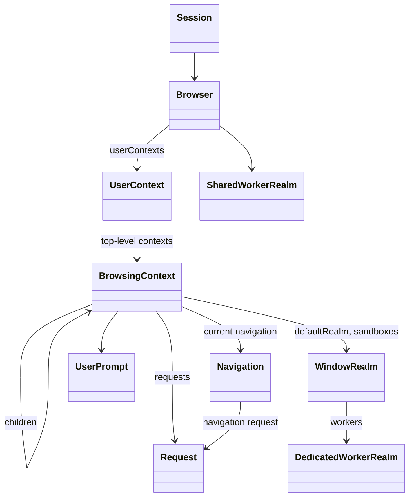
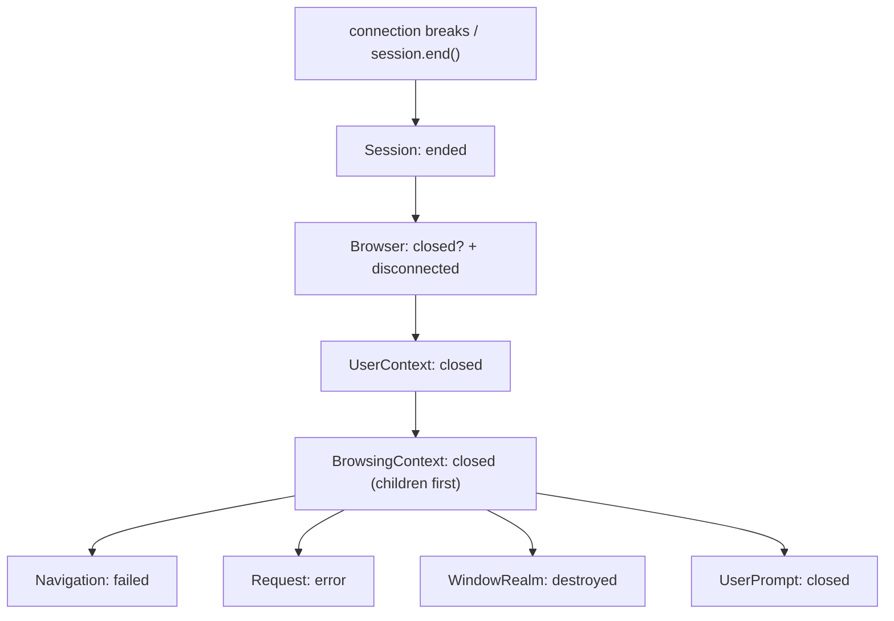

## Overview

WebDriver BiDi is a flat protocol: commands such as `browsingContext.navigate` take ids, and events such as `network.beforeRequestSent` arrive on one session stream with ids inside. `bidi/core` sits directly on that stream and gives it an object model. It has a `Session`, a `Browser`, `UserContext`s, a tree of `BrowsingContext`s, `Navigation`s, `Request`s, `Realm`s and `UserPrompt`s, each of which subscribes to the session events that concern it and emits higher-level events of its own. The Puppeteer API classes in `bidi/` are built on these objects ([[BiDi Implementation of the Puppeteer API]]); the connection under the session is described in [[BiDi Connection and BiDi over CDP]].

Sources: [packages/puppeteer-core/src/bidi/core/README.md:1-7](repo://packages/puppeteer-core/src/bidi/core/README.md#L1-L7), [packages/puppeteer-core/src/bidi/core/core.ts:7-15](repo://packages/puppeteer-core/src/bidi/core/core.ts#L7-L15)

## Design rules

The layer's README sets rules that explain much of its shape:

Sources: [packages/puppeteer-core/src/bidi/core/README.md:8-52](repo://packages/puppeteer-core/src/bidi/core/README.md#L8-L52), [packages/puppeteer-core/src/bidi/core/UserContext.ts:114-116](repo://packages/puppeteer-core/src/bidi/core/UserContext.ts#L114-L116)

| Rule | Consequence in the code |
| --- | --- |
| Required arguments are function parameters, optional ones go in an options object | `navigate(url, wait?)`, `createBrowsingContext(type, options)` |
| Only the browser exposes the session | Other objects reach it through private getters such as `#session` |
| Follow the specification, never Puppeteer's needs | A bug can be attributed to the spec or to Puppeteer precisely; Puppeteer-specific composition happens in `bidi/` |
| Implement every node and edge of the event graph, and never shortcut one | A fragment navigation goes navigation → browsing context; there is no direct fragment event on the browsing context |
| Implement the surrounding specifications too | Nested navigations (a fragment navigation inside `beforeunload`) are modelled even though BiDi has no such concept |

Sources: [packages/puppeteer-core/src/bidi/core/README.md:8-52](repo://packages/puppeteer-core/src/bidi/core/README.md#L8-L52), [packages/puppeteer-core/src/bidi/core/UserContext.ts:114-116](repo://packages/puppeteer-core/src/bidi/core/UserContext.ts#L114-L116)

## The object graph

### Ownership

Sources: [packages/puppeteer-core/src/bidi/core/Browser.ts:32-66](repo://packages/puppeteer-core/src/bidi/core/Browser.ts#L32-L66), [packages/puppeteer-core/src/bidi/core/BrowsingContext.ts:86-181](repo://packages/puppeteer-core/src/bidi/core/BrowsingContext.ts#L86-L181)

Every object is created through a static `from` or `create` factory that runs a private `#initialize`, where it subscribes to its parent and to the session. Objects are never created from user calls alone. Even `createBrowsingContext` returns the context that the `contextCreated` event already produced, and asserts that it exists.

Sources: [packages/puppeteer-core/src/bidi/core/BrowsingContext.ts:131-147](repo://packages/puppeteer-core/src/bidi/core/BrowsingContext.ts#L131-L147), [packages/puppeteer-core/src/bidi/core/UserContext.ts:136-161](repo://packages/puppeteer-core/src/bidi/core/UserContext.ts#L136-L161)

### Session and Browser

`Session.from(connection, capabilities)` sends `session.new`, then creates the `Browser`. The connection property uses the `@bubble()` decorator, which re-emits every event of the connection on the session, so objects subscribe to `session.on('browsingContext.load', …)`. The session also normalizes one inconsistency: some implementations do not send `navigationStarted` before `fragmentNavigated`, so it emits a synthetic `navigationStarted` first. `send` and `subscribe` throw the end reason once the session has ended.

Sources: [packages/puppeteer-core/src/bidi/core/Session.ts:23-112](repo://packages/puppeteer-core/src/bidi/core/Session.ts#L23-L112), [packages/puppeteer-core/src/util/decorators.ts:173-210](repo://packages/puppeteer-core/src/util/decorators.ts#L173-L210)

`Browser.from(session)` loads the current state. It creates a `UserContext` per `browser.getUserContexts` entry, then calls `browsingContext.getTree` and replays a `contextCreated` event on the session for every context in the tree, children included. The normal event handlers then build the objects, the same way as for contexts created later. Contexts created while `getTree` is in flight are tracked so they are not replayed twice. The browser also tracks shared-worker realms and provides `close`, preload scripts, intercept removal, user-context creation (with an optional manual proxy) and extension install.

Sources: [packages/puppeteer-core/src/bidi/core/Browser.ts:68-124](repo://packages/puppeteer-core/src/bidi/core/Browser.ts#L68-L124), [packages/puppeteer-core/src/bidi/core/Browser.ts:166-261](repo://packages/puppeteer-core/src/bidi/core/Browser.ts#L166-L261)

### UserContext

A `UserContext` (the BiDi name for an isolated profile, `default` for the default one) creates a `BrowsingContext` for every `contextCreated` event with no parent and its own id, and emits `browsingcontext`. It creates contexts (`browsingContext.create` of type `tab` or `window`), removes itself, gets and sets cookies partitioned by user context, and sets permissions.

Sources: [packages/puppeteer-core/src/bidi/core/UserContext.ts:31-112](repo://packages/puppeteer-core/src/bidi/core/UserContext.ts#L31-L112), [packages/puppeteer-core/src/bidi/core/UserContext.ts:136-231](repo://packages/puppeteer-core/src/bidi/core/UserContext.ts#L136-L231)

### BrowsingContext

A `BrowsingContext` is a tab or a frame. It listens to the session and, for its own id, creates child contexts, closes itself on `contextDestroyed`, keeps its URL current from `historyUpdated`, `domContentLoaded` and `load`, creates `Request`s from `network.beforeRequestSent`, creates `UserPrompt`s from `userPromptOpened`, and forwards file dialog and log events. Each command method sends one protocol command for its id: navigate, reload, traverse history, activate, capture a screenshot, print, set the viewport, perform input actions, add preload scripts and intercepts, locate nodes, set files, cookies, geolocation, time zone and scripting.

Sources: [packages/puppeteer-core/src/bidi/core/BrowsingContext.ts:183-255](repo://packages/puppeteer-core/src/bidi/core/BrowsingContext.ts#L183-L255), [packages/puppeteer-core/src/bidi/core/BrowsingContext.ts:290-321](repo://packages/puppeteer-core/src/bidi/core/BrowsingContext.ts#L290-L321), [packages/puppeteer-core/src/bidi/core/BrowsingContext.ts:375-447](repo://packages/puppeteer-core/src/bidi/core/BrowsingContext.ts#L375-L447), [packages/puppeteer-core/src/bidi/core/BrowsingContext.ts:454-517](repo://packages/puppeteer-core/src/bidi/core/BrowsingContext.ts#L454-L517), [packages/puppeteer-core/src/bidi/core/BrowsingContext.ts:702-728](repo://packages/puppeteer-core/src/bidi/core/BrowsingContext.ts#L702-L728)

## Navigations and requests

### Navigation

On `navigationStarted` for its id, a browsing context creates a `Navigation` unless one is still running, in which case the event belongs to a nested navigation that the running one handles. The navigation adopts the navigation id of the first matching event. It ends (disposes) on `domContentLoaded` or `load` for that id, and emits `fragment`, `failed` or `aborted` with the URL before ending on the corresponding events; a closed context makes it `failed`. It records the navigation `Request` and follows that request's redirects. A `navigationStarted` during a navigation creates a nested `Navigation`, and while it is unfinished the outer one ignores events.

Sources: [packages/puppeteer-core/src/bidi/core/BrowsingContext.ts:256-289](repo://packages/puppeteer-core/src/bidi/core/BrowsingContext.ts#L256-L289), [packages/puppeteer-core/src/bidi/core/Navigation.ts:25-97](repo://packages/puppeteer-core/src/bidi/core/Navigation.ts#L25-L97), [packages/puppeteer-core/src/bidi/core/Navigation.ts:99-149](repo://packages/puppeteer-core/src/bidi/core/Navigation.ts#L99-L149)

### Request

A `Request` wraps one `beforeRequestSent` event. A later `beforeRequestSent` with the same request id and `redirectCount + 1` creates the redirect's `Request`, emits `redirect`, and ends this one. `authRequired` for a blocked request emits `authenticate`; `fetchError` records the error and emits `error`; `responseCompleted` stores the response and emits `success`, ending the request unless the status is a 3xx redirect. Getters expose the URL, method, headers, initiator, navigation id, and Chrome's non-standard `goog:resourceType` and `goog:postData` fields. Interception methods (`continueRequest`, `failRequest`, `provideResponse`, `continueWithAuth`) send the matching `network.*` commands.

Sources: [packages/puppeteer-core/src/bidi/core/Request.ts:30-122](repo://packages/puppeteer-core/src/bidi/core/Request.ts#L30-L122), [packages/puppeteer-core/src/bidi/core/Request.ts:124-185](repo://packages/puppeteer-core/src/bidi/core/Request.ts#L124-L185), [packages/puppeteer-core/src/bidi/core/Request.ts:186-270](repo://packages/puppeteer-core/src/bidi/core/Request.ts#L186-L270)

## Realms

`Realm` is the base for script execution: `evaluate` sends `script.evaluate` and `callFunction` sends `script.callFunction` with the realm as target, and `disown` releases handles. `resolveExecutionContextId` asks a BiDi-over-CDP connection for the CDP execution context id with `goog:cdp.resolveRealm`.

Sources: [packages/puppeteer-core/src/bidi/core/Realm.ts:37-148](repo://packages/puppeteer-core/src/bidi/core/Realm.ts#L37-L148)

A `WindowRealm` belongs to a browsing context and an optional sandbox name. Every browsing context has a default realm and can create sandboxes with `createWindowRealm(name)`, which is how Puppeteer gets its isolated realm. The `WindowRealm` object persists across realm changes: it updates its id and origin on each matching `script.realmCreated`, emitting `updated`; its target is `{context, sandbox}` so commands work before the new id is known. Dedicated-worker realms are created when a worker realm lists the window realm as an owner, and shared-worker realms belong to the browser.

Sources: [packages/puppeteer-core/src/bidi/core/Realm.ts:150-222](repo://packages/puppeteer-core/src/bidi/core/Realm.ts#L150-L222), [packages/puppeteer-core/src/bidi/core/BrowsingContext.ts:354-360](repo://packages/puppeteer-core/src/bidi/core/BrowsingContext.ts#L354-L360), [packages/puppeteer-core/src/bidi/core/BrowsingContext.ts:523-525](repo://packages/puppeteer-core/src/bidi/core/BrowsingContext.ts#L523-L525)

## Disposal

### How end of life propagates

Each object owns a `DisposableStack` of its subscriptions and a reason string. Disposing records the reason, emits `closed` (or `ended`, `destroyed`), unsubscribes everything and removes all listeners. Children subscribe to their parent's end event, so disposal cascades down the graph:

Sources: [packages/puppeteer-core/src/bidi/core/Session.ts:54-62](repo://packages/puppeteer-core/src/bidi/core/Session.ts#L54-L62), [packages/puppeteer-core/src/bidi/core/Session.ts:154-161](repo://packages/puppeteer-core/src/bidi/core/Session.ts#L154-L161), [packages/puppeteer-core/src/bidi/core/Browser.ts:263-273](repo://packages/puppeteer-core/src/bidi/core/Browser.ts#L263-L273), [packages/puppeteer-core/src/bidi/core/UserContext.ts:69-78](repo://packages/puppeteer-core/src/bidi/core/UserContext.ts#L69-L78), [packages/puppeteer-core/src/bidi/core/BrowsingContext.ts:183-189](repo://packages/puppeteer-core/src/bidi/core/BrowsingContext.ts#L183-L189), [packages/puppeteer-core/src/bidi/core/BrowsingContext.ts:362-369](repo://packages/puppeteer-core/src/bidi/core/BrowsingContext.ts#L362-L369)

Sources: [packages/puppeteer-core/src/bidi/core/Session.ts:54-62](repo://packages/puppeteer-core/src/bidi/core/Session.ts#L54-L62), [packages/puppeteer-core/src/bidi/core/Session.ts:154-161](repo://packages/puppeteer-core/src/bidi/core/Session.ts#L154-L161), [packages/puppeteer-core/src/bidi/core/Browser.ts:263-273](repo://packages/puppeteer-core/src/bidi/core/Browser.ts#L263-L273), [packages/puppeteer-core/src/bidi/core/UserContext.ts:69-78](repo://packages/puppeteer-core/src/bidi/core/UserContext.ts#L69-L78), [packages/puppeteer-core/src/bidi/core/BrowsingContext.ts:183-189](repo://packages/puppeteer-core/src/bidi/core/BrowsingContext.ts#L183-L189), [packages/puppeteer-core/src/bidi/core/BrowsingContext.ts:362-369](repo://packages/puppeteer-core/src/bidi/core/BrowsingContext.ts#L362-L369)

### Using a disposed object

Methods are decorated with `@throwIfDisposed`, using the object's reason as the message, so calling a method on a closed browsing context throws, for example, `Browsing context already closed.` `dispose` itself is `@inertIfDisposed`, so a second disposal does nothing and the first reason wins. The `UserPrompt` follows the same pattern and is described with dialogs in [[Dialogs, File Choosers and Device Prompts]].

Sources: [packages/puppeteer-core/src/bidi/core/Browser.ts:159-176](repo://packages/puppeteer-core/src/bidi/core/Browser.ts#L159-L176), [packages/puppeteer-core/src/util/decorators.ts:53-79](repo://packages/puppeteer-core/src/util/decorators.ts#L53-L79), [packages/puppeteer-core/src/bidi/core/UserPrompt.ts:111-137](repo://packages/puppeteer-core/src/bidi/core/UserPrompt.ts#L111-L137)
