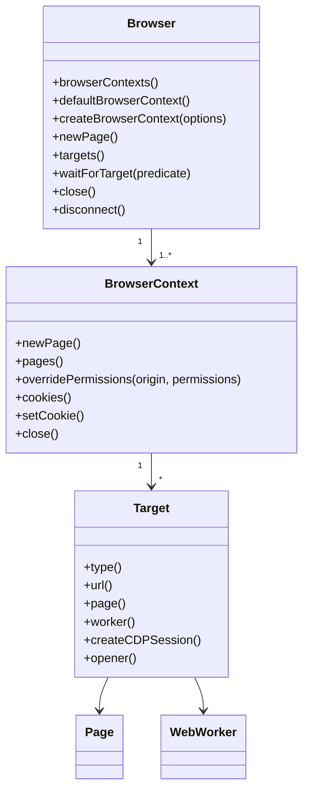

## Overview

Above pages sit three objects. A `Browser` is one browser instance, launched or connected. A `BrowserContext` is an isolated profile inside it with its own cookies and storage. A `Target` is anything the browser can debug: a tab, a page, a worker, the browser itself. All three are abstract classes in `src/api`; the CDP and BiDi backends subclass them. This page describes the shared contract. How CDP discovers and attaches targets is in [[Target Management (CDP)]], and the BiDi equivalents are in [[BiDi Implementation of the Puppeteer API]].

Sources: [packages/puppeteer-core/src/api/Browser.ts:209-254](repo://packages/puppeteer-core/src/api/Browser.ts#L209-L254), [packages/puppeteer-core/src/api/BrowserContext.ts:62-108](repo://packages/puppeteer-core/src/api/BrowserContext.ts#L62-L108), [packages/puppeteer-core/src/api/Target.ts:37-95](repo://packages/puppeteer-core/src/api/Target.ts#L37-L95)



Sources: [packages/puppeteer-core/src/api/Browser.ts:284-338](repo://packages/puppeteer-core/src/api/Browser.ts#L284-L338), [packages/puppeteer-core/src/api/Browser.ts:355-392](repo://packages/puppeteer-core/src/api/Browser.ts#L355-L392), [packages/puppeteer-core/src/api/Browser.ts:415-426](repo://packages/puppeteer-core/src/api/Browser.ts#L415-L426), [packages/puppeteer-core/src/api/BrowserContext.ts:162-183](repo://packages/puppeteer-core/src/api/BrowserContext.ts#L162-L183), [packages/puppeteer-core/src/api/BrowserContext.ts:204-270](repo://packages/puppeteer-core/src/api/BrowserContext.ts#L204-L270)

## Browser

### Contexts and pages

A browser always has a default context, returned by `defaultBrowserContext()`; `browserContexts()` lists it with every context created since. `newPage()` opens a page in the default context. `pages()` is not tracked separately: it asks every context for its pages and concatenates the results.

Sources: [packages/puppeteer-core/src/api/Browser.ts:284-323](repo://packages/puppeteer-core/src/api/Browser.ts#L284-L323), [packages/puppeteer-core/src/api/Browser.ts:382-392](repo://packages/puppeteer-core/src/api/Browser.ts#L382-L392)

`createBrowserContext(options)` takes `BrowserContextOptions`: a `proxyServer` and `proxyBypassList` that apply only to that context, and a `downloadBehavior`. On CDP these become `Target.createBrowserContext` parameters, with the bypass list joined by commas, and the download behaviour is applied once the context exists.

Sources: [packages/puppeteer-core/src/api/Browser.ts:36-53](repo://packages/puppeteer-core/src/api/Browser.ts#L36-L53), [packages/puppeteer-core/src/cdp/Browser.ts:200-222](repo://packages/puppeteer-core/src/cdp/Browser.ts#L200-L222)

### Events and waiting for targets

`Browser` is an `EventEmitter` ([[Events and Async Primitives]]). It emits `targetcreated`, `targetchanged` (a target's URL changed) and `targetdestroyed` for targets in every context, and `disconnected` when the connection goes away, either because the browser closed or crashed or because `disconnect()` was called.

Sources: [packages/puppeteer-core/src/api/Browser.ts:145-199](repo://packages/puppeteer-core/src/api/Browser.ts#L145-L199)

`waitForTarget(predicate, {timeout, signal})` merges three streams: the targets that already exist, every `targetcreated` event and every `targetchanged` event. It runs the (possibly async) predicate on each and resolves with the first match. It races the stream against the timeout (30 seconds by default, `0` disables it) and the optional `AbortSignal`. Because changed targets are included, waiting for a URL works even when a page navigates there after it was created.

Sources: [packages/puppeteer-core/src/api/Browser.ts:355-370](repo://packages/puppeteer-core/src/api/Browser.ts#L355-L370), [packages/puppeteer-core/src/api/Browser.ts:126-138](repo://packages/puppeteer-core/src/api/Browser.ts#L126-L138)

```ts
const newWindowTarget = await browser.waitForTarget(
  target => target.url() === 'https://www.example.com/',
);
```

Sources: [packages/puppeteer-core/src/api/Browser.ts:355-370](repo://packages/puppeteer-core/src/api/Browser.ts#L355-L370), [packages/puppeteer-core/src/api/Browser.ts:126-138](repo://packages/puppeteer-core/src/api/Browser.ts#L126-L138)

### Close versus disconnect

`close()` closes the browser and all its pages. `disconnect()` drops Puppeteer's connection and leaves the process running, so another script can reconnect with the endpoint from `wsEndpoint()`. Disposal picks between them: a browser that has a `process()` (one Puppeteer launched) is closed, and a connected one is only disconnected.

Sources: [packages/puppeteer-core/src/api/Browser.ts:229-243](repo://packages/puppeteer-core/src/api/Browser.ts#L229-L243), [packages/puppeteer-core/src/api/Browser.ts:415-426](repo://packages/puppeteer-core/src/api/Browser.ts#L415-L426), [packages/puppeteer-core/src/api/Browser.ts:493-506](repo://packages/puppeteer-core/src/api/Browser.ts#L493-L506)

```ts
const browser = await puppeteer.launch();
// Store the endpoint to be able to reconnect to the browser.
const browserWSEndpoint = browser.wsEndpoint();
// Disconnect puppeteer from the browser.
await browser.disconnect();

// Use the endpoint to reestablish a connection
const browser2 = await puppeteer.connect({browserWSEndpoint});
// Close the browser.
await browser2.close();
```

Sources: [packages/puppeteer-core/src/api/Browser.ts:229-243](repo://packages/puppeteer-core/src/api/Browser.ts#L229-L243), [packages/puppeteer-core/src/api/Browser.ts:415-426](repo://packages/puppeteer-core/src/api/Browser.ts#L415-L426), [packages/puppeteer-core/src/api/Browser.ts:493-506](repo://packages/puppeteer-core/src/api/Browser.ts#L493-L506)

### Other members

| Member | Purpose |
| --- | --- |
| `process()` | The spawned `ChildProcess`, or `null` for a connected browser |
| `wsEndpoint()` | WebSocket URL to reconnect with |
| `target()` | The browser's own target |
| `version()`, `userAgent()` | Product version and default user agent |
| `cookies()`, `setCookie()`, `deleteCookie()` | Shortcuts to the default context's cookie methods |
| `installExtension(path)`, `uninstallExtension(id)` | Load an unpacked extension and remove it by id |
| `connected`, `isConnected()` | Whether the connection is still open |
| `protocol` | `cdp` or `webDriverBiDi` |
| `debugInfo` | Pending protocol calls as `Error`s with stacks, for diagnosing hangs |
| `isNetworkEnabled()` | Whether network events are tracked (the `networkEnabled` option) |

Sources: [packages/puppeteer-core/src/api/Browser.ts:263-338](repo://packages/puppeteer-core/src/api/Browser.ts#L263-L338), [packages/puppeteer-core/src/api/Browser.ts:405-426](repo://packages/puppeteer-core/src/api/Browser.ts#L405-L426), [packages/puppeteer-core/src/api/Browser.ts:436-528](repo://packages/puppeteer-core/src/api/Browser.ts#L436-L528), [packages/puppeteer-core/src/api/Browser.ts:205-207](repo://packages/puppeteer-core/src/api/Browser.ts#L205-L207)

## BrowserContext

### Isolation

Each context has isolated storage: cookies, local storage and the like do not leak between contexts. In Chrome every non-default context is incognito. A popup opened with `window.open` belongs to its opener's context. The default context cannot be closed; closing any other context closes its pages. `closed` is true once the browser no longer lists the context.

Sources: [packages/puppeteer-core/src/api/BrowserContext.ts:62-101](repo://packages/puppeteer-core/src/api/BrowserContext.ts#L62-L101), [packages/puppeteer-core/src/api/BrowserContext.ts:236-277](repo://packages/puppeteer-core/src/api/BrowserContext.ts#L236-L277)

```ts
// Create a new browser context
const context = await browser.createBrowserContext();
// Create a new page inside context.
const page = await context.newPage();
// ... do stuff with page ...
await page.goto('https://example.com');
// Dispose context once it's no longer needed.
await context.close();
```

Sources: [packages/puppeteer-core/src/api/BrowserContext.ts:77-89](repo://packages/puppeteer-core/src/api/BrowserContext.ts#L77-L89)

A context emits the same three target events as the browser, limited to its own targets, and has its own `waitForTarget` with a 30-second default timeout. `BrowserContext` also implements disposal by closing itself, so `await using context = await browser.createBrowserContext()` cleans up at the end of a block.

Sources: [packages/puppeteer-core/src/api/BrowserContext.ts:31-61](repo://packages/puppeteer-core/src/api/BrowserContext.ts#L31-L61), [packages/puppeteer-core/src/api/BrowserContext.ts:162-174](repo://packages/puppeteer-core/src/api/BrowserContext.ts#L162-L174), [packages/puppeteer-core/src/api/BrowserContext.ts:287-294](repo://packages/puppeteer-core/src/api/BrowserContext.ts#L287-L294)

### Permissions

`overridePermissions(origin, permissions)` grants web permissions such as `geolocation`, `camera` or `clipboard-read` to an origin, and `clearPermissionOverrides()` resets them. Puppeteer names permissions as the web platform does; `WEB_PERMISSION_TO_PROTOCOL_PERMISSION` maps each name to the CDP permission type. Several names share one protocol permission: `accelerometer`, `gyroscope`, `magnetometer` and `ambient-light-sensor` all become `sensors`.

Sources: [packages/puppeteer-core/src/api/Browser.ts:73-121](repo://packages/puppeteer-core/src/api/Browser.ts#L73-L121), [packages/puppeteer-core/src/api/BrowserContext.ts:204-223](repo://packages/puppeteer-core/src/api/BrowserContext.ts#L204-L223), [packages/puppeteer-core/src/cdp/BrowserContext.ts:85-89](repo://packages/puppeteer-core/src/cdp/BrowserContext.ts#L85-L89)

### Cookies

`cookies()` returns every cookie in the context and `setCookie(...cookies)` writes `CookieData` objects (name, value and domain are required; path, expiry, `sameSite`, priority and partition key are optional). `deleteCookie(...cookies)` has no protocol call of its own: it rewrites each cookie with `expires: 1`, a date in the past, and sets it again.

Sources: [packages/puppeteer-core/src/api/BrowserContext.ts:250-270](repo://packages/puppeteer-core/src/api/BrowserContext.ts#L250-L270), [packages/puppeteer-core/src/common/Cookie.ts:197-249](repo://packages/puppeteer-core/src/common/Cookie.ts#L197-L249)

The `Cookie` type returned by `cookies()` adds the fields only the browser knows: `size`, `session`, a required `expires` (`-1` for session cookies) and `partitionKeyOpaque`.

Sources: [packages/puppeteer-core/src/common/Cookie.ts:59-124](repo://packages/puppeteer-core/src/common/Cookie.ts#L59-L124)

### Screenshot serialisation

Opening or closing a page in a context waits until the context's screenshots have finished. `BrowserContext` keeps a lazily created `Mutex`. `Page.screenshot` holds it through `startScreenshot()`, and `newPage()` and `Page.close()` wait on it through `waitForScreenshotOperations()`. The mutex is dropped when the last screenshot finishes, so contexts without screenshots never wait.

Sources: [packages/puppeteer-core/src/api/BrowserContext.ts:119-145](repo://packages/puppeteer-core/src/api/BrowserContext.ts#L119-L145), [packages/puppeteer-core/src/api/Page.ts:2588-2592](repo://packages/puppeteer-core/src/api/Page.ts#L2588-L2592), [packages/puppeteer-core/src/cdp/BrowserContext.ts:91-94](repo://packages/puppeteer-core/src/cdp/BrowserContext.ts#L91-L94), [packages/puppeteer-core/src/cdp/Page.ts:1151-1154](repo://packages/puppeteer-core/src/cdp/Page.ts#L1151-L1154)

## Target

### Target types

A `Target` describes one debuggable entity. `type()` returns a `TargetType`: `page`, `background_page`, `service_worker`, `shared_worker`, `browser`, `webview`, `tab` or `other`. `url()`, `browser()`, `browserContext()` and `opener()` (the target that opened it) describe where it lives.

Sources: [packages/puppeteer-core/src/api/Target.ts:16-28](repo://packages/puppeteer-core/src/api/Target.ts#L16-L28), [packages/puppeteer-core/src/api/Target.ts:63-95](repo://packages/puppeteer-core/src/api/Target.ts#L63-L95)

The base class returns `null` from `page()` and `worker()`. Subclasses for page and worker targets override them, so `page()` gives a `Page` only for page-like targets. `asPage()` forces a `Page` for any target, for example a target of type `other`. `createCDPSession()` opens a raw CDP session to the target ([[CDP Connection and Sessions]]).

Sources: [packages/puppeteer-core/src/api/Target.ts:46-70](repo://packages/puppeteer-core/src/api/Target.ts#L46-L70)

### Workers

`target.worker()` returns a `WebWorker` for dedicated, shared and service workers. A worker has a URL, a `client` CDP session and a main realm. `evaluate` and `evaluateHandle` run in that realm exactly as on a page ([[JavaScript Evaluation and Handles]]). `close()` throws `UnsupportedOperation` unless the backend overrides it.

Sources: [packages/puppeteer-core/src/api/WebWorker.ts:42-139](repo://packages/puppeteer-core/src/api/WebWorker.ts#L42-L139)
