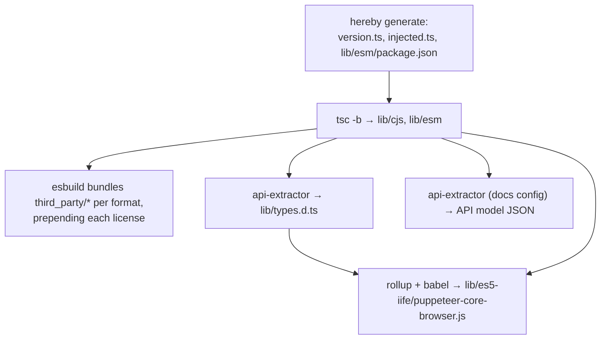

## Overview

The repository is an npm workspace whose scripts are orchestrated by `wireit`: each script declares its dependencies, which run first, and often its input files and outputs. `puppeteer-core` has the most involved build. It generates source files from templates (the injected script bundle and the version string), compiles TypeScript to CommonJS and ES modules, bundles the vendored third-party code, rolls up a browser-ready IIFE, and produces a single `.d.ts` with API Extractor. The same API Extractor data feeds the generated API reference. Supporting tools test the examples in doc comments, run the test suites, and roll browser versions.

Sources: [package.json:43-100](repo://package.json#L43-L100), [package.json:198-206](repo://package.json#L198-L206), [packages/puppeteer-core/package.json:60-120](repo://packages/puppeteer-core/package.json#L60-L120)

## Workspace scripts

| Script | What it runs |
| --- | --- |
| `npm run build` | Builds `@puppeteer/browsers`, `ng-schematics`, `puppeteer-core`, `puppeteer`, `testserver`, the test packages and the tools |
| `npm test`, `npm run test:*` | The mocha runner ([[Test Infrastructure]]) |
| `npm run docs` | API docs for `puppeteer`, `puppeteer-core` and `@puppeteer/browsers`, then `hereby docs` |
| `npm run doctest` | `@puppeteer/doctest` on the built `puppeteer-core` ES modules |
| `npm run lint`, `npm run format` | ESLint, Prettier, and sorting of `TestExpectations.json` |
| `npm run unit` | Each workspace's `unit` script, such as `node --test` on `puppeteer-core`'s compiled `*.test.js` |

Sources: [package.json:6-42](repo://package.json#L6-L42), [package.json:43-100](repo://package.json#L43-L100), [packages/puppeteer-core/package.json:116-121](repo://packages/puppeteer-core/package.json#L116-L121)

## Building puppeteer-core

### The pipeline



Sources: [packages/puppeteer-core/Herebyfile.mjs:17-88](repo://packages/puppeteer-core/Herebyfile.mjs#L17-L88), [packages/puppeteer-core/Herebyfile.mjs:90-166](repo://packages/puppeteer-core/Herebyfile.mjs#L90-L166), [packages/puppeteer-core/package.json:60-115](repo://packages/puppeteer-core/package.json#L60-L115)

`build:tsc` runs `hereby build` after `@puppeteer/browsers` is built. Its inputs are `src` and `third_party` (excluding `src/generated`) and its outputs `lib/cjs` and `lib/esm`. `build` then depends on `build:tsc`, `build:types` and `build:es5`.

Sources: [packages/puppeteer-core/package.json:60-91](repo://packages/puppeteer-core/package.json#L60-L91)

### Generated sources

Some source files only exist after the `generate` task:

Sources: [packages/puppeteer-core/Herebyfile.mjs:17-80](repo://packages/puppeteer-core/Herebyfile.mjs#L17-L80), [packages/puppeteer-core/src/templates/version.ts.tmpl:1-4](repo://packages/puppeteer-core/src/templates/version.ts.tmpl#L1-L4)

| Task | Output | How |
| --- | --- | --- |
| `generate:version` | `src/generated/version.ts` | Replaces `PACKAGE_VERSION` in `src/templates/version.ts.tmpl` with the package version; when `PUBLISH` is set it also replaces `"NEXT"` in `versions.json` |
| `generate:injected` | `src/generated/injected.ts` | Bundles `src/injected/injected.ts` with esbuild (CommonJS, minified, targeting Chrome 125 and Firefox 125) and stores the code as a JSON string in place of `SOURCE_CODE` |
| `generate:package-json` | `lib/esm/package.json` | `{"type": "module"}`, so Node treats the ESM output as modules |

Sources: [packages/puppeteer-core/Herebyfile.mjs:17-80](repo://packages/puppeteer-core/Herebyfile.mjs#L17-L80), [packages/puppeteer-core/src/templates/version.ts.tmpl:1-4](repo://packages/puppeteer-core/src/templates/version.ts.tmpl#L1-L4)

The injected template is what the `ScriptInjector` imports and evaluates in every execution context ([[JavaScript Evaluation and Handles]]):

Sources: [packages/puppeteer-core/src/templates/injected.ts.tmpl:1-8](repo://packages/puppeteer-core/src/templates/injected.ts.tmpl#L1-L8), [packages/puppeteer-core/src/common/ScriptInjector.ts:6-6](repo://packages/puppeteer-core/src/common/ScriptInjector.ts#L6-L6)

```ts
export const source = SOURCE_CODE;
```

Sources: [packages/puppeteer-core/src/templates/injected.ts.tmpl:1-8](repo://packages/puppeteer-core/src/templates/injected.ts.tmpl#L1-L8), [packages/puppeteer-core/src/common/ScriptInjector.ts:6-6](repo://packages/puppeteer-core/src/common/ScriptInjector.ts#L6-L6)

### Vendored dependencies

After `tsc`, the `build` task re-bundles each `lib/<format>/third_party/<name>/<name>.js` entry point (`rxjs`, `mitt`, `parsel-js`) with esbuild for ESM and CJS, unminified, and prepends the package's license text. A new vendored package without license handling fails the build. [[Events and Async Primitives]] explains why these dependencies are imported from `third_party`.

Sources: [packages/puppeteer-core/Herebyfile.mjs:90-166](repo://packages/puppeteer-core/Herebyfile.mjs#L90-L166)

### Types and the browser bundle

`build:types` runs API Extractor to roll all declarations into `lib/types.d.ts` and then fixes it with ESLint. `build:es5` runs Rollup from `lib/esm/puppeteer/puppeteer-core-browser.js` into an IIFE named `Puppeteer`, resolving modules for the browser and transpiling class fields, private members and dynamic imports with Babel. The BiDi and Node folders and `node_modules` stay external, while the connector and browser WebSocket transport are bundled. `tools/patch.mjs` then strips constructs from the bundle, such as `__proto__` assignments and `new Function` calls.

Sources: [packages/puppeteer-core/package.json:92-115](repo://packages/puppeteer-core/package.json#L92-L115), [packages/puppeteer-core/rollup.config.mjs:13-55](repo://packages/puppeteer-core/rollup.config.mjs#L13-L55), [tools/patch.mjs:6-30](repo://tools/patch.mjs#L6-L30)

### The puppeteer package

The `puppeteer` package has its own `build:tsc` and `build:types`, writes the ESM `package.json` with `tools/generate_module_package_json.ts`, and copies the root `README.md` into the package before packing. Its `postinstall` runs `install.mjs` ([[Configuration and Browser Download]]).

Sources: [packages/puppeteer/package.json:38-68](repo://packages/puppeteer/package.json#L38-L68)

## Documentation tooling

### docgen

`npm run docs` first runs each package's `build:docs`, which uses API Extractor with a docs configuration to write an API model JSON. `@puppeteer/docgen` loads that model with `ApiModel.loadPackage` and generates Markdown with a customised `MarkdownDocumenter`. It also provides `spliceIntoSection`, which replaces the lines between a `<name>-start` and a `<name>-end` HTML comment marker in a file.

Sources: [packages/puppeteer-core/package.json:68-78](repo://packages/puppeteer-core/package.json#L68-L78), [tools/docgen/src/docgen.ts:11-38](repo://tools/docgen/src/docgen.ts#L11-L38)

### hereby docs

The root `Herebyfile.mjs` assembles the `docs` folder:

Sources: [Herebyfile.mjs:39-127](repo://Herebyfile.mjs#L39-L127)

1. Copies the root `README.md` to `docs/index.md` and the ng-schematics README to `docs/guides/ng-schematics.md`.
2. Generates `docs/api` and `docs/browsers-api` from the API models, putting the `@puppeteer/browsers` README on its index page.
3. Rebuilds the supported-browsers table from `versions.json`, which maps every Puppeteer release to its Chrome and Firefox versions.
4. Copies the changelog with `{` escaped for MDX and runs Prettier on `docs`.

Sources: [Herebyfile.mjs:39-127](repo://Herebyfile.mjs#L39-L127)

### doctest

`@puppeteer/doctest` tests the `@example` code in JSDoc comments of compiled files. For each file it extracts examples from block comments (fenced code, JavaScript by default, `ts` to switch, and `ignore` or `fail` flags), compiles them with SWC into a temporary folder inside the package, imports them, and reports each example as a `node:test` case named after its source position.

Sources: [tools/doctest/src/doctest.ts:9-27](repo://tools/doctest/src/doctest.ts#L9-L27), [tools/doctest/src/doctest.ts:98-140](repo://tools/doctest/src/doctest.ts#L98-L140), [package.json:72-78](repo://package.json#L72-L78)

## Release and browser rolls

### Releases

Releases are managed by release-please. `puppeteer` and `puppeteer-core` share a version (a linked-versions group), `docker/Dockerfile` is bumped with `puppeteer`, `@puppeteer/browsers` and `@pptr/testserver` are versioned as workspace packages, and `ng-schematics` gets separate pull requests.

Sources: [release-please-config.json:1-31](repo://release-please-config.json#L1-L31)

### Rolling browser versions

`tools/update_browser_revision.mjs`, driven by `BROWSER_TO_UPDATE`, rolls Chrome or Firefox. It resolves the current stable build with `@puppeteer/browsers`, exits if it is not newer than the pinned revision, and replaces the revision in `src/revisions.ts`. It records the change in `versions.json`. For Chrome it also updates the last maintained version and the `devtools-protocol` dependency to the latest version not newer than the new revision, then regenerates the lockfile. Finally it formats the touched files and outputs a `fix:` or `feat:` commit message depending on whether the major version changed.

Sources: [tools/update_browser_revision.mjs:22-31](repo://tools/update_browser_revision.mjs#L22-L31), [tools/update_browser_revision.mjs:85-107](repo://tools/update_browser_revision.mjs#L85-L107), [tools/update_browser_revision.mjs:135-170](repo://tools/update_browser_revision.mjs#L135-L170), [tools/update_browser_revision.mjs:227-252](repo://tools/update_browser_revision.mjs#L227-L252), [versions.json:1-12](repo://versions.json#L1-L12)
