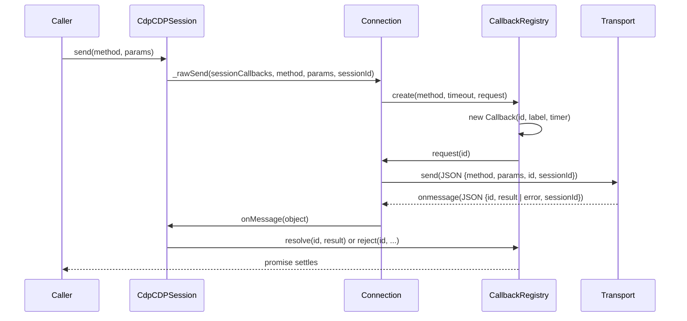

## Overview

Everything Puppeteer does over the Chrome DevTools Protocol passes through one `Connection` per browser. The connection owns the transport ([[Connecting to a Browser and Transports]]), numbers every command, matches responses back to their callers, and routes events. CDP uses flattened sessions: the browser target and every page, worker and iframe target share one socket, and each message carries the `sessionId` of the target it belongs to. A `CdpCDPSession` represents one such attached session; the connection is itself the browser-level session. This page follows a command from `send` to its result and an event from the socket to its listener.

Sources: [packages/puppeteer-core/src/cdp/Connection.ts:31-59](repo://packages/puppeteer-core/src/cdp/Connection.ts#L31-L59), [packages/puppeteer-core/src/cdp/CdpSession.ts:27-52](repo://packages/puppeteer-core/src/cdp/CdpSession.ts#L27-L52)

## The CDPSession API

### Public contract

`CDPSession` is the public, abstract face of a session. `send(method, params, {timeout})` is typed against the protocol mapping from `devtools-protocol`, so method names, parameters and results are checked at compile time. Events are emitted under their protocol names (`'Network.requestWillBeSent'`), plus internal symbols for `Disconnected`, `Swapped` (a target was replaced, as on prerender activation) and `Ready`, and the string events `sessionattached` and `sessiondetached`.

Sources: [packages/puppeteer-core/src/api/CDPSession.ts:14-61](repo://packages/puppeteer-core/src/api/CDPSession.ts#L14-L61), [packages/puppeteer-core/src/api/CDPSession.ts:91-138](repo://packages/puppeteer-core/src/api/CDPSession.ts#L91-L138)

Scripts get their own sessions from `page.createCDPSession()` or `target.createCDPSession()` and can use any protocol domain directly:

Sources: [packages/puppeteer-core/src/api/CDPSession.ts:62-90](repo://packages/puppeteer-core/src/api/CDPSession.ts#L62-L90)

```ts
const client = await page.createCDPSession();
await client.send('Animation.enable');
client.on('Animation.animationCreated', () =>
  console.log('Animation created!'),
);
const response = await client.send('Animation.getPlaybackRate');
console.log('playback rate is ' + response.playbackRate);
await client.send('Animation.setPlaybackRate', {
  playbackRate: response.playbackRate / 2,
});
```

Sources: [packages/puppeteer-core/src/api/CDPSession.ts:62-90](repo://packages/puppeteer-core/src/api/CDPSession.ts#L62-L90)

## Sending a command

### From send to the socket



Sources: [packages/puppeteer-core/src/cdp/CdpSession.ts:91-140](repo://packages/puppeteer-core/src/cdp/CdpSession.ts#L91-L140), [packages/puppeteer-core/src/cdp/Connection.ts:109-146](repo://packages/puppeteer-core/src/cdp/Connection.ts#L109-L146), [packages/puppeteer-core/src/common/CallbackRegistry.ts:21-47](repo://packages/puppeteer-core/src/common/CallbackRegistry.ts#L21-L47)

`Connection.send` sends on the browser session, with no `sessionId`. A `CdpCDPSession.send` calls `connection._rawSend` with its own `CallbackRegistry` and session id. A closed connection rejects at once with `ConnectionClosedError('Connection closed.')`, and a detached session with ``TargetCloseError: Protocol error (<method>): Session closed. Most likely the <type> has been closed.``

Sources: [packages/puppeteer-core/src/cdp/Connection.ts:126-146](repo://packages/puppeteer-core/src/cdp/Connection.ts#L126-L146), [packages/puppeteer-core/src/cdp/CdpSession.ts:91-110](repo://packages/puppeteer-core/src/cdp/CdpSession.ts#L91-L110)

### Callbacks and ids

`CallbackRegistry.create` allocates an id from one incrementing generator shared by every registry, so ids are unique across the connection and all its sessions. It stores a `Callback` and calls the request function synchronously. If writing to the transport throws, the callback is rejected and removed, and the error is thrown synchronously. The returned promise removes the callback from the map once it settles.

Sources: [packages/puppeteer-core/src/common/CallbackRegistry.ts:14-47](repo://packages/puppeteer-core/src/common/CallbackRegistry.ts#L14-L47)

A `Callback` creates a `ProtocolError` when the command is sent, so its stack trace is captured where the command was issued rather than in the socket handler that later receives the error. When the protocol returns an error, `_reject` rewrites that pre-built error with the message ``Protocol error (<method>): <message>`` and keeps the browser's raw text as `originalMessage`.

Sources: [packages/puppeteer-core/src/common/CallbackRegistry.ts:65-88](repo://packages/puppeteer-core/src/common/CallbackRegistry.ts#L65-L88), [packages/puppeteer-core/src/common/CallbackRegistry.ts:125-172](repo://packages/puppeteer-core/src/common/CallbackRegistry.ts#L125-L172)

### Protocol timeouts

Every command has a timeout: the per-call `options.timeout`, else the connection's `protocolTimeout` (180 seconds by default). When it fires, the callback rejects with ``<method> timed out. Increase the 'protocolTimeout' setting in launch/connect calls for a higher timeout if needed.``

Sources: [packages/puppeteer-core/src/cdp/Connection.ts:42-59](repo://packages/puppeteer-core/src/cdp/Connection.ts#L42-L59), [packages/puppeteer-core/src/cdp/Connection.ts:136-136](repo://packages/puppeteer-core/src/cdp/Connection.ts#L136-L136), [packages/puppeteer-core/src/common/CallbackRegistry.ts:132-145](repo://packages/puppeteer-core/src/common/CallbackRegistry.ts#L132-L145)

`browser.debugInfo.pendingProtocolErrors` collects the commands still waiting on the connection and on every session, each as an `Error` whose message names the method and includes the stack from where it was sent.

Sources: [packages/puppeteer-core/src/cdp/Connection.ts:279-286](repo://packages/puppeteer-core/src/cdp/Connection.ts#L279-L286), [packages/puppeteer-core/src/common/CallbackRegistry.ts:109-120](repo://packages/puppeteer-core/src/common/CallbackRegistry.ts#L109-L120), [packages/puppeteer-core/src/api/Browser.ts:205-207](repo://packages/puppeteer-core/src/api/Browser.ts#L205-L207)

## Receiving messages

### Dispatch in Connection.onMessage

Each incoming message is handled in this order:

Sources: [packages/puppeteer-core/src/cdp/Connection.ts:158-215](repo://packages/puppeteer-core/src/cdp/Connection.ts#L158-L215), [packages/puppeteer-core/src/cdp/Connection.ts:25-26](repo://packages/puppeteer-core/src/cdp/Connection.ts#L25-L26)

1. If `slowMo` is set, wait that many milliseconds first.
2. Parse the JSON and log it under the `puppeteer:protocol:RECV ◀` debug namespace.
3. On `Target.attachedToTarget`, create a `CdpCDPSession` for the new `sessionId`, store it, and emit `sessionattached` on the connection and on the parent session.
4. On `Target.detachedFromTarget`, close and remove that session and emit `sessiondetached` on the connection and the parent.
5. A message with a `sessionId` goes to that session's `onMessage`.
6. A message with an `id` resolves or rejects a browser-level callback.
7. Anything else is a browser-level event, emitted under its method name.

Sources: [packages/puppeteer-core/src/cdp/Connection.ts:158-215](repo://packages/puppeteer-core/src/cdp/Connection.ts#L158-L215), [packages/puppeteer-core/src/cdp/Connection.ts:25-26](repo://packages/puppeteer-core/src/cdp/Connection.ts#L25-L26)

A session's `onMessage` does the same for its scope: responses with an `id` settle its own callbacks, and everything else is emitted as an event on the session. Steps 3 and 4 run before step 5, so a session exists before the first message addressed to it is routed.

Sources: [packages/puppeteer-core/src/cdp/CdpSession.ts:115-140](repo://packages/puppeteer-core/src/cdp/CdpSession.ts#L115-L140), [packages/puppeteer-core/src/cdp/Connection.ts:166-197](repo://packages/puppeteer-core/src/cdp/Connection.ts#L166-L197)

### Raw errors

A connection created with `rawErrors` (used when probing for BiDi over a CDP endpoint, see [[BiDi Connection and BiDi over CDP]]) rejects callbacks with the protocol's error object as is instead of a rewritten `ProtocolError`. Its sessions inherit the flag.

Sources: [packages/puppeteer-core/src/cdp/Connection.ts:199-211](repo://packages/puppeteer-core/src/cdp/Connection.ts#L199-L211), [packages/puppeteer-core/src/cdp/CdpSession.ts:122-135](repo://packages/puppeteer-core/src/cdp/CdpSession.ts#L122-L135)

## Session lifecycle

### Creating sessions

Most sessions are created by auto-attach: the target manager asks the browser to attach to new targets, and the browser sends `Target.attachedToTarget` ([[Target Management (CDP)]]). `connection.createSession(targetInfo)` attaches manually with `Target.attachToTarget` and `flatten: true`, then returns the session that the resulting `attachedToTarget` event created. While a manual attach is in progress, its target id is recorded so that `isAutoAttached(targetId)` reports false for it.

Sources: [packages/puppeteer-core/src/cdp/Connection.ts:237-274](repo://packages/puppeteer-core/src/cdp/Connection.ts#L237-L274)

Each `CdpCDPSession` knows its parent session id. `parentSession()` returns the parent, or the session itself when there is none, as for DevTools pages. The target manager links a session to its `CdpTarget` with `setTarget`.

Sources: [packages/puppeteer-core/src/cdp/CdpSession.ts:59-89](repo://packages/puppeteer-core/src/cdp/CdpSession.ts#L59-L89)

### Detaching and closing

`session.detach()` sends `Target.detachFromTarget` and marks the session detached; detaching twice throws. When the browser reports the detach, or the connection closes, `onClosed()` rejects every pending command of the session with `TargetCloseError('Target closed')` and emits `CDPSessionEvent.Disconnected`.

Sources: [packages/puppeteer-core/src/cdp/CdpSession.ts:146-165](repo://packages/puppeteer-core/src/cdp/CdpSession.ts#L146-L165), [packages/puppeteer-core/src/common/CallbackRegistry.ts:98-104](repo://packages/puppeteer-core/src/common/CallbackRegistry.ts#L98-L104)

When the transport closes, the connection runs `#onClose` once: it unhooks the transport, rejects all browser-level callbacks, closes every session, and emits `Disconnected`. `dispose()` does the same and closes the transport, and `closeBrowser()` sends `Browser.close`. `CdpBrowser` listens for the connection's `Disconnected` to emit the public `disconnected` event.

Sources: [packages/puppeteer-core/src/cdp/Connection.ts:148-235](repo://packages/puppeteer-core/src/cdp/Connection.ts#L148-L235), [packages/puppeteer-core/src/cdp/Browser.ts:128-133](repo://packages/puppeteer-core/src/cdp/Browser.ts#L128-L133)

`isTargetClosedError(error)` lets internal code recognise the errors produced this way and ignore them when a target disappears mid-operation, as the network manager does ([[Network Manager (CDP)]]).

Sources: [packages/puppeteer-core/src/cdp/Connection.ts:292-294](repo://packages/puppeteer-core/src/cdp/Connection.ts#L292-L294), [packages/puppeteer-core/src/cdp/NetworkManager.ts:99-104](repo://packages/puppeteer-core/src/cdp/NetworkManager.ts#L99-L104)
