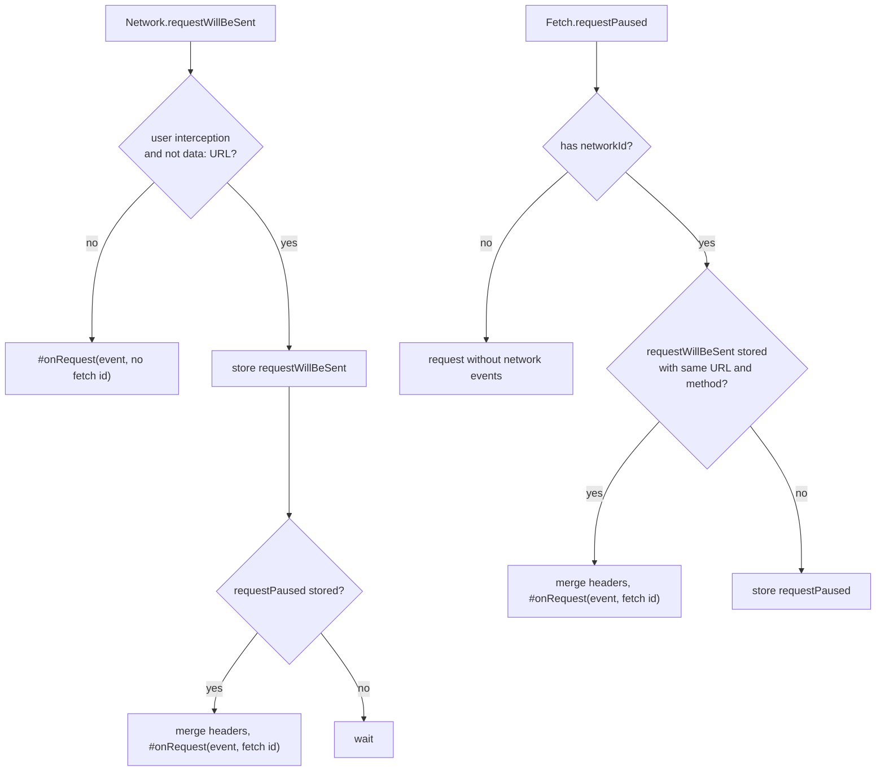

## Overview

Chrome reports one HTTP request through several independent protocol events: `Network.requestWillBeSent` when it is about to go out, `Fetch.requestPaused` when interception holds it, `Network.responseReceived` and `Network.responseReceivedExtraInfo` for its headers, and `Network.loadingFinished` or `loadingFailed` at the end. These events can arrive in different orders, and redirects reuse the same request id. `NetworkManager` reconciles them into exactly one `CdpHTTPRequest` per request (and one per redirect hop) and emits `Request`, `Response`, `RequestFinished`, `RequestFailed` and `RequestServedFromCache` in a consistent order. `NetworkEventManager` holds the events that arrived early until their partner shows up. The public objects and interception rules are described in [[Network Requests and Interception]].

Sources: [packages/puppeteer-core/src/cdp/NetworkManager.ts:65-97](repo://packages/puppeteer-core/src/cdp/NetworkManager.ts#L65-L97), [packages/puppeteer-core/src/cdp/NetworkEventManager.ts:44-101](repo://packages/puppeteer-core/src/cdp/NetworkEventManager.ts#L44-L101), [packages/puppeteer-core/src/common/NetworkManagerEvents.ts:19-38](repo://packages/puppeteer-core/src/common/NetworkManagerEvents.ts#L19-L38)

## One manager, many sessions

### Adding clients

Each page's `FrameManager` creates one `NetworkManager` ([[CDP Pages and Frame Management]]). The page's main session, every out-of-process iframe session, dedicated worker sessions and prerender sessions are added with `addClient`. For each client the manager subscribes its event handlers (bound to that client, so replies go to the right session) and, in parallel, enables the `Network` domain and re-applies the current extra headers, network conditions, cache setting, interception state and user agent. Settings changed later are applied to every client by `#applyToAllClients`. A client that disconnects is removed.

Sources: [packages/puppeteer-core/src/cdp/NetworkManager.ts:78-140](repo://packages/puppeteer-core/src/cdp/NetworkManager.ts#L78-L140), [packages/puppeteer-core/src/cdp/NetworkManager.ts:229-235](repo://packages/puppeteer-core/src/cdp/NetworkManager.ts#L229-L235)

With `networkEnabled: false` on launch or connect, `addClient` returns immediately: no `Network.enable`, no events, and no `HTTPRequest` objects.

Sources: [packages/puppeteer-core/src/cdp/NetworkManager.ts:93-109](repo://packages/puppeteer-core/src/cdp/NetworkManager.ts#L93-L109), [packages/puppeteer-core/src/cdp/FrameManager.ts:88-91](repo://packages/puppeteer-core/src/cdp/FrameManager.ts#L88-L91)

Errors from a target that closed, or from a domain the target does not support (`Not supported`), are swallowed while applying settings.

Sources: [packages/puppeteer-core/src/cdp/NetworkManager.ts:99-104](repo://packages/puppeteer-core/src/cdp/NetworkManager.ts#L99-L104)

### User interception versus protocol interception

The manager keeps two flags. User interception is what `setRequestInterception(true)` asked for. Protocol interception, the `Fetch` domain being enabled, is on when either user interception is on or `authenticate()` set credentials. When credentials alone enabled it, every `Fetch.requestPaused` is continued at once with `Fetch.continueRequest`, so only the authentication challenges are handled.

Sources: [packages/puppeteer-core/src/cdp/NetworkManager.ts:142-152](repo://packages/puppeteer-core/src/cdp/NetworkManager.ts#L142-L152), [packages/puppeteer-core/src/cdp/NetworkManager.ts:287-324](repo://packages/puppeteer-core/src/cdp/NetworkManager.ts#L287-L324), [packages/puppeteer-core/src/cdp/NetworkManager.ts:402-415](repo://packages/puppeteer-core/src/cdp/NetworkManager.ts#L402-L415)

## Creating the request object

### Pairing requestWillBeSent and requestPaused

Without user interception, every `requestWillBeSent` immediately creates a request. With it, a request needs both events: the `requestWillBeSent` event carries the full request data, the `requestPaused` event carries the `Fetch` id that `continue`, `respond` and `abort` must use. The two can arrive in either order, so whichever comes first is stored by network request id:

Sources: [packages/puppeteer-core/src/cdp/NetworkManager.ts:342-370](repo://packages/puppeteer-core/src/cdp/NetworkManager.ts#L342-L370), [packages/puppeteer-core/src/cdp/NetworkManager.ts:402-446](repo://packages/puppeteer-core/src/cdp/NetworkManager.ts#L402-L446), [packages/puppeteer-core/src/cdp/NetworkEventManager.ts:44-76](repo://packages/puppeteer-core/src/cdp/NetworkEventManager.ts#L44-L76)

Sources: [packages/puppeteer-core/src/cdp/NetworkManager.ts:342-370](repo://packages/puppeteer-core/src/cdp/NetworkManager.ts#L342-L370), [packages/puppeteer-core/src/cdp/NetworkManager.ts:402-446](repo://packages/puppeteer-core/src/cdp/NetworkManager.ts#L402-L446), [packages/puppeteer-core/src/cdp/NetworkEventManager.ts:44-76](repo://packages/puppeteer-core/src/cdp/NetworkEventManager.ts#L44-L76)

When paired, the headers of the paused event are merged over those of `requestWillBeSent`, because the paused event includes headers such as `Accept` and `Origin` that the network event lacks. A stored `requestWillBeSent` whose URL or method differs from the paused event belongs to an earlier redirect hop; it is dropped and the paused event is stored to wait for the next `requestWillBeSent`. A paused request without a network id (no network instrumentation for it) still gets an `HTTPRequest` so the user can intercept it.

Sources: [packages/puppeteer-core/src/cdp/NetworkManager.ts:424-479](repo://packages/puppeteer-core/src/cdp/NetworkManager.ts#L424-L479)

### #onRequest

`#onRequest` builds the `CdpHTTPRequest` with the client, the frame (looked up by frame id), the fetch id and whether user interception is on. It stores the request, emits `Request`, and calls `finalizeInterceptions()`, which runs the user's queued handlers and applies their decision. If the event carries a `redirectResponse`, the previous hop is finished first (below) and its redirect chain is passed on.

Sources: [packages/puppeteer-core/src/cdp/NetworkManager.ts:481-539](repo://packages/puppeteer-core/src/cdp/NetworkManager.ts#L481-L539)

### Served from cache

`Network.requestServedFromCache` marks the request as coming from memory cache, which makes it non-interceptable. If no request object exists yet but a `requestWillBeSent` was stored (with user interception on, it was waiting for its paused event), the request is created from that event now. Then `RequestServedFromCache` is emitted.

Sources: [packages/puppeteer-core/src/cdp/NetworkManager.ts:541-567](repo://packages/puppeteer-core/src/cdp/NetworkManager.ts#L541-L567)

## Responses and extra info

### Why responses wait

`Network.responseReceivedExtraInfo` carries the raw headers and status line as they came over the wire, which `CdpHTTPResponse` prefers. It is a separate event that can arrive before or after `responseReceived`, and a redirect chain produces one per hop. The manager therefore pairs them:

Sources: [packages/puppeteer-core/src/cdp/NetworkManager.ts:627-687](repo://packages/puppeteer-core/src/cdp/NetworkManager.ts#L627-L687), [packages/puppeteer-core/src/cdp/NetworkManager.ts:703-717](repo://packages/puppeteer-core/src/cdp/NetworkManager.ts#L703-L717), [packages/puppeteer-core/src/cdp/NetworkEventManager.ts:87-140](repo://packages/puppeteer-core/src/cdp/NetworkEventManager.ts#L87-L140)

- `responseReceived` with `hasExtraInfo` takes the oldest stored extra-info event for the request. If there is none yet, the response is queued as an event group and nothing is emitted.
- `responseReceivedExtraInfo` first checks for a queued redirect waiting for it, then for a queued response group. If it finds the group, it emits the response and then any `loadingFinished` or `loadingFailed` that arrived in the meantime. Otherwise it stores itself for a later response.
- `loadingFinished` and `loadingFailed` join the queued group when the response is still waiting, so the finish never overtakes the response.

Sources: [packages/puppeteer-core/src/cdp/NetworkManager.ts:627-687](repo://packages/puppeteer-core/src/cdp/NetworkManager.ts#L627-L687), [packages/puppeteer-core/src/cdp/NetworkManager.ts:703-717](repo://packages/puppeteer-core/src/cdp/NetworkManager.ts#L703-L717), [packages/puppeteer-core/src/cdp/NetworkEventManager.ts:87-140](repo://packages/puppeteer-core/src/cdp/NetworkEventManager.ts#L87-L140)

Requests served from memory cache do not wait for extra info, and extra info is discarded for disk-cache responses because Chromium sends wrong extra-info events for them.

Sources: [packages/puppeteer-core/src/cdp/NetworkManager.ts:586-625](repo://packages/puppeteer-core/src/cdp/NetworkManager.ts#L586-L625)

### Redirects

A redirect arrives as a new `requestWillBeSent` with the same request id and a `redirectResponse`. If that response has extra info that has not arrived yet, the whole new request is queued as redirect info and handled when the extra info comes, so the old hop's `response` and `requestfinished` are emitted before the new hop's `request`. `#handleRequestRedirect` builds the response for the old hop, adds the old request to the redirect chain, marks its body as unavailable (`Response body is unavailable for redirect responses`), forgets the old request, and emits `Response` and `RequestFinished`.

Sources: [packages/puppeteer-core/src/cdp/NetworkManager.ts:487-522](repo://packages/puppeteer-core/src/cdp/NetworkManager.ts#L487-L522), [packages/puppeteer-core/src/cdp/NetworkManager.ts:569-584](repo://packages/puppeteer-core/src/cdp/NetworkManager.ts#L569-L584)

## Finishing a request

### Finished and failed

`#emitLoadingFinished` resolves the response body (so `response.content()` can fetch it), forgets the request and all its stored events, and emits `RequestFinished`. `#emitLoadingFailed` records `errorText` as the failure, resolves the body, forgets everything and emits `RequestFailed`. Events for requests the manager never saw (for example when it connected late) are ignored.

Sources: [packages/puppeteer-core/src/cdp/NetworkManager.ts:719-775](repo://packages/puppeteer-core/src/cdp/NetworkManager.ts#L719-L775), [packages/puppeteer-core/src/cdp/NetworkManager.ts:689-701](repo://packages/puppeteer-core/src/cdp/NetworkManager.ts#L689-L701)

### Session adoption

A document request for an out-of-process iframe starts in the parent frame's session but finishes in the child's. When `loadingFinished` or `loadingFailed` arrives on a different session than the request was created with, the request's client is switched to that session, so a later `response.content()` asks the session that owns the body. The same applies to worker script requests.

Sources: [packages/puppeteer-core/src/cdp/NetworkManager.ts:777-787](repo://packages/puppeteer-core/src/cdp/NetworkManager.ts#L777-L787), [packages/puppeteer-core/src/cdp/HTTPResponse.ts:119-151](repo://packages/puppeteer-core/src/cdp/HTTPResponse.ts#L119-L151)

## Authentication

`Fetch.authRequired` is answered with `Fetch.continueWithAuth`. Without credentials the response is `Default` (the browser's own behaviour). With credentials, the first challenge for a fetch id gets `ProvideCredentials` with the username and password, and a repeated challenge for the same id gets `CancelAuth`. The attempted ids are forgotten when their request is forgotten.

Sources: [packages/puppeteer-core/src/cdp/NetworkManager.ts:372-393](repo://packages/puppeteer-core/src/cdp/NetworkManager.ts#L372-L393), [packages/puppeteer-core/src/cdp/NetworkManager.ts:689-701](repo://packages/puppeteer-core/src/cdp/NetworkManager.ts#L689-L701)

## Who listens

`CdpPage` re-emits the five events as `request`, `requestservedfromcache`, `response`, `requestfailed` and `requestfinished`. The `LifecycleWatcher` listens for the frame's navigation request and its response to produce the result of `goto`. `inFlightRequestsCount()` counts stored requests without a response.

Sources: [packages/puppeteer-core/src/cdp/Page.ts:184-204](repo://packages/puppeteer-core/src/cdp/Page.ts#L184-L204), [packages/puppeteer-core/src/cdp/LifecycleWatcher.ts:136-187](repo://packages/puppeteer-core/src/cdp/LifecycleWatcher.ts#L136-L187), [packages/puppeteer-core/src/cdp/NetworkEventManager.ts:142-150](repo://packages/puppeteer-core/src/cdp/NetworkEventManager.ts#L142-L150)
