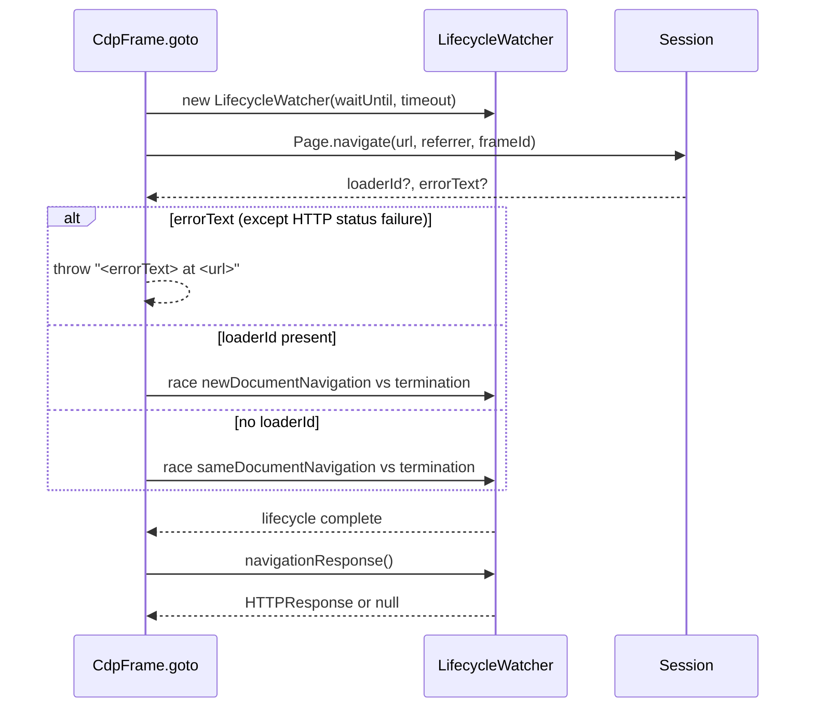

## Overview

A `CdpPage` is built from one CDP session, the page target's, and keeps working while that session changes underneath it. Its `FrameManager` turns the `Page.*` and `Runtime.*` events of that session (and of the sessions of out-of-process iframes) into a tree of `CdpFrame` objects, each with a main world and a Puppeteer world. Navigation calls use a `LifecycleWatcher` to decide when a navigation has finished. This page follows how the page is assembled, how the frame tree is kept in sync, and how `goto` decides it is done. [[Frames and Navigation]] describes the public frame API that this implements.

Sources: [packages/puppeteer-core/src/cdp/Page.ts:98-158](repo://packages/puppeteer-core/src/cdp/Page.ts#L98-L158), [packages/puppeteer-core/src/cdp/FrameManager.ts:43-97](repo://packages/puppeteer-core/src/cdp/FrameManager.ts#L43-L97)

## Assembling a CdpPage

### Construction

`PageTarget.page()` calls `CdpPage._create(session, target, defaultViewport)` ([[Target Management (CDP)]]). The constructor stores the page target's session as the primary session and its parent, the tab target's session, separately. It creates one of each helper on the primary session: keyboard, mouse, touchscreen, `FrameManager` (which owns the `NetworkManager`), `EmulationManager`, `Tracing` and `Coverage`. Frame and network manager events are re-emitted as page events (`frameattached`, `request`, `response` and so on).

Sources: [packages/puppeteer-core/src/cdp/Page.ts:143-204](repo://packages/puppeteer-core/src/cdp/Page.ts#L143-L204), [packages/puppeteer-core/src/cdp/FrameManager.ts:80-97](repo://packages/puppeteer-core/src/cdp/FrameManager.ts#L80-L97)

On the tab session the page listens for `Swapped` (the page target was replaced) and `Ready` (a secondary target such as a prerender attached). On the primary session it listens for DOM content and load events, dialogs, exceptions, crashes, metrics, log entries and file choosers. The page emits `close` when the tab target's `_isClosedDeferred` resolves.

Sources: [packages/puppeteer-core/src/cdp/Page.ts:206-235](repo://packages/puppeteer-core/src/cdp/Page.ts#L206-L235), [packages/puppeteer-core/src/cdp/Page.ts:293-317](repo://packages/puppeteer-core/src/cdp/Page.ts#L293-L317)

### Initialization

`_create` then awaits `#initialize`, which runs `frameManager.initialize(session)` together with `Performance.enable` and `Log.enable`, and finally applies the default viewport. A target that closes during this is tolerated: the target-closed error is only logged.

Sources: [packages/puppeteer-core/src/cdp/Page.ts:99-118](repo://packages/puppeteer-core/src/cdp/Page.ts#L99-L118), [packages/puppeteer-core/src/cdp/Page.ts:348-362](repo://packages/puppeteer-core/src/cdp/Page.ts#L348-L362)

`FrameManager.initialize` sends its setup commands in one synchronous batch while the target is still paused by auto-attach: register the session with the network manager, `Page.enable`, `Page.getFrameTree`, `Page.setLifecycleEventsEnabled`, `Runtime.enable` followed by creating the Puppeteer world, and, for a re-initialized frame, its preload scripts and exposed-function bindings. Frame and context events that arrive before the frame tree response are held back by awaiting a `#frameTreeHandled` deferred, so the tree is always built from `getFrameTree` first.

Sources: [packages/puppeteer-core/src/cdp/FrameManager.ts:164-244](repo://packages/puppeteer-core/src/cdp/FrameManager.ts#L164-L244)

### Child targets and workers

The page walks the target tree below its primary target for already-attached children and handles each like a newly attached one. For every child session, `#onAttachedToTarget` lets the frame manager adopt `iframe` targets and creates a `CdpWebWorker` (with the page's console and exception handlers and network manager) for dedicated `worker` targets, emitting `workercreated`. It subscribes to `Ready` on the child session so grandchildren are handled too. `workerdestroyed` is emitted when the target manager reports the worker's target gone.

Sources: [packages/puppeteer-core/src/cdp/Page.ts:238-257](repo://packages/puppeteer-core/src/cdp/Page.ts#L238-L257), [packages/puppeteer-core/src/cdp/Page.ts:319-346](repo://packages/puppeteer-core/src/cdp/Page.ts#L319-L346)

## The frame tree

### FrameTree

`FrameTree` is a set of maps: frames by id, parent id by frame id, child ids by frame id, and the main frame. Adding a frame without a parent makes it the main frame when there is none yet or the old one was removed. `waitForFrame(id)` returns a promise for a frame that has not been added yet.

Sources: [packages/puppeteer-core/src/cdp/FrameTree.ts:17-100](repo://packages/puppeteer-core/src/cdp/FrameTree.ts#L17-L100)

### Frame events

| CDP event | FrameManager action |
| --- | --- |
| `Page.getFrameTree` response | Walk the tree: attach each child frame, and treat each frame as navigated unless a `frameNavigated` for it was already seen |
| `Page.frameAttached` | Create a `CdpFrame` with the reporting session, or switch an existing frame to that session |
| `Page.frameNavigated` | Remove the frame's children; for the main frame keep the same `CdpFrame` object under the new id; record name and URL; emit `FrameNavigated` |
| `Page.navigatedWithinDocument` | Update the URL; emit `FrameNavigatedWithinDocument` and `FrameNavigated` |
| `Page.frameDetached` with reason `remove` | Dispose the frame and its descendants; emit `FrameDetached` |
| `Page.frameDetached` with reason `swap` | Keep the frame; emit `FrameSwapped` (the frame is becoming an out-of-process iframe) |
| `Page.lifecycleEvent`, `frameStartedLoading`, `frameStoppedLoading` | Update the frame's lifecycle state; emit `LifecycleEvent` |
| `Runtime.executionContextCreated` | Attach an `ExecutionContext` to the matching world |

Sources: [packages/puppeteer-core/src/cdp/FrameManager.ts:356-465](repo://packages/puppeteer-core/src/cdp/FrameManager.ts#L356-L465), [packages/puppeteer-core/src/cdp/FrameManager.ts:500-576](repo://packages/puppeteer-core/src/cdp/FrameManager.ts#L500-L576)

Keeping the main frame object across cross-process navigations means `page.mainFrame()` stays the same object for the life of the page, even though Chrome assigns a new frame id.

Sources: [packages/puppeteer-core/src/cdp/FrameManager.ts:448-459](repo://packages/puppeteer-core/src/cdp/FrameManager.ts#L448-L459)

### Out-of-process iframes

An out-of-process iframe has its own CDP target of type `iframe`. When that target attaches, `onAttachedToTarget` finds the existing `CdpFrame` with the target's id, points it at the new session with `updateClient`, subscribes to the session's events, and runs `initialize` on it with that frame, which also installs existing preload scripts and bindings there. From then on the frame's commands go to its own session.

Sources: [packages/puppeteer-core/src/cdp/FrameManager.ts:334-345](repo://packages/puppeteer-core/src/cdp/FrameManager.ts#L334-L345), [packages/puppeteer-core/src/cdp/Frame.ts:120-134](repo://packages/puppeteer-core/src/cdp/Frame.ts#L120-L134)

### Worlds and execution contexts

Every `CdpFrame` has two `IsolatedWorld`s, `MAIN_WORLD` and `PUPPETEER_WORLD`. The Puppeteer world is created once per session: `Page.addScriptToEvaluateOnNewDocument` with the world name `__puppeteer_utility_world__<version>` covers future documents, and `Page.createIsolatedWorld` (with universal access) covers the frames that already exist. When `Runtime.executionContextCreated` arrives, the context is assigned to the main world if its aux data marks it as the default context, or to the Puppeteer world if its name is the utility world name; contexts from another session or of another world are ignored. Setting a context re-runs pending waits ([[Waiting for Conditions]]).

Sources: [packages/puppeteer-core/src/cdp/Frame.ts:58-97](repo://packages/puppeteer-core/src/cdp/Frame.ts#L58-L97), [packages/puppeteer-core/src/cdp/FrameManager.ts:467-498](repo://packages/puppeteer-core/src/cdp/FrameManager.ts#L467-L498), [packages/puppeteer-core/src/cdp/FrameManager.ts:534-566](repo://packages/puppeteer-core/src/cdp/FrameManager.ts#L534-L566), [packages/puppeteer-core/src/common/util.ts:301-302](repo://packages/puppeteer-core/src/common/util.ts#L301-L302)

## Navigation and the LifecycleWatcher

### Lifecycle state per frame

Each `CdpFrame` keeps a loader id and a set of lifecycle event names. A `Page.lifecycleEvent` named `init` starts a new document: it records the new loader id and clears the set. Later events (`DOMContentLoaded`, `load`, `networkAlmostIdle`, `networkIdle`) are added to it. `frameStoppedLoading` adds `DOMContentLoaded` and `load` as well.

Sources: [packages/puppeteer-core/src/cdp/Frame.ts:385-409](repo://packages/puppeteer-core/src/cdp/Frame.ts#L385-L409)

### What the watcher waits for

A `LifecycleWatcher` maps the `waitUntil` values to protocol events (`load` → `load`, `domcontentloaded` → `DOMContentLoaded`, `networkidle0` → `networkIdle`, `networkidle2` → `networkAlmostIdle`) and remembers the frame's loader id at start. Whenever a lifecycle event, navigation or swap happens, it checks whether the frame and every child frame that has started loading have all expected events. When they do, it resolves:

Sources: [packages/puppeteer-core/src/cdp/LifecycleWatcher.ts:55-158](repo://packages/puppeteer-core/src/cdp/LifecycleWatcher.ts#L55-L158), [packages/puppeteer-core/src/cdp/LifecycleWatcher.ts:220-269](repo://packages/puppeteer-core/src/cdp/LifecycleWatcher.ts#L220-L269)

- `lifecyclePromise` always;
- `sameDocumentNavigationPromise` if a same-document navigation was seen;
- `newDocumentNavigationPromise` if the loader id changed or the frame was swapped.

Sources: [packages/puppeteer-core/src/cdp/LifecycleWatcher.ts:55-158](repo://packages/puppeteer-core/src/cdp/LifecycleWatcher.ts#L55-L158), [packages/puppeteer-core/src/cdp/LifecycleWatcher.ts:220-269](repo://packages/puppeteer-core/src/cdp/LifecycleWatcher.ts#L220-L269)

It also tracks the frame's navigation request through the network manager and resolves `navigationResponse()` once that request has a response or failed. `terminationPromise` resolves with an error on timeout (`Navigation timeout of <n> ms exceeded`), on abort, or when the frame detaches (`Navigating frame was detached`). A back-forward-cache restore counts as a swap.

Sources: [packages/puppeteer-core/src/cdp/LifecycleWatcher.ts:160-218](repo://packages/puppeteer-core/src/cdp/LifecycleWatcher.ts#L160-L218), [packages/puppeteer-core/src/cdp/LifecycleWatcher.ts:225-235](repo://packages/puppeteer-core/src/cdp/LifecycleWatcher.ts#L225-L235)

### How goto finishes

Sources: [packages/puppeteer-core/src/cdp/Frame.ts:140-222](repo://packages/puppeteer-core/src/cdp/Frame.ts#L140-L222)

`goto` sends `Page.navigate` with the referrer and referrer policy (from the options or from extra HTTP headers, converted to CDP's camel case). An `errorText` other than `net::ERR_HTTP_RESPONSE_CODE_FAILURE` becomes an error such as `net::ERR_NAME_NOT_RESOLVED at https://…`, so HTTP error statuses resolve normally. A response with a `loaderId` means a new document is loading; without one the navigation stayed in the same document. `goto` waits for the matching promise, then returns the navigation response and disposes the watcher.

Sources: [packages/puppeteer-core/src/cdp/Frame.ts:150-222](repo://packages/puppeteer-core/src/cdp/Frame.ts#L150-L222), [packages/puppeteer-core/src/cdp/Frame.ts:445-454](repo://packages/puppeteer-core/src/cdp/Frame.ts#L445-L454)

`waitForNavigation` races both kinds of navigation (or only new-document navigations when `ignoreSameDocumentNavigation` is set, as `reload` does) against termination. `setContent` waits only for the lifecycle.

Sources: [packages/puppeteer-core/src/cdp/Frame.ts:224-306](repo://packages/puppeteer-core/src/cdp/Frame.ts#L224-L306), [packages/puppeteer-core/src/cdp/Page.ts:886-895](repo://packages/puppeteer-core/src/cdp/Page.ts#L886-L895)

## Session swaps and preload scripts

### Prerender activation and lost sessions

When a prerendered page is activated, the target manager emits `Swapped` on the tab session with the prerender's session. `CdpPage.#onActivation` makes that session primary, moves the input devices, emulation, tracing and coverage to it, and calls `frameManager.swapFrameTree`. That re-ids the main frame to the new target id, points it at the new session, re-runs `initialize`, and emits `FrameSwappedByActivation`, which the main frame turns into a synthetic start and stop of loading. Before activation, a prerender target only registers its session with the network and emulation managers.

Sources: [packages/puppeteer-core/src/cdp/Page.ts:259-287](repo://packages/puppeteer-core/src/cdp/Page.ts#L259-L287), [packages/puppeteer-core/src/cdp/FrameManager.ts:139-162](repo://packages/puppeteer-core/src/cdp/FrameManager.ts#L139-L162), [packages/puppeteer-core/src/cdp/Frame.ts:83-87](repo://packages/puppeteer-core/src/cdp/Frame.ts#L83-L87)

When the primary session disconnects, the frame manager removes the child frames and waits 100 ms for a swap. If none comes, or the browser is disconnected, it removes the main frame too.

Sources: [packages/puppeteer-core/src/cdp/FrameManager.ts:36-36](repo://packages/puppeteer-core/src/cdp/FrameManager.ts#L36-L36), [packages/puppeteer-core/src/cdp/FrameManager.ts:104-132](repo://packages/puppeteer-core/src/cdp/FrameManager.ts#L104-L132)

### Preload scripts and bindings across sessions

`page.evaluateOnNewDocument` registers the script on the main frame's session and wraps it in a `CdpPreloadScript`, which remembers the identifier the script has in each session's frame. `addPreloadScript` installs it on every other frame that has its own session (an iframe sharing its parent's session already has it), and re-initialized OOPIF frames get it too. Removing the script removes it from each frame by that frame's identifier. Exposed-function bindings follow the same pattern through `addExposedFunctionBinding` ([[JavaScript Evaluation and Handles]]).

Sources: [packages/puppeteer-core/src/cdp/FrameManager.ts:264-332](repo://packages/puppeteer-core/src/cdp/FrameManager.ts#L264-L332), [packages/puppeteer-core/src/cdp/CdpPreloadScript.ts:12-46](repo://packages/puppeteer-core/src/cdp/CdpPreloadScript.ts#L12-L46), [packages/puppeteer-core/src/cdp/Frame.ts:324-374](repo://packages/puppeteer-core/src/cdp/Frame.ts#L324-L374)
