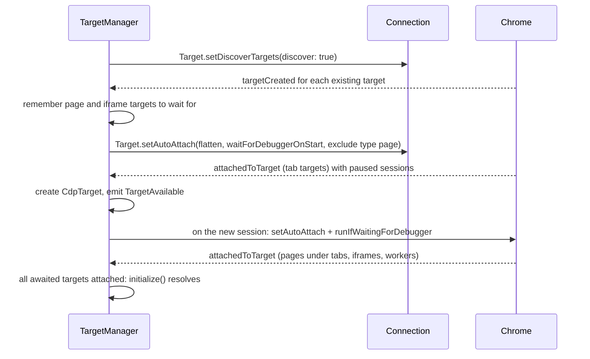

## Overview

On CDP, a browser is a set of targets: tabs, pages, iframes in other processes, workers, the browser itself. `CdpBrowser` does not poll for them. Its `TargetManager` turns on target discovery and auto-attach, so Chrome reports every target and attaches a session to it as it appears, paused until Puppeteer has configured it. The manager wraps each attached target in a `CdpTarget` subclass, keeps the parent/child tree of targets, and tells the browser when targets become available, change URL or go away. The browser turns those signals into the public `targetcreated`, `targetchanged` and `targetdestroyed` events ([[Browsers, Browser Contexts and Targets]]).

Sources: [packages/puppeteer-core/src/cdp/TargetManager.ts:50-118](repo://packages/puppeteer-core/src/cdp/TargetManager.ts#L50-L118), [packages/puppeteer-core/src/cdp/Browser.ts:132-154](repo://packages/puppeteer-core/src/cdp/Browser.ts#L132-L154)

## Creating the browser

`CdpBrowser._create` builds the browser with the connection, the known context ids and the options from launch or connect. When `acceptInsecureCerts` is set it sends `Security.setIgnoreCertificateErrors`. `_attach` then subscribes to the connection's `Disconnected` event, applies the default context's download behaviour, subscribes to the target manager's four events, and awaits `targetManager.initialize()`. `launch()` and `connect()` therefore return only after the initial targets are known.

Sources: [packages/puppeteer-core/src/cdp/Browser.ts:47-78](repo://packages/puppeteer-core/src/cdp/Browser.ts#L47-L78), [packages/puppeteer-core/src/cdp/Browser.ts:132-154](repo://packages/puppeteer-core/src/cdp/Browser.ts#L132-L154)

## Discovery and auto-attach

### Initialization

Sources: [packages/puppeteer-core/src/cdp/TargetManager.ts:120-173](repo://packages/puppeteer-core/src/cdp/TargetManager.ts#L120-L173), [packages/puppeteer-core/src/cdp/TargetManager.ts:316-428](repo://packages/puppeteer-core/src/cdp/TargetManager.ts#L316-L428)

`initialize()` first enables discovery. Every `Target.targetCreated` is stored by target id and re-emitted as `TargetDiscovered`. The browser target, which the connection is attached to implicitly, gets a `CdpTarget` immediately without a session.

Sources: [packages/puppeteer-core/src/cdp/TargetManager.ts:151-157](repo://packages/puppeteer-core/src/cdp/TargetManager.ts#L151-L157), [packages/puppeteer-core/src/cdp/TargetManager.ts:233-252](repo://packages/puppeteer-core/src/cdp/TargetManager.ts#L233-L252)

The manager then records which of the already-discovered targets it must wait for: pages and iframes that pass the `targetFilter` and are not `chrome-extension://` URLs. It turns on auto-attach at the browser level with `flatten: true` and `waitForDebuggerOnStart: true`, excluding targets of type `page`. Pages are reached through the `tab` targets they live in, because each attached session enables auto-attach for its own children in turn. `initialize()` resolves when every awaited target has attached, been filtered out, or been destroyed. Passing `waitForInitiallyDiscoveredTargets: false` skips the wait.

Sources: [packages/puppeteer-core/src/cdp/TargetManager.ts:120-173](repo://packages/puppeteer-core/src/cdp/TargetManager.ts#L120-L173), [packages/puppeteer-core/src/cdp/TargetManager.ts:421-428](repo://packages/puppeteer-core/src/cdp/TargetManager.ts#L421-L428)

### Handling an attached target

When `Target.attachedToTarget` arrives on the connection or on any attached session, `#onAttachedToTarget` runs:

Sources: [packages/puppeteer-core/src/cdp/TargetManager.ts:316-419](repo://packages/puppeteer-core/src/cdp/TargetManager.ts#L316-L419)

1. Look up the `CdpCDPSession` the connection already created for the event ([[CDP Connection and Sessions]]). Targets attached manually with `createSession` are ignored here.
2. Service workers are detached again at once (after resuming them), because staying attached would keep them alive; they still get a `CdpTarget` and a `TargetAvailable` event.
3. Reuse the existing `CdpTarget` for the target id, or create one with the browser's target factory.
4. If the user's `targetFilter` rejects it, remember the id as ignored, resume it and detach silently.
5. Listen for attach and detach events on the new session, record the target by target id and session id, register it as a child of the parent session's target, and emit `CDPSessionEvent.Ready` on the parent session.
6. Emit `TargetAvailable` for new targets and check whether initialization is complete.
7. On the new session, enable auto-attach for its children and send `Runtime.runIfWaitingForDebugger` so the target resumes.

Sources: [packages/puppeteer-core/src/cdp/TargetManager.ts:316-419](repo://packages/puppeteer-core/src/cdp/TargetManager.ts#L316-L419)

Because every target starts paused and only resumes in step 7, Puppeteer has a chance to subscribe to its events before it runs any script. A silent detach sends `Target.detachFromTarget` through the parent session, not the connection.

Sources: [packages/puppeteer-core/src/cdp/TargetManager.ts:326-335](repo://packages/puppeteer-core/src/cdp/TargetManager.ts#L326-L335), [packages/puppeteer-core/src/cdp/TargetManager.ts:408-418](repo://packages/puppeteer-core/src/cdp/TargetManager.ts#L408-L418)

### Changes and removal

| Protocol event | Manager behaviour | Emitted |
| --- | --- | --- |
| `Target.targetInfoChanged` | Updates the target's info; for an attached, initialized target whose URL changed, reports the change | `TargetChanged` |
| `Target.targetInfoChanged` on a prerender target losing its subtype | Emits `CDPSessionEvent.Swapped` on the parent session so the page can switch sessions | none |
| `Target.detachedFromTarget` | Removes the target from its parent and the maps | `TargetGone` |
| `Target.targetDestroyed` | Forgets the discovered info; for an attached service worker reports it gone | `TargetGone` (service workers) |

Sources: [packages/puppeteer-core/src/cdp/TargetManager.ts:254-314](repo://packages/puppeteer-core/src/cdp/TargetManager.ts#L254-L314), [packages/puppeteer-core/src/cdp/TargetManager.ts:430-447](repo://packages/puppeteer-core/src/cdp/TargetManager.ts#L430-L447), [packages/puppeteer-core/src/cdp/TargetManager.ts:31-36](repo://packages/puppeteer-core/src/cdp/TargetManager.ts#L31-L36)

## Target classes

### Choosing a class

The browser's `#createTarget` factory picks the browser context from the target's `browserContextId` (falling back to the default context) and gives every target a session factory that calls `connection._createSession`. It then chooses a class:

Sources: [packages/puppeteer-core/src/cdp/Browser.ts:184-194](repo://packages/puppeteer-core/src/cdp/Browser.ts#L184-L194), [packages/puppeteer-core/src/cdp/Browser.ts:242-299](repo://packages/puppeteer-core/src/cdp/Browser.ts#L242-L299), [packages/puppeteer-core/src/cdp/Target.ts:207-311](repo://packages/puppeteer-core/src/cdp/Target.ts#L207-L311)

| Condition | Class | Adds |
| --- | --- | --- |
| URL starts with `devtools://` | `DevToolsTarget` | Same as `PageTarget` |
| The page-target predicate matches (by default types `page`, `background_page`, `webview`) | `PageTarget` | `page()` creates a `CdpPage` with the default viewport; popup events |
| Type `service_worker` or `shared_worker` | `WorkerTarget` | `worker()` creates a `CdpWebWorker` |
| Anything else | `OtherTarget` | nothing |

Sources: [packages/puppeteer-core/src/cdp/Browser.ts:184-194](repo://packages/puppeteer-core/src/cdp/Browser.ts#L184-L194), [packages/puppeteer-core/src/cdp/Browser.ts:242-299](repo://packages/puppeteer-core/src/cdp/Browser.ts#L242-L299), [packages/puppeteer-core/src/cdp/Target.ts:207-311](repo://packages/puppeteer-core/src/cdp/Target.ts#L207-L311)

### Initialization status

Each `CdpTarget` has an `_initializedDeferred` that resolves to `SUCCESS` or `ABORTED`. A plain target succeeds as soon as it is initialized. A `PageTarget` waits until its URL is non-empty, so a page whose first URL is not known yet is not announced. The browser emits `targetcreated` only for exposed targets (not `tab` targets and not targets with a subtype such as prerender) whose initialization succeeded. A target that is detached first resolves to `ABORTED`, and no `targetdestroyed` is emitted for it either. `browser.targets()` applies the same filter.

Sources: [packages/puppeteer-core/src/cdp/Target.ts:25-43](repo://packages/puppeteer-core/src/cdp/Target.ts#L25-L43), [packages/puppeteer-core/src/cdp/Target.ts:184-201](repo://packages/puppeteer-core/src/cdp/Target.ts#L184-L201), [packages/puppeteer-core/src/cdp/Target.ts:263-270](repo://packages/puppeteer-core/src/cdp/Target.ts#L263-L270), [packages/puppeteer-core/src/cdp/Browser.ts:301-332](repo://packages/puppeteer-core/src/cdp/Browser.ts#L301-L332), [packages/puppeteer-core/src/cdp/Browser.ts:377-386](repo://packages/puppeteer-core/src/cdp/Browser.ts#L377-L386)

### Pages, popups and sessions

`PageTarget.page()` creates the `CdpPage` once and caches the promise, using the auto-attached session or, if there is none, a new session. When a page target initializes and its opener is a page target whose page has `popup` listeners, the opener page emits `popup` with the new page. `asPage()` builds a `CdpPage` for any target type. `createCDPSession()` always opens an additional manual session.

Sources: [packages/puppeteer-core/src/cdp/Target.ts:72-119](repo://packages/puppeteer-core/src/cdp/Target.ts#L72-L119), [packages/puppeteer-core/src/cdp/Target.ts:223-261](repo://packages/puppeteer-core/src/cdp/Target.ts#L223-L261)

`opener()` looks up the target whose id equals the target info's `openerId` among the browser's targets.

Sources: [packages/puppeteer-core/src/cdp/Target.ts:172-182](repo://packages/puppeteer-core/src/cdp/Target.ts#L172-L182)

### Workers

`CdpWebWorker` wraps a worker session. It creates an `IsolatedWorld` and fills it with the first `Runtime.executionContextCreated`, forwards console calls as `JSHandle`s, disposes the world when the session disconnects, optionally registers with a network manager, and enables `Runtime`. `close()` closes and detaches service and shared workers through the connection, and calls `self.close()` in a dedicated worker.

Sources: [packages/puppeteer-core/src/cdp/WebWorker.ts:39-116](repo://packages/puppeteer-core/src/cdp/WebWorker.ts#L39-L116), [packages/puppeteer-core/src/cdp/Target.ts:281-306](repo://packages/puppeteer-core/src/cdp/Target.ts#L281-L306)

## Contexts, pages and closing

### CdpBrowserContext

A `CdpBrowserContext` holds a context id; the default context has none. Its targets are the browser's targets in that context, and `pages()` resolves `page()` on the page targets (and `other` targets that the page-target predicate accepts). Permissions go through `Browser.grantPermissions` and `Browser.resetPermissions`, cookies through `Storage.getCookies` and `Storage.setCookies` (translating the partition key format), and `close()` sends `Target.disposeBrowserContext`; closing the default context fails an assertion.

Sources: [packages/puppeteer-core/src/cdp/BrowserContext.ts:37-144](repo://packages/puppeteer-core/src/cdp/BrowserContext.ts#L37-L144), [packages/puppeteer-core/src/cdp/Browser.ts:232-240](repo://packages/puppeteer-core/src/cdp/Browser.ts#L232-L240)

### Opening a page

`newPage()` runs `_createPageInContext`: it sends `Target.createTarget` for `about:blank` in the context, waits with `waitForTarget` until a target with the returned id shows up through auto-attach, checks that it initialized, and returns its `page()`.

Sources: [packages/puppeteer-core/src/cdp/Browser.ts:338-366](repo://packages/puppeteer-core/src/cdp/Browser.ts#L338-L366)

### Closing and disconnecting

`close()` runs the close callback from the launcher or connector, then `disconnect()`. `disconnect()` disposes the target manager and the connection and removes the browser's listeners. `connected` is true while the connection is open.

Sources: [packages/puppeteer-core/src/cdp/Browser.ts:408-422](repo://packages/puppeteer-core/src/cdp/Browser.ts#L408-L422), [packages/puppeteer-core/src/cdp/Browser.ts:156-174](repo://packages/puppeteer-core/src/cdp/Browser.ts#L156-L174)
