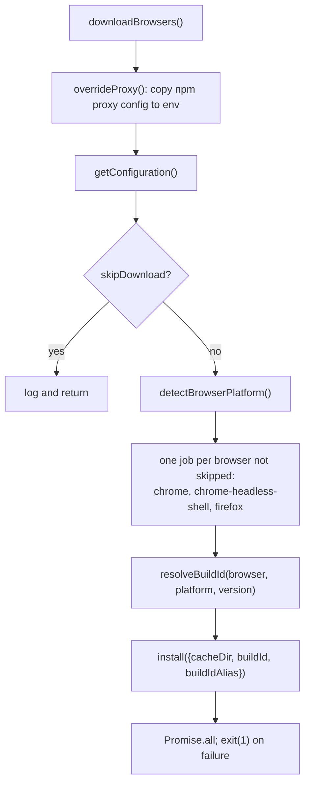

## Overview

The `puppeteer` package, unlike `puppeteer-core`, reads a configuration once when it is first imported and hands it to its `PuppeteerNode` instance. The same configuration decides which browsers the postinstall step downloads, where they are cached, which browser `launch()` starts by default, and which executable it runs. This page follows how that configuration is assembled and how the download uses it. The download mechanics themselves belong to `@puppeteer/browsers` and are covered in [[Installing Browsers and the Cache]].

Sources: [packages/puppeteer/src/puppeteer.ts:13-23](repo://packages/puppeteer/src/puppeteer.ts#L13-L23), [packages/puppeteer-core/src/puppeteer-core.ts:22-28](repo://packages/puppeteer-core/src/puppeteer-core.ts#L22-L28)

## The Configuration object

`Configuration` is a public type exported by `puppeteer-core`. Its fields are optional; the comments on each field name the environment variable that overrides it and the default.

Sources: [packages/puppeteer-core/src/common/Configuration.ts:16-80](repo://packages/puppeteer-core/src/common/Configuration.ts#L16-L80), [packages/puppeteer-core/src/common/Configuration.ts:85-199](repo://packages/puppeteer-core/src/common/Configuration.ts#L85-L199)

| Field | Meaning | Environment override | Default |
| --- | --- | --- | --- |
| `cacheDirectory` | Where browsers are downloaded and looked up | `PUPPETEER_CACHE_DIR` | `~/.cache/puppeteer` |
| `executablePath` | Browser executable for `launch()` | `PUPPETEER_EXECUTABLE_PATH` | computed from the cache |
| `defaultBrowser` | `chrome` or `firefox` | `PUPPETEER_BROWSER` | `chrome` |
| `temporaryDirectory` | Parent folder of temporary profiles | `PUPPETEER_TMP_DIR` | `os.tmpdir()` |
| `skipDownload` | Skip every download at install | `PUPPETEER_SKIP_DOWNLOAD` | `false`, or `true` when `executablePath` is set |
| `logLevel` | `silent`, `error` or `warn` | `PUPPETEER_LOGLEVEL` | `warn` |
| `experiments` | Experimental flags (currently none) | none | `{}` |
| `chrome`, `chrome-headless-shell`, `firefox` | Per-browser `version`, `downloadBaseUrl`, `skipDownload` | `PUPPETEER_<BROWSER>_VERSION`, `PUPPETEER_<BROWSER>_DOWNLOAD_BASE_URL`, `PUPPETEER_<BROWSER>_SKIP_DOWNLOAD` | pinned revision; Firefox skipped |

Sources: [packages/puppeteer-core/src/common/Configuration.ts:16-80](repo://packages/puppeteer-core/src/common/Configuration.ts#L16-L80), [packages/puppeteer-core/src/common/Configuration.ts:85-199](repo://packages/puppeteer-core/src/common/Configuration.ts#L85-L199)

The pinned revisions live in `PUPPETEER_REVISIONS`, one entry per browser. A Puppeteer release is tested against exactly these builds, and the installer, the CLI, `launch()` and `trimCache()` all fall back to them when the configuration names no version.

Sources: [packages/puppeteer-core/src/revisions.ts:10-14](repo://packages/puppeteer-core/src/revisions.ts#L10-L14)

```ts
export const PUPPETEER_REVISIONS = Object.freeze({
  chrome: '139.0.7258.154',
  'chrome-headless-shell': '139.0.7258.154',
  firefox: 'stable_142.0.1',
});
```

Sources: [packages/puppeteer-core/src/revisions.ts:10-14](repo://packages/puppeteer-core/src/revisions.ts#L10-L14)

## How getConfiguration resolves settings

### Resolution order

`getConfiguration()` builds the object in a fixed order, so a later step can see the result of an earlier one.

Sources: [packages/puppeteer/src/getConfiguration.ts:118-166](repo://packages/puppeteer/src/getConfiguration.ts#L118-L166), [packages/puppeteer/src/getConfiguration.ts:51-76](repo://packages/puppeteer/src/getConfiguration.ts#L51-L76)

1. **Find a file.** `cosmiconfigSync('puppeteer', {searchStrategy: 'global'}).search()` looks for a configuration file under the module name `puppeteer` (the installation tests use `.puppeteerrc.cjs` and `puppeteer.config.ts`). With no file, the configuration starts empty.
2. **Log level.** `PUPPETEER_LOGLEVEL` or the file's `logLevel` is normalised to `silent`, `error` or `warn`; anything else becomes `warn`.
3. **Default browser.** `PUPPETEER_BROWSER` or `defaultBrowser` must be `chrome` or `firefox`; another value throws `Unsupported browser`.
4. **Executable path.** `PUPPETEER_EXECUTABLE_PATH` wins over the file. When an executable path is set, `skipDownload` turns on, because Puppeteer will not use a downloaded browser.
5. **Skip download.** `PUPPETEER_SKIP_DOWNLOAD` overrides the value from steps 1 and 4.
6. **Per-browser settings.** `getBrowserSetting` fills `chrome`, `chrome-headless-shell` and `firefox`. Firefox defaults to `skipDownload: true`.
7. **Directories.** `PUPPETEER_CACHE_DIR`, then the file, then `~/.cache/puppeteer` gives `cacheDirectory`; `PUPPETEER_TMP_DIR` or the file gives `temporaryDirectory`.

Sources: [packages/puppeteer/src/getConfiguration.ts:118-166](repo://packages/puppeteer/src/getConfiguration.ts#L118-L166), [packages/puppeteer/src/getConfiguration.ts:51-76](repo://packages/puppeteer/src/getConfiguration.ts#L51-L76)

### Boolean environment variables

Boolean environment variables are read leniently: an unset variable returns `undefined` so the next source applies, while `''`, `0`, `false` and `off` (in any case) mean false and every other value means true.

Sources: [packages/puppeteer/src/getConfiguration.ts:19-33](repo://packages/puppeteer/src/getConfiguration.ts#L19-L33)

### Per-browser settings

`getBrowserSetting` turns the browser name into an environment prefix by upper-casing it and replacing hyphens, so `chrome-headless-shell` reads `PUPPETEER_CHROME_HEADLESS_SHELL_VERSION`. For each of `version`, `downloadBaseUrl` and `skipDownload` it takes the environment variable first, then the file's per-browser object, then the default. `skipDownload` also accepts the older spelling `PUPPETEER_SKIP_<BROWSER>_DOWNLOAD`. If the global `skipDownload` is already true, the function returns `{skipDownload: true}` and ignores everything else.

Sources: [packages/puppeteer/src/getConfiguration.ts:78-113](repo://packages/puppeteer/src/getConfiguration.ts#L78-L113)

### Writing a configuration file

A configuration file exports a plain object. The installation tests use both a CommonJS `.puppeteerrc.cjs` and a TypeScript `puppeteer.config.ts` that checks itself against the exported type:

Sources: [test/installation/assets/puppeteer/configuration/puppeteer.config.ts:1-6](repo://test/installation/assets/puppeteer/configuration/puppeteer.config.ts#L1-L6), [test/installation/assets/puppeteer/configuration/.puppeteerrc.cjs:1-8](repo://test/installation/assets/puppeteer/configuration/.puppeteerrc.cjs#L1-L8)

```ts
import {type Configuration} from 'puppeteer';
import {join} from 'node:path';

export default {
  cacheDirectory: join(__dirname, '.cache', 'puppeteer'),
} satisfies Configuration;
```

Sources: [test/installation/assets/puppeteer/configuration/puppeteer.config.ts:1-6](repo://test/installation/assets/puppeteer/configuration/puppeteer.config.ts#L1-L6), [test/installation/assets/puppeteer/configuration/.puppeteerrc.cjs:1-8](repo://test/installation/assets/puppeteer/configuration/.puppeteerrc.cjs#L1-L8)

> [!IMPORTANT]
> The cache directory must be the same at install time and at run time. A cache set only for `npm install` leaves `launch()` looking in `~/.cache/puppeteer`, and it fails with "Could not find Chrome".

Sources: [packages/puppeteer-core/src/node/BrowserLauncher.ts:470-500](repo://packages/puppeteer-core/src/node/BrowserLauncher.ts#L470-L500)

## How the configuration is used at run time

`PuppeteerNode` keeps the configuration and reads it lazily:

Sources: [packages/puppeteer-core/src/node/PuppeteerNode.ts:79-104](repo://packages/puppeteer-core/src/node/PuppeteerNode.ts#L79-L104), [packages/puppeteer-core/src/node/PuppeteerNode.ts:219-250](repo://packages/puppeteer-core/src/node/PuppeteerNode.ts#L219-L250), [packages/puppeteer-core/src/node/BrowserLauncher.ts:425-474](repo://packages/puppeteer-core/src/node/BrowserLauncher.ts#L425-L474), [packages/puppeteer-core/src/node/ChromeLauncher.ts:33-55](repo://packages/puppeteer-core/src/node/ChromeLauncher.ts#L33-L55)

- `defaultBrowser` picks the launcher when `launch()` gets no `browser` option, and sets `defaultBrowserRevision` from `PUPPETEER_REVISIONS`.
- `browserVersion` prefers the per-browser `version` over the pinned revision, and `defaultDownloadPath` is `cacheDirectory`; together they locate the executable inside the cache.
- `executablePath` short-circuits that lookup completely.
- `temporaryDirectory` becomes the parent of the `puppeteer_dev_<browser>_profile-` folder each launch creates.
- `logLevel: 'warn'` lets `ChromeLauncher` print a warning when an x64 Node runs Chrome on Apple Silicon.

Sources: [packages/puppeteer-core/src/node/PuppeteerNode.ts:79-104](repo://packages/puppeteer-core/src/node/PuppeteerNode.ts#L79-L104), [packages/puppeteer-core/src/node/PuppeteerNode.ts:219-250](repo://packages/puppeteer-core/src/node/PuppeteerNode.ts#L219-L250), [packages/puppeteer-core/src/node/BrowserLauncher.ts:425-474](repo://packages/puppeteer-core/src/node/BrowserLauncher.ts#L425-L474), [packages/puppeteer-core/src/node/ChromeLauncher.ts:33-55](repo://packages/puppeteer-core/src/node/ChromeLauncher.ts#L33-L55)

`puppeteer-core` constructs its `PuppeteerNode` without calling `getConfiguration()`, so none of these files or variables apply to it: pass `executablePath` or `browser` to `launch()` directly.

Sources: [packages/puppeteer-core/src/puppeteer-core.ts:22-28](repo://packages/puppeteer-core/src/puppeteer-core.ts#L22-L28)

## The postinstall download

`npm install puppeteer` runs `install.mjs`. It imports `puppeteer/internal/node/install.js` and calls `downloadBrowsers()`. When the package has not been built (a fresh repository checkout), the import fails and the script exits with code 0 after a warning; a failed download is also caught and logged, so neither breaks `npm install`.

Sources: [packages/puppeteer/install.mjs:22-43](repo://packages/puppeteer/install.mjs#L22-L43)



Sources: [packages/puppeteer/src/node/install.ts:23-133](repo://packages/puppeteer/src/node/install.ts#L23-L133)

`downloadBrowsers` first copies npm's `https-proxy`, `proxy` and `no-proxy` settings into `HTTPS_PROXY`, `HTTP_PROXY` and `NO_PROXY`, so a proxy configured for npm also applies to the browser download. It throws if `detectBrowserPlatform()` cannot name the platform.

Sources: [packages/puppeteer/src/node/install.ts:67-80](repo://packages/puppeteer/src/node/install.ts#L67-L80), [packages/puppeteer/src/node/install.ts:150-167](repo://packages/puppeteer/src/node/install.ts#L150-L167)

Each `downloadBrowser` job takes the configured `version`, else the pinned revision, else `latest`, and resolves it to a concrete build id with `resolveBuildId` ([[Browser Data and Version Resolution]]). When the requested version was a tag such as `stable` and resolved to a different id, it passes the tag as `buildIdAlias` so the cache can map the alias to the build. A failure is rethrown with a hint to set `PUPPETEER_SKIP_DOWNLOAD`; `downloadBrowsers` then prints the error and exits with code 1.

Sources: [packages/puppeteer/src/node/install.ts:37-61](repo://packages/puppeteer/src/node/install.ts#L37-L61), [packages/puppeteer/src/node/install.ts:127-132](repo://packages/puppeteer/src/node/install.ts#L127-L132)

Progress messages go through `logPolitely`, which stays quiet when npm's log level (`npm_config_loglevel`) is `silent`, `error` or `warn`.

Sources: [packages/puppeteer/src/node/install.ts:138-145](repo://packages/puppeteer/src/node/install.ts#L138-L145)

## The puppeteer browsers command

The `puppeteer` package's `bin` is `cli.js`, which runs the `@puppeteer/browsers` `CLI` class under the `browsers` sub-command with this installation's settings. Its cache path is fixed to the configured `cacheDirectory` (`allowCachePathOverride: false`), and its pinned browsers mirror the postinstall rules: Chrome and `chrome-headless-shell` are installed by default, Firefox is skipped unless its `skipDownload` is false. So `npx puppeteer browsers install` repeats the postinstall download, and `npx puppeteer browsers install firefox` adds Firefox. [[Browsers CLI]] documents the commands.

Sources: [packages/puppeteer/src/node/cli.ts:9-50](repo://packages/puppeteer/src/node/cli.ts#L9-L50), [packages/puppeteer/package.json:12-12](repo://packages/puppeteer/package.json#L12-L12)

## Removing old browsers

`puppeteer.trimCache()` deletes cached Chrome and Firefox builds other than the ones the current configuration resolves to. For each browser it resolves the configured version or pinned revision to a build id, then calls `uninstall` for every installed build of that browser whose id differs. Browsers Puppeteer does not manage are left alone.

Sources: [packages/puppeteer-core/src/node/PuppeteerNode.ts:289-359](repo://packages/puppeteer-core/src/node/PuppeteerNode.ts#L289-L359)
