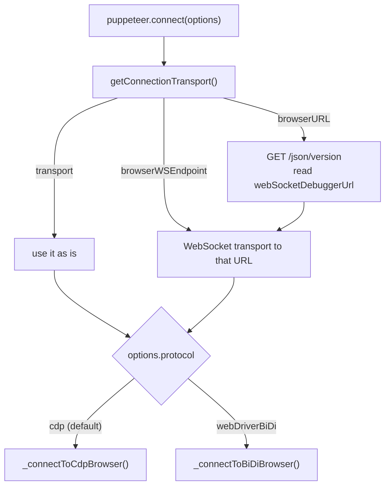

## Overview

`puppeteer.connect()` attaches to a browser that something else started: a browser launched earlier with a fixed debugging port, a remote browser service, or the tab an extension is debugging. It returns the same `Browser` object as `launch()`, with no process attached. Underneath both calls sits one small interface, `ConnectionTransport`, which moves protocol messages as strings. Every way of reaching a browser (Node WebSocket, browser WebSocket, stdio pipe, Chrome extension debugger) is an implementation of it. [[Launching Browsers]] shows how `launch()` builds a transport for a process it spawned; this page covers `connect()` and the transports themselves.

Sources: [packages/puppeteer-core/src/common/Puppeteer.ts:122-124](repo://packages/puppeteer-core/src/common/Puppeteer.ts#L122-L124), [packages/puppeteer-core/src/common/ConnectionTransport.ts:10-15](repo://packages/puppeteer-core/src/common/ConnectionTransport.ts#L10-L15)

## The connect flow

### From options to a connector

`Puppeteer.connect()` calls `_connectToBrowser`, which first obtains a transport and an endpoint URL and then hands them to the CDP or the BiDi connector depending on `options.protocol`. With no `protocol`, connecting uses CDP.

Sources: [packages/puppeteer-core/src/common/BrowserConnector.ts:30-89](repo://packages/puppeteer-core/src/common/BrowserConnector.ts#L30-L89), [packages/puppeteer-core/src/common/ConnectOptions.ts:85-96](repo://packages/puppeteer-core/src/common/ConnectOptions.ts#L85-L96)



Sources: [packages/puppeteer-core/src/common/BrowserConnector.ts:30-89](repo://packages/puppeteer-core/src/common/BrowserConnector.ts#L30-L89), [packages/puppeteer-core/src/common/ConnectOptions.ts:85-96](repo://packages/puppeteer-core/src/common/ConnectOptions.ts#L85-L96)

### Choosing the endpoint

Exactly one of `browserWSEndpoint`, `browserURL` and `transport` must be given; anything else fails an assertion. A `browserURL` such as `http://localhost:9222` is resolved by fetching `/json/version` and reading `webSocketDebuggerUrl`; a failed fetch rethrows with the URL it tried in the message. Custom `headers` are sent only on the `browserWSEndpoint` path and only in Node.

Sources: [packages/puppeteer-core/src/common/BrowserConnector.ts:57-111](repo://packages/puppeteer-core/src/common/BrowserConnector.ts#L57-L111), [packages/puppeteer-core/src/common/ConnectOptions.ts:104-112](repo://packages/puppeteer-core/src/common/ConnectOptions.ts#L104-L112)

The WebSocket class is picked at run time: `NodeWebSocketTransport` when `isNode` is true, otherwise `BrowserWebSocketTransport`. Both are loaded with a dynamic `import()`, so a browser bundle never pulls in the `ws` package.

Sources: [packages/puppeteer-core/src/common/BrowserConnector.ts:17-22](repo://packages/puppeteer-core/src/common/BrowserConnector.ts#L17-L22), [packages/puppeteer-core/src/environment.ts:12-12](repo://packages/puppeteer-core/src/environment.ts#L12-L12)

### Connecting over CDP

`_connectToCdpBrowser` wraps the transport in a CDP `Connection` with the `slowMo` delay and `protocolTimeout`, asks the browser for its existing contexts with `Target.getBrowserContexts`, and creates a `CdpBrowser` that knows them. The browser has no process; its close callback sends `Browser.close` over the connection. [[CDP Connection and Sessions]] and [[Target Management (CDP)]] continue from there.

Sources: [packages/puppeteer-core/src/cdp/BrowserConnector.ts:20-62](repo://packages/puppeteer-core/src/cdp/BrowserConnector.ts#L20-L62)

### Connecting over WebDriver BiDi

The BiDi connector does not know in advance whether the endpoint speaks BiDi natively (Firefox, or a BiDi-capable driver) or only CDP. It probes:

Sources: [packages/puppeteer-core/src/bidi/BrowserConnector.ts:59-123](repo://packages/puppeteer-core/src/bidi/BrowserConnector.ts#L59-L123)

1. It opens a `BidiConnection` on the transport and sends `session.status`. A `success` reply means the endpoint is pure BiDi; closing the browser then sends `browser.close`.
2. If the reply is a `ProtocolError`, it unbinds that connection and opens a CDP `Connection` on the same transport with raw errors. Any other error is rethrown.
3. It calls `Browser.getVersion` and refuses Firefox, which cannot run BiDi over CDP.
4. It runs `connectBidiOverCdp` to translate BiDi to CDP in-process; closing the browser then sends CDP `Browser.close`.

Sources: [packages/puppeteer-core/src/bidi/BrowserConnector.ts:59-123](repo://packages/puppeteer-core/src/bidi/BrowserConnector.ts#L59-L123)

The resulting connection goes to `BidiBrowser.create` together with `defaultViewport`, `acceptInsecureCerts`, `networkEnabled` and the optional WebDriver `capabilities` for `session.new`. [[BiDi Connection and BiDi over CDP]] describes both connection kinds.

Sources: [packages/puppeteer-core/src/bidi/BrowserConnector.ts:25-50](repo://packages/puppeteer-core/src/bidi/BrowserConnector.ts#L25-L50), [packages/puppeteer-core/src/common/ConnectOptions.ts:114-120](repo://packages/puppeteer-core/src/common/ConnectOptions.ts#L114-L120)

## ConnectOptions

These options apply to both `connect()` and `launch()`:

Sources: [packages/puppeteer-core/src/common/ConnectOptions.ts:46-121](repo://packages/puppeteer-core/src/common/ConnectOptions.ts#L46-L121)

| Option | Default | Effect |
| --- | --- | --- |
| `browserWSEndpoint`, `browserURL`, `transport` | none | Where to connect; exactly one is required for `connect()` |
| `headers` | none | Extra WebSocket handshake headers (Node only) |
| `protocol` | `cdp` when connecting | `cdp` or `webDriverBiDi` |
| `protocolTimeout` | `180000` | Timeout for a single protocol call |
| `slowMo` | `0` | Delay, in milliseconds, before each incoming message is handled |
| `defaultViewport` | `{width: 800, height: 600}` | Viewport applied to every page; `null` disables it |
| `acceptInsecureCerts` | `false` | Ignore HTTPS certificate errors |
| `networkEnabled` | `true` | Experimental: `false` stops network event tracking, so `HTTPRequest` and `HTTPResponse` stop working |
| `downloadBehavior` | none | Download behaviour for the default context |
| `targetFilter` | none | Callback deciding which targets Puppeteer attaches to |
| `capabilities` | none | BiDi `session.new` capabilities, BiDi `connect()` only |

Sources: [packages/puppeteer-core/src/common/ConnectOptions.ts:46-121](repo://packages/puppeteer-core/src/common/ConnectOptions.ts#L46-L121)

## Transports

### The ConnectionTransport contract

A transport has two methods and two callbacks. `send(message)` writes one serialized protocol message; `close()` shuts the channel. The connection that owns the transport assigns `onmessage` and `onclose`, and the transport calls them for each complete incoming message and once when the channel closes. The transport neither parses JSON nor reconnects.

Sources: [packages/puppeteer-core/src/common/ConnectionTransport.ts:10-15](repo://packages/puppeteer-core/src/common/ConnectionTransport.ts#L10-L15)

```ts
export interface ConnectionTransport {
  send(message: string): void;
  close(): void;
  onmessage?: (message: string) => void;
  onclose?: () => void;
}
```

Sources: [packages/puppeteer-core/src/common/ConnectionTransport.ts:10-15](repo://packages/puppeteer-core/src/common/ConnectionTransport.ts#L10-L15)

### Built-in transports

| Transport | Environment | How it works |
| --- | --- | --- |
| `NodeWebSocketTransport` | Node | `ws` client with redirects followed, compression off, a 256 MB maximum payload and a `User-Agent: Puppeteer <version>` header merged with custom headers |
| `BrowserWebSocketTransport` | Browsers | The global `WebSocket`; no custom headers |
| `PipeTransport` | Node, launched Chrome | Writes each message followed by a NUL byte to fd 3 and splits fd 4 on NUL bytes |
| `ExtensionTransport` | Chrome extension | Routes CDP through `chrome.debugger` for one tab |

Sources: [packages/puppeteer-core/src/node/NodeWebSocketTransport.ts:14-65](repo://packages/puppeteer-core/src/node/NodeWebSocketTransport.ts#L14-L65), [packages/puppeteer-core/src/common/BrowserWebSocketTransport.ts:11-50](repo://packages/puppeteer-core/src/common/BrowserWebSocketTransport.ts#L11-L50), [packages/puppeteer-core/src/node/PipeTransport.ts:15-97](repo://packages/puppeteer-core/src/node/PipeTransport.ts#L15-L97), [packages/puppeteer-core/src/cdp/ExtensionTransport.ts:35-52](repo://packages/puppeteer-core/src/cdp/ExtensionTransport.ts#L35-L52)

Both WebSocket transports resolve `create()` on `open` and reject on the first `error`; after that they ignore socket errors and rely on `close` to report a lost connection.

Sources: [packages/puppeteer-core/src/node/NodeWebSocketTransport.ts:31-56](repo://packages/puppeteer-core/src/node/NodeWebSocketTransport.ts#L31-L56), [packages/puppeteer-core/src/common/BrowserWebSocketTransport.ts:16-41](repo://packages/puppeteer-core/src/common/BrowserWebSocketTransport.ts#L16-L41)

### Pipe framing

A pipe delivers bytes, not messages, so `PipeTransport` reassembles them. Each `data` chunk is scanned for NUL separators: text before the first one completes the pending partial message, every further NUL-terminated piece is a whole message, and the trailing bytes become the new pending text. Each message is delivered to `onmessage` in its own `setImmediate` callback. Sending or receiving after `close()` fails an assertion.

Sources: [packages/puppeteer-core/src/node/PipeTransport.ts:56-96](repo://packages/puppeteer-core/src/node/PipeTransport.ts#L56-L96)

### The extension transport

An extension cannot open a DevTools WebSocket, but it can call `chrome.debugger`. `ExtensionTransport.connectTab(tabId)` attaches the debugger to a tab and fakes the browser-level part of CDP that `chrome.debugger` lacks. It answers `Browser.getVersion` and `Target.getBrowserContexts` itself, emits `targetCreated` for a synthetic tab target and page target on `Target.setDiscoverTargets`, and emits `attachedToTarget` with fixed session ids on `Target.setAutoAttach`. Every other command goes to `chrome.debugger.sendCommand`; the page session id is stripped on the way out and restored on the reply, and debugger events for the tab come back as messages on the page session.

Sources: [packages/puppeteer-core/src/cdp/ExtensionTransport.ts:8-102](repo://packages/puppeteer-core/src/cdp/ExtensionTransport.ts#L8-L102), [packages/puppeteer-core/src/cdp/ExtensionTransport.ts:103-193](repo://packages/puppeteer-core/src/cdp/ExtensionTransport.ts#L103-L193)

## Running outside Node

`puppeteer-core` has a browser entry point, `puppeteer-core-browser.js`, set as the package's `browser` field. It exports the whole API but builds a plain `Puppeteer` rather than a `PuppeteerNode`, so only `connect` exists: nothing can launch a process. Node-only features read `fs`, `path` and `ScreenRecorder` from `environment.value`, whose defaults throw "not available in this environment"; only the Node entry point replaces them.

Sources: [packages/puppeteer-core/src/puppeteer-core-browser.ts:7-25](repo://packages/puppeteer-core/src/puppeteer-core-browser.ts#L7-L25), [packages/puppeteer-core/package.json:11-14](repo://packages/puppeteer-core/package.json#L11-L14), [packages/puppeteer-core/src/environment.ts:20-38](repo://packages/puppeteer-core/src/environment.ts#L20-L38)

In a web page, connect with a `browserWSEndpoint`; the repository's browser example reads it from an input box and disconnects when done:

Sources: [examples/puppeteer-in-browser/main.mjs:9-21](repo://examples/puppeteer-in-browser/main.mjs#L9-L21)

```js
import puppeteer from 'puppeteer-core/lib/esm/puppeteer/puppeteer-core-browser.js';

async function onConnectClick() {
  const wsUrl = document.querySelector('#ws').value;

  const browser = await puppeteer.connect({
    browserWSEndpoint: wsUrl,
  });

  alert('Browser has ' + (await browser.pages()).length + ' pages');

  browser.disconnect();
}
```

Sources: [examples/puppeteer-in-browser/main.mjs:9-21](repo://examples/puppeteer-in-browser/main.mjs#L9-L21)

In an extension's background script, pass an `ExtensionTransport` for a tab. The result behaves like a browser with one page:

Sources: [examples/puppeteer-in-extension/background.js:6-31](repo://examples/puppeteer-in-extension/background.js#L6-L31)

```js
const browser = await connect({
  transport: await ExtensionTransport.connectTab(tab.id),
});
const [page] = await browser.pages();
```

Sources: [examples/puppeteer-in-extension/background.js:6-31](repo://examples/puppeteer-in-extension/background.js#L6-L31)
