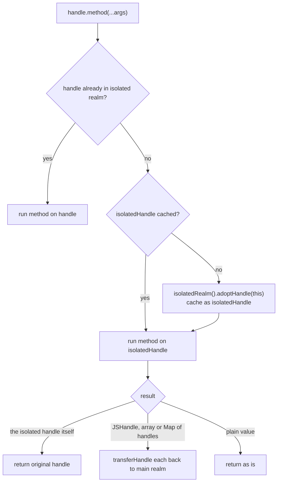

## Overview

An `ElementHandle` is a `JSHandle` that points at a DOM node. `page.$`, `frame.$`, `waitForSelector` and evaluations returning a node all produce one. On top of the handle basics from [[JavaScript Evaluation and Handles]], it adds queries scoped to the element, geometry (clickable point, bounding box, box model), visibility checks, user-like actions (click, hover, tap, type, drag), form helpers (`select`, `uploadFile`, `autofill`) and element screenshots. Most of this is implemented once in `api/ElementHandle.ts` with page-side JavaScript; `CdpElementHandle` adds the parts that need protocol calls. Actions end in the page's input devices, which [[Keyboard, Mouse and Touch]] describes.

Sources: [packages/puppeteer-core/src/api/ElementHandle.ts:181-242](repo://packages/puppeteer-core/src/api/ElementHandle.ts#L181-L242), [packages/puppeteer-core/src/cdp/ElementHandle.ts:36-67](repo://packages/puppeteer-core/src/cdp/ElementHandle.ts#L36-L67)

An element handle keeps the node from being garbage-collected until it is disposed. It is disposed automatically when its frame navigates.

Sources: [packages/puppeteer-core/src/api/ElementHandle.ts:199-202](repo://packages/puppeteer-core/src/api/ElementHandle.ts#L199-L202)

## Structure

### Wrapping a JSHandle

`ElementHandle` does not extend a backend handle class. It wraps one: the constructor stores a `JSHandle` in `this.handle` and forwards `id`, `disposed`, `evaluate`, `evaluateHandle`, `jsonValue`, `toString` and `remoteObject` to it. `CdpElementHandle` builds its inner handle as a `CdpJSHandle` over the same `RemoteObject`, and its `frame` is the realm's environment. Disposing an element handle disposes the wrapped handle and its isolated twin (below).

Sources: [packages/puppeteer-core/src/api/ElementHandle.ts:215-256](repo://packages/puppeteer-core/src/api/ElementHandle.ts#L215-L256), [packages/puppeteer-core/src/api/ElementHandle.ts:281-358](repo://packages/puppeteer-core/src/api/ElementHandle.ts#L281-L358), [packages/puppeteer-core/src/cdp/ElementHandle.ts:42-67](repo://packages/puppeteer-core/src/cdp/ElementHandle.ts#L42-L67)

### Running in the isolated realm

Handles given to users live in the main realm. Most `ElementHandle` methods are decorated with `@bindIsolatedHandle`, which runs the method body on a copy of the handle in the frame's isolated realm:

Sources: [packages/puppeteer-core/src/api/ElementHandle.ts:131-180](repo://packages/puppeteer-core/src/api/ElementHandle.ts#L131-L180)

Sources: [packages/puppeteer-core/src/api/ElementHandle.ts:131-180](repo://packages/puppeteer-core/src/api/ElementHandle.ts#L131-L180)

The adopted copy is cached on the handle as `isolatedHandle`, so repeated calls pay for one adoption. Results are moved back to the user's realm, so `$` called on a main-realm handle still returns a main-realm handle.

Sources: [packages/puppeteer-core/src/api/ElementHandle.ts:141-178](repo://packages/puppeteer-core/src/api/ElementHandle.ts#L141-L178), [packages/puppeteer-core/src/api/ElementHandle.ts:344-346](repo://packages/puppeteer-core/src/api/ElementHandle.ts#L344-L346)

## Queries from an element

`$` and `waitForSelector` resolve the selector's query handler with `getQueryHandlerAndSelector` and call its `queryOne` or `waitFor` ([[Selectors and Query Handlers]]). `$$` collects `queryAll` into an array. By default it runs isolated; `{isolate: false}` skips the isolated realm, which saves the adoption and transfer work when a query returns many elements.

Sources: [packages/puppeteer-core/src/api/ElementHandle.ts:381-451](repo://packages/puppeteer-core/src/api/ElementHandle.ts#L381-L451), [packages/puppeteer-core/src/api/Page.ts:421-432](repo://packages/puppeteer-core/src/api/Page.ts#L421-L432)

`$eval` queries one element and throws `failed to find element matching selector` when nothing matches. `$$eval` queries all, packs the handles into one in-page array, runs the function on that array, and disposes the individual handles.

Sources: [packages/puppeteer-core/src/api/ElementHandle.ts:493-589](repo://packages/puppeteer-core/src/api/ElementHandle.ts#L493-L589)

Query handlers return many results as an iterator living in the page. `transposeIterableHandle` turns that into an async iterator of handles in Node. It reads results in batches with one evaluation per batch, starting at 20 and doubling each time, until a batch comes back empty.

Sources: [packages/puppeteer-core/src/common/HandleIterator.ts:12-76](repo://packages/puppeteer-core/src/common/HandleIterator.ts#L12-L76)

`toElement(tagName)` checks the node name and narrows the TypeScript type, throwing when the tag differs. `contentFrame()` returns the `Frame` an `<iframe>` hosts, looked up by the `frameId` from `DOM.describeNode`.

Sources: [packages/puppeteer-core/src/api/ElementHandle.ts:709-728](repo://packages/puppeteer-core/src/api/ElementHandle.ts#L709-L728), [packages/puppeteer-core/src/cdp/ElementHandle.ts:69-82](repo://packages/puppeteer-core/src/cdp/ElementHandle.ts#L69-L82)

## Geometry

### Where to click

Every pointer action starts from `clickablePoint(offset?)`, which uses a private `#clickableBox`:

Sources: [packages/puppeteer-core/src/api/ElementHandle.ts:733-750](repo://packages/puppeteer-core/src/api/ElementHandle.ts#L733-L750), [packages/puppeteer-core/src/api/ElementHandle.ts:1167-1241](repo://packages/puppeteer-core/src/api/ElementHandle.ts#L1167-L1241), [packages/puppeteer-core/src/api/ElementHandle.ts:1651-1670](repo://packages/puppeteer-core/src/api/ElementHandle.ts#L1651-L1670)

1. Read the element's `getClientRects()`. An inline element that wraps over lines has several rectangles. A non-element or an element without rectangles gives `null`, and `clickablePoint` throws `Node is either not clickable or not an Element`.
2. Clip each rectangle to the frame's document size (`clientWidth` and `clientHeight` of the root element).
3. For each ancestor frame, find the hosting `<iframe>` with `frameElement()`, shift the rectangles by its position plus padding and border, and clip again against that frame.
4. Take the first rectangle at least 1×1 pixel.

Sources: [packages/puppeteer-core/src/api/ElementHandle.ts:733-750](repo://packages/puppeteer-core/src/api/ElementHandle.ts#L733-L750), [packages/puppeteer-core/src/api/ElementHandle.ts:1167-1241](repo://packages/puppeteer-core/src/api/ElementHandle.ts#L1167-L1241), [packages/puppeteer-core/src/api/ElementHandle.ts:1651-1670](repo://packages/puppeteer-core/src/api/ElementHandle.ts#L1651-L1670)

`clickablePoint` returns that rectangle's centre, or its top-left corner plus `offset`.

Sources: [packages/puppeteer-core/src/api/ElementHandle.ts:733-750](repo://packages/puppeteer-core/src/api/ElementHandle.ts#L733-L750), [packages/puppeteer-core/src/api/ElementHandle.ts:1167-1241](repo://packages/puppeteer-core/src/api/ElementHandle.ts#L1167-L1241), [packages/puppeteer-core/src/api/ElementHandle.ts:1651-1670](repo://packages/puppeteer-core/src/api/ElementHandle.ts#L1651-L1670)

### Boxes

`boundingBox()` returns `getBoundingClientRect()` offset by the top-left corner of every ancestor frame, so the result is relative to the main frame's viewport, or `null` for nodes without layout. `boxModel()` computes the four CSS quads (content, padding, border, margin) from the computed style in the page and applies the same frame offset.

Sources: [packages/puppeteer-core/src/api/ElementHandle.ts:1248-1275](repo://packages/puppeteer-core/src/api/ElementHandle.ts#L1248-L1275), [packages/puppeteer-core/src/api/ElementHandle.ts:1289-1381](repo://packages/puppeteer-core/src/api/ElementHandle.ts#L1289-L1381), [packages/puppeteer-core/src/api/ElementHandle.ts:1383-1418](repo://packages/puppeteer-core/src/api/ElementHandle.ts#L1383-L1418)

### Visibility and the viewport

`isVisible()` and `isHidden()` call `PuppeteerUtil.checkVisibility` in the page. An element counts as visible when its computed `visibility` is not `hidden` or `collapse` and its bounding box has non-zero width and height; text nodes are judged by their parent element.

Sources: [packages/puppeteer-core/src/api/ElementHandle.ts:642-689](repo://packages/puppeteer-core/src/api/ElementHandle.ts#L642-L689), [packages/puppeteer-core/src/injected/util.ts:6-36](repo://packages/puppeteer-core/src/injected/util.ts#L6-L36)

`isIntersectingViewport({threshold})` observes the element once with an `IntersectionObserver` (for SVG children, the owning `<svg>`) and compares the ratio to the threshold; a threshold of 1 requires full visibility. It first asserts that the node is connected and is an element.

Sources: [packages/puppeteer-core/src/api/ElementHandle.ts:1477-1491](repo://packages/puppeteer-core/src/api/ElementHandle.ts#L1477-L1491), [packages/puppeteer-core/src/api/ElementHandle.ts:1517-1542](repo://packages/puppeteer-core/src/api/ElementHandle.ts#L1517-L1542), [packages/puppeteer-core/src/api/ElementHandle.ts:1575-1599](repo://packages/puppeteer-core/src/api/ElementHandle.ts#L1575-L1599)

`scrollIntoView()` scrolls the element to the centre of the viewport. On CDP it uses `DOM.scrollIntoViewIfNeeded` and falls back to the in-page `element.scrollIntoView({block: 'center', inline: 'center'})` when the command fails. Actions call the internal `scrollIntoViewIfNeeded`, which scrolls only when the element is not fully in view.

Sources: [packages/puppeteer-core/src/api/ElementHandle.ts:1496-1559](repo://packages/puppeteer-core/src/api/ElementHandle.ts#L1496-L1559), [packages/puppeteer-core/src/cdp/ElementHandle.ts:84-99](repo://packages/puppeteer-core/src/cdp/ElementHandle.ts#L84-L99)

## Actions

### Pointer and keyboard actions

Each action follows the same steps: scroll into view if needed, compute the clickable point, then call the page's input device.

Sources: [packages/puppeteer-core/src/api/ElementHandle.ts:757-822](repo://packages/puppeteer-core/src/api/ElementHandle.ts#L757-L822), [packages/puppeteer-core/src/api/ElementHandle.ts:1046-1165](repo://packages/puppeteer-core/src/api/ElementHandle.ts#L1046-L1165)

| Method | Input call |
| --- | --- |
| `click(options)` | `page.mouse.click(x, y, options)`; `offset` moves the point, `debugHighlight` draws a fading red dot where it clicked |
| `hover()` | `page.mouse.move(x, y)` |
| `tap()`, `touchStart()`, `touchMove(touch?)`, `touchEnd()` | `page.touchscreen` methods |
| `focus()` | `element.focus()` in the page; throws for non-`HTMLElement`s |
| `type(text, options)`, `press(key, options)` | `focus()`, then `page.keyboard.type` or `press` |

Sources: [packages/puppeteer-core/src/api/ElementHandle.ts:757-822](repo://packages/puppeteer-core/src/api/ElementHandle.ts#L757-L822), [packages/puppeteer-core/src/api/ElementHandle.ts:1046-1165](repo://packages/puppeteer-core/src/api/ElementHandle.ts#L1046-L1165)

### Drag and drop

There are two drag models. With drag interception enabled (`page.setDragInterception(true)`), `drag(target)` uses `mouse.drag` to capture the drag data, and `dragEnter`, `dragOver`, `drop(data)` and `dragAndDrop(target)` replay protocol drag events at the element's point; `dragAndDrop` asserts that interception is on. Without interception, `drag` hovers the source, presses the mouse once (tracked in `page._isDragging`) and moves to the target. `target.drop(source)` drags `source` onto the receiving element and releases the mouse.

Sources: [packages/puppeteer-core/src/api/ElementHandle.ts:830-890](repo://packages/puppeteer-core/src/api/ElementHandle.ts#L830-L890), [packages/puppeteer-core/src/api/ElementHandle.ts:911-953](repo://packages/puppeteer-core/src/api/ElementHandle.ts#L911-L953)

### Form helpers

`select(...values)` works only on `<select>`: it asserts every value is a string, selects the first matching option (or all matching options for `multiple`), dispatches bubbling `input` and `change` events, and returns the selected values.

Sources: [packages/puppeteer-core/src/api/ElementHandle.ts:971-1015](repo://packages/puppeteer-core/src/api/ElementHandle.ts#L971-L1015)

`uploadFile(...paths)` on CDP asserts that several files are only given to `<input multiple>` and resolves relative paths against the working directory when `path` is available. It then calls `DOM.setFileInputFiles`. With no paths it clears the input and dispatches `input` and `change` itself.

Sources: [packages/puppeteer-core/src/cdp/ElementHandle.ts:101-160](repo://packages/puppeteer-core/src/cdp/ElementHandle.ts#L101-L160)

`autofill({creditCard})` triggers Chrome's autofill for the field with `Autofill.trigger`, identifying the field by its backend node id and frame.

Sources: [packages/puppeteer-core/src/cdp/ElementHandle.ts:162-174](repo://packages/puppeteer-core/src/cdp/ElementHandle.ts#L162-L174), [packages/puppeteer-core/src/api/ElementHandle.ts:1638-1649](repo://packages/puppeteer-core/src/api/ElementHandle.ts#L1638-L1649)

## Element screenshots

`screenshot(options)` scrolls into view (unless `scrollIntoView: false`), asserts that the bounding box exists and has non-zero width and height, converts it to page coordinates with `visualViewport.pageLeft` and `pageTop`, and calls `page.screenshot` with that box as `clip`. A `clip` option is relative to the element. [[Screenshots, PDFs and Screen Recording]] describes the page-level capture.

Sources: [packages/puppeteer-core/src/api/ElementHandle.ts:1425-1472](repo://packages/puppeteer-core/src/api/ElementHandle.ts#L1425-L1472)

## Other members

| Member | Purpose |
| --- | --- |
| `asLocator()` | A `Locator` that starts from this handle ([[Locators]]) |
| `queryAXTree(name, role)` | Accessibility-tree search under the element, skipping ignored and text-only nodes; the ARIA query handler uses it |
| `backendNodeId()` | The CDP backend node id, cached after the first call |

Sources: [packages/puppeteer-core/src/api/ElementHandle.ts:1566-1569](repo://packages/puppeteer-core/src/api/ElementHandle.ts#L1566-L1569), [packages/puppeteer-core/src/cdp/ElementHandle.ts:176-215](repo://packages/puppeteer-core/src/cdp/ElementHandle.ts#L176-L215), [packages/puppeteer-core/src/cdp/AriaQueryHandler.ts:70-80](repo://packages/puppeteer-core/src/cdp/AriaQueryHandler.ts#L70-L80)
