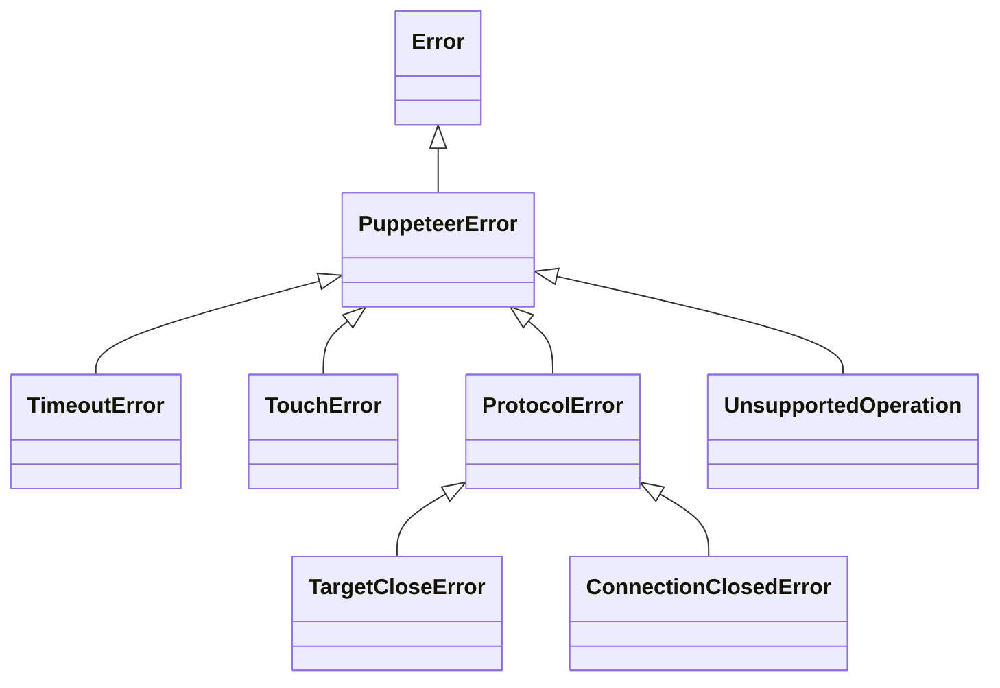

## Overview

Puppeteer reports failures with a small hierarchy of error classes, so scripts can tell a timeout from a closed target from a protocol rejection with `instanceof`. Errors thrown inside the page during `evaluate` are rebuilt in Node with a stack that points at both the page code and the Puppeteer call. For diagnosing what happened on the wire, every protocol message and every swallowed error is written to a named debug channel that can be switched on with the `DEBUG` environment variable in Node or a global in the browser.

Sources: [packages/puppeteer-core/src/common/Errors.ts:7-98](repo://packages/puppeteer-core/src/common/Errors.ts#L7-L98), [packages/puppeteer-core/src/common/Debug.ts:29-102](repo://packages/puppeteer-core/src/common/Debug.ts#L29-L102)

## Error classes

### The hierarchy

Sources: [packages/puppeteer-core/src/common/Errors.ts:12-98](repo://packages/puppeteer-core/src/common/Errors.ts#L12-L98)

| Class | Raised when | Examples |
| --- | --- | --- |
| `PuppeteerError` | Base class; its `name` is the subclass name | none directly |
| `TimeoutError` | An operation exceeded its timeout | `waitForSelector`, `waitForFunction`, navigation, `launch` waiting for the endpoint, a `Deferred` with a timeout |
| `TouchError` | Moving or ending a touch that does not exist | `touchscreen.touchMove` without `touchStart` |
| `ProtocolError` | The browser rejected a command, or a command timed out | Any CDP or BiDi error reply; carries `code` and `originalMessage` |
| `UnsupportedOperation` | The current protocol or browser cannot do this | Many BiDi page methods; `WebWorker.close()` by default |
| `TargetCloseError` | The target or session closed while a command was pending or before it was sent | Commands on a closed page; pending commands when a session detaches |
| `ConnectionClosedError` | The whole connection is closed | `send` after disconnect |

Sources: [packages/puppeteer-core/src/common/Errors.ts:29-98](repo://packages/puppeteer-core/src/common/Errors.ts#L29-L98), [packages/puppeteer-core/src/api/Input.ts:549-566](repo://packages/puppeteer-core/src/api/Input.ts#L549-L566), [packages/puppeteer-core/src/util/Deferred.ts:72-79](repo://packages/puppeteer-core/src/util/Deferred.ts#L72-L79), [packages/puppeteer-core/src/cdp/CdpSession.ts:96-102](repo://packages/puppeteer-core/src/cdp/CdpSession.ts#L96-L102)

`TimeoutError`, `TouchError`, `ProtocolError`, `UnsupportedOperation` and `ConnectionClosedError` are public; `TargetCloseError` is internal, but as a `ProtocolError` subclass it can still be caught as one. The launcher converts `@puppeteer/browsers`' own `TimeoutError` into Puppeteer's, so one `instanceof` check covers both ([[Launching Browsers]]).

Sources: [packages/puppeteer-core/src/common/Errors.ts:88-98](repo://packages/puppeteer-core/src/common/Errors.ts#L88-L98), [packages/puppeteer-core/src/node/BrowserLauncher.ts:211-217](repo://packages/puppeteer-core/src/node/BrowserLauncher.ts#L211-L217)

### Protocol error messages

`createProtocolErrorMessage` builds the text of a CDP error reply from its `message` and, when present, its `data`. The callback registry then rewrites a `ProtocolError` that was created when the command was sent, so its stack points at the caller: the message becomes ``Protocol error (<method>): <text>``, and `originalMessage` keeps the browser's own text so code can match it reliably. Timeouts reuse the same error object with the message ``<method> timed out. Increase the 'protocolTimeout' setting…`` ([[CDP Connection and Sessions]]).

Sources: [packages/puppeteer-core/src/util/ErrorLike.ts:36-66](repo://packages/puppeteer-core/src/util/ErrorLike.ts#L36-L66), [packages/puppeteer-core/src/common/CallbackRegistry.ts:65-88](repo://packages/puppeteer-core/src/common/CallbackRegistry.ts#L65-L88), [packages/puppeteer-core/src/common/CallbackRegistry.ts:132-145](repo://packages/puppeteer-core/src/common/CallbackRegistry.ts#L132-L145)

Internal code matches on `originalMessage` to decide which errors are expected. Request interception, for example, rethrows invalid-header errors and only logs others, which typically mean the request was already cancelled.

Sources: [packages/puppeteer-core/src/api/HTTPRequest.ts:731-747](repo://packages/puppeteer-core/src/api/HTTPRequest.ts#L731-L747)

`isErrorLike` accepts any object with `name` and `message`, not only `Error` instances; `isErrnoException` additionally checks for Node's `errno`, `code`, `path` or `syscall`.

Sources: [packages/puppeteer-core/src/util/ErrorLike.ts:12-34](repo://packages/puppeteer-core/src/util/ErrorLike.ts#L12-L34)

## Errors from page code

When `evaluate` throws inside the page, CDP returns exception details, and `createEvaluationError` turns them into a Node error:

Sources: [packages/puppeteer-core/src/cdp/utils.ts:15-70](repo://packages/puppeteer-core/src/cdp/utils.ts#L15-L70), [packages/puppeteer-core/src/common/util.ts:52-98](repo://packages/puppeteer-core/src/common/util.ts#L52-L98)

1. A thrown non-`Error` value (a string, a number, a plain object) is returned as that value, so `throw 'x'` in the page rejects with `'x'` in Node.
2. Otherwise a new `Error` gets the page error's name and message.
3. Its stack is rebuilt from the protocol's call frames. Frames whose URL is a `pptr:` URL (the `sourceURL` Puppeteer attached to the evaluated function) are rewritten as `at <function> (<method> at <caller site>, <anonymous>:line:col)`, pointing at the line of the script that called `evaluate`; other frames keep their page URL.

Sources: [packages/puppeteer-core/src/cdp/utils.ts:15-70](repo://packages/puppeteer-core/src/cdp/utils.ts#L15-L70), [packages/puppeteer-core/src/common/util.ts:52-98](repo://packages/puppeteer-core/src/common/util.ts#L52-L98)

The BiDi backend has its own `createEvaluationError` for BiDi exception details, and console `pageerror` events on BiDi rebuild stacks the same way from log entries ([[BiDi Implementation of the Puppeteer API]]).

Sources: [packages/puppeteer-core/src/bidi/Realm.ts:180-184](repo://packages/puppeteer-core/src/bidi/Realm.ts#L180-L184), [packages/puppeteer-core/src/bidi/Frame.ts:200-222](repo://packages/puppeteer-core/src/bidi/Frame.ts#L200-L222)

## Debug logging

### The debug function

`debug(prefix)` returns a logging function for one channel. In Node it lazily imports the `debug` package and logs through it, so the standard `DEBUG` environment variable selects channels (`DEBUG=*`, `DEBUG=puppeteer:*`, `DEBUG=puppeteer:protocol:*`). In a browser it checks `globalThis.__PUPPETEER_DEBUG` on every call: `*` logs everything, a value ending in `*` is compared with `prefix.startsWith(value)`, and any other value must equal the prefix. Matching messages go to `console.log` with the prefix.

Sources: [packages/puppeteer-core/src/common/Debug.ts:15-102](repo://packages/puppeteer-core/src/common/Debug.ts#L15-L102)

### Channels

| Channel | Content |
| --- | --- |
| `puppeteer:protocol:SEND ►`, `puppeteer:protocol:RECV ◀` | Every CDP message, as JSON |
| `puppeteer:webDriverBiDi:SEND ►`, `puppeteer:webDriverBiDi:RECV ◀` | Every BiDi message |
| `bidi:<prefix>` | Logs of the in-process `chromium-bidi` mapper (BiDi over CDP) |
| `puppeteer:error` | Errors Puppeteer caught and deliberately ignored (`debugError`) |
| `puppeteer:ffmpeg` | ffmpeg's stderr while screen recording |
| `puppeteer:browsers:install`, `puppeteer:browsers:cache`, `puppeteer:browsers:launcher`, `puppeteer:browsers:fileUtil` | `@puppeteer/browsers` downloads, cache, process launch, archive extraction |

Sources: [packages/puppeteer-core/src/cdp/Connection.ts:25-26](repo://packages/puppeteer-core/src/cdp/Connection.ts#L25-L26), [packages/puppeteer-core/src/bidi/Connection.ts:24-25](repo://packages/puppeteer-core/src/bidi/Connection.ts#L24-L25), [packages/puppeteer-core/src/bidi/BidiOverCdp.ts:19-21](repo://packages/puppeteer-core/src/bidi/BidiOverCdp.ts#L19-L21), [packages/puppeteer-core/src/common/util.ts:37-37](repo://packages/puppeteer-core/src/common/util.ts#L37-L37), [packages/puppeteer-core/src/node/ScreenRecorder.ts:38-38](repo://packages/puppeteer-core/src/node/ScreenRecorder.ts#L38-L38), [packages/browsers/src/install.ts:28-28](repo://packages/browsers/src/install.ts#L28-L28), [packages/browsers/src/Cache.ts:21-21](repo://packages/browsers/src/Cache.ts#L21-L21), [packages/browsers/src/launch.ts:23-23](repo://packages/browsers/src/launch.ts#L23-L23), [packages/browsers/src/fileUtil.ts:17-17](repo://packages/browsers/src/fileUtil.ts#L17-L17)

`puppeteer:error` is the channel to enable when something fails silently: the many `.catch(debugError)` calls across the code base write there instead of throwing.

Sources: [packages/puppeteer-core/src/common/util.ts:37-37](repo://packages/puppeteer-core/src/common/util.ts#L37-L37), [packages/puppeteer-core/src/cdp/JSHandle.ts:112-126](repo://packages/puppeteer-core/src/cdp/JSHandle.ts#L112-L126)

### Capturing logs in tests

`setLogCapture(true)` makes the Node logger also append every message (prefix plus arguments) to an in-memory list, and `getCapturedLogs()` returns it. The repository's mocha runner uses this to print a debug log for a failing test ([[Test Infrastructure]]).

Sources: [packages/puppeteer-core/src/common/Debug.ts:104-126](repo://packages/puppeteer-core/src/common/Debug.ts#L104-L126), [tools/mocha-runner/src/interface.ts:52-60](repo://tools/mocha-runner/src/interface.ts#L52-L60)
