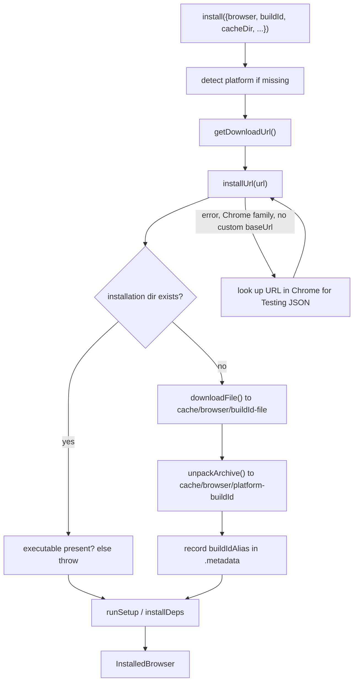

## Overview

`@puppeteer/browsers` is a standalone package that downloads, caches and launches browser builds: Chrome for Testing, `chrome-headless-shell`, ChromeDriver, Chromium and Firefox. Puppeteer uses it for its postinstall download and to find and start the browser ([[Configuration and Browser Download]], [[Launching Browsers]]), and it can be used on its own from code or from its CLI ([[Browsers CLI]]). This page follows `install()` from a browser name and build id to an unpacked browser in the cache, and describes the cache layout the rest of the package relies on. How build ids and download URLs are computed per browser is covered in [[Browser Data and Version Resolution]].

Sources: [packages/browsers/README.md:1-10](repo://packages/browsers/README.md#L1-L10), [packages/browsers/src/main.ts:7-46](repo://packages/browsers/src/main.ts#L7-L46)

## The public API

| Export | Purpose |
| --- | --- |
| `install(options)` | Download and unpack a build into the cache (or only download it with `unpack: false`) |
| `uninstall(options)` | Remove one build from the cache |
| `getInstalledBrowsers({cacheDir})` | List cached builds as `InstalledBrowser` objects |
| `canDownload(options)` | `HEAD` request to check that a build exists |
| `getDownloadUrl(browser, platform, buildId, baseUrl?)` | The URL `install` would use |
| `makeProgressCallback(browser, buildId)` | A terminal progress bar for downloads |
| `detectBrowserPlatform()` | The `BrowserPlatform` of this machine |
| `resolveBuildId`, `createProfile`, `computeExecutablePath`, `launch` | Version resolution, profiles and launching |
| `Cache`, `InstalledBrowser`, `CLI` | Cache access and the command-line interface |

Sources: [packages/browsers/src/main.ts:7-46](repo://packages/browsers/src/main.ts#L7-L46), [packages/browsers/src/install.ts:392-487](repo://packages/browsers/src/install.ts#L392-L487)

## Detecting the platform

`detectBrowserPlatform()` maps Node's `os.platform()` and `os.arch()` to a `BrowserPlatform`: `mac_arm` or `mac` on macOS, `linux_arm` or `linux` on Linux, and `win64` or `win32` on Windows. Windows on ARM counts as `win64` when the OS release is Windows 11 (build 22000 or later), because Windows 11 can emulate x64. Other operating systems return `undefined`, and every function that needs a platform throws `Cannot download a binary for the provided platform`.

Sources: [packages/browsers/src/detectPlatform.ts:14-52](repo://packages/browsers/src/detectPlatform.ts#L14-L52), [packages/browsers/src/install.ts:140-149](repo://packages/browsers/src/install.ts#L140-L149)

## How install works

### The install flow



Sources: [packages/browsers/src/install.ts:140-214](repo://packages/browsers/src/install.ts#L140-L214), [packages/browsers/src/install.ts:257-357](repo://packages/browsers/src/install.ts#L257-L357)

### Options

| Option | Default | Meaning |
| --- | --- | --- |
| `browser`, `buildId` | required | What to install; the build id uniquely identifies binaries and names the cache folder |
| `cacheDir` | required | Root of the cache |
| `platform` | detected | Target platform, which may differ from the current one |
| `buildIdAlias` | none | A tag such as `canary` recorded for this build in the cache metadata |
| `downloadProgressCallback` | none | `(downloaded, total) => void`, or `'default'` for a progress bar |
| `baseUrl` | Chrome for Testing storage or the Firefox archive | Download host |
| `unpack` | `true` | `false` only downloads and returns the archive path |
| `installDeps` | `false` | On Debian-like Linux, install system packages for Chrome (needs root) |

Sources: [packages/browsers/src/install.ts:49-116](repo://packages/browsers/src/install.ts#L49-L116)

### Download, unpack and cleanup

`installUrl` names the archive after the last URL segment, prefixed with the build id, and stores it in the browser's cache folder. If the installation folder already exists, the browser is treated as installed: no download happens, but the executable must exist, or install throws `The browser folder (…) exists but the executable (…) is missing`. Otherwise it downloads, unpacks into the installation folder, records the alias, and in all cases deletes the archive in a `finally` block. Download and extraction times are logged on the `puppeteer:browsers:install` channel.

Sources: [packages/browsers/src/install.ts:257-357](repo://packages/browsers/src/install.ts#L257-L357), [packages/browsers/src/install.ts:28-44](repo://packages/browsers/src/install.ts#L28-L44)

### Fallback through Chrome for Testing

When a download fails for Chrome, ChromeDriver or `chrome-headless-shell` and no custom `baseUrl` was given, `install` fetches `https://googlechromelabs.github.io/chrome-for-testing/<buildId>.json`. It looks up the download for its platform (`linux64`, `mac-arm64`, `mac-x64`, `win32`, `win64`) and retries with that URL if it differs from the one that failed. Firefox and Chromium have no fallback.

Sources: [packages/browsers/src/install.ts:156-213](repo://packages/browsers/src/install.ts#L156-L213)

### Post-install steps

On Windows, when the installed build is Chrome for the current platform, `runSetup` runs the bundled `setup.exe --configure-browser-in-directory=<dir>` to configure the sandbox. With `installDeps` on Linux, `installDeps` reads the `deb.deps` file shipped next to the executable and runs `apt-get satisfy -y <deps> --no-install-recommends`. It requires root and `apt-get`, and throws with the output otherwise.

Sources: [packages/browsers/src/install.ts:216-255](repo://packages/browsers/src/install.ts#L216-L255), [packages/browsers/src/install.ts:359-387](repo://packages/browsers/src/install.ts#L359-L387)

## HTTP and archives

### Downloading

`httpRequest` builds a request through a `ProxyAgent`, so the standard proxy environment variables apply. Credentials in the URL become basic auth, and 3xx responses with a `Location` header are followed. `downloadFile` rejects on any status other than 200 (`Download failed: server returned code …`), streams the body to the archive file, and reports progress from the `content-length` header. `getJSON` and `getText` fetch small documents such as version lists, and `headHttpRequest` resolves `true` only for a 200 answer.

Sources: [packages/browsers/src/httpUtil.ts:14-70](repo://packages/browsers/src/httpUtil.ts#L14-L70), [packages/browsers/src/httpUtil.ts:75-154](repo://packages/browsers/src/httpUtil.ts#L75-L154)

The `'default'` progress callback creates a `progress` bar labelled `Downloading <browser> <buildId or alias> - <size> MB` on the first chunk and advances it by the bytes received since the last call.

Sources: [packages/browsers/src/install.ts:492-522](repo://packages/browsers/src/install.ts#L492-L522)

### Unpacking

`unpackArchive` chooses an extractor by file extension:

Sources: [packages/browsers/src/fileUtil.ts:22-54](repo://packages/browsers/src/fileUtil.ts#L22-L54), [packages/browsers/src/fileUtil.ts:113-183](repo://packages/browsers/src/fileUtil.ts#L113-L183)

| Extension | Extraction |
| --- | --- |
| `.zip` | `extract-zip` into the folder |
| `.tar.bz2`, `.tar.xz` | Pipe the file through the system `bzip2 -d` or `xz -d` into `tar-fs` |
| `.dmg` | Mount with `hdiutil attach`, copy the `.app` with `cp -R`, detach |
| `.exe` | Run the Firefox installer with `/ExtractDir=<folder>` |

Sources: [packages/browsers/src/fileUtil.ts:22-54](repo://packages/browsers/src/fileUtil.ts#L22-L54), [packages/browsers/src/fileUtil.ts:113-183](repo://packages/browsers/src/fileUtil.ts#L113-L183)

A missing `xz` or `bzip2` tool fails with the error that the utility "is required to unpack this archive", which is why the README lists them, and `hdiutil` for macOS, as system requirements for Firefox downloads. Any other extension throws `Unsupported archive format`.

Sources: [packages/browsers/src/fileUtil.ts:118-132](repo://packages/browsers/src/fileUtil.ts#L118-L132), [packages/browsers/README.md:5-10](repo://packages/browsers/README.md#L5-L10)

## The cache

### Layout

Every browser has a folder under the cache root, and every installed build a folder named `<platform>-<buildId>` inside it. A `.metadata` JSON file per browser maps aliases to build ids. The class comment describes the structure:

Sources: [packages/browsers/src/Cache.ts:96-114](repo://packages/browsers/src/Cache.ts#L96-L114), [packages/browsers/src/Cache.ts:129-172](repo://packages/browsers/src/Cache.ts#L129-L172)

```text
- rootDir
  -- <browser1> | browserRoot(browser1)
  ---- <platform>-<buildId> | installationDir()
  ------ the browser-platform-buildId
  ------ specific structure.
  -- <browser2> | browserRoot(browser2)
  ---- <platform>-<buildId> | installationDir()
  ------ the browser-platform-buildId
  ------ specific structure.
```

Sources: [packages/browsers/src/Cache.ts:96-114](repo://packages/browsers/src/Cache.ts#L96-L114), [packages/browsers/src/Cache.ts:129-172](repo://packages/browsers/src/Cache.ts#L129-L172)

### Cache and InstalledBrowser

`Cache` computes these paths (`browserRoot`, `installationDir`, `metadataFile`), reads and writes metadata, and resolves aliases. `latest` resolves to the highest aliased build id by the browser's version comparator. `computeExecutablePath` resolves an alias first, then joins the installation folder with the browser-specific relative executable path. `InstalledBrowser` is a cached build with its `browser`, `buildId`, `platform`, `path` and `executablePath`.

Sources: [packages/browsers/src/Cache.ts:115-172](repo://packages/browsers/src/Cache.ts#L115-L172), [packages/browsers/src/Cache.ts:233-258](repo://packages/browsers/src/Cache.ts#L233-L258), [packages/browsers/src/Cache.ts:26-73](repo://packages/browsers/src/Cache.ts#L26-L73)

`getInstalledBrowsers` lists browser folders whose names are known `Browser` values and parses each `<platform>-<buildId>` subfolder (exactly one hyphen) into an `InstalledBrowser`. `clear()` deletes the whole cache root, and `uninstall` deletes one installation folder with retries. `uninstall` also walks the metadata for aliases pointing at the removed build; it deletes them from the object it read but does not write the file back.

Sources: [packages/browsers/src/Cache.ts:174-231](repo://packages/browsers/src/Cache.ts#L174-L231), [packages/browsers/src/Cache.ts:261-274](repo://packages/browsers/src/Cache.ts#L261-L274), [packages/browsers/src/install.ts:417-451](repo://packages/browsers/src/install.ts#L417-L451)
