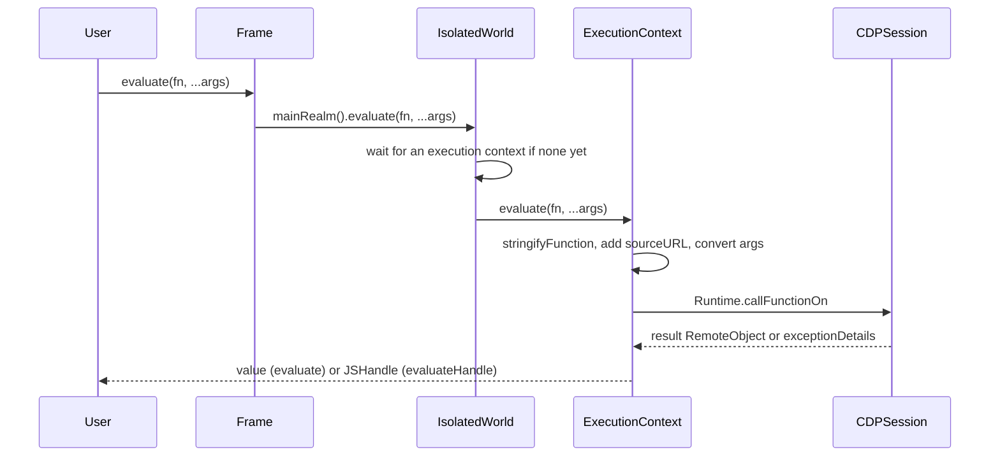
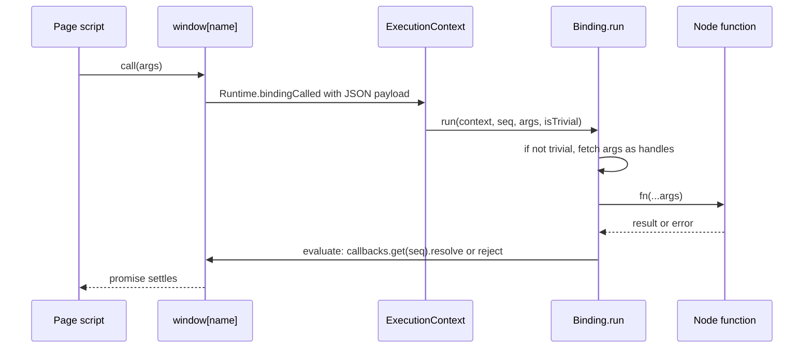

## Overview

Puppeteer code runs in Node, but most of what it does needs JavaScript running in the page. `evaluate` sends a function into a realm and returns its result as a plain value, and `evaluateHandle` returns a `JSHandle` that keeps a reference to the in-page object. This page follows one evaluation from the public call to the protocol message and back, explains how handles live and die, and shows how two internal mechanisms use the same machinery: the injected `PuppeteerUtil` script and `exposeFunction` bindings. The CDP implementation is shown; BiDi uses the same public contract with its own serializer ([[BiDi Implementation of the Puppeteer API]]).

Sources: [packages/puppeteer-core/src/api/JSHandle.ts:38-95](repo://packages/puppeteer-core/src/api/JSHandle.ts#L38-L95), [packages/puppeteer-core/src/cdp/ExecutionContext.ts:284-351](repo://packages/puppeteer-core/src/cdp/ExecutionContext.ts#L284-L351)

## From evaluate to the protocol

### The call path

Sources: [packages/puppeteer-core/src/api/Frame.ts:478-491](repo://packages/puppeteer-core/src/api/Frame.ts#L478-L491), [packages/puppeteer-core/src/cdp/IsolatedWorld.ts:178-197](repo://packages/puppeteer-core/src/cdp/IsolatedWorld.ts#L178-L197), [packages/puppeteer-core/src/cdp/ExecutionContext.ts:369-461](repo://packages/puppeteer-core/src/cdp/ExecutionContext.ts#L369-L461)

`Frame.evaluate` passes the call to its main realm, an `IsolatedWorld` on CDP. A world may briefly have no execution context, for example between navigations. In that case it waits for the next `context` event, failing with `Execution context was destroyed` if the world is disposed first and with a timeout after the default timeout. When a context exists it calls it synchronously, without an `await` first, so calls keep their order.

Sources: [packages/puppeteer-core/src/cdp/IsolatedWorld.ts:127-197](repo://packages/puppeteer-core/src/cdp/IsolatedWorld.ts#L127-L197)

### Turning the function into source

`ExecutionContext.#evaluate` handles two shapes. A string is sent as an expression with `Runtime.evaluate`. A function is converted with `stringifyFunction` and sent with `Runtime.callFunctionOn`. Both use `awaitPromise: true`, so a returned promise is awaited in the page, and `userGesture: true`.

Sources: [packages/puppeteer-core/src/cdp/ExecutionContext.ts:382-439](repo://packages/puppeteer-core/src/cdp/ExecutionContext.ts#L382-L439)

`stringifyFunction` calls `fn.toString()` and checks that the result parses with `new Function`. Method shorthand such as `test() {}` does not parse on its own, so it retries with a `function ` (or `async function `) prefix and throws `Passed function cannot be serialized!` if that fails too. Under a Content Security Policy that forbids `unsafe-eval` it cannot check, and sends the text as is.

Sources: [packages/puppeteer-core/src/util/Function.ts:30-60](repo://packages/puppeteer-core/src/util/Function.ts#L30-L60)

> [!IMPORTANT]
> The function is sent as source text. It cannot use variables from the Node scope it was written in; pass them as arguments instead.

Sources: [packages/puppeteer-core/src/util/Function.ts:30-33](repo://packages/puppeteer-core/src/util/Function.ts#L30-L33), [packages/puppeteer-core/src/cdp/ExecutionContext.ts:412-436](repo://packages/puppeteer-core/src/cdp/ExecutionContext.ts#L412-L436)

### Source URLs in stack traces

Every public entry point (`Page.evaluate`, `Frame.evaluate`, `JSHandle.evaluate` and others) calls `withSourcePuppeteerURLIfNone`. It records the caller's stack site on the function object as a `PuppeteerURL` of the form `pptr:<method>;<site>`. The context appends `//# sourceURL=<that URL>` to the source (or `pptr:internal` for internal calls), unless the code already has one. An exception thrown in the page then points back at the line of the script that called `evaluate`.

Sources: [packages/puppeteer-core/src/common/util.ts:52-122](repo://packages/puppeteer-core/src/common/util.ts#L52-L122), [packages/puppeteer-core/src/common/util.ts:307-314](repo://packages/puppeteer-core/src/common/util.ts#L307-L314), [packages/puppeteer-core/src/cdp/ExecutionContext.ts:377-387](repo://packages/puppeteer-core/src/cdp/ExecutionContext.ts#L377-L387)

### Arguments

Each argument becomes a CDP `CallArgument`:

Sources: [packages/puppeteer-core/src/cdp/ExecutionContext.ts:473-517](repo://packages/puppeteer-core/src/cdp/ExecutionContext.ts#L473-L517)

| Argument | Sent as |
| --- | --- |
| `bigint`, `-0`, `Infinity`, `-Infinity`, `NaN` | `unserializableValue` |
| A `JSHandle` from the same world | its `objectId`, or its primitive value |
| A `JSHandle` from another world | error: `JSHandles can be evaluated only in the context they were created!` |
| A disposed `JSHandle` | error: `JSHandle is disposed!` |
| Anything else | `value`, serialized as JSON |

Sources: [packages/puppeteer-core/src/cdp/ExecutionContext.ts:473-517](repo://packages/puppeteer-core/src/cdp/ExecutionContext.ts#L473-L517)

Circular objects fail JSON serialization; the context appends `Recursive objects are not allowed.` to that `TypeError`.

Sources: [packages/puppeteer-core/src/cdp/ExecutionContext.ts:440-448](repo://packages/puppeteer-core/src/cdp/ExecutionContext.ts#L440-L448)

Internal callers sometimes need an argument that only exists inside the target context, such as the `PuppeteerUtil` handle. They pass a `LazyArg`, a wrapper around a function of the context. When any argument is a `LazyArg`, the context resolves them all asynchronously before sending. Otherwise the conversion stays synchronous, so public calls keep their ordering.

Sources: [packages/puppeteer-core/src/common/LazyArg.ts:13-37](repo://packages/puppeteer-core/src/common/LazyArg.ts#L13-L37), [packages/puppeteer-core/src/cdp/ExecutionContext.ts:420-471](repo://packages/puppeteer-core/src/cdp/ExecutionContext.ts#L420-L471), [packages/puppeteer-core/src/common/QueryHandler.ts:125-139](repo://packages/puppeteer-core/src/common/QueryHandler.ts#L125-L139)

### Results and errors

If the page threw, `exceptionDetails` is turned into an error by `createEvaluationError` and thrown. For `evaluate`, `valueFromRemoteObject` returns the value, restoring the unserializable numbers and `bigint`. For `evaluateHandle`, the world wraps the `RemoteObject` with `createCdpHandle`: a DOM node becomes a `CdpElementHandle`, anything else a `CdpJSHandle`.

Sources: [packages/puppeteer-core/src/cdp/ExecutionContext.ts:449-461](repo://packages/puppeteer-core/src/cdp/ExecutionContext.ts#L449-L461), [packages/puppeteer-core/src/cdp/utils.ts:142-167](repo://packages/puppeteer-core/src/cdp/utils.ts#L142-L167), [packages/puppeteer-core/src/cdp/IsolatedWorld.ts:251-258](repo://packages/puppeteer-core/src/cdp/IsolatedWorld.ts#L251-L258)

Some protocol failures are rewritten. A value that cannot be returned by value, or whose reference chain is too long, resolves to `undefined`. `Cannot find context with specified id` and `Inspected target navigated or closed` become `Execution context was destroyed, most likely because of a navigation.`

Sources: [packages/puppeteer-core/src/cdp/ExecutionContext.ts:526-543](repo://packages/puppeteer-core/src/cdp/ExecutionContext.ts#L526-L543)

## Handles

### What a JSHandle offers

A `JSHandle<T>` belongs to one realm. `evaluate(fn, ...args)` and `evaluateHandle` on a handle pass the handle itself as the first argument. `getProperty(name)` returns a handle to one property, and `getProperties()` a map of the own enumerable properties; on CDP that is a single `Runtime.getProperties` call. `jsonValue()` copies the object back by value and throws `Could not serialize referenced object` when it cannot. `asElement()` returns the `ElementHandle` for nodes and `null` otherwise.

Sources: [packages/puppeteer-core/src/api/JSHandle.ts:65-181](repo://packages/puppeteer-core/src/api/JSHandle.ts#L65-L181), [packages/puppeteer-core/src/cdp/JSHandle.ts:46-106](repo://packages/puppeteer-core/src/cdp/JSHandle.ts#L46-L106)

### Disposal

A handle pins its object in the page until it is disposed. `dispose()` marks the handle disposed and sends `Runtime.releaseObject`; failures are ignored because they only happen when the page has already navigated or closed. Handles implement `Symbol.dispose` and `Symbol.asyncDispose`, so `using handle = await page.$('a')` releases them at the end of the block. Disposed handles reject further use through `@throwIfDisposed`.

Sources: [packages/puppeteer-core/src/cdp/JSHandle.ts:67-73](repo://packages/puppeteer-core/src/cdp/JSHandle.ts#L67-L73), [packages/puppeteer-core/src/cdp/JSHandle.ts:112-126](repo://packages/puppeteer-core/src/cdp/JSHandle.ts#L112-L126), [packages/puppeteer-core/src/api/JSHandle.ts:200-212](repo://packages/puppeteer-core/src/api/JSHandle.ts#L200-L212)

The `@moveable` class decorator adds `move()`. Calling it marks the instance so that its next dispose is skipped once. Code that obtains a handle with `using` and wants to return it calls `return handle.move()`, and the scope exit does not release it.

Sources: [packages/puppeteer-core/src/util/decorators.ts:16-50](repo://packages/puppeteer-core/src/util/decorators.ts#L16-L50), [packages/puppeteer-core/src/api/JSHandle.ts:135-160](repo://packages/puppeteer-core/src/api/JSHandle.ts#L135-L160)

### Moving handles between realms

A handle cannot be used in another realm directly. `adoptHandle` and `transferHandle` move DOM nodes. Both call `DOM.describeNode` to get the node's `backendNodeId` and `DOM.resolveNode` to create a new handle in the target world. `transferHandle` then disposes the original, while `adoptHandle` keeps it; adopting a handle into its own realm clones it. Primitive values are returned unchanged. This is how results computed in the isolated realm reach the user in the main realm ([[Frames and Navigation]]).

Sources: [packages/puppeteer-core/src/cdp/IsolatedWorld.ts:199-246](repo://packages/puppeteer-core/src/cdp/IsolatedWorld.ts#L199-L246)

## The injected PuppeteerUtil script

Selectors, text matching and polling run inside the page. They are written as ordinary TypeScript in `src/injected`, bundled into one script at build time, and exposed as a frozen `PuppeteerUtil` object combining the query selectors (ARIA, CSS, custom, pierce, P-selectors, text, XPath), the pollers, `Deferred`, `createFunction` and text-content helpers.

Sources: [packages/puppeteer-core/src/injected/injected.ts:7-53](repo://packages/puppeteer-core/src/injected/injected.ts#L7-L53)

Each `ExecutionContext` exposes `puppeteerUtil`, a promise of a handle to that object. On first access it installs two bindings, `__ariaQuerySelector` and `__ariaQuerySelectorAll`, which call back into Node for ARIA queries ([[Selectors and Query Handlers]]). It then evaluates the script from `scriptInjector`. `ScriptInjector` wraps the generated source and appends one `(statement)(module.exports.default)` call per registered amendment, which is how custom query handlers are added. When an amendment changes, the next access re-injects the script and disposes the old handle.

Sources: [packages/puppeteer-core/src/cdp/ExecutionContext.ts:42-63](repo://packages/puppeteer-core/src/cdp/ExecutionContext.ts#L42-L63), [packages/puppeteer-core/src/cdp/ExecutionContext.ts:210-242](repo://packages/puppeteer-core/src/cdp/ExecutionContext.ts#L210-L242), [packages/puppeteer-core/src/common/ScriptInjector.ts:11-57](repo://packages/puppeteer-core/src/common/ScriptInjector.ts#L11-L57)

## Calling Node from the page

### Page bindings

`page.exposeFunction(name, fn)` makes `window[name](...args)` call `fn` in Node and resolve with its result. On CDP it creates a `Binding` and registers the same init script both for new documents (`evaluateOnNewDocument`) and for existing frames. A second function with the same name throws.

Sources: [packages/puppeteer-core/src/cdp/Page.ts:689-723](repo://packages/puppeteer-core/src/cdp/Page.ts#L689-L723)

The init script, `addPageBinding`, works on top of CDP's `Runtime.addBinding`, which can only pass one string. It defines `window[name]` as a wrapper that numbers each call with a sequence id, stores the arguments, and calls the raw binding `puppeteer_<name>` with a JSON payload `{type, name, seq, args, isTrivial}`. It returns a promise kept in a callbacks map. `isTrivial` is false when any argument is a DOM node.

Sources: [packages/puppeteer-core/src/cdp/utils.ts:172-231](repo://packages/puppeteer-core/src/cdp/utils.ts#L172-L231)

### Running the binding

Sources: [packages/puppeteer-core/src/cdp/ExecutionContext.ts:166-197](repo://packages/puppeteer-core/src/cdp/ExecutionContext.ts#L166-L197), [packages/puppeteer-core/src/cdp/Binding.ts:45-132](repo://packages/puppeteer-core/src/cdp/Binding.ts#L45-L132)

When a `Runtime.bindingCalled` event arrives, the context ignores payloads that are not JSON (the page called the raw binding itself). Internal bindings run in the context; every other payload is re-emitted as `bindingcalled` and handled by the page for exposed functions. `Binding.run` fetches the stored arguments as handles when some are nodes, so the Node function receives `ElementHandle`s for them. It then resolves the page-side promise with the return value, or rejects it with an `Error` carrying the original message and stack. Handles created for the call are disposed afterwards.

Sources: [packages/puppeteer-core/src/cdp/ExecutionContext.ts:166-197](repo://packages/puppeteer-core/src/cdp/ExecutionContext.ts#L166-L197), [packages/puppeteer-core/src/cdp/Binding.ts:45-97](repo://packages/puppeteer-core/src/cdp/Binding.ts#L45-L97)

Adding a binding goes through a `Mutex`, so concurrent callers install it once. Errors from a context that was destroyed meanwhile (`Execution context was destroyed`, `Cannot find context with specified id`) are swallowed: they happen when the page navigates while the binding is being added.

Sources: [packages/puppeteer-core/src/cdp/ExecutionContext.ts:113-164](repo://packages/puppeteer-core/src/cdp/ExecutionContext.ts#L113-L164)

`removeExposedFunction(name)` removes the new-document script and the binding. It throws if no function with that name exists.

Sources: [packages/puppeteer-core/src/cdp/Page.ts:725-738](repo://packages/puppeteer-core/src/cdp/Page.ts#L725-L738)
